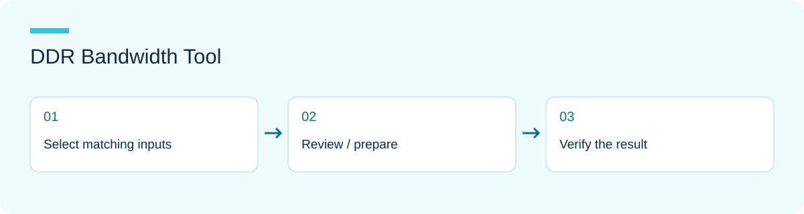





DDR bandwidth measurement helps determine whether a video, AI or display workload is moving large amounts of memory traffic. The probe observes controller counters; it is not a memory-stability test and its reported MB/s is not an application benchmark score.

## Choose the target binary and sampling conditions

The package contains 32- and 64-bit user probes. Run the matching executable on the target board, not as a Windows host utility. Start with the actual package filename:

```text
./rk-msch-probe-for-user-64bit -h
```

The manual describes `-c chip_name`, `-d msecs` for the sampling interval and `-f freq` in MHz. Its generic filename differs from this package's filenames. Match the SoC selector and BSP before collecting data.

## Stabilize frequency deliberately

The manual requires avoiding `dmc_ondemand` during measurement and gives this userspace-governor example:

```text
echo userspace > /sys/class/devfreq/dmc/governor
echo 780000000 > /sys/class/devfreq/dmc/userspace/set_freq
```

`780000000` is a source example in Hz, not a frequency recommended for every board. Choose only an OPP supported by the actual BSP and preserve the previous governor/frequency for restoration. The `-f` argument uses MHz, unlike the sysfs value. If “DDR monitor time gets error” appears, discard that sample.

## Read the output correctly

`ALL` aggregates channels; `CHx` is one channel. `LOAD`, `RD` and `WR` report total/read/write traffic and utilization. `ACT(access : active)` describes accesses per activation and therefore locality. `PRE` is derived from activation statistics in the source, not a separately measured precharge counter. Low-power fields describe fractions of time, not bandwidth.

## A useful comparison

Capture an idle baseline and the same fixed-duration workload with identical DDR settings. Record SoC, memory configuration, kernel, governor, frequency, sample interval and workload phase. A missing `/dev/mem` can indicate that `CONFIG_DEVMEM` is disabled; use an approved debug kernel rather than weakening a production system casually. No bandwidth measurements in this article were performed on ArmSoM hardware.

## Applicability and verification

This is a documentation-based workflow for the supplied tool collection. Confirm the exact board, SoC, carrier, SDK/BSP and host architecture before using it. No flashing, provisioning, register writes or hardware tests were performed. Package availability does not establish support for every ArmSoM product.

## Download, versions and SHA-256

Download the matching archive, verify the hash, and extract the entire directory. For the split Linux PinDebug archive, follow the linked reconstruction instructions; the hash below is for the reconstructed file.

| Host / version | Package |
|---|---|
| Linux target / manual 1.4.1 | [ddr-bandwidth-linux-directory-snapshot.zip](https://raw.githubusercontent.com/ArmSoM/rockchip-tools/main/downloads/ddr-bandwidth/ddr-bandwidth-linux-directory-snapshot.zip) |

**ddr-bandwidth-linux-directory-snapshot.zip — SHA-256**

```text
198ec5ad23aedee97518936fb4c2810f3d92c415269fad56788e833811af612d
```

[GitHub · catalog.json](https://github.com/ArmSoM/rockchip-tools/blob/main/catalog.json) · [SHA256SUMS](https://github.com/ArmSoM/rockchip-tools/blob/main/SHA256SUMS)

## Source documents and figures

- Rockchip_Introduction_DDR_Bandwidth_Tool_CN.pdf V1.4.1, pp.3–6; packaged 32/64-bit probes
- [Original PDF: Rockchip_Introduction_DDR_Bandwidth_Tool_CN.pdf](https://raw.githubusercontent.com/ArmSoM/rockchip-tools/main/manuals/35fc41c5ec2e.pdf)

## Continue with the related workflow

- [Rockchip DDR Developer Guide: Frequency, Capacity, Validation, Eye Diagrams and ECC](/articles/037-rockchip-ddr/)
- [DDR_UserTool 1.41: select DDR test configurations for a board](/articles/rockchip-tool-ddr-user-tool/)
- [Rockchip tool download and workflow index](/articles/rockchip-tools-download-guide/)

## Find the correct ArmSoM board documentation

For board and carrier requirements, use the product manual first. The links below are platform references, not a statement that this archived tool has been validated on these products.

[ArmSoM Docs](https://docs.armsom.org/) · [Sige7](https://www.armsom.org/sige7) / [Docs](https://docs.armsom.org/armsom-sige7) · [CM5](https://www.armsom.org/cm5) / [Docs](https://docs.armsom.org/armsom-cm5)


