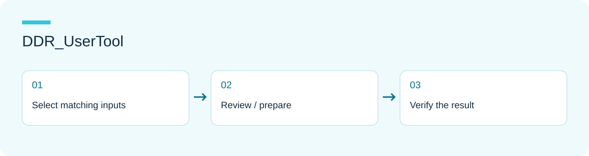





DDR_UserTool is part of the DDR bring-up and test workflow. Its supplied archive contains a substantial platform-specific `TestFile` configuration tree. It must not be confused with the bandwidth probe or with the program that edits DDR initialization binaries.

## Start from the memory topology

Record the exact SoC, DDR generation, chip organization, number of devices, bus width, rank/chip-select layout and board revision. The archive includes configuration names that encode combinations of these details. Matching only total memory capacity is insufficient: two configurations can expose the same capacity through different wiring.

## Prepare one controlled test

1. Keep the original SDK DDR binary and working Loader.
2. Select a configuration for the supported platform and actual memory population. Confirm it against the schematic and SDK DDR guide rather than choosing the nearest filename.
3. Copy that configuration into a project work area, keeping an untouched reference. Document each changed parameter and its reason.
4. Follow the matched SDK's loading procedure on a development board with a recovery route. The archive tree alone does not establish a universal launch command for every SoC.
5. Save test selection, frequency, temperature conditions, duration and error output; repeat under the product's required operating conditions.

## Interpret results with the right scope

A soldering/wiring check, a frequency stress test and a bandwidth measurement answer different questions. A pass in one selected configuration does not certify every DDR frequency or every board lot. If initialization fails before a test starts, return to topology, Loader and power sequencing instead of changing many parameters together.

## Documentation boundary

No standalone comprehensive PDF was found in this package. This article explains configuration selection and evidence capture; the linked full DDR guide supplies the broader test methodology. It does not claim that all configurations in 1.41 apply to current ArmSoM products.

## Applicability and verification

This is a documentation-based workflow for the supplied tool collection. Confirm the exact board, SoC, carrier, SDK/BSP and host architecture before using it. No flashing, provisioning, register writes or hardware tests were performed. Package availability does not establish support for every ArmSoM product.

## Download, versions and SHA-256

Download the matching archive, verify the hash, and extract the entire directory. For the split Linux PinDebug archive, follow the linked reconstruction instructions; the hash below is for the reconstructed file.

| Host / version | Package |
|---|---|
| Windows / 1.41 | [DDR_UserTool_v1.41.7z](https://raw.githubusercontent.com/ArmSoM/rockchip-tools/main/downloads/ddr-user-tool/DDR_UserTool_v1.41.7z) |

**DDR_UserTool_v1.41.7z — SHA-256**

```text
f53d06ad782e9fa85f5f098572fc20bd82945886936b1df5faf6ebf6ea892416
```

[GitHub · catalog.json](https://github.com/ArmSoM/rockchip-tools/blob/main/catalog.json) · [SHA256SUMS](https://github.com/ArmSoM/rockchip-tools/blob/main/SHA256SUMS)

## Source documents and figures

- DDR_UserTool_v1.41.7z: per-platform TestFile configuration tree; existing Rockchip DDR guide

## Continue with the related workflow

- [Rockchip DDR Developer Guide: Frequency, Capacity, Validation, Eye Diagrams and ECC](/articles/037-rockchip-ddr/)
- [DDR Bandwidth Tool: measure memory traffic and interpret Rockchip counters](/articles/rockchip-tool-ddr-bandwidth/)
- [rk_ddrbin_tool: inspect and change DDR initialization parameters](/articles/rockchip-tool-ddrbin-tool/)
- [Rockchip tool download and workflow index](/articles/rockchip-tools-download-guide/)

## Find the correct ArmSoM board documentation

For board and carrier requirements, use the product manual first. The links below are platform references, not a statement that this archived tool has been validated on these products.

[ArmSoM Docs](https://docs.armsom.org/) · [Sige7](https://www.armsom.org/sige7) / [Docs](https://docs.armsom.org/armsom-sige7) · [CM5](https://www.armsom.org/cm5) / [Docs](https://docs.armsom.org/armsom-cm5)


