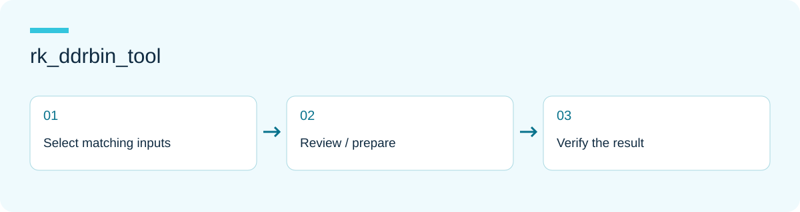





The DDR binary controls early memory initialization, before Linux starts. `rk_ddrbin_tool` changes supported parameters inside a supported DDR binary. It does not replace board routing analysis or repair an arbitrary incompatible Loader.

## Check two versions, not one

The tool version and DDR-binary version are separate. The supplied guide contains a platform/version support matrix; an unsupported matrix entry is not made compatible by renaming the file. Retain the original binary and a hash before editing.

## Read, modify, compare

The bundled text guide gives these historical PX30 Python examples:

```text
./ddrbin_tool.py px30 ddrbin_param.txt px30_ddr_333MHz_v1.13.bin
./ddrbin_tool.py px30 -g gen_param.txt px30_ddr_333MHz_v1.15.bin
```

The first applies `ddrbin_param.txt`; the second exports values with `-g`. These are verbatim examples from the guide, not a claim that every packaged GUI contains `ddrbin_tool.py` or that PX30 values fit another SoC. Use the actual interface shipped in the chosen package. Blank parameter values preserve defaults according to the text guide.

Select the exact chip and supported binary version, export current settings where supported, then change one documented parameter in a copy. Compare output, file size and configuration before incorporating the result into the board's Loader. Keep the tool version, original/output hashes and the parameter file together.

## Test the resulting boot chain

Validate memory initialization, cold/warm boot and the DDR test plan on the correct board population. A modified file being accepted by the editor does not prove timing margin or stability. If the board stops before the serial console, recover with the known-working Loader and review the changed setting rather than repeatedly changing unrelated parameters.

## Applicability and verification

This is a documentation-based workflow for the supplied tool collection. Confirm the exact board, SoC, carrier, SDK/BSP and host architecture before using it. No flashing, provisioning, register writes or hardware tests were performed. Package availability does not establish support for every ArmSoM product.

## GitHub tool directory, versions and SHA-256

Open the matching GitHub directory, select the required host/version, then verify the file hash and extract the full directory. Links below open repository directories.

[Open the tool directory on GitHub](https://github.com/ArmSoM/rockchip-tools/tree/main/downloads/ddrbin-tool)

| Platform / version | File | SHA-256 |
|---|---|---|
| Linux / 1.01 | `rk_ddrbin_tool_V1.01.7z` | `db87698a90f620dcea6ab166af7d330dfb6f36e9b2cc9ec02dd000bf474b2212` |
| Windows / 1.07.2 | `rk_ddrBin_tool_V1.07.2.zip` | `618bd996e570cb2f94b2c714e53776c3edc6bad3211e6c377be3cfd45bc48bc1` |

[GitHub · catalog.json](https://github.com/ArmSoM/rockchip-tools/blob/main/catalog.json) · [SHA256SUMS](https://github.com/ArmSoM/rockchip-tools/blob/main/SHA256SUMS)

## Source documents and figures

- rk_ddrbin_tool 1.01 / 1.07.2 packages; ddrbin_tool_user_guide.txt; parameter/version matrix

## Continue with the related workflow

- [Rockchip DDR Developer Guide: Frequency, Capacity, Validation, Eye Diagrams and ECC](/articles/037-rockchip-ddr/)
- [boot_merger: prepare a Rockchip Loader without mixing DDR and boot components](/articles/rockchip-tool-boot-merger/)
- [DDR_UserTool 1.41: select DDR test configurations for a board](/articles/rockchip-tool-ddr-user-tool/)
- [Rockchip tool download and workflow index](/articles/rockchip-tools-download-guide/)

## Find the correct ArmSoM board documentation

For board and carrier requirements, use the product manual first. The links below are platform references, not a statement that this archived tool has been validated on these products.

[ArmSoM Docs](https://docs.armsom.org/) · [Sige7](https://www.armsom.org/sige7) / [Docs](https://docs.armsom.org/armsom-sige7) · [CM5](https://www.armsom.org/cm5) / [Docs](https://docs.armsom.org/armsom-cm5)


