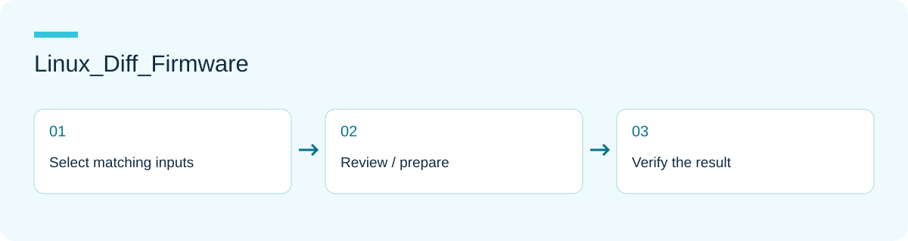





A differential update describes changes from a specific old firmware to a specific new firmware. It can reduce the transferred payload, but the result depends on the actual images; no fixed reduction ratio is promised.

## Establish the baseline

Keep immutable copies and hashes of `old.img` and `new.img`. The deployed device must run the expected old baseline. Confirm the same product, storage layout and supported update mechanism; a small delta does not make unrelated firmware compatible.

## Host prerequisites and invocation

The supplied script checks `bsdiff`, `rkImageMaker`, `afptool` and `md5sum`. It detects Squashfs and ext4 and creates temporary OLD/NEW/DIFF directories beneath its own directory. Work on copies with sufficient free space for both unpacked images and generated data.

```text
./mk-diff-ota.sh old.img new.img diff.img
```

The argument order is old, new, output. Review the script's chip mapping against the target SDK. Its A/B support is marked TODO; do not assume the package supports a modern A/B deployment just because partition names exist.

## Acceptance procedure

First confirm both complete images independently boot on the test board. Then test the delta from the exact old baseline and verify the final system version, files and essential services. Test an incorrect baseline and interrupted update according to the product's supported recovery design. Keep the full recovery image available.

## Troubleshooting

An unsupported filesystem requires a supported packaging path, not renaming the file. Missing utilities require installing the matching host dependencies. Baseline mismatches need correction of the release process. Preserve logs and exit status; never label a generated delta as a successful field upgrade before device verification.

## Applicability and verification

This is a documentation-based workflow for the supplied tool collection. Confirm the exact board, SoC, carrier, SDK/BSP and host architecture before using it. No flashing, provisioning, register writes or hardware tests were performed. Package availability does not establish support for every ArmSoM product.

## Download, versions and SHA-256

Download the matching archive, verify the hash, and extract the entire directory. For the split Linux PinDebug archive, follow the linked reconstruction instructions; the hash below is for the reconstructed file.

| Host / version | Package |
|---|---|
| Linux / directory snapshot | [linux-diff-firmware-directory-snapshot.zip](https://raw.githubusercontent.com/ArmSoM/rockchip-tools/main/downloads/diff-firmware/linux-diff-firmware-directory-snapshot.zip) |

**linux-diff-firmware-directory-snapshot.zip — SHA-256**

```text
e13711865267ea4ee1f71c048d356bc5dff2de0f24e3d1b71dcd4cfb159b45b9
```

[GitHub · catalog.json](https://github.com/ArmSoM/rockchip-tools/blob/main/catalog.json) · [SHA256SUMS](https://github.com/ArmSoM/rockchip-tools/blob/main/SHA256SUMS)

## Source documents and figures

- Linux_Diff_Firmware/mk-diff-ota.sh and bundled packaging utilities

## Continue with the related workflow

- [afptool and rkImageMaker: understand and package Rockchip update.img](/articles/rockchip-tool-firmware-pack-tools/)
- [Rockchip Production Firmware Flashing: USB, SD, Programmers and Troubleshooting](/articles/147-rockchip-firmware-production/)
- [Rockchip tool download and workflow index](/articles/rockchip-tools-download-guide/)

## Find the correct ArmSoM board documentation

For board and carrier requirements, use the product manual first. The links below are platform references, not a statement that this archived tool has been validated on these products.

[ArmSoM Docs](https://docs.armsom.org/) · [Sige7](https://www.armsom.org/sige7) / [Docs](https://docs.armsom.org/armsom-sige7) · [CM5](https://www.armsom.org/cm5) / [Docs](https://docs.armsom.org/armsom-cm5)


