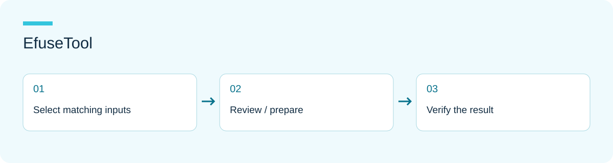





EfuseTool is associated with writing security information such as a public-key hash. eFuse/OTP state may be irreversible. It should be used only within a board-specific provisioning procedure, not as an alternative to an ordinary recovery flasher.

## What the package actually documents

The 1.42 revision notes add 356X support; earlier entries fix public-key-hash issues for RK3288/RK3399 and RK3229P. That history does not establish support for every newer SoC. No complete standalone PDF was found in this package; the language resource exposes firmware loading, device IDs, per-device status and key-hash write/read/compare errors.

## Prepare the station

Review the approved firmware and enrolled public-key identity before connecting devices. Record firmware and Loader versions, tool version, USB topology and target board revision. Label each physical USB port against the ID shown by the tool, as its included help requests. Validate the process on a designated engineering sample first.

## Control the irreversible step

Keep signing, signature verification and fuse provisioning as separate approval points in the manufacturing procedure. Do not infer a safe register address or key length from another chip. The UI's “firmware is unsigned” or “creating publickey hash failed” errors require correcting the artifact/key relationship, not bypassing verification.

## Record outcomes per device

Preserve device identity, intended key fingerprint, operation status and subsequent boot/recovery result. A retry must account for the device's now-current state. Never blindly repeat provisioning after a timeout. The supplied UI terminology is evidence of available stages, not a verified universal click-by-click procedure; no fuses were programmed for this guide.

## Applicability and verification

This is a documentation-based workflow for the supplied tool collection. Confirm the exact board, SoC, carrier, SDK/BSP and host architecture before using it. No flashing, provisioning, register writes or hardware tests were performed. Package availability does not establish support for every ArmSoM product.

## Download, versions and SHA-256

Download the matching archive, verify the hash, and extract the entire directory. For the split Linux PinDebug archive, follow the linked reconstruction instructions; the hash below is for the reconstructed file.

| Host / version | Package |
|---|---|
| Windows / 1.42 | [EfuseTool_v1.42.zip](https://raw.githubusercontent.com/ArmSoM/rockchip-tools/main/downloads/efuse-tool/EfuseTool_v1.42.zip) |

**EfuseTool_v1.42.zip — SHA-256**

```text
abb81d072ad6a7cec31d7a7c5a3f72d9bfe57544ee4d8715e4c031b4bd780fc9
```

[GitHub · catalog.json](https://github.com/ArmSoM/rockchip-tools/blob/main/catalog.json) · [SHA256SUMS](https://github.com/ArmSoM/rockchip-tools/blob/main/SHA256SUMS)

## Source documents and figures

- EfuseTool_v1.42.zip: revision.txt and Language/English.ini

## Continue with the related workflow

- [rk_sign_tool and sign_tool: prepare and verify signed Rockchip firmware](/articles/rockchip-tool-rk-sign-tool/)
- [SecureBootTool 1.85: understand a historical Rockchip Secure Boot workflow](/articles/rockchip-tool-secureboot-tool/)
- [Complete Rockchip Secure Boot Application Guide: Signing, eFuse, OTP and Verification](/articles/105-rockchip-secure-boot/)
- [Rockchip tool download and workflow index](/articles/rockchip-tools-download-guide/)

## Find the correct ArmSoM board documentation

For board and carrier requirements, use the product manual first. The links below are platform references, not a statement that this archived tool has been validated on these products.

[ArmSoM Docs](https://docs.armsom.org/) · [Sige7](https://www.armsom.org/sige7) / [Docs](https://docs.armsom.org/armsom-sige7) · [CM5](https://www.armsom.org/cm5) / [Docs](https://docs.armsom.org/armsom-cm5)


