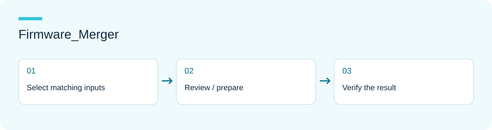





Firmware_Merger creates an image from `setting.ini`. It is useful when the manufacturing flow needs a defined whole-storage layout. The three formats in the bundled manual must be distinguished before choosing a writing tool.

## Choose the output format

| `Gpt_Enable` | Source meaning | Writing route |
|---|---|---|
| Empty value | Flat RK firmware, RK miniloader | Matched raw-image workflow |
| `0` | Flat GPT, U-Boot SPL | Matched raw-image workflow |
| `1` | Compact GPT | Production tool required |

The empty/0/1 mapping is reproduced exactly. A compact image must not be treated as a flat image for a `wl` raw write. `Backup_Partition_Enable=1` requests a backup header; the empty value is the documented default, including when the flash size is unknown.

## Describe the layout

IDBlock must be the first partition. The source example is:

```text
Name=IDBlock
Type=0x2
PartOffset=0x40
PartSize=0x400
Flag=
File=Image/FlashData.bin,Image/FlashBoot.bin
```

The manual states that its partition must be smaller than 2M. Do not reinterpret hexadecimal offsets as bytes without checking the tool's format. For subsequent partitions, empty `Flag` writes a file and fills its partition; `0x2` fills without a file; `0x1` skips; `0x4` lets the last partition grow into remaining space. `Type_Guid` references a key in `[PARTITION_TYPE_GUID]`.

## Build and validate

Copy the matched configuration, resolve all image paths, check the layout against storage capacity and run the README's packaging command:

```text
./firmware_merger -P setting.ini ./
```

This creates a file; flashing is a separate step. Compare expected and produced size, record the hash and inspect the partition mapping with the appropriate SDK tools. Before hardware testing, confirm the chosen writer supports the generated format.

## Common mistakes

A missing image path, an overlapping partition or confusing compact with flat output will not be fixed by trying another USB cable. Keep the configuration and its input images as a single release unit. The bundled example is a format reference, not a validated ArmSoM storage layout.

## Applicability and verification

This is a documentation-based workflow for the supplied tool collection. Confirm the exact board, SoC, carrier, SDK/BSP and host architecture before using it. No flashing, provisioning, register writes or hardware tests were performed. Package availability does not establish support for every ArmSoM product.

## Download, versions and SHA-256

Download the matching archive, verify the hash, and extract the entire directory. For the split Linux PinDebug archive, follow the linked reconstruction instructions; the hash below is for the reconstructed file.

| Host / version | Package |
|---|---|
| Linux / directory snapshot | [firmware-merger-linux-directory-snapshot.zip](https://raw.githubusercontent.com/ArmSoM/rockchip-tools/main/downloads/firmware-merger/firmware-merger-linux-directory-snapshot.zip) |

**firmware-merger-linux-directory-snapshot.zip — SHA-256**

```text
798ce66df5ee1f22cd96f811bf9140e5e9f4f0f3977a4ef37acd54554d6992ea
```

[GitHub · catalog.json](https://github.com/ArmSoM/rockchip-tools/blob/main/catalog.json) · [SHA256SUMS](https://github.com/ArmSoM/rockchip-tools/blob/main/SHA256SUMS)

## Source documents and figures

- Firmware_Merger/Readme.txt; user_manual.txt; setting examples

## Continue with the related workflow

- [afptool and rkImageMaker: understand and package Rockchip update.img](/articles/rockchip-tool-firmware-pack-tools/)
- [programmer_image_tool: convert update.img for eMMC, SPI NOR and NAND programmers](/articles/rockchip-tool-programmer-image-tool/)
- [Rockchip tool download and workflow index](/articles/rockchip-tools-download-guide/)

## Find the correct ArmSoM board documentation

For board and carrier requirements, use the product manual first. The links below are platform references, not a statement that this archived tool has been validated on these products.

[ArmSoM Docs](https://docs.armsom.org/) · [Sige7](https://www.armsom.org/sige7) / [Docs](https://docs.armsom.org/armsom-sige7) · [CM5](https://www.armsom.org/cm5) / [Docs](https://docs.armsom.org/armsom-cm5)


