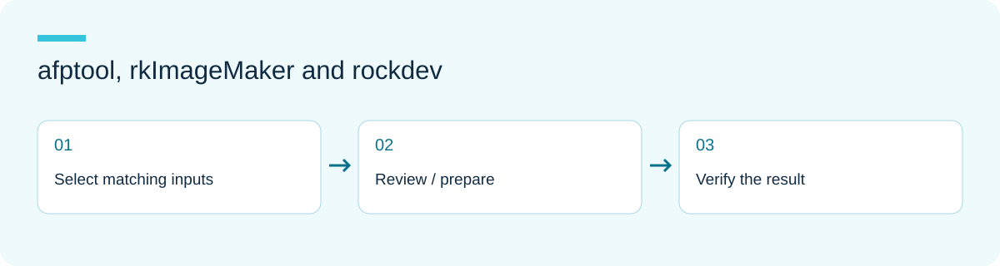





The rockdev packaging directory combines two jobs: `afptool` packages the files listed by `package-file`, then `rkImageMaker` combines that payload with a Loader and chip information. A packed firmware container is different from a raw disk image.

## Prepare a coherent input tree

Place the partition images and matched Loader in `Image/`. Supply `Image/parameter` or `Image/parameter.txt`, and review the top-level `package-file`. Every referenced filename must exist, and its intended partition must agree with parameter. Keep all components from the same board build.

## Follow the platform script

The included RK3588 script performs these two stages:

```text
./afptool -pack ./ Image/update.img
./rkImageMaker -RK3588 Image/MiniLoaderAll.bin Image/update.img update.img -os_type:androidos
```

This is the original RK3588 example, including `-os_type:androidos`; it is not a universal Linux recipe. `Image/update.img` is the intermediate payload, while top-level `update.img` is the final container. Run from the script's expected rockdev directory. Select the actual SDK's script for other SoCs and OS configurations.

## Inspect before distribution

The README describes `unpack.sh`, whose extracted files go to `output`. Use a separate working directory so an older extraction cannot be mistaken for the new image. Compare the unpacked file inventory, Loader, partition names and image lengths with the release inputs; record the final SHA-256.

## Common packaging failures

Missing parameter and package-file are explicitly checked by the RK3588 script. A nonexistent path or image larger than its partition must be corrected at the input stage. A wrong chip flag may only surface when flashing, which is why inspecting the target identifier matters before release.

The Linux directory snapshot, macOS rockdev 2.1 and Windows RKImageMaker dated package are preserved separately. They need not expose the same flags. Building `update.img` proves container generation only: validate boot, storage, recovery and update behavior on the intended board before using it in production.

## Applicability and verification

This is a documentation-based workflow for the supplied tool collection. Confirm the exact board, SoC, carrier, SDK/BSP and host architecture before using it. No flashing, provisioning, register writes or hardware tests were performed. Package availability does not establish support for every ArmSoM product.

## Download, versions and SHA-256

Download the matching archive, verify the hash, and extract the entire directory. For the split Linux PinDebug archive, follow the linked reconstruction instructions; the hash below is for the reconstructed file.

| Host / version | Package |
|---|---|
| Linux / directory snapshot | [rockdev-linux-directory-snapshot.zip](https://raw.githubusercontent.com/ArmSoM/rockchip-tools/main/downloads/firmware-pack-tools/rockdev-linux-directory-snapshot.zip) |
| macOS / 2.1 | [rockdev_v2.1_mac.zip](https://raw.githubusercontent.com/ArmSoM/rockchip-tools/main/downloads/firmware-pack-tools/rockdev_v2.1_mac.zip) |
| Windows / 20230109 | [RKImageMaker_20230109.zip](https://raw.githubusercontent.com/ArmSoM/rockchip-tools/main/downloads/firmware-pack-tools/RKImageMaker_20230109.zip) |

**rockdev-linux-directory-snapshot.zip — SHA-256**

```text
06049f3eb612de5d1a3866bffe4b1d8d7dabaef4fd38b07decd79380f5af5a36
```

**rockdev_v2.1_mac.zip — SHA-256**

```text
af29d720edba7a0f082f984d57adf5a09b81a8df6deebf7f158aeedabd4018e7
```

**RKImageMaker_20230109.zip — SHA-256**

```text
887863bb2563ba0ab9c77b846a26f47fe7774f95152d66253c4de910419591cd
```

[GitHub · catalog.json](https://github.com/ArmSoM/rockchip-tools/blob/main/catalog.json) · [SHA256SUMS](https://github.com/ArmSoM/rockchip-tools/blob/main/SHA256SUMS)

## Source documents and figures

- Linux_Pack_Firmware/rockdev/readme.txt; rk3588-mkupdate.sh; unpack.sh
- rockdev_v2.1_mac.zip; RKImageMaker_20230109.zip

## Continue with the related workflow

- [Firmware_Merger: flat RK, flat GPT and compact GPT images](/articles/rockchip-tool-firmware-merger/)
- [upgrade_tool download: command-line Rockchip firmware workflow](/articles/rockchip-tool-upgrade-tool/)
- [Rockchip Production Firmware Flashing: USB, SD, Programmers and Troubleshooting](/articles/147-rockchip-firmware-production/)
- [Rockchip tool download and workflow index](/articles/rockchip-tools-download-guide/)

## Find the correct ArmSoM board documentation

For board and carrier requirements, use the product manual first. The links below are platform references, not a statement that this archived tool has been validated on these products.

[ArmSoM Docs](https://docs.armsom.org/) · [Sige7](https://www.armsom.org/sige7) / [Docs](https://docs.armsom.org/armsom-sige7) · [CM5](https://www.armsom.org/cm5) / [Docs](https://docs.armsom.org/armsom-cm5)


