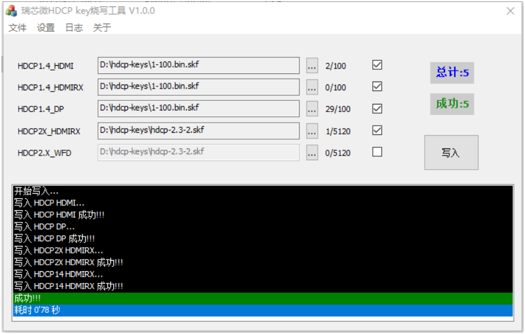
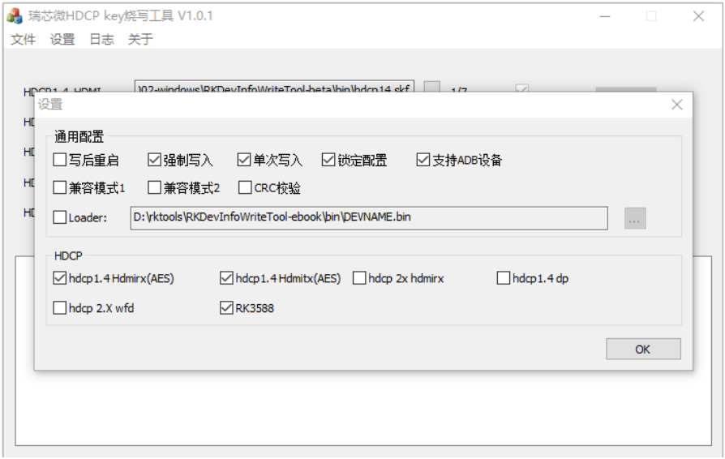
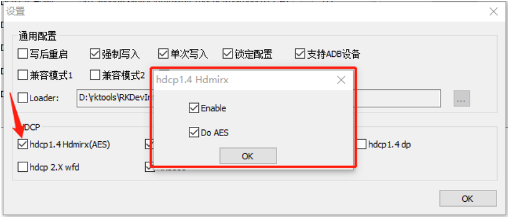
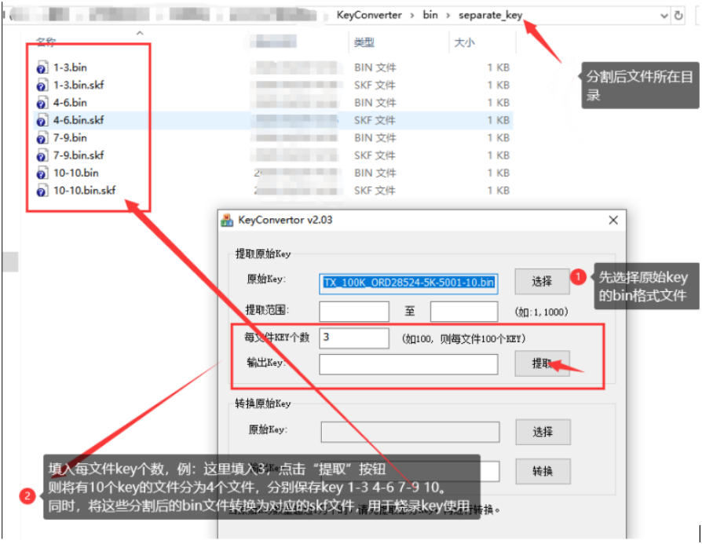




## HDCP Key Writer V1.0.1: configuration and packaging

The tool provisions licensed HDCP keys from a specially packed `.skf` file. Manual V1.0.1 differs from package 1.0.5. This section retains every setting, the HdcpKeyPack example and KeyConvertor illustration. Filenames and example logs are shown, not actual keys.

<figure style="margin:1.6rem 0">
<a href="/assets/rockchip-tools/manuals/e1ef88b767b1/p02-f01.png" target="_blank" rel="noopener" aria-label="View full-size image"></a>
<figcaption style="margin-top:.6rem;font-size:.9em;line-height:1.55"><strong>Figure 1: HDCP Key Writer main window and write log</strong></figcaption>
</figure>

### 1. General and HDCP settings

| Setting | Meaning |
|---|---|
| 写后重启 / Reboot | Whether to reboot after writing |
| 强制写入 / Force write | Normally checks for prior provisioning and skips written devices; the manual requires this option because HDCP readback was removed. This describes that version only. |
| 单次写入 / Single write | Enabled: press Write each time. Disabled: inserting a device starts writing automatically |
| 锁定配置 / Lock configuration | Prevents enabling programming items in the main window |
| 支持 ADB / ADB support | Runs `adb reboot loader` before programming |
| 兼容模式 1 / 2 | Legacy-platform modes; on failure the source suggests trying one of them |
| RK3588 | Explicit RK3588 selection because its controller and key encryption differ |
| HDCP / AES | Enable each HDCP item separately; for RK3588, AES transport encryption is independently enabled per key |

<figure style="margin:1.6rem 0">
<a href="/assets/rockchip-tools/manuals/e1ef88b767b1/p02-f02.png" target="_blank" rel="noopener" aria-label="View full-size image"></a>
<figcaption style="margin-top:.6rem;font-size:.9em;line-height:1.55"><strong>Figure 2: General settings and HDCP write options</strong></figcaption>
</figure>

<figure style="margin:1.6rem 0">
<a href="/assets/rockchip-tools/manuals/e1ef88b767b1/p03-f01.png" target="_blank" rel="noopener" aria-label="View full-size image"></a>
<figcaption style="margin-top:.6rem;font-size:.9em;line-height:1.55"><strong>Figure 3: Enable AES transfer encryption for an HDCP key</strong></figcaption>
</figure>

### 2. HdcpKeyPack

The accompanying extraction script produces one HDCP2.3 key per file. The source example has ten files of 1000 bytes each. Place them in `hdcpkeys` and pack into skf. `--pack` packages, `--in` selects the input directory and `--out` the output file. Existing output is overwritten; preserve the production batch first.

```text
HdcpKeyPack.exe --pack --in .\hdcpkeys --out .\hdcp.skf
```

```text
Current dir is D:\rktools\002-windows\003-hdcp\RKDevInfoTool\bin\
output filename is .\hdcp.skf
dest file exist, will be overwrite
file D:\rktools\002-windows\003-hdcp\RKDevInfoTool\bin\.\hdcpkeys\fw_hdcp_receivers_0737C22DEC.bin size is 1000
file D:\rktools\002-windows\003-hdcp\RKDevInfoTool\bin\.\hdcpkeys\fw_hdcp_receivers_32DC5BF80C.bin size is 1000
file D:\rktools\002-windows\003-hdcp\RKDevInfoTool\bin\.\hdcpkeys\fw_hdcp_receivers_4D64BA99B4.bin size is 1000
file D:\rktools\002-windows\003-hdcp\RKDevInfoTool\bin\.\hdcpkeys\fw_hdcp_receivers_55EEC3E501.bin size is 1000
file D:\rktools\002-windows\003-hdcp\RKDevInfoTool\bin\.\hdcpkeys\fw_hdcp_receivers_62CCAA07DB.bin size is 1000
file D:\rktools\002-windows\003-hdcp\RKDevInfoTool\bin\.\hdcpkeys\fw_hdcp_receivers_9D3355F824.bin size is 1000
file D:\rktools\002-windows\003-hdcp\RKDevInfoTool\bin\.\hdcpkeys\fw_hdcp_receivers_AA113C1AFE.bin size is 1000
file D:\rktools\002-windows\003-hdcp\RKDevInfoTool\bin\.\hdcpkeys\fw_hdcp_receivers_B29B45664B.bin size is 1000
file D:\rktools\002-windows\003-hdcp\RKDevInfoTool\bin\.\hdcpkeys\fw_hdcp_receivers_CD23A407F3.bin size is 1000
file D:\rktools\002-windows\003-hdcp\RKDevInfoTool\bin\.\hdcpkeys\fw_hdcp_receivers_F8C83DD213.bin size is 1000
10 file packed to .\hdcp.skf[CRC: 0xC75F3091]
```

### 3. KeyConvertor

The last source page explains KeyConvertor file selection and conversion settings through a complete annotated screenshot, without separate command-line options. The original figure follows. Select the conversion matching the licensed input format; do not mix HDCP versions, receiver/transmitter roles or chip options.

The KeyConvertor figure selects an original `.bin`, sets the extraction range and keys per output file, then clicks Extract. Its example splits ten keys at three per file into `1-3`, `4-6`, `7-9` and `10-10`, converting each resulting bin to skf in the illustrated `separate_key` directory. These counts are examples, not production quotas.

<figure style="margin:1.6rem 0">
<a href="/assets/rockchip-tools/manuals/e1ef88b767b1/p05-f01.png" target="_blank" rel="noopener" aria-label="View full-size image"></a>
<figcaption style="margin-top:.6rem;font-size:.9em;line-height:1.55"><strong>Figure 4: KeyConvertor extraction, grouping and conversion results</strong></figcaption>
</figure>

## Applicability and verification

This is a documentation-based workflow for the supplied tool collection. Confirm the exact board, SoC, carrier, SDK/BSP and host architecture before using it. No flashing, provisioning, register writes or hardware tests were performed. Package availability does not establish support for every ArmSoM product.

## GitHub tool directory, versions and SHA-256

Open the matching GitHub directory, select the required host/version, then verify the file hash and extract the full directory. Links below open repository directories.

[Open the tool directory on GitHub](https://github.com/ArmSoM/rockchip-tools/tree/main/downloads/hdcp-key-writer)

| Platform / version | File | SHA-256 |
|---|---|---|
| Windows / 1.0.5 | `Rockchip_HdcpKey_Writer_V1.0.5-clean.zip` | `39291cd73a8b979de8e70c0109cffecd40f72e26788951a72296449de67c6e3b` |

[GitHub · catalog.json](https://github.com/ArmSoM/rockchip-tools/blob/main/catalog.json) · [SHA256SUMS](https://github.com/ArmSoM/rockchip-tools/blob/main/SHA256SUMS)

## Source documents and figures

- Rockchip_User_Guide_HDCP_Key_Flash.pdf

## Continue with the related workflow

- [RKDevInfoWriteTool: controlled serial-number and MAC provisioning](/articles/rockchip-tool-devinfo-write/)
- [RK3588 HDCP Developer Guide: Keys, Firmware, HDMI/DP Configuration and Troubleshooting](/articles/046-rockchip-rk3588-hdcp/)
- [Rockchip tool download and workflow index](/articles/rockchip-tools-download-guide/)

## Find the correct ArmSoM board documentation

For board and carrier requirements, use the product manual first. The links below are platform references, not a statement that this archived tool has been validated on these products.

[ArmSoM Docs](https://docs.armsom.org/) · [Sige7](https://www.armsom.org/sige7) / [Docs](https://docs.armsom.org/armsom-sige7) · [CM5](https://www.armsom.org/cm5) / [Docs](https://docs.armsom.org/armsom-cm5)


