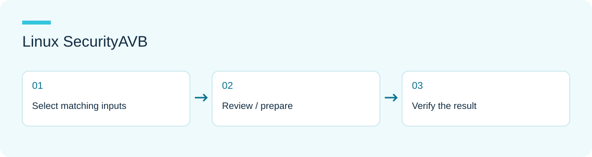





## Complete Linux AVB V2.2.5 technical manual

AVB extends a hardware-protected root of trust through U-Boot to subsequent partitions such as boot and recovery, checking for untrusted or corrupted code. The following retains the platform and layout requirements of the 2020 V2.2.5 manual, without mixing newer SDK assumptions.

| Chip | Security storage | Kernel | U-Boot | RKBin |
|---|---|---|---|---|
| RK3308 | OTP | ALL | d3a731e | e00dab6 |
| RK3326 | OTP | 4.4 | d3a731e | 20af526 |
| PX30 | OTP | 4.4 | d3a731e | 20af526 |
| RK3328 | OTP | 4.4 | d3a731e | 158ccc6 |
| RK3399 | eFuse | 4.4 | d3a731e | 158ccc6 |
| RK3288 | eFuse | 4.4 | d3a731e | c021945 |
| RK1808 | eFuse | 4.4 | d3a731e | 890556f |

### 1. Prerequisites

Unlocked devices still verify boot.img and report errors but continue booting; locked devices stop on invalid images. This manual does not support compressed kernel images. eFuse-based chips require Base SecureBoot.

### 2. Trust and U-Boot

Ensure trust.img enables secure support. For `rkbin/RKTRUST/RK3308TRUST.ini`, selected by U-Boot make.sh, change BL32 SEC from 0 to 1. TOS formats such as RK3288TOS.ini enable secure support by default.

```diff
diff --git a/RKTRUST/RK3308TRUST.ini b/RKTRUST/RK3308TRUST.ini
index 0b2839d..51ec627 100644
--- a/RKTRUST/RK3308TRUST.ini
+++ b/RKTRUST/RK3308TRUST.ini
@@ -8,7 +8,7 @@ SEC=1
 PATH=bin/rk33/rk3308_bl31_v2.21.elf
 ADDR=0x00010000
 [BL32_OPTION]
-SEC=0
+SEC=1
 PATH=bin/rk33/rk3308_bl32_v1.12.bin
 ADDR=0x00200000
 [BL33_OPTION]
```

The source configuration list is not a set to enable indiscriminately. OPTEE V1 applies to rk3288/rk3328/rk3399 and V2 to rk3308/rk3326/px30/rk1808; they are mutually exclusive. CRYPTO_V1 applies to eFuse chips such as rk3399/rk3288 and V2 to rk1808. `CONFIG_ANDROID_AB` is optional. Enable security-partition storage when RPMB is absent. Fastboot address and size are adjustable examples.

```text
# OPTEE support
CONFIG_OPTEE_CLIENT=y
CONFIG_OPTEE_V1=y
CONFIG_OPTEE_V2=y
# CRYPTO support
CONFIG_DM_CRYPTO=y
CONFIG_ROCKCHIP_CRYPTO_V1=y
CONFIG_ROCKCHIP_CRYPTO_V2=y
# AVB support
CONFIG_AVB_LIBAVB=y
CONFIG_AVB_LIBAVB_AB=y
CONFIG_AVB_LIBAVB_ATX=y
CONFIG_AVB_LIBAVB_USER=y
CONFIG_RK_AVB_LIBAVB_USER=y
CONFIG_AVB_VBMETA_PUBLIC_KEY_VALIDATE=y
CONFIG_ANDROID_AVB=y
CONFIG_ANDROID_AB=y
CONFIG_OPTEE_ALWAYS_USE_SECURITY_PARTITION=y
CONFIG_ROCKCHIP_PRELOADER_PUB_KEY=y
CONFIG_RK_AVB_LIBAVB_ENABLE_ATH_UNLOCK=y
# fastboot support
CONFIG_FASTBOOT=y
CONFIG_FASTBOOT_BUF_ADDR=0x2000000
CONFIG_FASTBOOT_BUF_SIZE=0x08000000
CONFIG_FASTBOOT_FLASH=y
CONFIG_FASTBOOT_FLASH_MMC_DEV=0
```

`CONFIG_ROCKCHIP_PRELOADER_PUB_KEY` and DM_CRYPTO apply to eFuse. For older U-Boot without ATH_UNLOCK, the source provides the following patch against commit `46a8a26905fc68e6683b93c97adae0dd9a4e37ba` to ensure `rk_auth_unlock()` executes. Compare this historical patch with the actual tree. The second patch removes skip_initramfs when A/B requires Ramdisk; the source says it could not be merged into its master because of an Android conflict.

```diff
diff --git a/drivers/usb/gadget/f_fastboot.c b/drivers/usb/gadget/f_fastboot.c
index 99d62a6..fec465e 100755
--- a/drivers/usb/gadget/f_fastboot.c
+++ b/drivers/usb/gadget/f_fastboot.c
@@ -1370,7 +1370,7 @@ static void cb_oem(struct usb_ep *ep, struct usb_request *req)
                         fastboot_tx_write_str("FAILThe vboot is disable!");
                 } else {
                         lock_state = 1;
-#ifdef CONFIG_RK_AVB_LIBAVB_ENABLE_ATH_UNLOCK
+#if 1
                         if (rk_auth_unlock((void *)CONFIG_FASTBOOT_BUF_ADDR,
                                            &out_is_trusted)) {
                                 printf("rk_auth_unlock ops error!\n");

diff --git a/common/android_bootloader.c b/common/android_bootloader.c
index 230bf0e..e5c81e6 100644
--- a/common/android_bootloader.c
+++ b/common/android_bootloader.c
@@ -1061,9 +1061,6 @@ int android_bootloader_boot_flow(struct blk_desc *dev_desc,
                  * "skip_initramfs" to the cmdline to make it ignore the
                  * recovery initramfs in the boot partition.
                  */
-#ifdef CONFIG_ANDROID_AB
-               mode_cmdline = "skip_initramfs";
-#endif
                 break;
         case ANDROID_BOOT_MODE_RECOVERY:
                 /* In recovery mode we still boot the kernel from "boot" but
```

Run `./make.sh xxx` to generate uboot.img, trust.img and loader.bin; `xxx` stands for the target platform.

### 3. Parameter and source discrepancies

Require a 1M vbmeta and system partition. Rename Buildroot rootfs to system, including its uuid partition name. Without eMMC RPMB, security stores encrypted AVB information; the prose says 4M. Source values are preserved: security `0x00002000` corresponds to 4 MiB with 512-byte sectors, and vbmeta `0x00000800` to 1 MiB. The A/B userdata address is written `0x0065f00`, visibly inconsistent with the preceding end; it is not silently corrected. Validate the actual layout before use.

```text
# AVB parameter:
0x00002000@0x00004000(uboot),0x00002000@0x00006000(trust),0x00002000@0x00008000(misc),0x00010000@0x0000a000(boot),0x00010000@0x0001a000(recovery),0x00010000@0x0002a000(backup),0x00020000@0x0003a000(oem),0x00300000@0x0005a000(system),0x00000800@0x0035a000(vbmeta),0x00002000@0x0035a800(security),-@0x0035c800(userdata:grow)
uuid:system=614e0000-0000-4b53-8000-1d28000054a9

# AVB and A/B parameter:
0x00002000@0x00004000(uboot),0x00002000@0x00006000(trust),0x00004000@0x00008000(misc),0x00010000@0x0000c000(boot_a),0x00010000@0x0001c000(boot_b),0x00010000@0x0002c000(backup),0x00020000@0x0003c000(oem),0x00300000@0x0005c000(system_a),0x00300000@0x0035c000(system_b),0x00000800@0x0065c000(vbmeta_a),0x00000800@0x0065c800(vbmeta_b),0x00002000@0x0065d000(security),-@0x0065f00(userdata:grow)
```

### 4. Four AVB key roles

PRK (Product RootKey) is the root: on eFuse, related information is verified by the Base SecureBoot Key; OTP uses the pre-stored PRK-Hash. PIK is intermediate, PSK signs firmware and PUK unlocks devices. The original includes test credentials; the distributed package omits sample keys. Protect project-specific production keys. `-n` deletes avb_keys before regenerating; Product ID is 16 bytes. Angle brackets below are source placeholders, not literal shell input.

```text
./avb_user_tool.sh -n <Product ID>
./avb_user_tool.sh -f < /Path/to/PrivateKey.pem >
```

Only eFuse needs the second command for permanent_attributes_cer.bin, using the Base SecureBoot PrivateKey.pem. It creates `.setting` and selects eFuse; when changing device type check `efuse`/`otp` explicitly. Preserve all generated files or unlocking and later upgrades may become impossible.

### 5. Sign, package and configure flashing

```text
./avb_user_tool.sh -s -b < /path/to/boot.img > -r < /path/to/recovery.img >
```

Omit `-r` without recovery. Signed images and vbmeta.img go to `out`. Package the AVB-configured uboot/trust/loader, avb_keys and out results through the firmware workflow. If Base SecureBoot is also used, sign update.img with `exclude_boot_sign = True`. In Windows RKDevTool add vbmeta and optionally security, clear addresses and reload parameter. U-Boot initializes security; no image is downloaded there. Initial state is unlock, so successful flashing does not prove rejection of invalid images.

### 6. Lock, unlock and verification log

Enter fastboot using a boot-time fastboot button, `reboot fastboot` in the OS, or `fastboot usb 0` in U-Boot. CONFIG_BOOTDELAY can allow time for Ctrl-C to enter the U-Boot console. The source offers a stored sudo-password option; inspect credential storage before use. Program root information with `-d` before `-l`/`-u`, then reboot. Password/path values are placeholders.

```text
./avb_user_tool.sh --su_pswd < /user/password >
./avb_user_tool.sh -d
./avb_user_tool.sh -l
./avb_user_tool.sh -u

ANDROID: reboot reason: "(none)"
Could not find security partition
read_is_device_unlocked() ops returned that device is LOCKED
```

The final three lines are the source Verity example. It still says the security partition was not found; a single LOCKED line does not prove complete verification. Assess RPMB/security configuration and invalid-signature boot tests together. None of these operations were performed here.

## Applicability and verification

This is a documentation-based workflow for the supplied tool collection. Confirm the exact board, SoC, carrier, SDK/BSP and host architecture before using it. No flashing, provisioning, register writes or hardware tests were performed. Package availability does not establish support for every ArmSoM product.

## GitHub tool directory, versions and SHA-256

Open the matching GitHub directory, select the required host/version, then verify the file hash and extract the full directory. Links below open repository directories.

[Open the tool directory on GitHub](https://github.com/ArmSoM/rockchip-tools/tree/main/downloads/linux-avb)

| Platform / version | File | SHA-256 |
|---|---|---|
| Linux / manual 2.2.5 | `linux-security-avb-without-keys.zip` | `fc7eae22caeadd51d85723b65451c70e88475a2c9ba7e7f5394ca1314688d17d` |

[GitHub · catalog.json](https://github.com/ArmSoM/rockchip-tools/blob/main/catalog.json) · [SHA256SUMS](https://github.com/ArmSoM/rockchip-tools/blob/main/SHA256SUMS)

## Source documents and figures

- Rockchip_User_Manual_Linux_AVB_EN.pdf

## Continue with the related workflow

- [Rockchip Linux Secure Boot Developer Guide](/articles/203-rockchip-linux-secure-boot/)
- [Rockchip U-Boot Nextdev Developer Guide: Boot, Drivers, FIT and Platform Configuration](/articles/157-rockchip-uboot-nextdev/)
- [rk_sign_tool and sign_tool: prepare and verify signed Rockchip firmware](/articles/rockchip-tool-rk-sign-tool/)
- [Rockchip tool download and workflow index](/articles/rockchip-tools-download-guide/)

## Find the correct ArmSoM board documentation

For board and carrier requirements, use the product manual first. The links below are platform references, not a statement that this archived tool has been validated on these products.

[ArmSoM Docs](https://docs.armsom.org/) · [Sige7](https://www.armsom.org/sige7) / [Docs](https://docs.armsom.org/armsom-sige7) · [CM5](https://www.armsom.org/cm5) / [Docs](https://docs.armsom.org/armsom-cm5)


