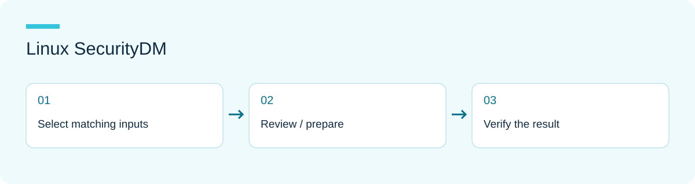





Linux SecurityDM 1.01 contains a historical `mkdm.sh` pipeline, configuration, boot-image tooling and a nested ramdisk archive. Its modes include `dmv`, `fde`, `fde-s` and `ramdisk`. These serve different integrity/encryption and image-preparation tasks.

## Inspect before execution

Read the script, ramdisk contents and help before providing real images:

```text
./mkdm.sh --help
```

The script supports `-d` for root partition, `-s` for a read-only system image, `-k` kernel, `-r` resource, `-c` configuration and `-m` mode. Long options include input/output paths, filesystem type and image size. Select values from the matching BSP; a partition path copied from another product can target the wrong device.

## Build an isolated image workflow

Keep copies of the original filesystem, kernel and resource image. Determine whether the root filesystem is read-only and whether integrity checking or encryption is required. The script's `dmv` path expects a read-only filesystem; encrypted-image paths must not be assumed compatible with compressed filesystem input.

The implementation can use privileged mounts, loop devices and `dmsetup`. Run reviewed build steps only on a controlled build host; do not treat this as a passive document viewer. The script can print key parameters, so test values and redacted logs are essential before production integration.

## Validate the boot dependency

The kernel configuration, ramdisk/init logic, mapping parameters and generated filesystem must agree. Test normal boot, corrupted data handling, recovery and updates with nonproduction material first. A generated boot image is not proof that secure storage or encryption has been enabled on a board. Preserve the complete build inputs and hashes for reproducibility.

## Applicability and verification

This is a documentation-based workflow for the supplied tool collection. Confirm the exact board, SoC, carrier, SDK/BSP and host architecture before using it. No flashing, provisioning, register writes or hardware tests were performed. Package availability does not establish support for every ArmSoM product.

## GitHub tool directory, versions and SHA-256

Open the matching GitHub directory, select the required host/version, then verify the file hash and extract the full directory. Links below open repository directories.

[Open the tool directory on GitHub](https://github.com/ArmSoM/rockchip-tools/tree/main/downloads/linux-dm)

| Platform / version | File | SHA-256 |
|---|---|---|
| Linux / 1.01 | `Linux_SecurityDM_v1_01.tar.gz` | `2db8bc9618a326f624e5bc519f95ac00ec33df6db47ba82ab446367fa4de5912` |

[GitHub · catalog.json](https://github.com/ArmSoM/rockchip-tools/blob/main/catalog.json) · [SHA256SUMS](https://github.com/ArmSoM/rockchip-tools/blob/main/SHA256SUMS)

## Source documents and figures

- Linux_SecurityDM_v1_01.tar.gz: mkdm.sh, configuration and nested ramdisk archive

## Continue with the related workflow

- [Linux SecurityAVB: keys, signed boot images and version boundaries](/articles/rockchip-tool-linux-avb/)
- [Rockchip Linux Secure Boot Developer Guide](/articles/203-rockchip-linux-secure-boot/)
- [Rockchip tool download and workflow index](/articles/rockchip-tools-download-guide/)

## Find the correct ArmSoM board documentation

For board and carrier requirements, use the product manual first. The links below are platform references, not a statement that this archived tool has been validated on these products.

[ArmSoM Docs](https://docs.armsom.org/) · [Sige7](https://www.armsom.org/sige7) / [Docs](https://docs.armsom.org/armsom-sige7) · [CM5](https://www.armsom.org/cm5) / [Docs](https://docs.armsom.org/armsom-cm5)


