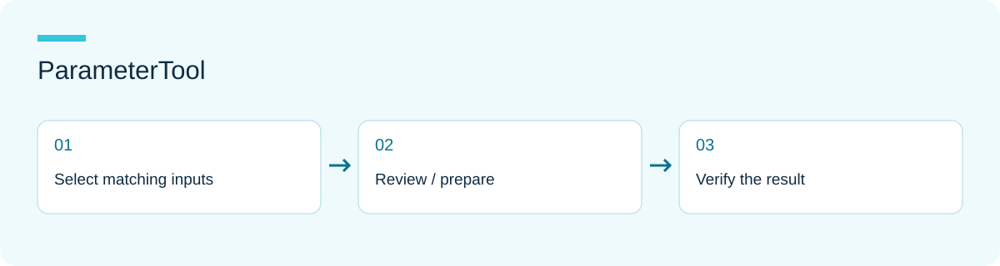



Partition parameters connect image packaging to where files are written on storage. ParameterTool is supplied as `parameter_tool.exe` with configuration and a nested boot_merger archive. There is no standalone user PDF in this package, so the workflow below focuses on verifiable parameter review rather than undocumented UI buttons.

## Start from the board's working layout

Copy the actual SDK parameter file and keep the original. Record storage capacity, partition order, names, offsets, sizes and any grow-to-end partition. Confirm the unit used by that SDK's format before converting hexadecimal values. A number written in hex is not automatically a byte address.

## Make one coherent change

For each enlarged image, compare its final generated size with the reserved partition, including format metadata. Check the next partition's start and total device capacity. Keep partition names synchronized with `package-file`, RKDevTool download rows and any boot arguments referring to them. An A/B product needs consistent slot names and boot/update logic, not merely duplicate entries.

## Validate the saved file

Compare the edited file text with the original, inspect unintended changes, then regenerate and unpack the firmware using its matched SDK. Re-import the resulting parameter in RKDevTool to inspect generated download rows without immediately executing a write. Test the final layout on a development device with a backup and recovery route.

## Packaging caveats

The nested boot_merger ZIP is another copy of that tool, not an additional unique tool or manual. Preserve it in the source package but do not assume its old Loader format matches a newer SoC. This archive alone provides no basis for publishing a universal ArmSoM partition table.

## Applicability and verification

This is a documentation-based workflow for the supplied tool collection. Confirm the exact board, SoC, carrier, SDK/BSP and host architecture before using it. No flashing, provisioning, register writes or hardware tests were performed. Package availability does not establish support for every ArmSoM product.

## GitHub tool directory, versions and SHA-256

Open the matching GitHub directory, select the required host/version, then verify the file hash and extract the full directory. Links below open repository directories.

[Open the tool directory on GitHub](https://github.com/ArmSoM/rockchip-tools/tree/main/downloads/parameter-tool)

| Platform / version | File | SHA-256 |
|---|---|---|
| Windows / 1.2 | `ParameterTool_v1.2.zip` | `46e4cda5ca71bd12444fc75c517753fe0f3fda9db1ce3917d1a5a3f48e92a6f2` |

[GitHub · catalog.json](https://github.com/ArmSoM/rockchip-tools/blob/main/catalog.json) · [SHA256SUMS](https://github.com/ArmSoM/rockchip-tools/blob/main/SHA256SUMS)

## Source documents and figures

- ParameterTool_v1.2.zip: parameter_tool.exe, config.json, nested boot_merger_v1.32_win.zip; existing storage guide

## Continue with the related workflow

- [Rockchip Storage Application Guide: Flash, Boot Flow, Partitions, Programming and Vendor Storage](/articles/099-rockchip-storage-application/)
- [RKDevTool download and workflow: Loader, partitions and update.img](/articles/rockchip-tool-rkdevtool/)
- [afptool and rkImageMaker: understand and package Rockchip update.img](/articles/rockchip-tool-firmware-pack-tools/)
- [Rockchip tool download and workflow index](/articles/rockchip-tools-download-guide/)

## Find the correct ArmSoM board documentation

For board and carrier requirements, use the product manual first. The links below are platform references, not a statement that this archived tool has been validated on these products.

[ArmSoM Docs](https://docs.armsom.org/) · [Sige7](https://www.armsom.org/sige7) / [Docs](https://docs.armsom.org/armsom-sige7) · [CM5](https://www.armsom.org/cm5) / [Docs](https://docs.armsom.org/armsom-cm5)


