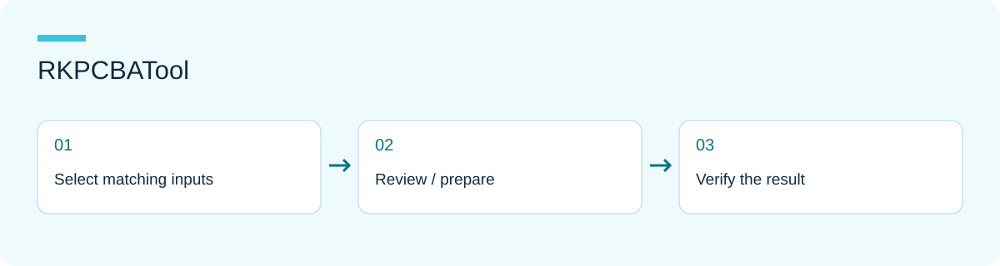
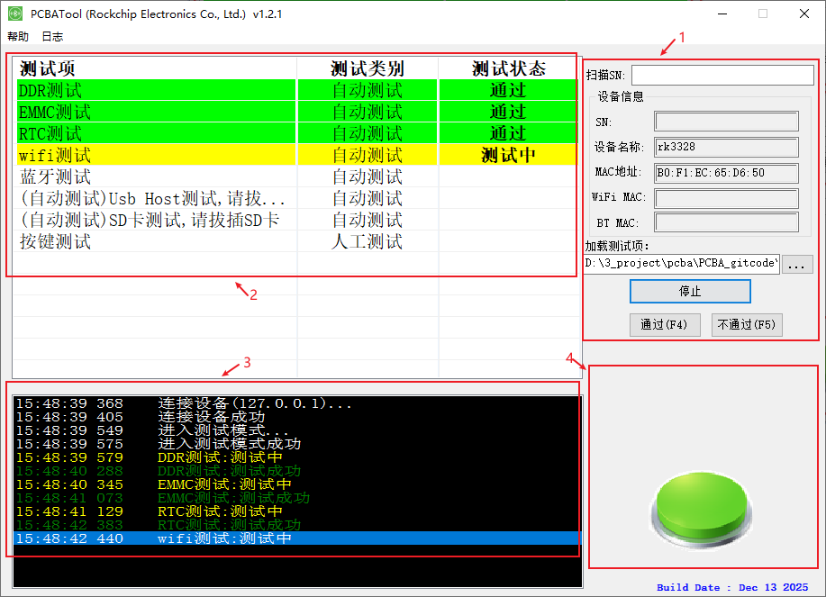





RKPCBATool combines a Windows host application with test programs on the Linux target. It can coordinate storage, wireless, audio, keys and other board tests, but only where the target BSP implements the corresponding functions. It is not the same workflow as the older Android PCBA tool.

## Install and connect

Use the complete installer/package in an English-only path, as the manual warns about ADB execution from non-English paths. Boot the target's PCBA-enabled firmware and connect ADB. The documented green connection indicator means the tool found an ADB device; orange means unavailable. Connection success does not mean functional tests have passed.

## Load a test plan

Press **F2** or the load-items **...** button and select a JSON configuration. `test_item` identifies the test; `test_bin_name` names the target program. `test_type` separates automatic results from operator judgement. The following is an ArmSoM-edited, syntactically valid illustration using documented keys, with MES disabled; it is not a factory-qualified plan:

```json
{
  "meta": {"version": "1.0", "needreboot": false},
  "test_groups": [{
    "test_item": "key_test",
    "test_bin_name": "echo_key_test",
    "name": "Key Test",
    "test_type": "manual",
    "enable": 1,
    "is_loop_test": false,
    "is_first": false,
    "is_last": false,
    "is_check_sn": false
  }],
  "mes_config": {"use_mes": false}
}
```

Keep its binary name only if that target program actually exists. Adapt tests to populated components and fixtures. The source JSON has formatting inconsistencies and includes example MES endpoints; do not copy those endpoints into a real station.

## Execute and judge correctly

The manual starts automatic tests and the first manual test together. Manual tests advance after Pass/Fail judgement. Audio needs actual listening/recording criteria; keys need defined board key names. A Wi-Fi scan result is not a throughput benchmark. Test only supported interfaces and record disabled/not-applicable cases separately.

## Integration and version differences

`needreboot` controls reboot behavior; the manual's A/B rootfs example is product-specific. Extending a test requires both host configuration/UI and a compatible target executable/protocol. The Chinese V1.2.0 removes an old camera subsection; the English V1.2.0 retains legacy camera text despite its revision note. Use the current Chinese structure and treat those English camera details as historical, not a guarantee of present support.

Archive the test-plan hash, host/tool version, target firmware, fixtures and per-device results. Tool 1.2.1 and manual V1.2.0 are separate version identifiers. No production tests were run for this article.

## Applicability and verification

This is a documentation-based workflow for the supplied tool collection. Confirm the exact board, SoC, carrier, SDK/BSP and host architecture before using it. No flashing, provisioning, register writes or hardware tests were performed. Package availability does not establish support for every ArmSoM product.

## Download, versions and SHA-256

Download the matching archive, verify the hash, and extract the entire directory. For the split Linux PinDebug archive, follow the linked reconstruction instructions; the hash below is for the reconstructed file.

| Host / version | Package |
|---|---|
| Windows host + Linux target / 1.2.1 | [RKPCBATool_v1.2.1_20251226.zip](https://raw.githubusercontent.com/ArmSoM/rockchip-tools/main/downloads/pcba-tool/RKPCBATool_v1.2.1_20251226.zip) |

**RKPCBATool_v1.2.1_20251226.zip — SHA-256**

```text
ec3747fa2360e8e1793920882d7ec51a4aa1087a4cfab5d3c218f677999440bc
```

[GitHub · catalog.json](https://github.com/ArmSoM/rockchip-tools/blob/main/catalog.json) · [SHA256SUMS](https://github.com/ArmSoM/rockchip-tools/blob/main/SHA256SUMS)

## Source documents and figures

- RKPCBATool 1.2.1 package; Rockchip_Developer_Guide_Linux_PCBA_CN/EN V1.2.0 (2025-12-13)
- [Original PDF: Rockchip_Developer_Guide_Linux_PCBA_CN.pdf](https://raw.githubusercontent.com/ArmSoM/rockchip-tools/main/manuals/31be89bdda4b.pdf)
- [Original PDF: Rockchip_Developer_Guide_Linux_PCBA_EN.pdf](https://raw.githubusercontent.com/ArmSoM/rockchip-tools/main/manuals/6cb5fb2c60e8.pdf)

Figures are extracted from the identified original PDF. If only a Chinese original exists, its interface text is retained; captions are localized. Screenshots are historical examples, not current ArmSoM test results.



Rockchip_Developer_Guide_Linux_PCBA_EN.pdf · p. 7

## Continue with the related workflow

- [Rockchip Linux PCBA Test Developer Guide](/articles/197-rockchip-linux-pcba/)
- [Rockchip PCBA Test Tool Developer Guide](/articles/252-rockchip-pcba-test-tool/)
- [RKDevInfoWriteTool: controlled serial-number and MAC provisioning](/articles/rockchip-tool-devinfo-write/)
- [Rockchip tool download and workflow index](/articles/rockchip-tools-download-guide/)

## Find the correct ArmSoM board documentation

For board and carrier requirements, use the product manual first. The links below are platform references, not a statement that this archived tool has been validated on these products.

[ArmSoM Docs](https://docs.armsom.org/) · [Sige7](https://www.armsom.org/sige7) / [Docs](https://docs.armsom.org/armsom-sige7) · [CM5](https://www.armsom.org/cm5) / [Docs](https://docs.armsom.org/armsom-cm5)


