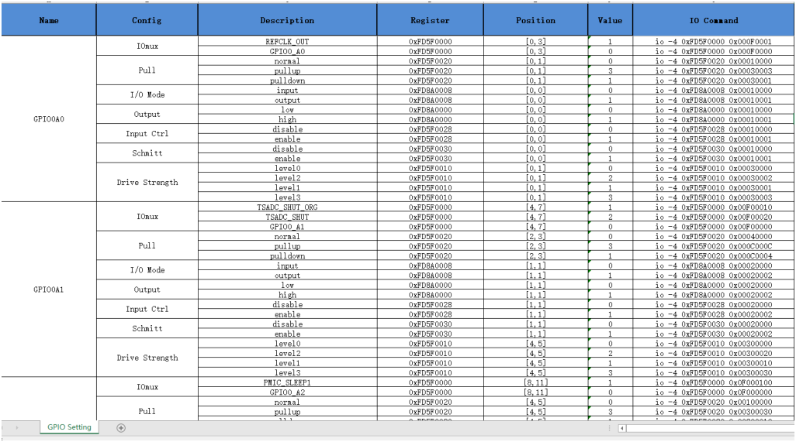




## Complete PinDebug V1.1 workflow

The manual lists RK3588, RK3566, RK3568, RV1126, RV1109, RV1106, RV1103 and RK3528. PinDebug queries IOMUX and configures pin properties; the supplied Windows 1.18 and Linux 1.11 interfaces may differ. The following covers source sections 1.1–1.11; illustrations retain the original Chinese interface.

### 1.1 Open a project

Select the SoC before any operation. The Pin page shows multiplexing by pin/GPIO: search by Function, right-click a Function to print its configuration command, or double-click while connected to apply it directly. Pin and IO-number columns are sortable. The IOmux page groups controllable signals by module.

### 1.2 Connect the device

Communication uses ADB. Open the project, enable ADB on the device, connect the host and click the toolbar connection icon.

### 1.3 Read IOMUX

Read all IOMUX registers to update both Pin and IOmux pages. Offline definitions do not replace actual device readback.

### 1.4 Modify IOMUX

Checking a functional IO in IOmux selects that function; clearing it selects GPIO. A conflict prompt allows cancellation or confirmation.

### 1.5 Pull and drive settings

Select an enabled functional IO and right-click to read or modify pull configuration and drive strength. The original figures use EMMC_CLKOUT; check whether the storage controller is actively using it before changes.

### 1.6 Read and modify GPIO data

The source uses GPIO1C3. The GPIO-function checkbox indicates GPIO mode; direction comes from GPIO `ddr`, output level from `dr`, IO voltage from PMU `vsel`, and port level from `ext_port`. Here `ddr` is a direction register, not DDR memory.

### 1.7 Read regulators

The tool reads the device regulator-summary node with `cat` and parses all domains. The manual does not specify the complete node path.

### 1.8 Read voltage-domain selection

The tool parses the voltage-selection register into a domain list. Section 1.8 spells it `vesl`, while 1.6 says `vsel`; this source discrepancy is retained. A selection value is not a measured voltage.

### 1.9 Check IOmux

Print selected IOs by module to determine which IO set is active when a module offers several modes.

### 1.10 Export GPIO configuration

After opening a project, export GPIO configuration to an Excel table. Record the selected SoC and distinguish static definitions from device-read values.

### 1.11 Offline GPIO command lookup

With the project open, look up IOMUX, pull, drive-strength and Schmitt-trigger commands without connecting a device. Enter `help` for syntax; the manual demonstrates `gpio0a0`. Generated commands do not establish suitability for the carrier wiring.

### Offline lookup syntax transcribed from the screenshot

Enter these in the tool search box, not a shell. Regular expressions are supported. Export and lookup screenshots are example projects and show different register addresses; do not combine them into a single board configuration.

```text
gpio [mux|pull|ds|smt|ddr|dr]
gpio0a0
gpio0a0 mux
gpio0a0 pull
gpio0a0 ds
gpio0a0 smt
gpio0a0 ddr
gpio0a0 dr
gpio0a0 ddr|dr
```

## Applicability and verification

This is a documentation-based workflow for the supplied tool collection. Confirm the exact board, SoC, carrier, SDK/BSP and host architecture before using it. No flashing, provisioning, register writes or hardware tests were performed. Package availability does not establish support for every ArmSoM product.

## GitHub tool directory, versions and SHA-256

Open the matching GitHub directory, select the required host/version, then verify the file hash and extract the full directory. Links below open repository directories.

[Open the tool directory on GitHub](https://github.com/ArmSoM/rockchip-tools/tree/main/downloads/pin-debug)

| Platform / version | File | SHA-256 |
|---|---|---|
| Linux / 1.11 | `pin_debug_tool_v1.11_for_linux.tar.gz` | `16cb25b8fc2533e8f730a790c7486ab5042baa964b3bdb95a161ddce143c4a34` |
| Windows / 1.18 | `pin_debug_tool_v1.18_20250322_win.zip` | `88c550ee9a578eaa451a9b8a05b3d088247dc63dd9bd426b832191994dc6a7d5` |

[GitHub · catalog.json](https://github.com/ArmSoM/rockchip-tools/blob/main/catalog.json) · [SHA256SUMS](https://github.com/ArmSoM/rockchip-tools/blob/main/SHA256SUMS)

## Source documents and figures

- PinDebug_UserManual.pdf

### Original manual interfaces and diagrams

Screens retain their source language. English-source figures are used where available; additional screens without English originals remain Chinese. Values are manual examples, not measurements of a current board.


PinDebug_UserManual.pdf · p. 2


PinDebug_UserManual.pdf · p. 2


PinDebug_UserManual.pdf · p. 3


PinDebug_UserManual.pdf · p. 3


PinDebug_UserManual.pdf · p. 3


PinDebug_UserManual.pdf · p. 4


PinDebug_UserManual.pdf · p. 4


PinDebug_UserManual.pdf · p. 5


PinDebug_UserManual.pdf · p. 5


PinDebug_UserManual.pdf · p. 5


PinDebug_UserManual.pdf · p. 6


PinDebug_UserManual.pdf · p. 6


PinDebug_UserManual.pdf · p. 6


PinDebug_UserManual.pdf · p. 7


PinDebug_UserManual.pdf · p. 7


PinDebug_UserManual.pdf · p. 7


PinDebug_UserManual.pdf · p. 7


PinDebug_UserManual.pdf · p. 8



PinDebug_UserManual.pdf · p. 8


PinDebug_UserManual.pdf · p. 9


PinDebug_UserManual.pdf · p. 9

## Continue with the related workflow

- [Rockchip Linux Pinctrl: Complete GPIO, IOMUX, Drive Strength and DTS Guide](/articles/116-rockchip-linux-pinctrl/)
- [USB SQ Tool 1.5: from USB eye-diagram diagnosis to PHY settings](/articles/rockchip-tool-usb-sq-tool/)
- [Rockchip tool download and workflow index](/articles/rockchip-tools-download-guide/)

## Find the correct ArmSoM board documentation

For board and carrier requirements, use the product manual first. The links below are platform references, not a statement that this archived tool has been validated on these products.

[ArmSoM Docs](https://docs.armsom.org/) · [Sige7](https://www.armsom.org/sige7) / [Docs](https://docs.armsom.org/armsom-sige7) · [CM5](https://www.armsom.org/cm5) / [Docs](https://docs.armsom.org/armsom-cm5)


