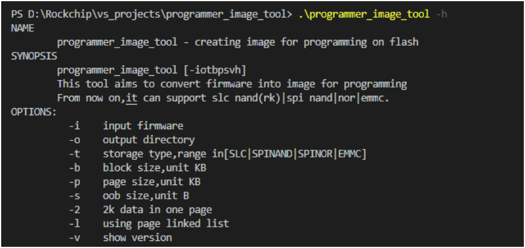




## programmer_image_tool: all examples from both manuals

The two `user_manual.pdf` files accompany Linux 1.26 and Windows 1.28 and contain the same four commands. The Linux usage-description section has a broken local image reference; the Windows manual has a help screenshot, reproduced below alongside every textual example. Outputs are programmer images; generation does not flash a board.

### 1. eMMC

```text
./programmer_image_tool -i update.img -t emmc
```

Generates `out_image.bin` in the program directory.

### 2. SPI NOR

```text
./programmer_image_tool -i update.img -t spinor
```

Also generates `out_image.bin` in the program directory, but for SPI NOR; it is not interchangeable with the eMMC output.

### 3. SPI NAND: 256 KB block, 4 KB page

```text
./programmer_image_tool -i update.img -b 256 -p 4 -t spinand -o out
```

Generates partition-named images in `out`. The source spells the placeholder `partiiton_name.img`; it denotes a partition name, not a mandated misspelling.

### 4. SLC NAND: 256 KB block, 4 KB page, 256 B OOB

```text
./programmer_image_tool -i update.img -b 256 -p 4 -s 256 -t slc -2 -o rockdev
```

Generates partition images in `rockdev`. The source heading additionally says `2k_page`, while the command uses `-p 4` and `-2`. Both are preserved; the help screenshot below confirms `-2` as 2k data per page, not a change to the physical page size. Check the actual NAND datasheet and tool help.

## Complete options from the help screenshot

The Windows source screenshot confirms that `-2` means 2k data in one page, not changing `-p 4` into a 2 KB physical page. A copyable transcription follows. SYNOPSIS lists fewer options than OPTIONS; that source difference is retained.

```text
NAME
    programmer_image_tool - creating image for programming on flash
SYNOPSIS
    programmer_image_tool [-iotbpsvh]
DESCRIPTION
    This tool aims to convert firmware into image for programming
    From now on,it can support slc nand(rk)|spi nand|nor|emmc.
OPTIONS:
    -i    input file
    -o    output directory
    -t    storage type,range in[SLC|SPINAND|SPINOR|EMMC]
    -f    input format,range in[UPDATE|PARAMETER|IMAGE]
    -b    block size,unit KB
    -p    page size,unit KB
    -s    oob size,unit B
    -2    2k data in one page
    -1    single idblock
    -d    set idblock start sector
    -l    using page linked list
    -v    show version
```

## Applicability and verification

This is a documentation-based workflow for the supplied tool collection. Confirm the exact board, SoC, carrier, SDK/BSP and host architecture before using it. No flashing, provisioning, register writes or hardware tests were performed. Package availability does not establish support for every ArmSoM product.

## GitHub tool directory, versions and SHA-256

Open the matching GitHub directory, select the required host/version, then verify the file hash and extract the full directory. Links below open repository directories.

[Open the tool directory on GitHub](https://github.com/ArmSoM/rockchip-tools/tree/main/downloads/programmer-image-tool)

| Platform / version | File | SHA-256 |
|---|---|---|
| Linux / 1.26 | `programmer_image_tool_v1.26_linux.tar.gz` | `ea38df34e97cd697aa53d09af06fa1ff2b0847fe2c9699c49d1890509cc5c0d0` |
| Windows / 1.28 | `programmer_image_tool_v1.28.zip` | `696d07d8232a637ef59b724d0c0522e500fc9f26571c2633d96271ffce48e56f` |

[GitHub · catalog.json](https://github.com/ArmSoM/rockchip-tools/blob/main/catalog.json) · [SHA256SUMS](https://github.com/ArmSoM/rockchip-tools/blob/main/SHA256SUMS)

## Source documents and figures

- user_manual.pdf
- user_manual.pdf

### Original manual interfaces and diagrams

Screens retain their source language. English-source figures are used where available; additional screens without English originals remain Chinese. Values are manual examples, not measurements of a current board.



user_manual.pdf · p. 1


user_manual.pdf · p. 1

## Continue with the related workflow

- [Firmware_Merger: flat RK, flat GPT and compact GPT images](/articles/rockchip-tool-firmware-merger/)
- [afptool and rkImageMaker: understand and package Rockchip update.img](/articles/rockchip-tool-firmware-pack-tools/)
- [Rockchip Storage Application Guide: Flash, Boot Flow, Partitions, Programming and Vendor Storage](/articles/099-rockchip-storage-application/)
- [Rockchip tool download and workflow index](/articles/rockchip-tools-download-guide/)

## Find the correct ArmSoM board documentation

For board and carrier requirements, use the product manual first. The links below are platform references, not a statement that this archived tool has been validated on these products.

[ArmSoM Docs](https://docs.armsom.org/) · [Sige7](https://www.armsom.org/sige7) / [Docs](https://docs.armsom.org/armsom-sige7) · [CM5](https://www.armsom.org/cm5) / [Docs](https://docs.armsom.org/armsom-cm5)


