

## RKDevTool manual: partitions, firmware and advanced operations

This section combines the 2018 Chinese/English V1.2 manuals with the 2021 Chinese V1.0 manual for tool 2.88. The numbering is not chronological: V1.2 is not the newer document. The package itself is a snapshot with 3.37 release notes. Chinese figures come from Chinese originals, other languages from the matching English original; 2021-only screens retain Chinese labels. All technical functions from both editions are covered below.

### 1. Create, import and export configuration

Right-click the download configuration area and import a `ParameterFile` to generate partition entries. Delete unused entries and assign images and target storage (optional for a single storage type). Export as `ConfigFile` for reuse. Bundled defaults may not match the project. `DEFAULT_IMAGE_CONFIG` in `Config.ini` selects the startup file; V1.2 also describes replacing `config.cfg`. Restart after editing configuration.

### 2. Boot download versus Loader programming

Boot download in Maskrom runs Loader DDR initialization and loads usbplug into DDR without writing storage. Double-click Loader on the first row, select `LoaderToDDR`, check it and execute. For persistent programming select `Loader`; this generates IDBlock and writes storage in Maskrom or Loader mode. Boot failures require checking DDR soldering, SoC, Loader match and USB, then rebooting before retry. Persistent writes additionally require flash-support, soldering and chip-flag checks.

### 3. Partition images and the device table

Connect in Loader/Maskrom, checking Loader for Maskrom. Select parameter for partition addresses/sizes, assign images and storage, select partitions and execute. Do not assume zero addresses are correct. V1.2 offers Device partition table to read, parse and load the existing device layout. Resolve missing/busy files, oversized images and USB errors separately.

### 4. Device modes and multiple devices

When detected as ADB, MSC, MTP or UVC, use Switch to enter Rockusb. Loader can then switch using Enter Maskrom. With multiple devices, select the intended device from the dropdown before further operations.

### 5. Complete update.img upgrade

Select update.img, connect in Maskrom/Loader and click Upgrade. V1.2 says this interface also accepts Loader files. Check file availability, format/corruption, digest, packer version, partition size, chip flag and communication. Inspect cables for intermittent failures and the device side for repeatable failures.

### 6. Force writing by address

Enable Force write by address, choose the file, enter the address and select the entry to execute. This bypasses normal partition addressing; verify the actual layout, rather than using it to bypass an incorrect or oversized image.

### 7. Erase storage

The 2021 manual requires Maskrom and a successful Boot download before erasure. Sector erasure lists only eMMC; full erasure lists `emmc|nor|nand`. The 2018 manual says Erase Flash covers all blocks, including system blocks preceding firmware. It can precede a retry after repeated upgrade failures, but destroys data. Do not assume newer command-line SPI-erasure support exists in this old GUI.

### 8. Read Chip information

Read Chip information; `Image Chip Flag` must match the flag used when packaging the Loader/firmware. On mismatch prepare the proper chip files.

### 9. Multiple storage types

Download Boot in Maskrom and read the storage list: a check marks the current storage, a cross means unsupported, and a circle means supported. Select a circled entry and switch storage.

### 10. Unpack firmware

Unpacking uses `output`: `boot.bin` is the packaged Loader, `firmware.img` is the internal afptool firmware, and `Android` contains the expanded firmware.img. Source filenames are retained.

### 11. GPT and capabilities

V1.2 accepts parameter or `partition_table.img` for GPT. A parameter file needs `TYPE:GPT`; its last partition uses `grow` to allocate the remaining storage. `Read Capability` must show `DirectLBA` enabled, otherwise GPT is unsupported.

### 12. Clear serial numbers and troubleshoot

V1.2 can clear serial numbers written by the unified-library tool. For missing download items inspect the partition image path. Download failures call for driver/tool updates, a shielded cable and rear PC port, and checking flash soldering, damage and support. Verification failures require partition-size, flash-mapping and DDR-stability checks; the source suggests erasing and retrying, which requires evaluating data loss first. Use an English-only path on non-Chinese systems; run as administrator on Windows 7/Vista and restart after Config.ini changes.

### Additional Chinese/English V1.2 differences

English erasure instructions first select update.img or loader.bin with Firmware, connect in Maskrom/Loader and click EraseFlash; the 2021 Chinese manual explicitly requires Maskrom and a prior Boot download. Follow the actual version. English Clear sn specifies SN/MAC in IDBlock sector3, whereas Chinese describes serial numbers from the unified-library tool. English download-failure advice updates the tool and Loader; Chinese updates Rockusb and the tool, so check both. English requires an administrator account; Chinese specifically names Win7/Vista.

## Applicability and verification

This is a documentation-based workflow for the supplied tool collection. Confirm the exact board, SoC, carrier, SDK/BSP and host architecture before using it. No flashing, provisioning, register writes or hardware tests were performed. Package availability does not establish support for every ArmSoM product.

## GitHub tool directory, versions and SHA-256

Open the matching GitHub directory, select the required host/version, then verify the file hash and extract the full directory. Links below open repository directories.

[Open the tool directory on GitHub](https://github.com/ArmSoM/rockchip-tools/tree/main/downloads/rkdevtool)

| Platform / version | File | SHA-256 |
|---|---|---|
| Windows / 3.37 release notes | `RKDevTool-windows-directory-snapshot.zip` | `d453bd22c00141f12ef39469629d478aa61304763bdb2977288d6f019a74f20c` |

[GitHub · catalog.json](https://github.com/ArmSoM/rockchip-tools/blob/main/catalog.json) · [SHA256SUMS](https://github.com/ArmSoM/rockchip-tools/blob/main/SHA256SUMS)

## Source documents and figures

- RKDevTool_manual_v1.2_cn.pdf
- RKDevTool_manual_v1.2_en.pdf
- 开发工具使用说明_v1.0.pdf

### Original manual interfaces and diagrams

Screens retain their source language. English-source figures are used where available; additional screens without English originals remain Chinese. Values are manual examples, not measurements of a current board.

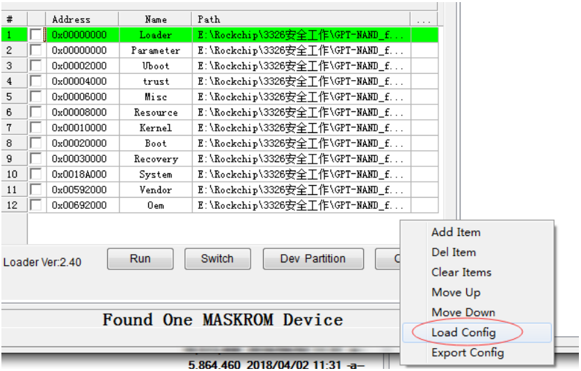

RKDevTool_manual_v1.2_en.pdf · p. 4

RKDevTool_manual_v1.2_en.pdf · p. 5

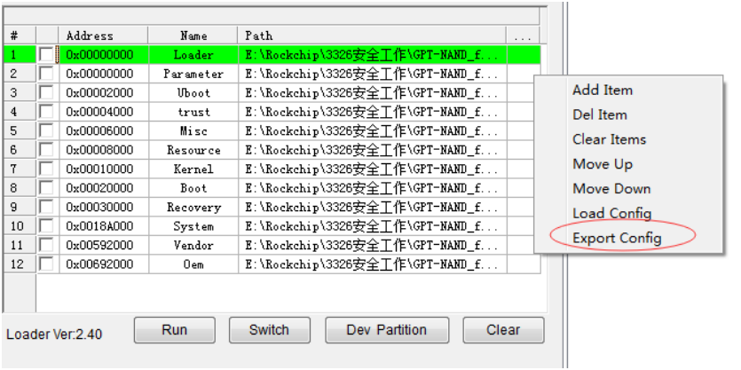

RKDevTool_manual_v1.2_en.pdf · p. 5

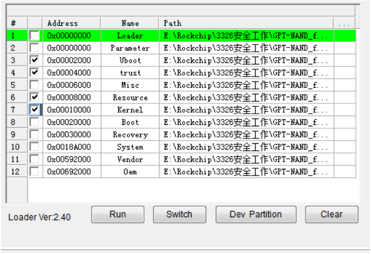

RKDevTool_manual_v1.2_en.pdf · p. 6

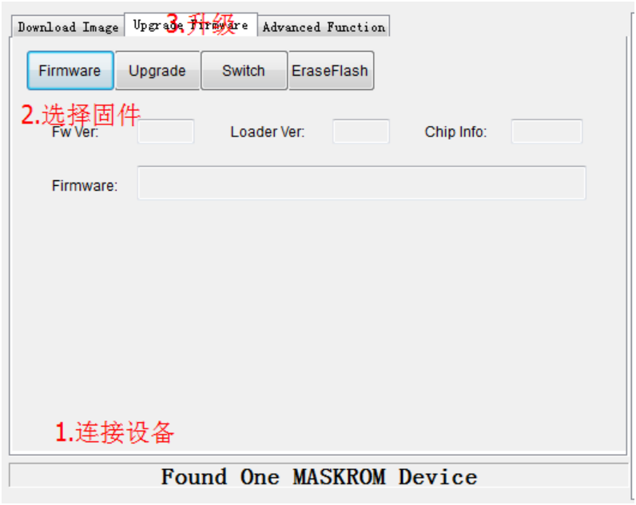

RKDevTool_manual_v1.2_en.pdf · p. 7

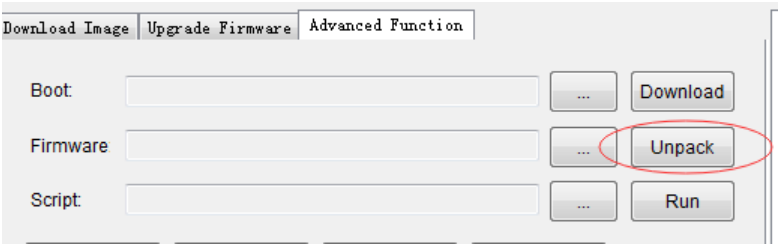

RKDevTool_manual_v1.2_en.pdf · p. 8

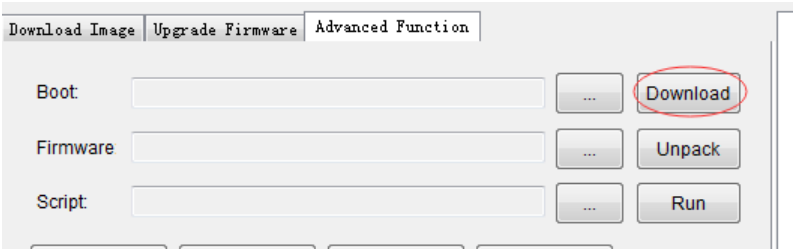

RKDevTool_manual_v1.2_en.pdf · p. 8

RKDevTool_manual_v1.2_en.pdf · p. 8

RKDevTool_manual_v1.2_en.pdf · p. 9

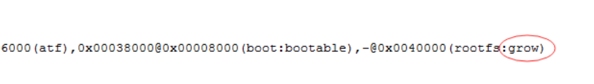

RKDevTool_manual_v1.2_en.pdf · p. 9

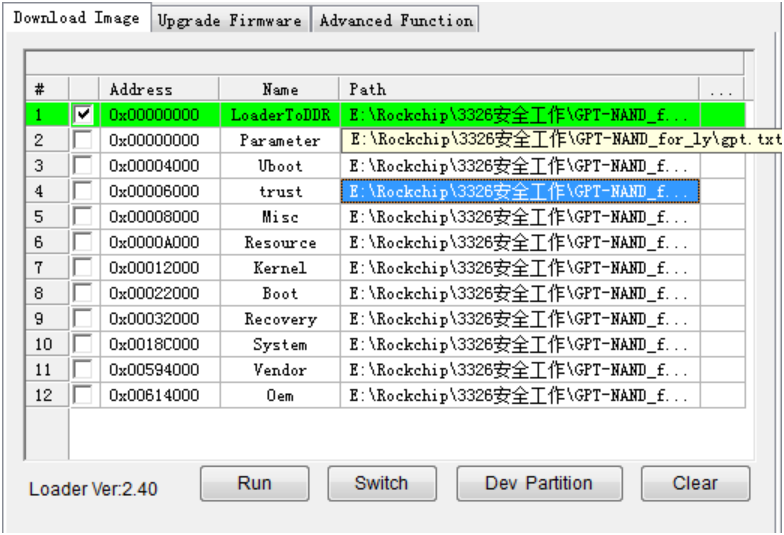

RKDevTool_manual_v1.2_en.pdf · p. 9

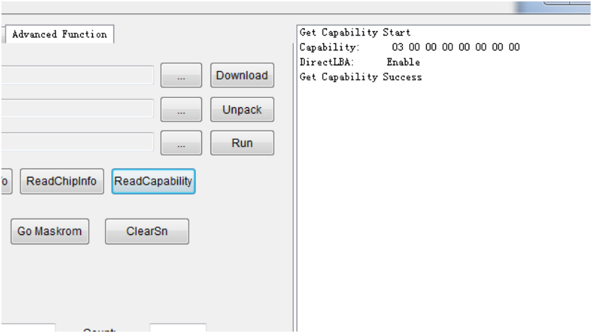

RKDevTool_manual_v1.2_en.pdf · p. 10

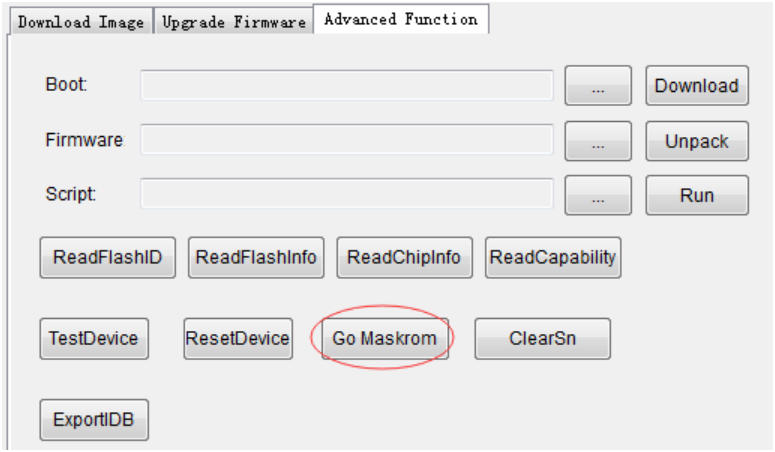

RKDevTool_manual_v1.2_en.pdf · p. 10

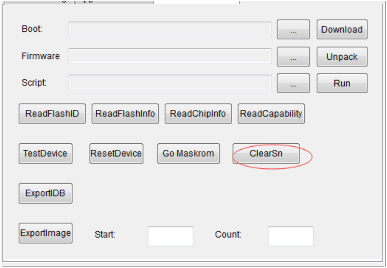

RKDevTool_manual_v1.2_en.pdf · p. 11

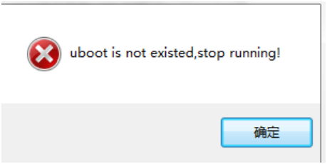

RKDevTool_manual_v1.2_en.pdf · p. 11

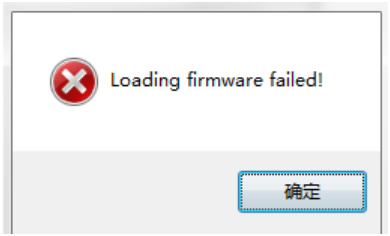

RKDevTool_manual_v1.2_en.pdf · p. 12

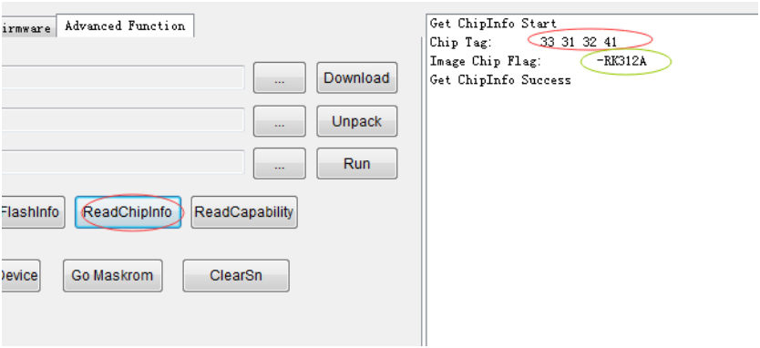

RKDevTool_manual_v1.2_en.pdf · p. 12

RKDevTool_manual_v1.2_en.pdf · p. 12

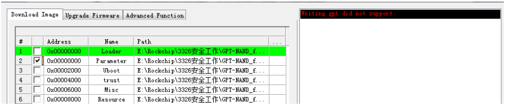

RKDevTool_manual_v1.2_en.pdf · p. 13

开发工具使用说明_v1.0.pdf · p. 2

开发工具使用说明_v1.0.pdf · p. 2

开发工具使用说明_v1.0.pdf · p. 3

开发工具使用说明_v1.0.pdf · p. 4

开发工具使用说明_v1.0.pdf · p. 5

开发工具使用说明_v1.0.pdf · p. 5

开发工具使用说明_v1.0.pdf · p. 6

开发工具使用说明_v1.0.pdf · p. 7

开发工具使用说明_v1.0.pdf · p. 8

开发工具使用说明_v1.0.pdf · p. 9

开发工具使用说明_v1.0.pdf · p. 9

开发工具使用说明_v1.0.pdf · p. 10

开发工具使用说明_v1.0.pdf · p. 11

开发工具使用说明_v1.0.pdf · p. 11

## Continue with the related workflow

- [Rockchip Storage Application Guide: Flash, Boot Flow, Partitions, Programming and Vendor Storage](/articles/099-rockchip-storage-application/)
- [DriverAssitant 5.13: install Rockusb and ADB drivers on Windows](/articles/rockchip-tool-driver-assistant/)
- [upgrade_tool download: command-line Rockchip firmware workflow](/articles/rockchip-tool-upgrade-tool/)
- [Rockchip tool download and workflow index](/articles/rockchip-tools-download-guide/)

## Find the correct ArmSoM board documentation

For board and carrier requirements, use the product manual first. The links below are platform references, not a statement that this archived tool has been validated on these products.

[ArmSoM Docs](https://docs.armsom.org/) · [Sige7](https://www.armsom.org/sige7) / [Docs](https://docs.armsom.org/armsom-sige7) · [CM5](https://www.armsom.org/cm5) / [Docs](https://docs.armsom.org/armsom-cm5)


