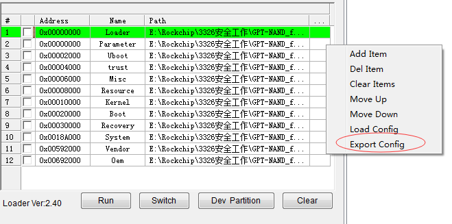




RKDevTool is the Windows graphical route for Rockusb firmware operations. It is useful when bringing up an ArmSoM development board or reproducing a specific flashing failure. A complete `update.img`, individual partition images and a Loader are different inputs; select the workflow before connecting a device.

## Prepare the host and board

Install the matched Rockusb driver with DriverAssitant. Extract the entire RKDevTool directory, including language files and DLLs. Use the board manual to identify the data USB port, power supply and recovery/Maskrom procedure. Back up data before any write. An ADB connection in a running OS is not the same as a Loader or Maskrom connection.

## Create a repeatable partition configuration

1. In the download area, right-click **Import configuration**, select **ParameterFile**, and open the parameter file from the same firmware build.
2. The tool generates partition entries. Remove entries that should not be written; select each image and, on multi-storage boards, its target storage.
3. Check partition sizes against image sizes. Export the resulting **ConfigFile** for repeat use. The manual identifies `DEFAULT_IMAGE_CONFIG` in `config.ini` as the startup configuration setting.
4. Review enabled rows before clicking Execute. Importing a configuration does not prove it matches the connected board.

## LoaderToDDR versus Loader

In Maskrom, **LoaderToDDR** downloads the upgrade code into RAM; the documented operation does not write storage. **Loader** generates an IDBlock and writes it to storage. The distinction matters when diagnosing DDR initialization without replacing the boot loader. Use only the board/DDR-matched Loader.

For a full update, choose `update.img`, connect in Maskrom or Loader, and select Upgrade. For individual partitions, load their parameter file first. Address-based writing bypasses that helpful association: do not copy another board's offsets. Erase All destroys the storage contents.

## Diagnose failures by stage

| Symptom | First check |
|---|---|
| No device | USB data cable, correct port, driver and board mode |
| Download Boot fails | Matched DDR/Loader, power, USB; restart before retrying |
| Image too large | Partition definition versus actual image size |
| Chip flag or digest error | Packaging input and image integrity; regenerate the correct firmware |
| Intermittent transfer error | USB connection and power; deterministic failures also require target-side investigation |

## Version boundaries and acceptance

The package includes 2018 bilingual V1.2 manuals and a 2021 Chinese V1.0 manual for tool V2.88; the directory's release notes reach 3.37. A lower document version can therefore be newer. Screenshots are source examples, not a capture of a tested ArmSoM session. After writing, capture the tool result and verify a cold boot, reported storage and OS version. A green transfer result alone does not validate the whole product.

## Applicability and verification

This is a documentation-based workflow for the supplied tool collection. Confirm the exact board, SoC, carrier, SDK/BSP and host architecture before using it. No flashing, provisioning, register writes or hardware tests were performed. Package availability does not establish support for every ArmSoM product.

## Download, versions and SHA-256

Download the matching archive, verify the hash, and extract the entire directory. For the split Linux PinDebug archive, follow the linked reconstruction instructions; the hash below is for the reconstructed file.

| Host / version | Package |
|---|---|
| Windows / 3.37 release notes | [RKDevTool-windows-directory-snapshot.zip](https://raw.githubusercontent.com/ArmSoM/rockchip-tools/main/downloads/rkdevtool/RKDevTool-windows-directory-snapshot.zip) |

**RKDevTool-windows-directory-snapshot.zip — SHA-256**

```text
d453bd22c00141f12ef39469629d478aa61304763bdb2977288d6f019a74f20c
```

[GitHub · catalog.json](https://github.com/ArmSoM/rockchip-tools/blob/main/catalog.json) · [SHA256SUMS](https://github.com/ArmSoM/rockchip-tools/blob/main/SHA256SUMS)

## Source documents and figures

- RKDevTool_manual_v1.2_cn.pdf; RKDevTool_manual_v1.2_en.pdf (2018)
- 开发工具使用说明_v1.0.pdf (2021, tool V2.88); bundled revision notes through 3.37
- [Original PDF: RKDevTool_manual_v1.2_cn.pdf](https://raw.githubusercontent.com/ArmSoM/rockchip-tools/main/manuals/27081f89d32f.pdf)
- [Original PDF: RKDevTool_manual_v1.2_en.pdf](https://raw.githubusercontent.com/ArmSoM/rockchip-tools/main/manuals/6a8a5813c129.pdf)
- [Original PDF: 开发工具使用说明_v1.0.pdf](https://raw.githubusercontent.com/ArmSoM/rockchip-tools/main/manuals/be6d064c5f70.pdf)

Figures are extracted from the identified original PDF. If only a Chinese original exists, its interface text is retained; captions are localized. Screenshots are historical examples, not current ArmSoM test results.


RKDevTool_manual_v1.2_en.pdf · p. 5



RKDevTool_manual_v1.2_en.pdf · p. 5

## Continue with the related workflow

- [Rockchip Storage Application Guide: Flash, Boot Flow, Partitions, Programming and Vendor Storage](/articles/099-rockchip-storage-application/)
- [DriverAssitant 5.13: install Rockusb and ADB drivers on Windows](/articles/rockchip-tool-driver-assistant/)
- [upgrade_tool download: command-line Rockchip firmware workflow](/articles/rockchip-tool-upgrade-tool/)
- [Rockchip tool download and workflow index](/articles/rockchip-tools-download-guide/)

## Find the correct ArmSoM board documentation

For board and carrier requirements, use the product manual first. The links below are platform references, not a statement that this archived tool has been validated on these products.

[ArmSoM Docs](https://docs.armsom.org/) · [Sige7](https://www.armsom.org/sige7) / [Docs](https://docs.armsom.org/armsom-sige7) · [CM5](https://www.armsom.org/cm5) / [Docs](https://docs.armsom.org/armsom-cm5)


