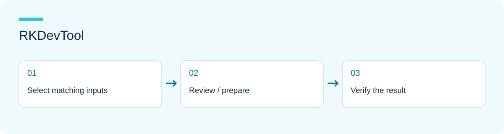
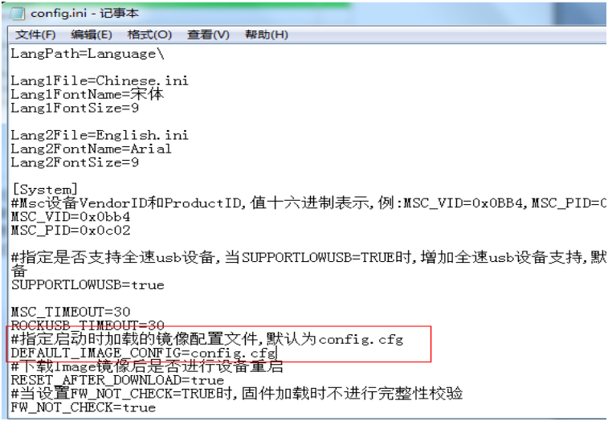
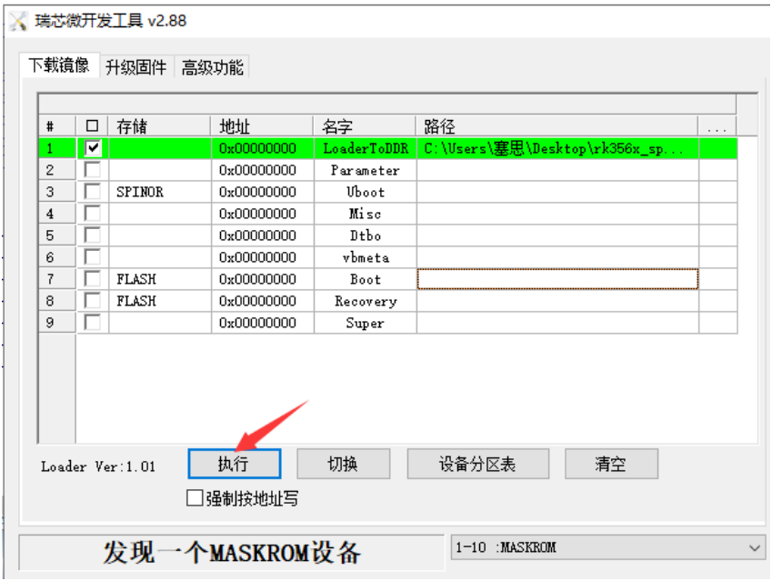
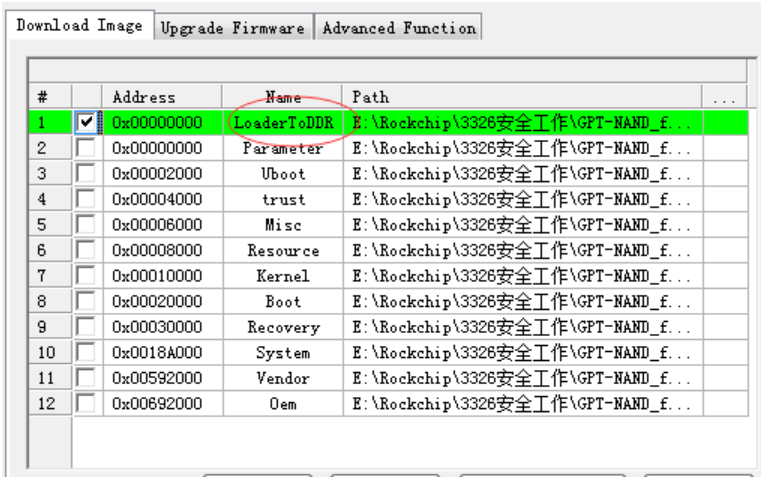



## RKDevTool manual: partitions, firmware and advanced operations

This section combines the 2018 Chinese/English V1.2 manuals with the 2021 Chinese V1.0 manual for tool 2.88. The numbering is not chronological: V1.2 is not the newer document. The package itself is a snapshot with 3.37 release notes. Chinese figures come from Chinese originals, other languages from the matching English original; 2021-only screens retain Chinese labels. All technical functions from both editions are covered below.

### 1. Create, import and export configuration

#### 1.1 Create configuration from parameter

First confirm that parameter belongs to the current project. Right-click the empty download configuration area and select Import configuration. The following view shows the menu in tool 2.88.

<figure style="margin:1.6rem 0">

<figcaption style="margin-top:.6rem;font-size:.9em;line-height:1.55"><strong>Figure 1: Import configuration in the context menu</strong></figcaption>
</figure>

In the file dialog select `ParameterFile`, then choose the project parameter file. The tool creates download entries from its partition table.

<figure style="margin:1.6rem 0">

<figcaption style="margin-top:.6rem;font-size:.9em;line-height:1.55"><strong>Figure 2: Select ParameterFile before opening the partition configuration</strong></figcaption>
</figure>

After import, remove unused entries, assign images to the remaining entries and select the target storage. Storage selection is optional with a single storage type. Bundled defaults may not match the project. The 2018 V1.2 import entry below uses different interface wording.

<figure style="margin:1.6rem 0">

<figcaption style="margin-top:.6rem;font-size:.9em;line-height:1.55"><strong>Figure 3: Partition configuration import in V1.2</strong></figcaption>
</figure>

#### 1.2 Export the configuration for reuse

When configuration is complete, right-click the download area and export it as `ConfigFile`. Import that file on the next run. V1.2 also describes replacing the tool directory’s `config.cfg` to load this configuration at startup.

<figure style="margin:1.6rem 0">

<figcaption style="margin-top:.6rem;font-size:.9em;line-height:1.55"><strong>Figure 4: Export the current partition configuration</strong></figcaption>
</figure>

#### 1.3 Choose the startup configuration

Set `DEFAULT_IMAGE_CONFIG` in `Config.ini` to choose the file loaded at startup. Restart the tool after saving the change. The path in the figure is a source example; use the configuration location for your project.

<figure style="margin:1.6rem 0">

<figcaption style="margin-top:.6rem;font-size:.9em;line-height:1.55"><strong>Figure 5: DEFAULT_IMAGE_CONFIG in Config.ini</strong></figcaption>
</figure>

### 2. Boot download versus Loader programming

#### 2.1 Download Boot to memory only

Boot download in Maskrom runs the Loader’s DDR initialization and loads usbplug into DDR without writing device storage. Double-click Loader on the first row, select `LoaderToDDR`, check the entry and execute.

<figure style="margin:1.6rem 0">

<figcaption style="margin-top:.6rem;font-size:.9em;line-height:1.55"><strong>Figure 6: LoaderToDDR loads upgrade code into DDR without programming storage</strong></figcaption>
</figure>

The 2018 V1.2 manual also provides an Advanced Function route: select the Boot file and click Download. This likewise loads Boot into memory.

<figure style="margin:1.6rem 0">

<figcaption style="margin-top:.6rem;font-size:.9em;line-height:1.55"><strong>Figure 7: Boot download from V1.2 Advanced Function</strong></figcaption>
</figure>

V1.2 also offers `LoaderToDDR` in the download-list dropdown. Both routes perform the same kind of memory download. Before retrying, reboot the device and check DDR soldering, SoC, Loader compatibility and USB communication.

<figure style="margin:1.6rem 0">

<figcaption style="margin-top:.6rem;font-size:.9em;line-height:1.55"><strong>Figure 8: LoaderToDDR in the V1.2 download list</strong></figcaption>
</figure>

#### 2.2 Program Loader persistently

For persistent programming select `Loader` on the first row, check it and execute. Maskrom and Loader modes are both accepted; the operation creates IDBlock and writes storage. In addition to DDR, SoC and USB, check flash support, soldering and the chip flag. Inspect USB for intermittent communication failures and the device side for repeatable failures.

<figure style="margin:1.6rem 0">

<figcaption style="margin-top:.6rem;font-size:.9em;line-height:1.55"><strong>Figure 9: Loader generates IDBlock and writes device storage</strong></figcaption>
</figure>

### 3. Partition images and the device table

Connect in Loader/Maskrom, checking Loader for Maskrom. Select parameter for partition addresses/sizes, assign images and storage, select partitions and execute. Do not assume zero addresses are correct. V1.2 offers Device partition table to read, parse and load the existing device layout. Resolve missing/busy files, oversized images and USB errors separately.

<figure style="margin:1.6rem 0">

<figcaption style="margin-top:.6rem;font-size:.9em;line-height:1.55"><strong>Figure 10: Execute selected entries after checking partitions, image paths and storage</strong></figcaption>
</figure>

V1.2 likewise requires checking each partition address. The figure shows the list for a Maskrom device. If addresses were not loaded correctly, select the project parameter file rather than using zero addresses. Use Device partition table to read, parse and load the existing layout when that is the intended layout.

<figure style="margin:1.6rem 0">

<figcaption style="margin-top:.6rem;font-size:.9em;line-height:1.55"><strong>Figure 11: V1.2 partition download list and device state</strong></figcaption>
</figure>

### 4. Device modes and multiple devices

If detected as ADB, MSC, MTP or UVC, use Switch to enter Rockusb Loader or Maskrom before flashing. The figure uses an ADB device as its example.

<figure style="margin:1.6rem 0">

<figcaption style="margin-top:.6rem;font-size:.9em;line-height:1.55"><strong>Figure 12: Switch an ADB device into Rockusb mode</strong></figcaption>
</figure>

If the device is already in Loader mode, use Enter Maskrom in Advanced Function. Recheck the displayed device state after switching.

<figure style="margin:1.6rem 0">

<figcaption style="margin-top:.6rem;font-size:.9em;line-height:1.55"><strong>Figure 13: Enter Maskrom in tool 2.88</strong></figcaption>
</figure>

The corresponding 2018 V1.2 entry is shown below; it also requires a device in Loader mode.

<figure style="margin:1.6rem 0">

<figcaption style="margin-top:.6rem;font-size:.9em;line-height:1.55"><strong>Figure 14: Loader-to-Maskrom switching in V1.2</strong></figcaption>
</figure>

With several devices connected, select the target in the device dropdown before any subsequent operation. A detected-device message alone does not identify the intended write target.

<figure style="margin:1.6rem 0">

<figcaption style="margin-top:.6rem;font-size:.9em;line-height:1.55"><strong>Figure 15: Select the target when multiple devices are connected</strong></figcaption>
</figure>

### 5. Complete update.img upgrade

Select update.img, connect in Maskrom/Loader and click Upgrade. V1.2 says this interface also accepts Loader files. Check file availability, format/corruption, digest, packer version, partition size, chip flag and communication. Inspect cables for intermittent failures and the device side for repeatable failures.

<figure style="margin:1.6rem 0">

<figcaption style="margin-top:.6rem;font-size:.9em;line-height:1.55"><strong>Figure 16: Select update.img, confirm device mode, then start the upgrade</strong></figcaption>
</figure>

The 2018 V1.2 upgrade interface is shown below. That edition also accepts a Loader file through Firmware; confirm whether the intended operation uses a full update.img or only Loader.

<figure style="margin:1.6rem 0">

<figcaption style="margin-top:.6rem;font-size:.9em;line-height:1.55"><strong>Figure 17: Firmware selection and Upgrade controls in V1.2</strong></figcaption>
</figure>

### 6. Force writing by address

Enable Force write by address, choose the file, enter the address and select the entry to execute. This bypasses normal partition addressing; verify the actual layout, rather than using it to bypass an incorrect or oversized image.

<figure style="margin:1.6rem 0">

<figcaption style="margin-top:.6rem;font-size:.9em;line-height:1.55"><strong>Figure 18: For forced address writes, check the file, address and selected entry</strong></figcaption>
</figure>

### 7. Erase storage

The 2021 manual requires Maskrom and a successful Boot download before erasure. Sector erasure lists only eMMC; full erasure lists `emmc|nor|nand`. The 2018 manual says Erase Flash covers all blocks, including system blocks preceding firmware. It can precede a retry after repeated upgrade failures, but destroys data. Do not assume newer command-line SPI-erasure support exists in this old GUI.

<figure style="margin:1.6rem 0">

<figcaption style="margin-top:.6rem;font-size:.9em;line-height:1.55"><strong>Figure 19: Sector erase and full erase use different controls</strong></figcaption>
</figure>

### 8. Read Chip information

Read Chip information; `Image Chip Flag` must match the flag used when packaging the Loader/firmware. On mismatch prepare the proper chip files.

<figure style="margin:1.6rem 0">

<figcaption style="margin-top:.6rem;font-size:.9em;line-height:1.55"><strong>Figure 20: Check Image Chip Flag in the Read Chip output</strong></figcaption>
</figure>

The V1.2 output area also displays the chip flag. For a chip-check failure, compare this value with the firmware or Loader packaging configuration.

<figure style="margin:1.6rem 0">

<figcaption style="margin-top:.6rem;font-size:.9em;line-height:1.55"><strong>Figure 21: Chip information and Image Chip Flag output in V1.2</strong></figcaption>
</figure>

The source packaging example below highlights the chip field. It illustrates matching the packaged flag to the readout; do not copy the pictured chip value to a different board.

<figure style="margin:1.6rem 0">

<figcaption style="margin-top:.6rem;font-size:.9em;line-height:1.55"><strong>Figure 22: Example chip field in packaging configuration</strong></figcaption>
</figure>

### 9. Multiple storage types

Download Boot in Maskrom and read the storage list: a check marks the current storage, a cross means unsupported, and a circle means supported. Select a circled entry and switch storage.

<figure style="margin:1.6rem 0">

<figcaption style="margin-top:.6rem;font-size:.9em;line-height:1.55"><strong>Figure 23: Read the storage list and switch to a supported target</strong></figcaption>
</figure>

### 10. Unpack firmware

Unpacking uses `output`: `boot.bin` is the packaged Loader, `firmware.img` is the internal afptool firmware, and `Android` contains the expanded firmware.img. Source filenames are retained.

<figure style="margin:1.6rem 0">

<figcaption style="margin-top:.6rem;font-size:.9em;line-height:1.55"><strong>Figure 24: Use Unpack to extract images from the selected firmware</strong></figcaption>
</figure>

In V1.2, Unpack is in Advanced Function. Its output is for inspecting firmware contents; unpacking does not automatically flash a device.

<figure style="margin:1.6rem 0">

<figcaption style="margin-top:.6rem;font-size:.9em;line-height:1.55"><strong>Figure 25: Firmware unpacking in V1.2 Advanced Function</strong></figcaption>
</figure>

### 11. GPT and capabilities

V1.2 accepts parameter or `partition_table.img` for GPT. When using parameter, first check that it contains `TYPE:GPT`.

<figure style="margin:1.6rem 0">

<figcaption style="margin-top:.6rem;font-size:.9em;line-height:1.55"><strong>Figure 26: TYPE:GPT in parameter</strong></figcaption>
</figure>

The last partition needs the `grow` property to receive the remaining storage space. Retain the actual project addresses and names rather than copying the example layout.

<figure style="margin:1.6rem 0">

<figcaption style="margin-top:.6rem;font-size:.9em;line-height:1.55"><strong>Figure 27: The grow property on the last partition</strong></figcaption>
</figure>

After checking the partition description, select the corresponding parameter or GPT image in the download area. The figure shows the V1.2 selection.

<figure style="margin:1.6rem 0">

<figcaption style="margin-top:.6rem;font-size:.9em;line-height:1.55"><strong>Figure 28: Select the GPT partition-description file in the download area</strong></figcaption>
</figure>

Before downloading, inspect `Read Capability`. `DirectLBA` must be enabled; otherwise the tool reports GPT as unsupported. Force write by address does not remove this requirement.

<figure style="margin:1.6rem 0">

<figcaption style="margin-top:.6rem;font-size:.9em;line-height:1.55"><strong>Figure 29: DirectLBA capability in the Read Capability output</strong></figcaption>
</figure>

### 12. Clear serial numbers and troubleshoot

#### 12.1 Clear serial numbers

V1.2 Clear sn removes serial numbers written by the unified-library tool. The English manual further identifies SN/MAC in IDBlock sector3; establish which device information is intended to be cleared.

<figure style="margin:1.6rem 0">

<figcaption style="margin-top:.6rem;font-size:.9em;line-height:1.55"><strong>Figure 30: Clear sn in V1.2</strong></figcaption>
</figure>

#### 12.2 Missing download item

For a missing download item, check the image path of the named partition. The Chinese example names kernel; the English example reports a missing boot file. Follow the actual error message to locate the file.

<figure style="margin:1.6rem 0">

<figcaption style="margin-top:.6rem;font-size:.9em;line-height:1.55"><strong>Figure 31: Missing download item: inspect the file named in the message</strong></figcaption>
</figure>

#### 12.3 Firmware loading failure

Check whether another program holds the firmware file, whether its format is correct and whether it is damaged. For a chip-check failure, return to Read Chip information and compare `Image Chip Flag` with the Loader/firmware packaging flag.

<figure style="margin:1.6rem 0">

<figcaption style="margin-top:.6rem;font-size:.9em;line-height:1.55"><strong>Figure 32: Firmware loading failure message</strong></figcaption>
</figure>

#### 12.4 Download or verification failure

- **Boot download failure**: check DDR soldering, SoC and Loader compatibility, and USB; reboot before retrying.
- **Firmware or partition download failure**: the Chinese manual recommends updating Rockusb and the tool; the English edition also calls out the tool and Loader. Try a shielded cable and a rear PC port, and inspect flash support, soldering and damage.
- **Verification failure**: confirm that the parameter partitions can hold their images, then check flash mapping and DDR stability. The source suggests erasing before retrying when needed, which requires evaluating data loss first.

#### 12.5 GPT writing not supported

For the message shown below, use `Read Capability` to confirm that `DirectLBA` is enabled, then check the project GPT configuration.

<figure style="margin:1.6rem 0">

<figcaption style="margin-top:.6rem;font-size:.9em;line-height:1.55"><strong>Figure 33: Check DirectLBA when GPT is unsupported</strong></figcaption>
</figure>

#### 12.6 Paths, permissions and configuration changes

Use an English-only tool path on non-Chinese systems. English V1.2 requires an administrator account; the Chinese edition specifically names Windows 7/Vista. Restart the tool after changing `Config.ini`.

### Additional Chinese/English V1.2 differences

English erasure instructions first select update.img or loader.bin with Firmware, connect in Maskrom/Loader and click EraseFlash; the 2021 Chinese manual explicitly requires Maskrom and a prior Boot download. Follow the actual version. English Clear sn specifies SN/MAC in IDBlock sector3, whereas Chinese describes serial numbers from the unified-library tool. English download-failure advice updates the tool and Loader; Chinese updates Rockusb and the tool, so check both. English requires an administrator account; Chinese specifically names Win7/Vista.

## Applicability and verification

This is a documentation-based workflow for the supplied tool collection. Confirm the exact board, SoC, carrier, SDK/BSP and host architecture before using it. No flashing, provisioning, register writes or hardware tests were performed. Package availability does not establish support for every ArmSoM product.

## GitHub tool directory, versions and SHA-256

Open the matching GitHub directory, select the required host/version, then verify the file hash and extract the full directory. Links below open repository directories.

[Open the tool directory on GitHub](https://github.com/ArmSoM/rockchip-tools/tree/main/downloads/rkdevtool)

| Platform / version | File | SHA-256 |
|---|---|---|
| Windows / 3.37 release notes | `RKDevTool-windows-directory-snapshot.zip` | `d453bd22c00141f12ef39469629d478aa61304763bdb2977288d6f019a74f20c` |

[GitHub · catalog.json](https://github.com/ArmSoM/rockchip-tools/blob/main/catalog.json) · [SHA256SUMS](https://github.com/ArmSoM/rockchip-tools/blob/main/SHA256SUMS)

## Source documents and figures

- RKDevTool_manual_v1.2_cn.pdf
- RKDevTool_manual_v1.2_en.pdf
- 开发工具使用说明_v1.0.pdf

## Continue with the related workflow

- [Rockchip Storage Application Guide: Flash, Boot Flow, Partitions, Programming and Vendor Storage](/articles/099-rockchip-storage-application/)
- [DriverAssitant 5.13: install Rockusb and ADB drivers on Windows](/articles/rockchip-tool-driver-assistant/)
- [upgrade_tool download: command-line Rockchip firmware workflow](/articles/rockchip-tool-upgrade-tool/)
- [Rockchip tool download and workflow index](/articles/rockchip-tools-download-guide/)

## Find the correct ArmSoM board documentation

For board and carrier requirements, use the product manual first. The links below are platform references, not a statement that this archived tool has been validated on these products.

[ArmSoM Docs](https://docs.armsom.org/) · [Sige7](https://www.armsom.org/sige7) / [Docs](https://docs.armsom.org/armsom-sige7) · [CM5](https://www.armsom.org/cm5) / [Docs](https://docs.armsom.org/armsom-cm5)


