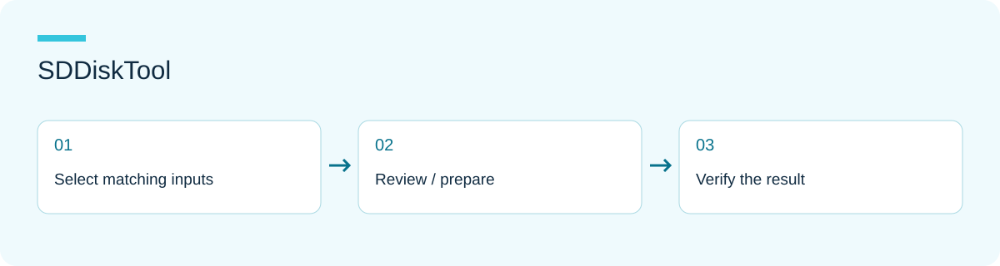





SDDiskTool creates Rockchip removable media for different purposes. Its interface offers Upgrade Firmware, PCBA Test and SD Boot. These are not equivalent to writing an arbitrary Linux distribution disk image.

## Select the intended result

SD Boot prepares media used to boot a supported image. Upgrade media can run a firmware-update path that writes the board's storage. PCBA media belongs to a test workflow. Verify what the target's bootloader will do before inserting a prepared card; creating the card and updating the board are separate stages.

## Preparation sequence

1. Use a removable card whose contents can be erased. Identify it by capacity and device identity, not just a drive letter.
2. In the tool, select the removable disk, function mode and matching firmware in that order, as the interface labels describe.
3. Supply any required SDK files. The package reports explicit errors for missing `SDBoot.bin` and `sd_boot_config.config`.
4. Review the target again before Create; the source confirmation states that data on the selected disk will be lost.
5. After success, eject safely and follow the board's documented boot priority and power-on sequence.

## Troubleshooting and restore

No removable disk, inability to lock/dismount the volume, missing firmware and formatting failures are separate stages. Close applications holding the volume and confirm the selected device before retrying. Restore is also destructive to the card; it is not recovery of the board's previous data.

## Version and acceptance

The 1.78 notes fix an address-access error when writing backup GPT. Earlier notes address grow partitions and large firmware handling. Do not infer universal compatibility from those fixes. Verify the intended boot/update result and preserve a known-good recovery method. A successfully created card does not prove that the supplied firmware matches a particular ArmSoM board.

## Applicability and verification

This is a documentation-based workflow for the supplied tool collection. Confirm the exact board, SoC, carrier, SDK/BSP and host architecture before using it. No flashing, provisioning, register writes or hardware tests were performed. Package availability does not establish support for every ArmSoM product.

## Download, versions and SHA-256

Download the matching archive, verify the hash, and extract the entire directory. For the split Linux PinDebug archive, follow the linked reconstruction instructions; the hash below is for the reconstructed file.

| Host / version | Package |
|---|---|
| Windows / 1.78 | [SDDiskTool_v1.78.zip](https://raw.githubusercontent.com/ArmSoM/rockchip-tools/main/downloads/sd-disk-tool/SDDiskTool_v1.78.zip) |

**SDDiskTool_v1.78.zip — SHA-256**

```text
4b4a8349c102b2b791ce2ae6f179c94aa81962e788df7232b603e9bb76549d08
```

[GitHub · catalog.json](https://github.com/ArmSoM/rockchip-tools/blob/main/catalog.json) · [SHA256SUMS](https://github.com/ArmSoM/rockchip-tools/blob/main/SHA256SUMS)

## Source documents and figures

- SDDiskTool_v1.78.zip: English.ini and revision.txt; Rockchip SD-card boot guide

## Continue with the related workflow

- [Rockchip SD Card Boot: Upgrade, Boot, Repair and BCB Guide](/articles/087-rockchip-sd-card-boot/)
- [RKDevTool download and workflow: Loader, partitions and update.img](/articles/rockchip-tool-rkdevtool/)
- [Rockchip tool download and workflow index](/articles/rockchip-tools-download-guide/)

## Find the correct ArmSoM board documentation

For board and carrier requirements, use the product manual first. The links below are platform references, not a statement that this archived tool has been validated on these products.

[ArmSoM Docs](https://docs.armsom.org/) · [Sige7](https://www.armsom.org/sige7) / [Docs](https://docs.armsom.org/armsom-sige7) · [CM5](https://www.armsom.org/cm5) / [Docs](https://docs.armsom.org/armsom-cm5)


