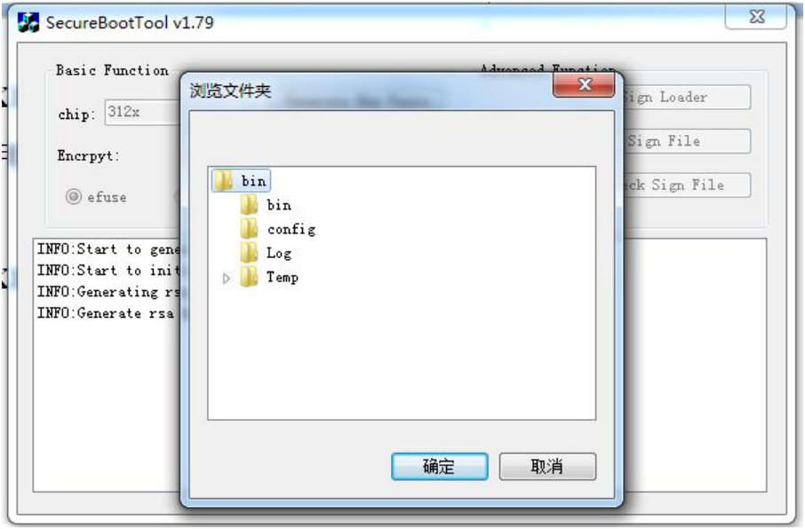
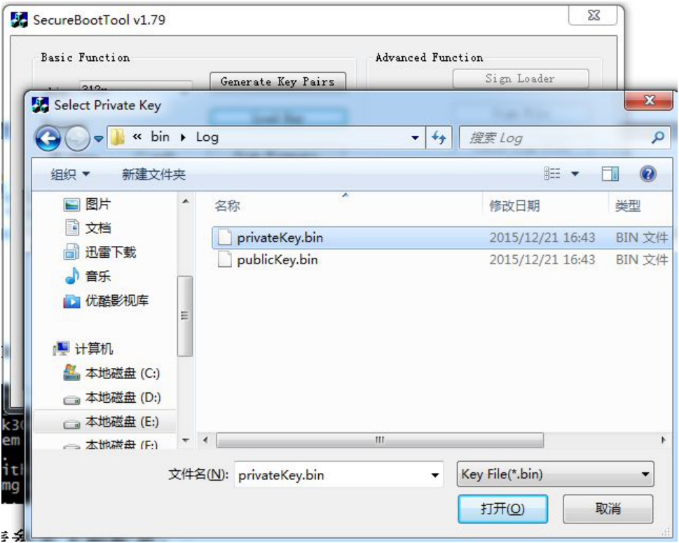
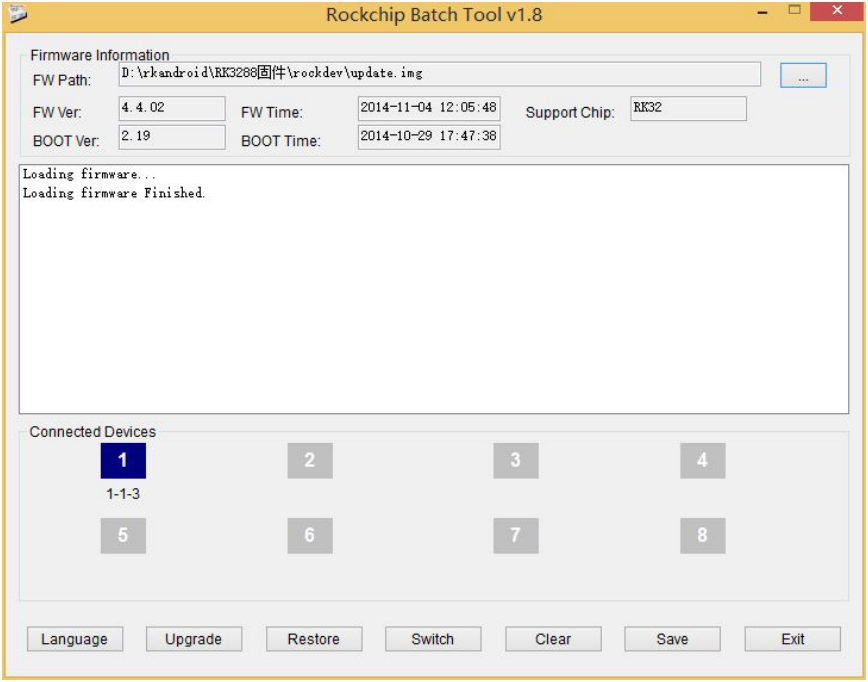
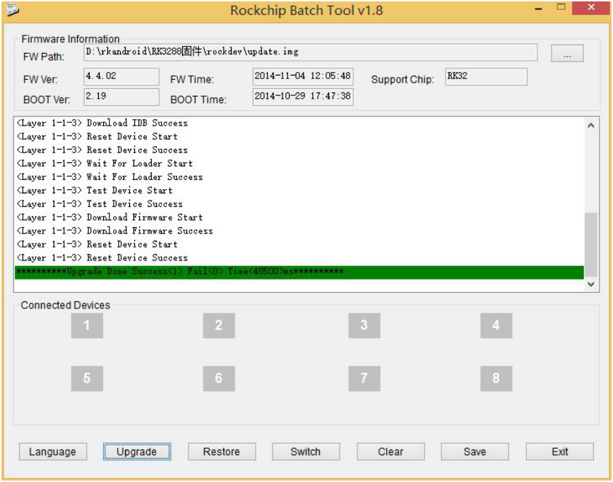




## Historical Secure Boot application note V1.2

This 2016 manual lists RK3126, RK3128, RK3228, RK3288 and RK3368; it is not a generic RK35xx configuration. Features include Secure Boot ROM, SHA256/SHA160, RSA2048/RSA1024, OTP verification of RSA public keys and Secure Boot Rockusb upgrades. Minimum versions: Miniloader 2.19, U-Boot 2.17, EfuseTool 1.35, SecureBootTool 1.75 and RKBatchTool 1.8.

### 1. Trust chain and signing configuration

The original diagram below shows verification across ROM, boot images and later stages. In the Windows tool choose the chip, using others for chips preceding 3188, then eFuse-level or software mode. The source lists 3128, 3288, 3228 and 3368 for eFuse-level support, excluding other older chips. The UI uses the word encryption; do not confuse signature verification with firmware confidentiality.

3188 and earlier use loaderex=false and 1024-bit keys. For 3128/3288/3228/3368 use the following with the minimum Loader/U-Boot versions above. Key accepts only 1024 or 2048.

```ini
[Options]
Loaderex=true
Key=2048
```

<figure style="margin:1.6rem 0">
<a href="/assets/rockchip-tools/manuals/094883c784c1/p05-f01.png" target="_blank" rel="noopener" aria-label="View full-size image"></a>
<figcaption style="margin-top:.6rem;font-size:.9em;line-height:1.55"><strong>Figure 1: Boot-image signing and verification flow</strong></figcaption>
</figure>

<figure style="margin:1.6rem 0">
<a href="/assets/rockchip-tools/manuals/094883c784c1/p06-f01.png" target="_blank" rel="noopener" aria-label="View full-size image"></a>
<figcaption style="margin-top:.6rem;font-size:.9em;line-height:1.55"><strong>Figure 2: SecureBootTool main window</strong></figcaption>
</figure>

<figure style="margin:1.6rem 0">
<a href="/assets/rockchip-tools/manuals/094883c784c1/p07-f01.png" target="_blank" rel="noopener" aria-label="View full-size image"></a>
<figcaption style="margin-top:.6rem;font-size:.9em;line-height:1.55"><strong>Figure 3: Select the target chip</strong></figcaption>
</figure>

<figure style="margin:1.6rem 0">
<a href="/assets/rockchip-tools/manuals/094883c784c1/p07-f02.png" target="_blank" rel="noopener" aria-label="View full-size image"></a>
<figcaption style="margin-top:.6rem;font-size:.9em;line-height:1.55"><strong>Figure 4: Select eFuse or software mode</strong></figcaption>
</figure>

### 2. Generate, save and load RSA keys

The source requires one key pair per product design, reused for later firmware and backed up separately. Generate, confirm and save, then load it from that location. OpenSSL `.pem` RSA2048 keys are supported. Losing keys can prevent future signed upgrades and recovery. The screenshots demonstrate workflow, not a production key-management system.

<figure style="margin:1.6rem 0">
<a href="/assets/rockchip-tools/manuals/094883c784c1/p09-f01.png" target="_blank" rel="noopener" aria-label="View full-size image"></a>
<figcaption style="margin-top:.6rem;font-size:.9em;line-height:1.55"><strong>Figure 5: Confirm saving the generated key pair</strong></figcaption>
</figure>

<figure style="margin:1.6rem 0">
<a href="/assets/rockchip-tools/manuals/094883c784c1/p10-f01.png" target="_blank" rel="noopener" aria-label="View full-size image"></a>
<figcaption style="margin-top:.6rem;font-size:.9em;line-height:1.55"><strong>Figure 6: Choose the key storage directory</strong></figcaption>
</figure>

<figure style="margin:1.6rem 0">
<a href="/assets/rockchip-tools/manuals/094883c784c1/p11-f01.png" target="_blank" rel="noopener" aria-label="View full-size image"></a>
<figcaption style="margin-top:.6rem;font-size:.9em;line-height:1.55"><strong>Figure 7: Load the saved private-key file</strong></figcaption>
</figure>

### 3. Prepare and sign firmware

Both boot.img and recovery.img must include the kernel. The source terminal screenshot demonstrates the following for RK3288 Android 4.4; NAND firmware also needs miniloader and uboot.img. Load the saved RSA key, select and sign the firmware, and retain the success result. The original repeats section number 3.5; the workflow is ordered here.

```text
./mkimage.sh ota
TARGET_PRODUCT=rk3288
TARGET_HARDWARE=rk30board
system filesystem is ext4
make ota images...
create boot.img with kernel... done.
create recovery.img with kernel... done.
create misc.img.... done.
```

<figure style="margin:1.6rem 0">
<a href="/assets/rockchip-tools/manuals/094883c784c1/p12-f01.png" target="_blank" rel="noopener" aria-label="View full-size image"></a>
<figcaption style="margin-top:.6rem;font-size:.9em;line-height:1.55"><strong>Figure 8: Build boot and recovery images containing the kernel</strong></figcaption>
</figure>

<figure style="margin:1.6rem 0">
<a href="/assets/rockchip-tools/manuals/094883c784c1/p07-f03.png" target="_blank" rel="noopener" aria-label="View full-size image"></a>
<figcaption style="margin-top:.6rem;font-size:.9em;line-height:1.55"><strong>Figure 9: Start signing with Sign Firmware</strong></figcaption>
</figure>

<figure style="margin:1.6rem 0">
<a href="/assets/rockchip-tools/manuals/094883c784c1/p13-f01.png" target="_blank" rel="noopener" aria-label="View full-size image"></a>
<figcaption style="margin-top:.6rem;font-size:.9em;line-height:1.55"><strong>Figure 10: Select the firmware to sign</strong></figcaption>
</figure>

<figure style="margin:1.6rem 0">
<a href="/assets/rockchip-tools/manuals/094883c784c1/p14-f01.png" target="_blank" rel="noopener" aria-label="View full-size image"></a>
<figcaption style="margin-top:.6rem;font-size:.9em;line-height:1.55"><strong>Figure 11: Firmware signing success prompt</strong></figcaption>
</figure>

### 4. eFuse programming

Open the eFuse tool, select signed production firmware and press Start. A blank device powers up over USB in `maskromrockusb`, triggering automatic programming; multiple devices are supported. RK312X needs a fixture with separate eFuse power, whereas RK3288 PCBA provides software-controlled power. Before a batch, program one device, upgrade complete signed firmware and verify all functions. eFuse is irreversible provisioning, not a procedure to trial casually on a normal board.

<figure style="margin:1.6rem 0">
<a href="/assets/rockchip-tools/manuals/094883c784c1/p15-f01.png" target="_blank" rel="noopener" aria-label="View full-size image"></a>
<figcaption style="margin-top:.6rem;font-size:.9em;line-height:1.55"><strong>Figure 12: Open the eFuse tool</strong></figcaption>
</figure>

<figure style="margin:1.6rem 0">
<a href="/assets/rockchip-tools/manuals/094883c784c1/p16-f01.png" target="_blank" rel="noopener" aria-label="View full-size image"></a>
<figcaption style="margin-top:.6rem;font-size:.9em;line-height:1.55"><strong>Figure 13: Select the signed production firmware</strong></figcaption>
</figure>

<figure style="margin:1.6rem 0">
<a href="/assets/rockchip-tools/manuals/094883c784c1/p17-f01.png" target="_blank" rel="noopener" aria-label="View full-size image"></a>
<figcaption style="margin-top:.6rem;font-size:.9em;line-height:1.55"><strong>Figure 14: Start the tool and wait for the device</strong></figcaption>
</figure>

<figure style="margin:1.6rem 0">
<a href="/assets/rockchip-tools/manuals/094883c784c1/p18-f01.png" target="_blank" rel="noopener" aria-label="View full-size image"></a>
<figcaption style="margin-top:.6rem;font-size:.9em;line-height:1.55"><strong>Figure 15: Inspect the eFuse programming result</strong></figcaption>
</figure>

### 5. Upgrade and verify

Upgrade signed firmware with the matching production tool. The source states that Secure Boot is not enabled without eFuse programming. Its negative test writes unsigned firmware: boot should fail, remain in `maskromrockusb`, and report a tool error after Loader upgrade. Original screenshots follow; they are not ArmSoM measurements.

<figure style="margin:1.6rem 0">
<a href="/assets/rockchip-tools/manuals/094883c784c1/p20-f01.png" target="_blank" rel="noopener" aria-label="View full-size image"></a>
<figcaption style="margin-top:.6rem;font-size:.9em;line-height:1.55"><strong>Figure 16: Load signed firmware in the batch tool</strong></figcaption>
</figure>

<figure style="margin:1.6rem 0">
<a href="/assets/rockchip-tools/manuals/094883c784c1/p21-f01.png" target="_blank" rel="noopener" aria-label="View full-size image"></a>
<figcaption style="margin-top:.6rem;font-size:.9em;line-height:1.55"><strong>Figure 17: Successful signed-firmware upgrade</strong></figcaption>
</figure>

<figure style="margin:1.6rem 0">
<a href="/assets/rockchip-tools/manuals/094883c784c1/p22-f01.png" target="_blank" rel="noopener" aria-label="View full-size image"></a>
<figcaption style="margin-top:.6rem;font-size:.9em;line-height:1.55"><strong>Figure 18: Negative verification with unsigned firmware</strong></figcaption>
</figure>

### 6. Common errors

For eFuse programming errors check power and whether the device has already been provisioned. Do not troubleshoot by repeatedly writing; retain keys, firmware version, target chip and operation records and consult the matching chip documentation.

## Applicability and verification

This is a documentation-based workflow for the supplied tool collection. Confirm the exact board, SoC, carrier, SDK/BSP and host architecture before using it. No flashing, provisioning, register writes or hardware tests were performed. Package availability does not establish support for every ArmSoM product.

## GitHub tool directory, versions and SHA-256

Open the matching GitHub directory, select the required host/version, then verify the file hash and extract the full directory. Links below open repository directories.

[Open the tool directory on GitHub](https://github.com/ArmSoM/rockchip-tools/tree/main/downloads/secureboot-tool)

| Platform / version | File | SHA-256 |
|---|---|---|
| Host to verify / 1.85 | `SecureBootTool_v1.85_foruser.zip` | `d241ccc7503a3202c68a036f51cdd7f5d2db2a7594eb749ec19e2ffb2c67681a` |

[GitHub · catalog.json](https://github.com/ArmSoM/rockchip-tools/blob/main/catalog.json) · [SHA256SUMS](https://github.com/ArmSoM/rockchip-tools/blob/main/SHA256SUMS)

## Source documents and figures

- Rockchip Secure Boot Application Note_v1.2_20160202.pdf

## Continue with the related workflow

- [Complete Rockchip Secure Boot Application Guide: Signing, eFuse, OTP and Verification](/articles/105-rockchip-secure-boot/)
- [Rockchip Linux Secure Boot Developer Guide](/articles/203-rockchip-linux-secure-boot/)
- [rk_sign_tool and sign_tool: prepare and verify signed Rockchip firmware](/articles/rockchip-tool-rk-sign-tool/)
- [EfuseTool 1.42: prepare a traceable Secure Boot provisioning station](/articles/rockchip-tool-efuse-tool/)
- [Rockchip tool download and workflow index](/articles/rockchip-tools-download-guide/)

## Find the correct ArmSoM board documentation

For board and carrier requirements, use the product manual first. The links below are platform references, not a statement that this archived tool has been validated on these products.

[ArmSoM Docs](https://docs.armsom.org/) · [Sige7](https://www.armsom.org/sige7) / [Docs](https://docs.armsom.org/armsom-sige7) · [CM5](https://www.armsom.org/cm5) / [Docs](https://docs.armsom.org/armsom-cm5)


