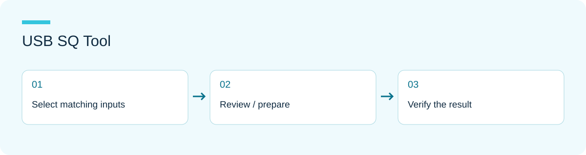



**Download temporarily withheld.** Windows Defender reported `Trojan:Win32/Pomal!rfn` for the supplied USB SQ 1.5 executable and quarantined it; the record says it did not execute. Vendor verification is pending. Do not disable protection or retrieve the historical Git package to run it. [Review status](https://github.com/ArmSoM/rockchip-tools/blob/main/SECURITY-REVIEW.md). The guide and PDF remain available for reference; the hash below identifies the withheld package, not an approved download.



USB SQ Tool generates platform-specific test commands, register settings and reference PHY-driver code. It helps investigate signal-related enumeration failures and disconnects, but it does not turn a poor cable or board layout into a validated design.

## Measure before tuning

Check cable quality, trace impedance, connector, power and the correct port first. Obtain an eye-diagram report with the appropriate test equipment. Record the failing condition and original PHY settings so a change can be compared with a real baseline.

## Follow the platform page

1. Select the exact supported SoC and USB port. USB2.0 and USB3.1 support lists differ.
2. Follow the page's adjustment order. Change one relevant parameter, not every value at once.
3. Where the page requests the initial register value, read the actual board and enter it. For the RK3568 example, missing high-word write-enable bits make this important to preserve unrelated bits.
4. Confirm the selection to generate the I/O command and Code Output. Review the result against the matched BSP before execution.
5. Measure again; retain only changes that solve the observed problem without creating regressions.

## Understand the controls

Pre-emphasis, eye height, slew rate and ODT influence transmit behavior. Squelch concerns receiver thresholds; host disconnect and B-session-valid settings address different detection paths. A larger numerical setting is not necessarily better. Do not copy another SoC's register address or assume its default voltage is identical.

## Integrate and re-test

Generated code is a reference for the relevant PHY driver, not an automatically applicable patch. Rebuild the matched kernel, then test boot, hot-plug, required speeds and actual peripherals, retaining eye-diagram evidence.

This download is tool 1.5 with manual V1.4.0. The existing full Blog reference uses V1.8.0 and includes additional platform coverage. Keep those scopes separate; neither download nor this article establishes compliance certification.

## Applicability and verification

This is a documentation-based workflow for the supplied tool collection. Confirm the exact board, SoC, carrier, SDK/BSP and host architecture before using it. No flashing, provisioning, register writes or hardware tests were performed. Package availability does not establish support for every ArmSoM product.

## Download, versions and SHA-256

Download the matching archive, verify the hash, and extract the entire directory. For the split Linux PinDebug archive, follow the linked reconstruction instructions; the hash below is for the reconstructed file.

| Host / version | Package |
|---|---|
| Windows / 1.5 | [Download withheld — review status](https://github.com/ArmSoM/rockchip-tools/blob/main/SECURITY-REVIEW.md) |

**Rockchip_USB_SQ_Tool_V1.5.7z — SHA-256**

```text
9b2ca5e6773bcb88e2bd73c57044ca16c1f2e16d81b1f010569724cb66550b37
```

[GitHub · catalog.json](https://github.com/ArmSoM/rockchip-tools/blob/main/catalog.json) · [SHA256SUMS](https://github.com/ArmSoM/rockchip-tools/blob/main/SHA256SUMS)

## Source documents and figures

- Rockchip_Introduction_USB_SQ_Tool_CN_V1.4.0.pdf, bundled in tool 1.5; existing article based on V1.8.0 is separate
- [Original PDF: Rockchip_Introduction_USB_SQ_Tool_CN_V1.4.0.pdf](https://raw.githubusercontent.com/ArmSoM/rockchip-tools/main/manuals/0ec9ef065fdc.pdf)

Figures are extracted from the identified original PDF. If only a Chinese original exists, its interface text is retained; captions are localized. Screenshots are historical examples, not current ArmSoM test results.


Rockchip_Introduction_USB_SQ_Tool_CN_V1.4.0.pdf · p. 5

## Continue with the related workflow

- [Rockchip USB SQ Tool: USB2.0/USB3.1 PHY Tuning and Code Integration](/articles/165-rockchip-usb-sq-tool/)
- [PinDebug: inspect Rockchip IOMUX, GPIO and voltage domains](/articles/rockchip-tool-pin-debug/)
- [Rockchip tool download and workflow index](/articles/rockchip-tools-download-guide/)

## Find the correct ArmSoM board documentation

For board and carrier requirements, use the product manual first. The links below are platform references, not a statement that this archived tool has been validated on these products.

[ArmSoM Docs](https://docs.armsom.org/) · [Sige7](https://www.armsom.org/sige7) / [Docs](https://docs.armsom.org/armsom-sige7) · [CM5](https://www.armsom.org/cm5) / [Docs](https://docs.armsom.org/armsom-cm5)


