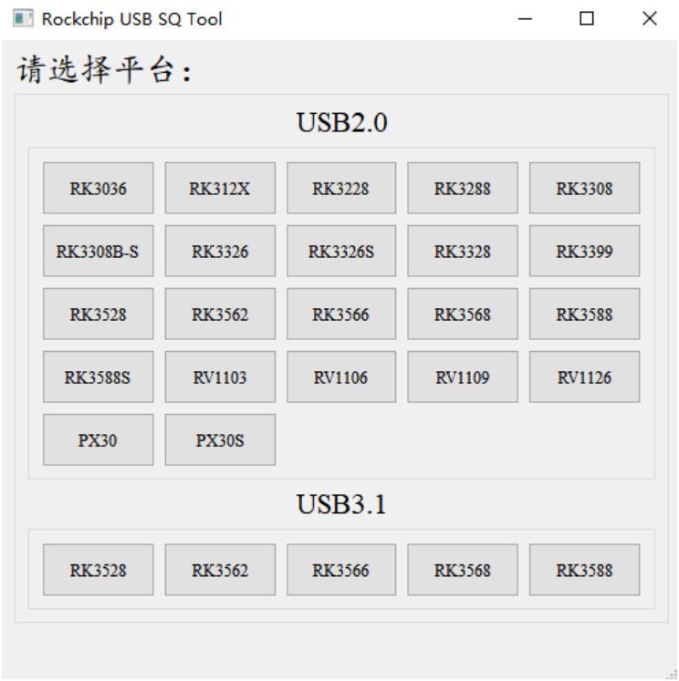
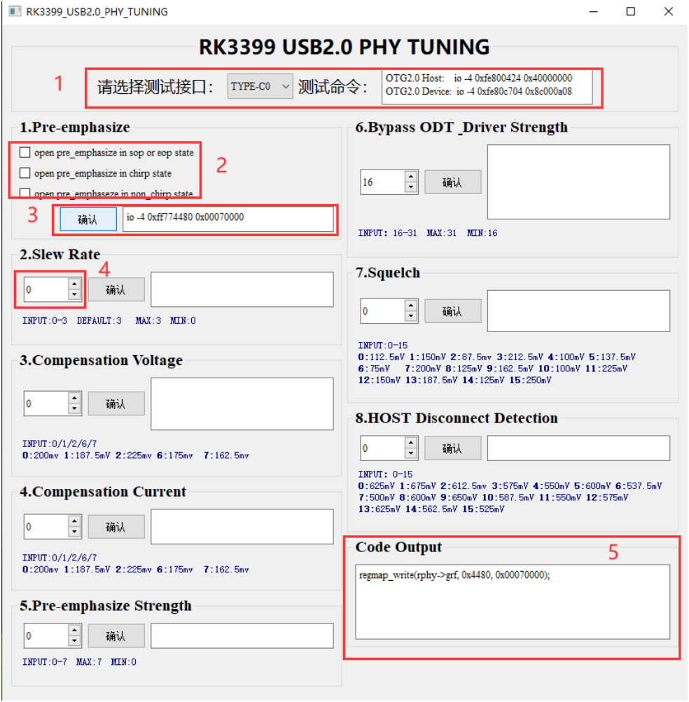
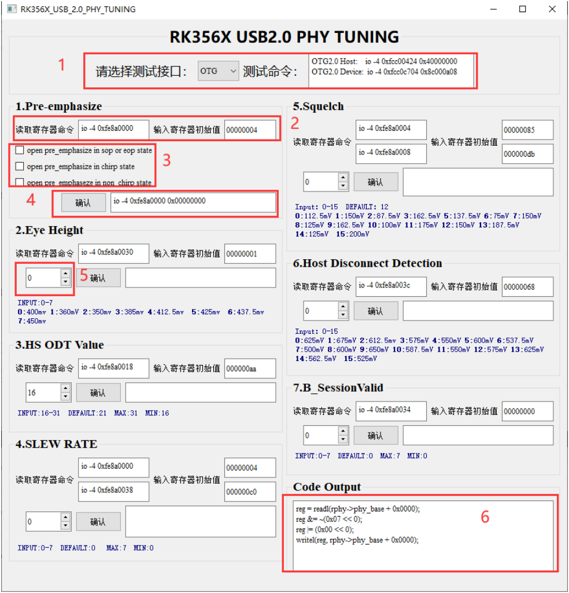
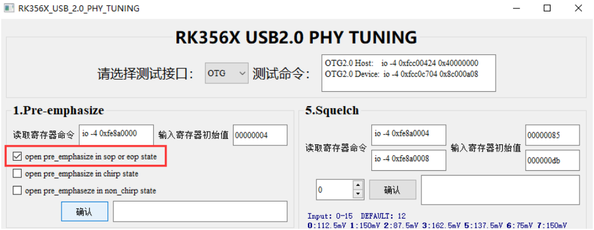
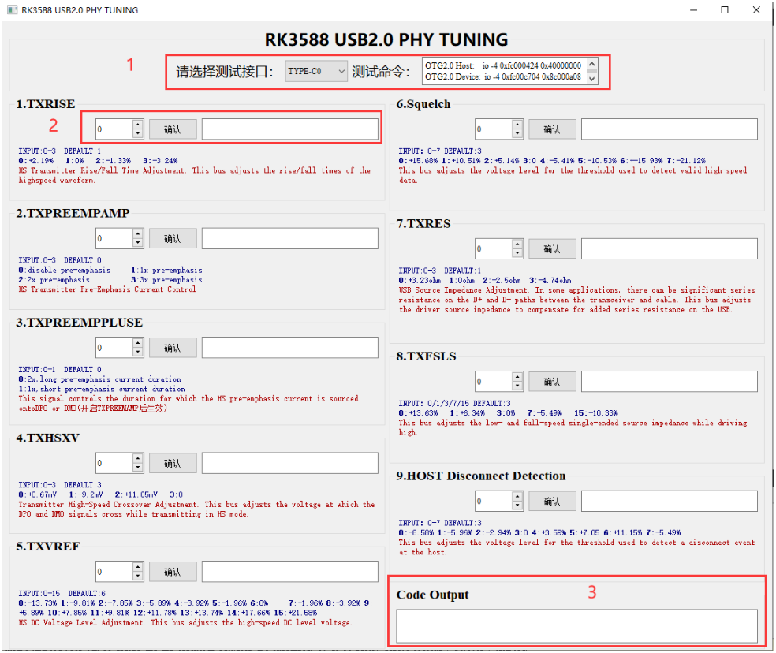
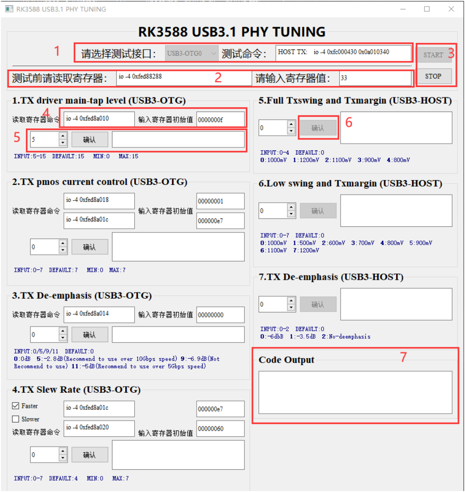
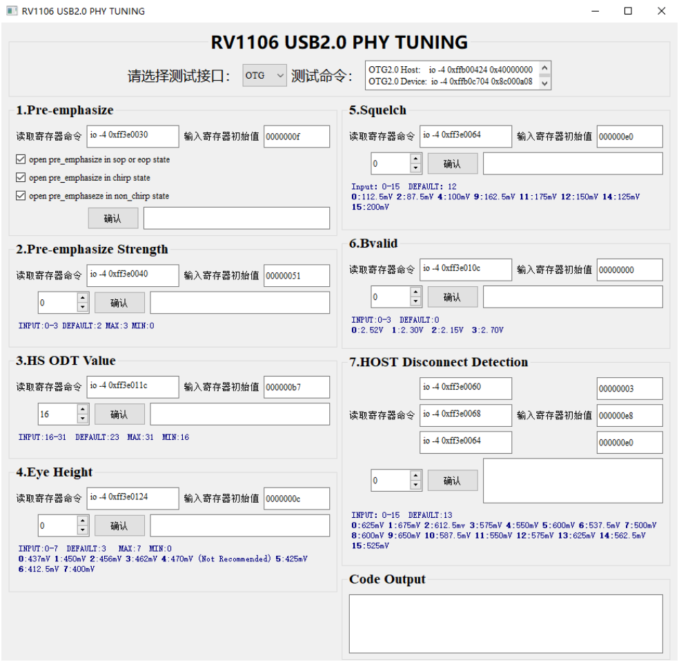
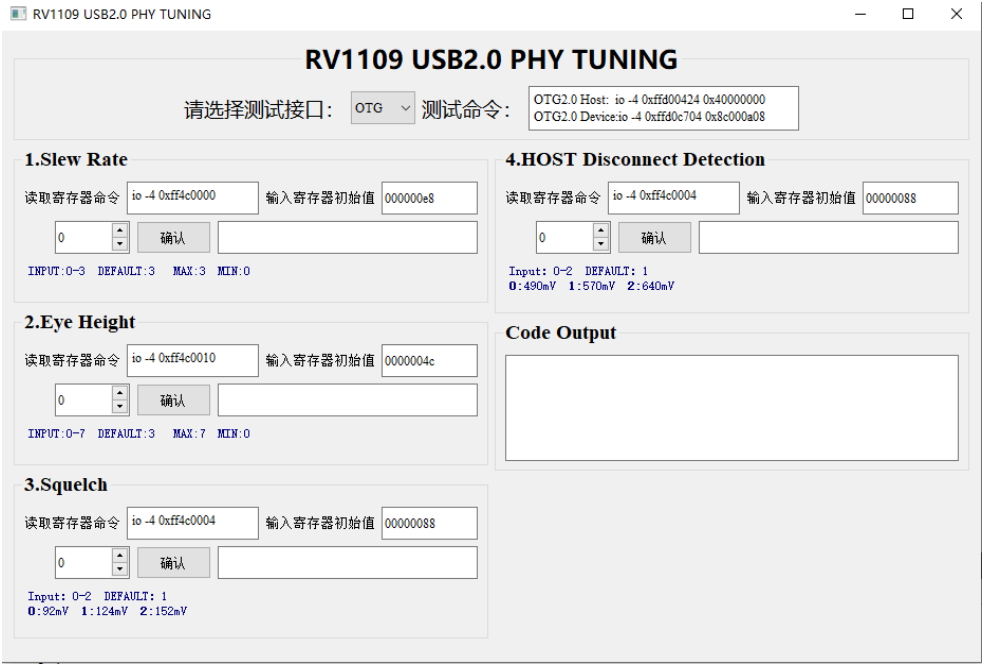
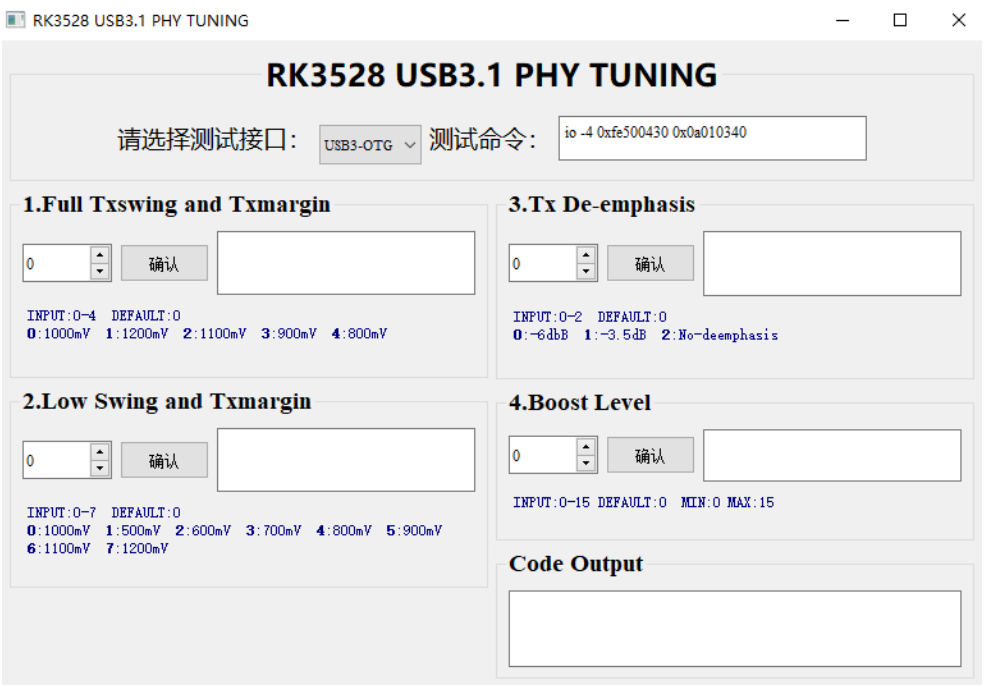




## Complete USB SQ Tool V1.4.0 technical reference

This section follows the bundled V1.4.0 manual. Matching technical sections reuse our proofread V1.8.0 translations, filtered to the older scope; newer platform lists do not establish support in an older tool. The USB2.0 main list contains RK3588/RK3588S, RK3568/RK3566/RK3562/RK3528, RK3399, PX30/PX30S, RK3308/RK3308B-S, RK3326/RK3326S, RK3228, RK3288, RK3328 and RV1103/RV1106. RK3328 covers OTG/HOST but excludes USB3 U2PHY. USB3.1 lists RK3528/RK3562/RK3566/RK3568/RK3588. Later source sections also discuss RK3036/RK312X and RV1109/RV1126, a discrepancy retained here. Follow the Windows interface sequence: platform, port, test command, parameters, confirmation and Code Output. Improve cable, impedance and power first, then tune gradually against an eye diagram; larger values are not inherently better.

The source RK3562 example ends with `]`; it is retained and is not directly compilable. All ellipses are insertion-point sketches, not complete patches. All figures are the original Chinese V1.4.0 figures.

<figure style="margin:1.6rem 0">
<a href="/assets/rockchip-tools/manuals/0ec9ef065fdc/p04-f01.png" target="_blank" rel="noopener" aria-label="View full-size image"></a>
<figcaption style="margin-top:.6rem;font-size:.9em;line-height:1.55"><strong>Figure 1: Select the USB platform and PHY type</strong></figcaption>
</figure>

### 1. RK3399 USB2.0 Tuning interface

RK3399 USB2.0 supports TYPE-C0, TYPE-C1, HOST0 and HOST1. Tuning steps:

<figure style="margin:1.6rem 0">
<a href="/assets/rockchip-tools/manuals/0ec9ef065fdc/p05-f01.png" target="_blank" rel="noopener" aria-label="View full-size image"></a>
<figcaption style="margin-top:.6rem;font-size:.9em;line-height:1.55"><strong>Figure 2: RK3399 USB2.0 PHY tuning interface</strong></figcaption>
</figure>

1. Select the test interface on the left of red box 1; the right-hand field automatically generates its SQ test command.

2. Select parameters in red box 2. Pre-emphasize is selected using checkboxes; other items use controls like box 4, accepting typed values or up/down buttons. Each item shows its valid range and description.

3. Choose the parameters and press Confirm in red box 3. The adjacent field generates io commands, and Code Output in box 5 generates reference code.

Table 3.  RK3399 USB2.0 signal-tuning parameters

| Parameter | Description |
| --- | --- |
| Pre-emphasize | Adjust HS Tx pre-emphasis |
| Slew Rate | Adjust HS Tx eye slew rate |
| Compensation Voltage | Adjust HS Tx voltage calibration; raising it increases eye height |
| Compensation Current | Adjust HS Tx current calibration; raising it increases eye height |
| Pre-emphasize Strength | Adjust HS Tx pre-emphasis strength |
| Bypass ODT &amp; Driver Strength | Bypass automatic resistance adjustment in the compensation circuit to adjust eye height |
| Squelch | Adjust HS Rx squelch threshold |
| HOST Disconnect Detection | Adjust HS disconnect threshold; HOST only |

### 2. RK3568 USB2.0 Tuning interface

RK3568 USB2.0 supports OTG, HOST1, HOST2 and HOST3. Tuning steps:

<figure style="margin:1.6rem 0">
<a href="/assets/rockchip-tools/manuals/0ec9ef065fdc/p07-f01.png" target="_blank" rel="noopener" aria-label="View full-size image"></a>
<figcaption style="margin-top:.6rem;font-size:.9em;line-height:1.55"><strong>Figure 3: RK3568 USB2.0 PHY parameters and code output</strong></figcaption>
</figure>

1. Select the test interface on the left of red box 1; the right-hand field automatically generates its SQ test command.

2. RK3568 USB2.0 PHY registers lack upper-16-bit write_enable bits. To avoid changing unrelated or untuned bits, read the initial register value using the command in red box 2 and enter it in the initial-value field to its right.

3. Select parameters in red box 3. Pre-emphasize uses checkboxes; other items use controls like box 5, with manual entry or up/down buttons. Each item supplies the range and description.

4. Press Confirm in red box 4. The adjacent field generates io commands and Code Output in box 6 generates reference code. Important: the initial-value field contains defaults. If not manually replaced, those defaults may affect tuning. Always read the current register value and enter it before testing.

| Parameter | Description |
| --- | --- |
| Pre-emphasize | Adjust HS Tx pre-emphasis |
| HS Eye Height | Adjust HS Tx eye height |
| HS ODT Value | Adjust the 45Ω ODT resistance. Higher input lowers resistance and increases eye height, but also increases FS/LS slew rate |
| Slew Rate | Adjust HS eye slew rate; effect is small |
| Squelch | Adjust HS Rx squelch threshold |
| HOST Disconnect Detection | Adjust disconnect threshold; HOST only |
| B_Session Valid | Adjust VBUS DET threshold; Device only |

RK3568 USB2.0 squelch: a long, poor-quality or high-impedance cable may prevent enumeration of a High-speed device. The PHY noise threshold is typically 150mV. Cable attenuation can lower valid signals below 150mV, causing them to be treated as noise. Squelch tuning can moderately lower the threshold, typically to 125mV or 112.5mV.

RK3568 disconnect threshold: use Host Disconnect Detection tuning. Typical Rockchip Host attachment logs follow:

```text
[ 1204.092638] usb 1-1: new high-speed USB device number 3 using ehci-platform
[ 1204.280373] usb 1-1: New USB device found, idVendor=058f, idProduct=6387, bcdDevice= 1.04
[ 1204.280449] usb 1-1: New USB device strings: Mfr=1, Product=2, SerialNumber=3
[ 1204.280476] usb 1-1: Product: Mass Storage
[ 1204.280498] usb 1-1: SerialNumber: FA45A19C
```

Typical Rockchip Host disconnection log:

```text
[ 985.341233] usb 1-1: USB disconnect, device number 2
```

1) Unplugging a USB2.0 device is not detected. If removal produces no disconnect log, try the following improvements:

<figure style="margin:1.6rem 0">
<a href="/assets/rockchip-tools/manuals/0ec9ef065fdc/p09-f01.png" target="_blank" rel="noopener" aria-label="View full-size image"></a>
<figcaption style="margin-top:.6rem;font-size:.9em;line-height:1.55"><strong>Figure 4: EOP pre-emphasis option</strong></figcaption>
</figure>

1. Enable EOP pre-emphasis, disabled by default in the SDK, as shown in Figure 4.

2. Reduce the Host disconnect threshold. Some Rockchip chips have no EOP adjustment: skip step 1 according to the actual tool interface. Otherwise perform step 2 in addition to step 1 only if step 1 gives no clear improvement. Excessively reducing the threshold can cause spontaneous disconnections during normal use; assess this risk.

2) Unexpected USB2.0 disconnection during normal operation: try increasing the Host disconnect threshold. Not every disconnect is threshold-related; device faults or hardware conditions are often responsible, so do not tune blindly. EOP pre-emphasis is already off by default in the SDK; no extra disabling write is needed. Excessive threshold increases may prevent unplug detection.

RK356X B_Sessionvalid tuning addresses a PC failing to recognize a USB Device (ADB/MTP) or losing it after detection. Try lowering the voltage decision threshold: default 3'b000; recommended source settings are 3'b111 (7) or 3'b101 (5).

Three main hardware causes of Device connection failure: low VBUS (below 4.7V commonly causes problems); excessive USB_AVDD1V0 ripple or raising it to 1.2V, preventing valid Bvalid detection; excessive Logic voltage ripple, disrupting the controller.

### 3. RK3588 USB2.0 Tuning interface

RK3588 USB2.0 supports TYPE-C0, TYPE-C1, USB2.0 HOST0 and USB2.0 HOST1. Steps:

<figure style="margin:1.6rem 0">
<a href="/assets/rockchip-tools/manuals/0ec9ef065fdc/p10-f01.png" target="_blank" rel="noopener" aria-label="View full-size image"></a>
<figcaption style="margin-top:.6rem;font-size:.9em;line-height:1.55"><strong>Figure 5: RK3588 USB2.0 PHY tuning interface</strong></figcaption>
</figure>

1. Select the test interface on the left of red box 1; the right-hand field automatically generates its SQ test command.

2. Select parameters in red box 2 by typing or using up/down buttons. Each item shows its range and description.

3. Choose the parameters and press Confirm in red box 2. The adjacent field generates io commands, and Code Output in box 3 generates reference code.

Table 5.  RK3588 USB2.0  signal-tuning parameters

| Parameter | Description |
| --- | --- |
| TXRISE | Adjust HS Tx slew rate to change rise/fall times |
| TXPREEMPAMP | Adjust HS Tx pre-emphasis current |
| TXPREEMPPLUSE | Adjust pre-emphasis-current duty cycle; effective only with TXPREEMPAMP TUNE enabled |
| TXHSXV | Adjust HS Tx DP/DM crossing voltage; no obvious change |
| TXVREF | Adjust HS Tx DC voltage; visibly changes eye amplitude |
| TXRES | Adjust HS Tx impedance; changes amplitude and rise/fall times |
| TXFSLS | Adjust FS/LS Tx impedance; changes amplitude, rise/fall times, crossing voltage and duty cycle |
| HOST DISCONNECT DETECTION | Adjust disconnect threshold; HOST only |

### 4. RK3588 USB3.1 Tuning interface

RK3588 USB3.1 tuning covers USB3-OTG0 (USB3&amp;Dp CombPhy0), USB3-OTG1 (USB3&amp;Dp CombPhy1) and USB3-HOST2 (USB3&amp;PCIE&amp;SATA CombPhy). Steps:

<figure style="margin:1.6rem 0">
<a href="/assets/rockchip-tools/manuals/0ec9ef065fdc/p12-f01.png" target="_blank" rel="noopener" aria-label="View full-size image"></a>
<figcaption style="margin-top:.6rem;font-size:.9em;line-height:1.55"><strong>Figure 6: RK3588 USB3.1 PHY ports and parameters</strong></figcaption>
</figure>

1. Select the test interface on the left of red box 1; the right-hand field automatically generates its SQ test command.

2. For USB3-OTG0/1, first read the orientation register for CombPhy0/1 using box 2, then enter its value. It must match 0xCx or 0x3x, otherwise an error appears. If reading fails (usually with Type-C), attach a USB cable to the port under test so CombPhy0/1 is active, then read again.

3. For USB3-HOST2 skip box 2 and press START in box 3.

4. After START, USB3-OTG0/1 activates the left-side Confirm buttons in box 5 and disables the right-side USB3-HOST2 buttons in box 6; selecting HOST2 reverses this.

5. RK3588 USB3.1 PHY registers lack upper-16-bit write_enable bits. To avoid changing unrelated or untuned bits, read the initial register value using the command in red box 4 and enter it in the initial-value field to its right.

6. Choose the parameters and press Confirm in red box 5. The adjacent field generates io commands, and Code Output in box 7 generates reference code.

Table 11.  RK3588 USB3.1  signal-tuning parameters

| Parameter | Description |
| --- | --- |
| TX Driver main-tap level(USB3-OTG) | Adjust SS Tx voltage |
| TX Pmos current control(USB3-OTG) | Adjust SS Tx current; use only if voltage tuning is insufficient |
| TX De-emphasis(USB3-OTG) | Adjust SS Tx de-emphasis |
| TX Slew Rate(USB3-OTG) | Adjust SS Tx slew rate |
| Full Txswing and TXmargin(USB3-HOST) | Full swing/Txmargin tuning: TX_SWING and TX_MARGIN[2:0] jointly control Tx output amplitude |
| Low swing and Txmargin(USB3-HOST) | Low swing/Txmargin tuning; same function as Full Tx swing, different levels |
| TX De-emphasis(USB3- HOST) | Configure transmitter de-emphasis level |

### 5. RV1106 USB2.0 Tuning interface

RV1106 USB2.0 supports pre-emphasis, its strength, ODT, eye height, squelch, Bvalid and disconnect thresholds. RV1103 and RV1103B lack a VBUS DET package pin and therefore cannot adjust Bvalid; other options match RV1106.

<figure style="margin:1.6rem 0">
<a href="/assets/rockchip-tools/manuals/0ec9ef065fdc/p14-f01.png" target="_blank" rel="noopener" aria-label="View full-size image"></a>
<figcaption style="margin-top:.6rem;font-size:.9em;line-height:1.55"><strong>Figure 7: RV1106 USB2.0 PHY tuning interface</strong></figcaption>
</figure>

Table 6.  RV1106 USB2.0  signal-tuning parameters

| Parameter | Description |
| --- | --- |
| Pre-emphasize | Adjust HS Tx pre-emphasis; enabled by default |
| Pre-emphasize Strength | Adjust HS Tx pre-emphasis strength; register is effective only when pre-emphasis is enabled |
| HS ODT Value | Adjust 45Ω ODT resistance. Higher input lowers resistance and raises eye height without affecting FS/LS slew rate |
| Eye Height | Adjust HS Tx eye height. Setting 4:470mV also requires chip logic voltage &gt; 850mV |
| Squelch | Adjust HS Rx squelch threshold |
| BValid | Adjust VBUS DET threshold; Device only |
| HOST Disconnect Detection | Adjust disconnect threshold; HOST only |

### 6. RV1109 USB2.0 Tuning interface

RV1109 USB2.0 supports slew rate, eye height, squelch and disconnect threshold. RV1126 has the same options.

<figure style="margin:1.6rem 0">
<a href="/assets/rockchip-tools/manuals/0ec9ef065fdc/p15-f01.png" target="_blank" rel="noopener" aria-label="View full-size image"></a>
<figcaption style="margin-top:.6rem;font-size:.9em;line-height:1.55"><strong>Figure 8: RV1109 USB2.0 PHY tuning interface</strong></figcaption>
</figure>

Table 7.  RV1109 USB2.0  signal-tuning parameters

| Parameter | Description |
| --- | --- |
| Slew Rate | Adjust HS Tx eye slew rate |
| Eye Height | Adjust HS Tx eye height |
| Squelch | Adjust HS Rx squelch threshold |
| HOST Disconnect Detection | Adjust disconnect threshold; HOST only |

### 7. RK3528 USB3.1 Tuning interface

RK3528 USB3.1 supports Full Txswing and Txmargin, Low Swing and Txmargin, Tx De-emphasis and Boost Level. RK3562 and RK3568 share these options.

<figure style="margin:1.6rem 0">
<a href="/assets/rockchip-tools/manuals/0ec9ef065fdc/p16-f01.png" target="_blank" rel="noopener" aria-label="View full-size image"></a>
<figcaption style="margin-top:.6rem;font-size:.9em;line-height:1.55"><strong>Figure 9: RK3528 USB3.1 PHY tuning interface</strong></figcaption>
</figure>

Table 10.  RK3528 USB3.1  signal-tuning parameters

| Parameter | Description |
| --- | --- |
| Full Txswing and TXmargin | Full swing/Txmargin tuning: TX_SWING and TX_MARGIN[2:0] jointly control Tx output amplitude |
| Low swing and Txmargin | Low swing/Txmargin tuning; same function as Full Tx swing, different levels |
| TX De-emphasis | Configure transmitter de-emphasis level |
| Boost Level | Adjust Tx boost level |

### 8. RK3036/RK312X USB2.0 PHY

RK3036 currently supports only kernel 3.10. Add the code to `usb20otg_hw_init()` in `kernel/drivers/usb/dwc_otg_310/usbdev_rk3036.c`.

```text
static void usb20otg_hw_init(void) {
    .../* OTG/Host PHY Tuning Code */
}
```

Add RK312X tuning code in `rk312x_usb2phy_tuning()` in `kernel/drivers/phy/rockchip/phy-rockchip-inno-usb2.c`.

```text
static int rk312x_usb2phy_tuning(struct rockchip_usb2phy *rphy)
{
    .../* OTG/Host PHY Tuning Code */
}
```

### 9. RK3228 USB2.0 PHY

Add RK3228 tuning code in `rk3228_usb2phy_tuning()` in `kernel/drivers/phy/rockchip/phy-rockchip-inno-usb2.c`.

```text
static int rk3228_usb2phy_tuning(struct rockchip_usb2phy *rphy)
{
    .../* OTG/Host PHY Tuning Code */
}
```

### 10. RK3288 USB2.0 PHY

RK3288 has two PHY-driver versions. Select Kernel Version 4.4 for kernel 4.4 and older, or 4.19 for kernel 4.19 and newer. This affects only generated code format, not io commands. For 4.19, append tuning to `rk3288_usb_phy_probe_init()` in `kernel/drivers/phy/rockchip/phy-rockchip-usb.c`. Three USB ports require a register-offset condition before each converted code fragment. OTG code:

```text
if (rk_phy->reg_offset == 0x320) {
    ... /* OTG PHY Tuning Code */
}
```

HOST1 code:

```text
if (rk_phy->reg_offset == 0x334) {
    ... /* HOST1 PHY Tuning Code */
}
```

HOST2 code:

```text
if (rk_phy->reg_offset == 0x348) {
    ... /* HOST2 PHY Tuning Code */
}
```

RK3288 kernel 4.4 driver: `kernel/drivers/usb/dwc_otg_310/usbdev_rk32.c`. Append OTG code to `usb20otg_hw_init()`, HOST1 to `rk_ehci_hw_init()`, and HOST2 to `usb20host_hw_init()`.

### 11. RK3308B_S/RK3308 USB2.0 PHY

For RK3308B_S, add code at the end of the `soc_is_rk3308bs()` branch in `rk3308_usb2phy_tuning()` in `kernel/drivers/phy/rockchip/phy-rockchip-inno-usb2.c`.

```text
if (soc_is_rk3308bs()) {
    ... /* OTG/HOST PHY Tuning Code */
}
```

For RK3308, append code to the else branch in `rk3308_usb2phy_tuning()` in `kernel/drivers/phy/rockchip/phy-rockchip-inno-usb2.c`.

```text
if (soc_is_rk3308bs()) {
    ...
} else {
    .../* OTG/HOST PHY Tuning Code */
}
```

### 12. RK3326S/PX30S/RK3326/PX30/RK3328 USB2.0 PHY

For RK3326S/PX30S, append code to the `soc_is_px30s()` branch of `rk3328_usb2phy_tuning()` in `kernel/drivers/phy/rockchip/phy-rockchip-inno-usb2.c`.

```text
if (soc_is_px30s()) {
    .../* OTG/HOST PHY Tuning Code */
}
```

For RK3326/PX30/RK3328, append code to the else branch of `rk3328_usb2phy_tuning()` in `kernel/drivers/phy/rockchip/phy-rockchip-inno-usb2.c`.

```text
if (soc_is_px30s()) {
    ...
} else {
    .../* OTG/HOST PHY Tuning Code */
}
```

### 13. RK3399 USB2.0 PHY

Add RK3399 USB2.0 tuning before `if (!of_property_read_bool(node, "rockchip,u2phy-tuning"))` in `rk3399_usb2phy_tuning()` in `kernel/drivers/phy/rockchip/phy-rockchip-inno-usb2.c`. TYPE-C0/HOST0 share the PHY at 0xe450; TYPE-C1/HOST1 share 0xe460. Prefix generated code with a register-address condition to distinguish these four ports.

```text
if (rphy->phy_cfg->reg == 0xe450) {
    .../* TYPE-C0/HOST0 PHY Tuning Code */
} else {
    ... /* TYPE-C1/HOST1 PHY Tuning Code */
}
if (!of_property_read_bool(node, "rockchip,u2phy-tuning"))
    return ret;
```

### 14. RK3528 USB2.0 PHY

Add RK3528 USB2.0 tuning code in `rk3528_usb2phy_tuning()` in `kernel/drivers/phy/rockchip/phy-rockchip-inno-usb2.c`.

```text
static int rk3528_usb2phy_tuning(struct rockchip_usb2phy *rphy)
{
    .../* USB2.0 PHY Tuning Code */
}
```

### 15. RK3562 USB2.0 PHY

Add RK3562 USB2.0 tuning code in `rk3562_usb2phy_tuning()` in `kernel/drivers/phy/rockchip/phy-rockchip-inno-usb2.c`.

```text
static int rk3562_usb2phy_tuning(struct rockchip_usb2phy *rphy)
{
    .../* USB2.0 PHY Tuning Code */
]
```

### 16. RK3568/RK3566 USB2.0 PHY

RK3568/RK3566 share code appended to `rk3568_usb2phy_tuning()` in `kernel/drivers/phy/rockchip/phy-rockchip-inno-usb2.c`. RK3568 OTG/HOST1 share base 0xfe8a0000; HOST2/HOST3 share 0xfe8b0000. Use a base-address condition before the generated code. OTG/HOST1:

```text
if (rphy->phy_cfg->reg == 0xfe8a0000) {
    ... /* OTG/Host1 PHY Tuning Code */
}
```

HOST2/HOST3 code:

```text
if (rphy->phy_cfg->reg == 0xfe8b0000) {
    ... /* Host2/Host3 PHY Tuning Code */
}
```

### 17. RK3528/RK3562/RK3566/RK3568 USB3.1 PHY

RK3528, RK3562 and RK3568 USB3.1 code belongs in the corresponding combphy_cfg function in `kernel/drivers/phy/rockchip/phy-rockchip-naneng-combphy.c`. The RK3528 insertion point in `rk3528_combphy_cfg` follows:

```text
case PHY_TYPE_USB3:
    ...
    /* Enable adaptive CTLE for USB3.0 Rx */
    val = readl(priv->mmio + 0x200);
    val &= ~GENMASK(17, 17);
    val |= 0x01;
    writel(val, priv->mmio + 0x200);
    ...
    .../* USB3.1 PHY Tuning Code */
    ...
    param_write(priv->phy_grf, &cfg->pipe_txcomp_sel, false);
    param_write(priv->phy_grf, &cfg->pipe_txelec_sel, false);
    param_write(priv->phy_grf, &cfg->usb_mode_set, true);
    break;
```

RK3562 insertion point in `rk3562_combphy_cfg`:

```text
case PHY_TYPE_USB3:
    /* Set SSC downward spread spectrum */
    val = readl(priv->mmio + (0x1f << 2));
    val &= ~GENMASK(5, 4);
    val |= 0x01 << 4;
    writel(val, priv->mmio + 0x7c);
    ...
    .../* USB3.1 PHY Tuning Code */
    ...
    param_write(priv->phy_grf, &cfg->pipe_sel_usb, true);
    param_write(priv->phy_grf, &cfg->pipe_txcomp_sel, false);
    param_write(priv->phy_grf, &cfg->pipe_txelec_sel, false);
    param_write(priv->phy_grf, &cfg->usb_mode_set, true);
    break;
```

RK3566 and RK3568 share code; insert it at this point in `rk3568_combphy_cfg`:

```text
case PHY_TYPE_USB3:
    ...
    /* Set PLL KVCO to min and set PLL charge pump current to max */
    writel(0xf0, priv->mmio + (0xa << 2));
    ...
    .../* USB3.1 PHY Tuning Code */
    ...
    param_write(priv->phy_grf, &cfg->pipe_sel_usb, true);
    param_write(priv->phy_grf, &cfg->pipe_txcomp_sel, false);
    param_write(priv->phy_grf, &cfg->pipe_txelec_sel, false);
    param_write(priv->phy_grf, &cfg->usb_mode_set, true);
```

### 18. RK3588 USB2.0 PHY

Add RK3588 USB2.0 tuning in `rk3588_usb2phy_tuning()` in `kernel/drivers/phy/rockchip/phy-rockchip-inno-usb2.c`. Distinguish TYPE-C0, TYPE-C1, HOST0 and HOST1 by `rphy->phy_cfg->reg`:

```text
if (rphy->phy_cfg->reg == 0x0000) {
    .../* TYPE-C0 PHY Tuning Code */
} else if (rphy->phy_cfg->reg == 0x4000) {
    .../* TYPE-C1 PHY Tuning Code */
} else if (rphy->phy_cfg->reg == 0x8000) {
    .../* HOST0 PHY Tuning Code */
} else if (rphy->phy_cfg->reg == 0xc000) {
    .../* HOST1 PHY Tuning Code */
}
```

### 19. RK3588 USB3.1 PHY

RK3588 USB3-OTG and USB3-HOST use different insertion points. USB3-OTG currently lacks a dedicated tuning interface like USB2.0, so append its code to `rk3588_udphy_init()` in `kernel/drivers/phy/rockchip/phy-rockchip-usbdp.c`.

```text
ret = rk3588_udphy_status_check(udphy);
if (ret)
    goto assert_phy;
    .../* USB3-OTG PHY Tuning Code */
return 0;
```

RK3588 USB3-HOST tuning belongs in `rk3588_combphy_cfg()` in `kernel/drivers/phy/rockchip/phy-rockchip-naneng-combphy.c`.

```text
case PHY_TYPE_USB3:
    /* Set SSC downward spread spectrum */
    val = readl(priv->mmio + (0x1f << 2));
    val &= ~GENMASK(5, 4);
    val |= 0x01 << 4;
    ...
    .../* USB3-HOST PHY Tuning Code */
    ...
    param_write(priv->phy_grf, &cfg->pipe_txcomp_sel, false);
    param_write(priv->phy_grf, &cfg->pipe_txelec_sel, false);
    param_write(priv->phy_grf, &cfg->usb_mode_set, true);
    break;
```

### 20. RV1103/RV1106 USB2.0 PHY

Add RV1103/RV1106 tuning code in `rv1106_usb2phy_tuning()` in `kernel/drivers/phy/rockchip/phy-rockchip-inno-usb2.c`.

```text
static int rv1106_usb2phy_tuning(struct rockchip_usb2phy *rphy)
{
    .../* OTG PHY Tuning Code */
}
```

### 21. RV1109/RV1126 USB2.0 PHY

Add RV1109/RV1126 tuning code in `rv1126_usb2phy_tuning()` in `kernel/drivers/phy/rockchip/phy-rockchip-naneng-usb2.c`.

```text
static int rv1126_usb2phy_tuning(struct rockchip_usb2phy *rphy)
{
    if (rphy->phy_cfg->reg == 0xff4c0000) {
        .../* OTG PHY Tuning Code */
    }
    if (rphy->phy_cfg->reg == 0xff4c8000) {
        .../* HOST PHY Tuning Code */
    }
}
```

## Applicability and verification

This is a documentation-based workflow for the supplied tool collection. Confirm the exact board, SoC, carrier, SDK/BSP and host architecture before using it. No flashing, provisioning, register writes or hardware tests were performed. Package availability does not establish support for every ArmSoM product.

## Source documents and figures

- Rockchip_Introduction_USB_SQ_Tool_CN_V1.4.0.pdf

## Continue with the related workflow

- [Rockchip USB SQ Tool: USB2.0/USB3.1 PHY Tuning and Code Integration](/articles/165-rockchip-usb-sq-tool/)
- [PinDebug: inspect Rockchip IOMUX, GPIO and voltage domains](/articles/rockchip-tool-pin-debug/)
- [Rockchip tool download and workflow index](/articles/rockchip-tools-download-guide/)

## Find the correct ArmSoM board documentation

For board and carrier requirements, use the product manual first. The links below are platform references, not a statement that this archived tool has been validated on these products.

[ArmSoM Docs](https://docs.armsom.org/) · [Sige7](https://www.armsom.org/sige7) / [Docs](https://docs.armsom.org/armsom-sige7) · [CM5](https://www.armsom.org/cm5) / [Docs](https://docs.armsom.org/armsom-cm5)


