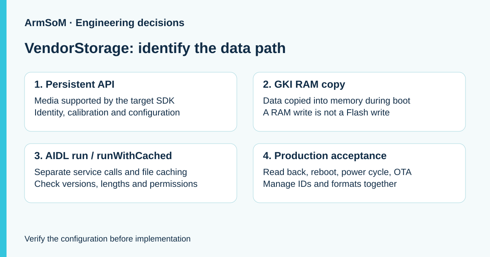

**VendorStorage suits small identity, calibration and manufacturing records, but a successful API call does not necessarily prove persistence.** First distinguish real media access, a GKI RAM copy and an Android service's file cache.

This ArmSoM guide reorganizes the supplied Android 16 AIDL V2 example. A matching SDK implementation of that newer service was not obtained and compiled in this work; its names are integration leads to verify against your branch. For older APIs, consult the existing [Vendor Storage V1.3 article](/articles/100-rockchip-vendor-storage-v13/).



## 1. Select the correct data path

| Environment | Typical entry point | Establish first |
| --- | --- | --- |
| U-Boot | `vendor_storage_read()` / `vendor_storage_write()` | Initialization, boot medium and branch layout |
| Non-GKI kernel | `rk_vendor_read()` / `rk_vendor_write()` | Registered backend and error handling |
| GKI RAM module | `ram_vendor_storage` | Whether it is a boot snapshot and whether writes reach media |
| Linux userspace | `/dev/vendor_storage` and ioctl | Kernel ABI, size limits and permissions |
| Android AIDL service | `IVendorStorage`, `libvendor_storage` | Version, VINTF, media support and SELinux |
| AIDL file cache | `runWithCached()` | File path and lifecycle, distinct from VendorStorage NVM |

The [Rockchip develop-6.1 implementation](https://github.com/rockchip-linux/kernel/blob/develop-6.1/drivers/soc/rockchip/sdmmc_vendor_storage.c) is a reference for an older kernel path. It does not prove the existence or identical media support of an Android 16 AIDL service.

## 2. Structure and IDs: this is not a filesystem

VendorStorage commonly contains a header, an entry index and payloads. Versioning, integrity information and redundant copies help select valid contents. Region size, slot count, offsets and capacity depend on media and SDK: do not transfer an eMMC layout to UFS, SPI NOR or NAND, or overwrite sectors that merely appear unused.

The supplied branch describes **156–256** as customer IDs. Earlier documentation does not define every range identically. Confirm the target headers and vendor agreement before maintaining a project allocation table.

| Data | Design rule |
| --- | --- |
| Serial numbers, MACs, calibration | Use assigned IDs and preserve factory data |
| Custom configuration | Define format version, size, byte order and integrity rules |
| Strings | Specify terminator semantics and honor returned length |
| Binary records | Do not infer size with `strlen()` or print as strings |
| Keys or DRM material | Use the relevant security design; ordinary VendorStorage is not automatically confidential or isolated |

Plan format migration. An older image must reject or safely interpret a newer record rather than reading it with an obsolete structure size.

## 3. Check four layers of Android service integration

Confirm source presence, interface version, packaging and device accessibility:

```bash
export SDK_ROOT=/path/to/android-sdk
rg -n 'BOARD_VENDOR_STORAGE_SERVICE|IVendorStorage|runWithCached' \
  "$SDK_ROOT/vendor/rockchip" "$SDK_ROOT/device/rockchip"
rg -n 'vendorstorage-V2-ndk|libvendor_storage|AidlVendorStorageClient' \
  "$SDK_ROOT/vendor/rockchip"
adb shell ls -l /vendor/bin/hw/rockchip.aidl.vendorstorage-service
adb shell service check rockchip.aidl.vendorstorage.IVendorStorage/default
adb shell ls -l /dev/vendor_storage
```

These are searches and read-only queries. A missing service can mean packaging, VINTF declaration, a different instance name or a different architecture—not damaged storage. The supplied example uses these components:

| Component | Example name | Role |
| --- | --- | --- |
| Service | `rockchip.aidl.vendorstorage-service` | Handles Binder requests |
| Instance | `rockchip.aidl.vendorstorage.IVendorStorage/default` | Discovery and VINTF declaration |
| Backend library | `libvendor_storage` | Media access |
| NDK interface | `rockchip.aidl.vendorstorage-V2-ndk` | Matches the frozen AIDL version |
| Example client | `AidlVendorStorageClient` | Development inspection |

The source SDK uses this integration flag. It only works if the target build rules consume it:

```makefile
BOARD_VENDOR_STORAGE_SERVICE := true
```

Check init, compatibility matrices, SEPolicy and libraries as well. `disabled` and `oneshot` can be normal lazy-HAL behavior; do not force permanent residency merely because the process is not always visible. Avoid packaging competing implementations of the same instance.

## 4. Binder success is not the complete response

The supplied interface contains:

```aidl
VendorStorageResponse run(in VendorStorageRequest request);
VendorStorageResponse runWithCached(in VendorStorageRequest request, String cachePath);
```

Requests contain `id`, `cmd`, `buf` and `buf_size`. The example initializes with `CMD_INIT` before reading or writing, and has operation-specific response semantics. Check each layer:

1. The service is declared and obtainable, with bounded waiting and failure handling.
2. The Binder transaction succeeds; a non-null proxy alone is insufficient.
3. `buf_size` is nonnegative and within both the actual vector and caller capacity.
4. `CMD_READ` returns the expected record; handle short reads explicitly.
5. `CMD_WRITE` and `CMD_INIT` success formats match the target version. The supplied example uses one zero-valued byte; do not assume that contract in another release.

Do not use `registerCallback()` as a substitute for a synchronous response. Match generated interfaces, service and test client rather than copying an isolated `.so` across versions.

## 5. Validate an allocated customer ID

The following is the source CLI's read-only example. Inspect its usage first; **read ID 156 only if it is an assigned, nonsensitive test record in your project**. Follow your branch's help if the syntax differs.

```bash
adb shell AidlVendorStorageClient
adb shell AidlVendorStorageClient r156
```

For writes, use an isolated test device, an allocated ID and the branch's supported API. Save the previous value, write a short versioned record, read and compare bytes, reboot and read, power-cycle and read, then restore the original. Record return codes and lengths at every step. Never use factory MAC, serial, calibration or security fields for trial writes.

| Symptom | First investigation |
| --- | --- |
| Readable now, lost after reboot | RAM backend or temporary cache |
| Survives warm reboot, not power loss | Persistent path, write completion and media behavior |
| Truncated content | Client buffer, entry capacity and length semantics |
| Works from shell, fails in the app | Service discovery, domains and SELinux denial logs |
| Changes after OTA | Layout, migration or an updater overwriting manufacturing data |

## 6. Cache lifecycle, permissions and U-Boot handoff

A `runWithCached()` file does not acquire manufacturing-data persistence merely by living under `/data`. Define factory reset, userdata erase, app reinstall and OTA separately. The service must constrain cache paths; applications should not gain arbitrary system-file access.

Grant only necessary service and data access to the business domain, not blanket write access to shell or all apps. If U-Boot and Android share fields, compare layout, IDs and initialization on both sides:

```bash
rg -n 'vendor_storage_init|vendor_storage_read|vendor_storage_write' u-boot
rg -n 'rk_vendor_read|rk_vendor_write|ram_vendor_storage' kernel*
```

Deliver an ID registry, format versions, supported media, service version, permission policy and power-loss/OTA records. The unloaded diagrams in the screenshot are replaced with an original flow diagram; unavailable source and parameters are not invented. [Supplied article](https://mp.weixin.qq.com/s/hv_oSAa7SZSpjwOI16nBQw)

## Products and further reading

Start an ArmSoM evaluation with the RK3588-based [Sige7](https://www.armsom.org/sige7), [AIM7](https://www.armsom.org/aim7) or [LM7](https://www.armsom.org/lm7), or the RK3576-based [CM5](https://www.armsom.org/cm5) and [Sige5](https://www.armsom.org/sige5). Check interfaces and available images in the [Sige7](https://docs.armsom.org/armsom-sige7), [CM5](https://docs.armsom.org/armsom-cm5) and [Sige5](https://docs.armsom.org/armsom-sige5) documentation. These links support product selection; they do not certify every SDK combination discussed here.
