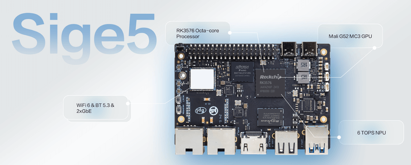

Sige5 packages RK3576 as an SBC that can connect directly to peripherals. These six development concepts describe the intended data flow, required integration and measurements needed before turning a prototype into a product.

## 1. Vision inspection and workstation assistance

Connect a suitable camera and lighting, capture workpieces, run a converted classification or defect model, then display results and retain abnormal samples. Stabilise optics, position and illumination before tuning the model. Measure missed defects, false positives, capture-to-result latency and long-run stability. This proposal does not imply industrial inspection certification.

## 2. A dual-port equipment gateway

The documented dual Gigabit Ethernet ports can connect an equipment network and an upstream network. Software handles collection, protocol translation and local buffering; network separation still needs correct configuration. Test reconnection, backlog delivery, storage endurance and access control. Two Gigabit ports do not guarantee wire-speed routing, encryption or VPN throughput.

## 3. Digital signage and interactive terminals

Combine playback, touch interaction and cached content for exhibits, visitor terminals or information displays. Validate EDID, display modes, touch drivers and media files first, then add content updates and automatic application startup. Hardware decoding depends on both the OS and player; chip peak figures alone are not a media acceptance test.

## 4. Local video-event analysis

Receive camera streams, infer on selected frames and retain clips needing review. CPU, decoding, preprocessing, NPU and storage all affect stream capacity. Start with one representative stream and increase load while tracking dropped frames, overall latency and temperature. No fixed camera count or validated security-system reliability is claimed here.

## 5. Robot high-level computing

Use Sige5 for perception, task planning, map display or communication with a motion controller. Appropriate dedicated controllers should handle motor loops and safety protection, while Linux handles higher-level tasks. Validate battery power, transient loads, camera synchronisation and communication jitter on the real robot.

## 6. Linux learning and application validation

A single board can demonstrate Linux services, containers, vision and the RKNN conversion-to-deployment process. Keep a recoverable OS image, record versions and build startup and health checks. After the experiment works, add production update and rollback procedures.

## Prototype-to-product checklist

| Direction | Measure first | Reason to move to CM5 |
|---|---|---|
| Vision | Accuracy, end-to-end latency, camera support | Custom camera and enclosure layout |
| Gateway | Reconnection, buffering, sustained throughput | Custom ports and power |
| Signage | Playback, touch, recovery | Compact enclosure and dedicated connectors |
| Robotics | Jitter, power, temperature | Mechanical and electrical integration |

Sige5 documentation identifies only the Type-C port marked PD Only as the power input. Choose power, peripherals and cooling for the exact hardware revision. These are proposals for evaluation; the complete systems have not all been hardware-validated for this article.

## Series and product links

- [RK3576 explained: from eight CPU cores to ArmSoM edge AI products](/articles/rk3576-chip-guide/)
- [ArmSoM CM5 as a Raspberry Pi CM4/CM5 alternative: selection and migration](/articles/cm5-raspberry-pi-cm4-cm5-alternative/)
- [RK3576 Datasheet V1.0: download, package, electrical and thermal guide](/articles/rk3576-datasheet-v10/)
- [ArmSoM CM5](https://www.armsom.org/cm5) · [ArmSoM Sige5](https://docs.armsom.org/armsom-sige5)

## References

- [Rockchip RK3576](https://www.rock-chips.com/a/en/products/RK35_Series/2024/1212/2033.html)
- [RK3576 Brief V1.2 (2025-08-28)](https://www.rock-chips.com/uploads/pdf/2024.3.18/191/RK3576%20Brief%20Datasheet%20V1.2-20250828.pdf)
- [ArmSoM CM5](https://docs.armsom.org/armsom-cm5)
- [ArmSoM Sige5](https://docs.armsom.org/armsom-sige5)
- [Raspberry Pi CM5](https://www.raspberrypi.com/products/compute-module-5/)
