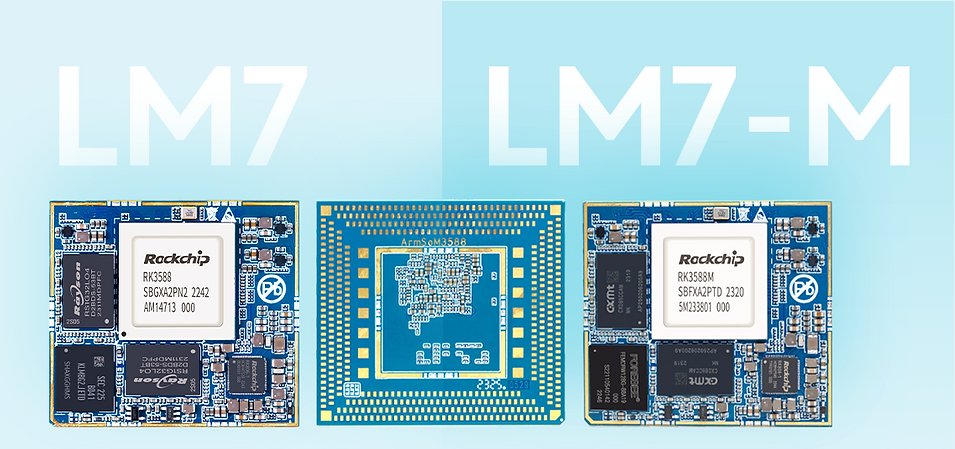

Sige7 and LM7 share RK3588 but support different development routes. Sige7 is an SBC with ready-made ports for getting applications running. LM7 is an LGA module for a custom baseboard. They are not simply different performance tiers.

## Choose the form factor first

| Need | Starting point | Main work |
|---|---|---|
| Connect networking, display and SSD quickly | Sige7 | Image, peripherals and application validation |
| Custom enclosure and connectors | LM7 with a matching development kit | Baseboard, assembly and system design |
| Removable module | AIM7 with matching carrier | Connector, pinout and carrier validation |

Sige7 documentation lists dual 2.5GbE and a PCIe 3.0 x4 M.2 slot, useful for evaluating network/storage-heavy tasks. LM7 is documented as a 506-pin LGA module with a 45×50mm footprint for custom baseboard work. Interface specifications are not end-to-end throughput guarantees.

## 1. Local storage and equipment data hub

Connect SSD and network devices to Sige7 for file services, archiving or edge caching. Test the actual file protocol, file sizes, client concurrency and sustained writes: Ethernet link rate is not file-copy speed. Multiple drives also need controller, power and cooling review; one M.2 slot is not a complete NAS design.

## 2. Multi-camera event analysis

Capture or receive video, sample frames at the business-required rate, preprocess and infer, then retain events for review. Cameras, decoding, memory, NPU and storage jointly determine stream capacity. Validate one stream before adding concurrency, logging dropped frames and temperature rather than promising an untested camera count.

## 3. Exhibition terminals and signage

Combine video, web UI and local content management. Validate the screen, touch input, formats and automatic startup before adding updates and power-loss recovery. Chip HDMI input support does not mean the selected board exposes a capture connector; check inputs and outputs separately.

## 4. Industrial vision assistance

With controlled lighting and camera position, evaluate classification, counting or appearance checks. Show results to an operator or send them to a business system. Acceptance includes false alarms, misses, total latency and difficult samples. This is a development direction, not a safety or inspection certification claim.

## 5. Robot high-level computing

Use RK3588 for perception, maps and task planning alongside a dedicated motion controller. Motor loops and safety protection belong in suitable control systems; ordinary Linux scheduling is not a hard-real-time guarantee. Check battery power, jitter, thermal design and camera synchronisation.

## 6. Custom commercial terminals

Once the application works, LM7 can support a baseboard designed around the enclosure, specialist ports and production test points. Plan power sequencing, routing, manufacturability, soldering/rework and programming. LM7 documentation specifies 4V±5% module supply: do not transfer Sige7's board-level power arrangement directly to LM7.

## From prototype to production

Freeze hardware revision, image, kernel, model and runtime. Define recovery entry, serial numbers, logs and updates. Qualify the final enclosure under intended ambient conditions and real load. No unmeasured cost, power or lifetime advantage is claimed, and each product's temperature range needs its own hardware reference.

## Series and product links

- [RK3588 explained: eight CPU cores, 6 TOPS NPU and high-speed expansion](/articles/rk3588-chip-guide/)
- [AIM7 as a Jetson Nano/Orin alternative: hardware review and RKNN migration](/articles/aim7-jetson-nano-orin-alternative/)
- [RK3588 Datasheet V1.4: download, block diagram, package and electrical guide](/articles/rk3588-datasheet-v14/)
- [ArmSoM AIM7](https://docs.armsom.org/armsom-aim7) · [Sige7](https://docs.armsom.org/armsom-sige7) · [LM7](https://docs.armsom.org/armsom-lm7)

## References

- [Rockchip RK3588](https://www.rock-chips.com/a/en/products/RK35_Series/2022/0926/1660.html)
- [ArmSoM AIM7](https://docs.armsom.org/armsom-aim7)
- [ArmSoM Sige7](https://docs.armsom.org/armsom-sige7)
- [ArmSoM LM7](https://docs.armsom.org/armsom-lm7)
- [NVIDIA Jetson modules](https://developer.nvidia.com/embedded/jetson-modules)
- [RKNN-Toolkit2](https://github.com/airockchip/rknn-toolkit2)
