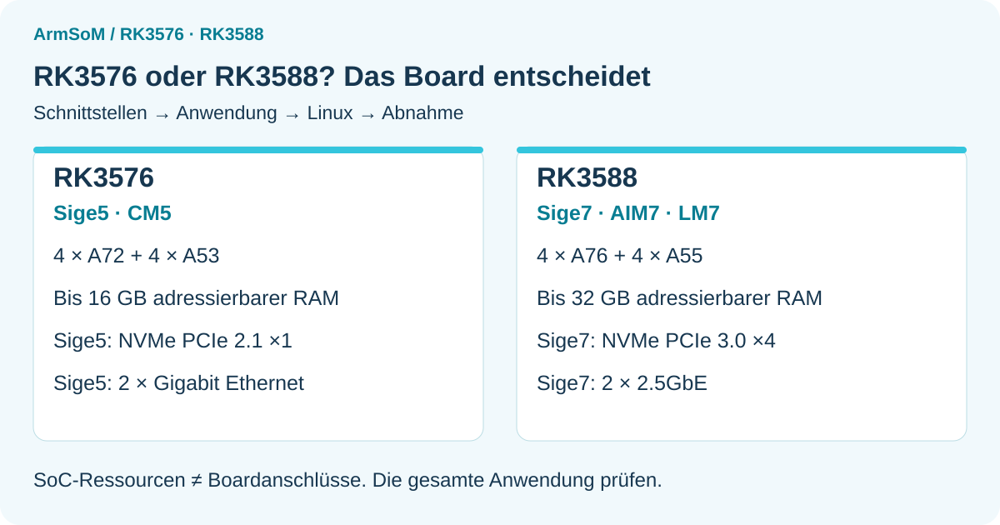
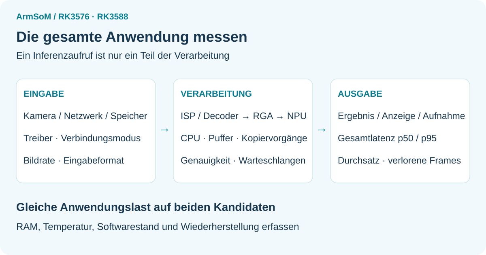

**Prüfen Sie RK3576, wenn die herausgeführten Schnittstellen von Sige5 oder CM5, ein Speicherbedarf innerhalb von 16 GB und die gemessene Anwendungslast zum Projekt passen. RK3588 ist besonders interessant, wenn Sie das breitere Speichersystem, Sige7 mit PCIe 3.0 ×4 für NVMe und zwei 2.5GbE-Ports oder mehr CPU-/GPU-Reserven für parallele Aufgaben benötigen.** Beide Plattformen werben mit 6 TOPS. Diese Zahl allein entscheidet jedoch nicht, welche Ihre Anwendung besser ausführt.

Dieser Leitfaden verbindet Chipdaten mit ArmSoM-Boards, Linux-Software und einem Abnahmeverfahren. Die Dokumentation wurde am 18. November 2026 geprüft. Die Anwendungsempfehlungen sind technische Einschätzungen und keine Ergebnisse eines ArmSoM-Vergleichstests. Tatsächliche Betriebsarten hängen von Boardrevision, Trägerplatine und BSP ab.



## 1. Was unterscheidet RK3576 und RK3588?

| Merkmal | RK3576 | RK3588 | Im Projekt zu prüfen |
|---|---|---|---|
| CPU | 4× Cortex-A72 + 4× Cortex-A53 | 4× Cortex-A76 + 4× Cortex-A55 | CPU-Zeit für Anwendungslogik, Vorverarbeitung, Datenbanken und Container |
| GPU | Mali-G52 MC3 | Mali-G610 MC4 | Grafiktreiber, Compositor, API-Unterstützung und reale Anzeigelast |
| NPU | Zwei Kerne; angegebene 6 TOPS INT8 unter Sparsity-Bedingung | Drei Kerne; angegebene 6 TOPS | Modellkonvertierung, Operatoren, Präzision, Kernzuordnung und Latenz |
| Speicherschnittstelle | 2×16 Bit; LPDDR4/4X/5; bis 16 GB adressierbar | 4×16 Bit; LPDDR4/4X/5; bis 32 GB adressierbar | Tatsächlich bestückter Speicher und Spitzenbedarf der Anwendung |
| PCIe | PCIe-2.1-Ressourcen, teilweise mehrfach belegte Schnittstellen | PCIe 3.0 und zusätzliche PCIe-Ressourcen | Herausgeführte Lanes, Leiterbahnführung, gemeinsame PHYs und Linkgeschwindigkeit |
| Multimedia | ISP, RGA, Hardware-Codecs und mehrere Displayschnittstellen | ISP, RGA, Hardware-Codecs, mehrere Displays und HDMI RX | Codec-Grenzen, Sensortreiber und gleichzeitig nutzbare Betriebsarten |
| NPU-Software | RKNN-Toolkit2 / RKNPU2 | RKNN-Toolkit2 / RKNPU2 | Passende Konvertierungswerkzeuge, Laufzeitbibliothek und Kerneltreiber |

Die Chipangaben basieren auf den [RK3576-Spezifikationen](https://www.rock-chips.com/a/en/products/RK35_Series/2024/1212/2033.html), den [RK3588-Spezifikationen](https://www.rock-chips.com/a/en/products/RK35_Series/2022/0926/1660.html) sowie den in unseren Artikeln zu [RK3576](/de/articles/rk3576-datasheet-v10/) und [RK3588](/de/articles/rk3588-datasheet-v14/) behandelten Datenblättern. Sie beschreiben keine auf jedem Produkt verfügbaren Anschlüsse.

RK3588 besitzt einen breiteren Speicherbus. Daraus folgt jedoch kein doppelter Anwendungsdurchsatz. DRAM-Typ und Takt, Cacheverhalten, Kopiervorgänge und konkurrierende Zugriffe beeinflussen die nutzbare Bandbreite. Auch die CPU-Kernnamen begründen weder einen festen Leistungsfaktor noch einen Vergleich der Leistungsaufnahme.

Unterscheiden Sie bei Video zwischen **Dekodierung, Kodierung und Bildausgabe**. Die ausführlichen RK3588-Angaben nennen etwa unterschiedliche Grenzen für H.265 und AV1. „8K“ gilt nicht pauschal für jeden Codec. Auch das ältere vollständige RK3576-Datenblatt und der neuere Brief stellen Videogrenzen unterschiedlich dar. Legen Sie Codec, Profil, Bittiefe, Auflösung und Bildrate fest und prüfen Sie diese mit dem vorgesehenen Betriebssystemabbild. Die höchsten Zahlen verschiedener Dokumente dürfen nicht zu einer uneingeschränkten Zusage kombiniert werden.

## 2. Sige5 und Sige7: die nutzbaren Anschlüsse vergleichen

Bei einem SBC-Prototyp ist die tatsächliche Boardbeschaltung oft aussagekräftiger als das vollständige SoC-Blockdiagramm. Die Handbücher von [Sige5](https://docs.armsom.org/armsom-sige5) und [Sige7](https://docs.armsom.org/armsom-sige7) nennen folgende Unterschiede:

| Boardmerkmal | ArmSoM Sige5 | ArmSoM Sige7 |
|---|---|---|
| Prozessor | RK3576 | RK3588 |
| Dokumentierte RAM-Konfigurationen | 8/16 GB, 32-Bit-LPDDR4X | 8/16/32 GB, 64-Bit-LPDDR4/4X |
| NVMe-Steckplatz | M.2 Key M, PCIe 2.1 ×1 | M.2 Key M, PCIe 3.0 ×4 |
| Kabelgebundenes Netzwerk | 2× Gigabit Ethernet | 2× 2,5-Gigabit-Ethernet |
| Kameraanschlüsse | 2× MIPI CSI mit je vier Lanes | 2× MIPI CSI mit je vier Lanes |
| Displayschnittstellen | HDMI, USB-C DisplayPort und MIPI DSI | HDMI, USB-C DisplayPort und MIPI DSI |
| Platinenabmessungen | 92 × 62 mm | 92 × 62 mm |

Eine SSD mit PCIe 3.0 ×4 kann an einem anderen Host eine langsamere und schmalere Verbindung aushandeln. Ihre beworbene Desktop-Leistung ist nicht auf den ×1-Link des Sige5 übertragbar. Beide Handbücher nennen NVMe für diesen M.2-Steckplatz. Ein ähnlich aussehender M.2-SATA-Datenträger ist deshalb nicht automatisch geeignet.

Für 2.5GbE am Sige7 müssen auch Switch, Kabel und Gegenstelle den ausgehandelten Modus unterstützen. Zwei Ports ergeben nicht automatisch eine einzelne Verbindung mit doppelter Geschwindigkeit. Ebenso bestätigen zwei CSI-Anschlüsse keine Kamerakompatibilität: Sensortreiber, Lane-Zuordnung, Versorgung, Takt, Device Tree und ISP-Abstimmung müssen passen.

Die gleichen Außenmaße erleichtern die frühe Gehäuseplanung. Sie garantieren aber weder identische Freiräume und Anschlusspositionen noch elektrische Pinkompatibilität. Prüfen Sie vor der Wiederverwendung eines Gehäuses die mechanischen Zeichnungen.

## 3. Vom Entwicklungsboard zu CM5, AIM7 oder LM7

Ein SBC stellt Anschlüsse und einen großen Teil der Peripheriebeschaltung bereits bereit. Bei einem Rechenmodul übernimmt Ihre Trägerplatine einen Teil dieser Integration.

| Produkt | Plattform und Bauform | Sinnvoller Ausgangspunkt |
|---|---|---|
| [CM5](https://www.armsom.org/cm5) | RK3576; Modul mit 55 × 40 mm | Kompakte eigene Trägerplatine für Terminal, Gateway oder Bildverarbeitung |
| [AIM7](https://www.armsom.org/aim7) | RK3588; 260-poliges SO-DIMM-Modul | Austauschbares Rechenmodul auf einer geprüften Trägerplatine |
| [LM7](https://www.armsom.org/lm7) | RK3588; LGA-Modul mit 45 × 50 mm | Aufgelötetes Modul auf einer Trägerplatine für die Serienfertigung |

Die [CM5-Dokumentation](https://docs.armsom.org/armsom-cm5) unterscheidet V1.3 mit LPDDR5 und V2.0 mit LPDDR4X. Die LPDDR5-Unterstützung des RK3576 bedeutet nicht, dass jeder Sige5 oder jedes CM5 diesen Speicher verwendet. Entscheidend sind bestellte Konfiguration und Revision.

Prüfen Sie bei [AIM7](https://docs.armsom.org/armsom-aim7) die Pinbelegung und die freigegebene Trägerkonfiguration. Eine passende Modulform garantiert weder die Verwendung auf jeder Jetson-Trägerplatine noch die Kompatibilität mit CUDA-Software. Bei [LM7](https://docs.armsom.org/armsom-lm7) gehören Bestückung, Signalintegrität, Einschaltreihenfolge und Reparaturkonzept zur Auswahl. Auch beim Wechsel vom SBC zum Modul müssen Device Tree und Peripherie neu validiert werden.

## 4. Nach der vollständigen Anwendung auswählen

### Kamera-KI und industrielle Inspektion

Eine Bildverarbeitungskette umfasst Aufnahme, ISP-Verarbeitung oder Dekodierung, Skalierung/Farbumwandlung, Inferenz und Nachverarbeitung. Beginnen Sie mit Sige5, wenn Kamerapfade und Speicherbudget die Anforderungen des Prototyps erfüllen. Sige7 wird interessant, wenn parallele Dienste, Bildpuffer oder CPU-/GPU-Verarbeitung die Ressourcen begrenzen. Keiner der beiden Ansätze garantiert eine bestimmte Anzahl von KI-Kamerastreams.

Messen Sie die Zeit vom Eintreffen eines Bildes bis zum verwertbaren Ergebnis einschließlich Warteschlangen und Speichertransfers. Eine schnelle einzelne Inferenz kann trotzdem mit hoher Gesamtlatenz einhergehen, wenn CPU-Skalierung oder Kopiervorgänge dominieren. [RKNN-Toolkit2](https://github.com/airockchip/rknn-toolkit2) führt beide Plattformen auf; Modelle müssen dennoch für das jeweilige Ziel konvertiert und geprüft werden.

### NAS, Datenaufzeichnung und Netzwerkgateways

Sige5 ist prüfenswert, wenn zwei Gigabit-Ports und eine NVMe-Verbindung mit einer Lane ausreichen. Sige7 bietet den passenderen Schnittstellenansatz für zwei 2.5GbE-Ports und eine breitere NVMe-Verbindung. Das sind Schnittstellenunterschiede, keine gemessenen Dateiübertragungsraten.

Nehmen Sie Verschlüsselung, Dateisystemverhalten, kleine Dateien, SSD-Temperatur und Wiederherstellung nach Stromausfall in die Tests auf. Ein SATA-Controller im SoC macht aus einem ausschließlich für NVMe beschalteten Steckplatz keinen SATA-Anschluss.

### HMI, Kioske und Anzeigeterminals

Bei festgelegter Bildschirmkonfiguration sollten zunächst Panel-Timings, Touch-Eingabe, Compositor und Hardware-Videopfad funktionieren. Prüfen Sie RK3588, wenn die tatsächliche Grafiklast oder gleichzeitige Bildausgabe mehr Reserven benötigt. Aus der Anzahl der Display-Engines im SoC lässt sich keine bestimmte Mehrschirmkonfiguration ableiten: Anschlüsse können Ressourcen teilen, und das BSP muss die Kombination unterstützen.

### Container und Dienste am Netzwerkrand

Bei einem Gateway mit Datenbank, Nachrichtenbroker und Inferenzdienst müssen Betriebssystem, Modell, Bildpuffer, Dateicache und maximale Warteschlangen gemeinsam ins Speicherbudget passen. RK3588-Produkte mit 32 GB sind relevant, wenn der gemessene Bedarf 16 GB überschreitet. Container beseitigen Hardwareabhängigkeiten nicht: GPU-, NPU- und Medienzugriffe hängen weiterhin von Hostkernel, Geräteberechtigungen und kompatiblen Bibliotheken ab.

## 5. Das Linux-Abbild vor der Hardwarefestlegung auswählen

„Linux startet“ und „alle Beschleuniger funktionieren in meiner Anwendung“ sind unterschiedliche Abnahmepunkte. Beginnen Sie mit dem für das konkrete Board empfohlenen Abbild aus der [ArmSoM-Einstiegsdokumentation](https://docs.armsom.org/getting-started) und halten Sie Kernel- und Paketversionen fest.

| Softwareschicht | Vor der Festlegung prüfen |
|---|---|
| Bootloader, Kernel und Device Tree | Boardrevision, Spannungsregler, Pin-Multiplexing und aktivierte Peripherie |
| Grafik und Anzeige | Kerneltreiber, Mesa oder Herstellerbibliotheken, Compositor und benötigte API-Versionen |
| Video und Bildverarbeitung | MPP/RGA-Bibliotheken sowie die tatsächliche Beschleunigeranbindung der Anwendung |
| NPU | Konvertierungsziel, RKNN-Laufzeit, Treiberkompatibilität und Modellgenauigkeit |
| Produktpflege | Abbildupdates, Sicherheitskorrekturen, Wiederherstellung und Verantwortlichkeit für den Freigabestand |

[Rockchip MPP](https://github.com/rockchip-linux/mpp) stellt Komponenten zur Medienverarbeitung bereit. Allein die Installation von FFmpeg oder GStreamer beweist nicht, dass der verwendete Build diese nutzt. Prüfen Sie Anwendungsprotokolle und CPU-Last beim Abspielen repräsentativer Dateien. Hersteller-BSP und upstreamorientierte Distributionen können auf demselben Board unterschiedliche Funktionen bereitstellen.

Wählen Sie bei der RKNN-Toolkit2-Konvertierung passend `target_platform="rk3576"` oder `target_platform="rk3588"` und speichern Sie getrennte Modellartefakte. Ein konvertiertes Modell, eine NPU-Kernmaske, ein Bootabbild oder ein Device Tree dürfen nicht ungeprüft zwischen den Plattformen übernommen werden. Halten Sie Modell, Kalibrierungsdaten und SDK-/Laufzeitversionen in der Auslieferungsdokumentation fest.

## 6. Einen Linux-Prototyp mit konkreten Befehlen prüfen

Die folgenden Befehle lesen Systeminformationen. Sie flashen keinen Speicher und verändern keine Takteinstellungen. Es handelt sich um Beispiele für eine Linux-Shell, nicht um Android-ADB-Befehle. Ihre Verfügbarkeit hängt vom Abbild ab. Fehlende Programme oder eingeschränkte Rechte beweisen nicht, dass Hardware fehlt.

### Board, Betriebssystem und Speicher identifizieren

```bash
uname -a
cat /etc/os-release
for f in /proc/device-tree/model /proc/device-tree/compatible; do
  if [ -r "$f" ]; then
    printf '\n%s\n' "$f"
    tr '\000' '\n' < "$f"
  fi
done
command -v lscpu >/dev/null 2>&1 && lscpu
free -h
lsblk -o NAME,SIZE,TYPE,FSTYPE,MOUNTPOINT
```

`MemTotal` und `free` zeigen den für Linux verfügbaren Speicher. Reservierte Bereiche können diesen gegenüber der physischen RAM-Kapazität verkleinern. `lsblk` beschreibt die Speicherkonfiguration und ist kein Durchsatztest. Notieren Sie zusätzlich die Hardwareversion von der Platinenkennzeichnung.

### PCIe-, USB- und Netzwerkverbindungen prüfen

```bash
command -v lspci >/dev/null 2>&1 && lspci -nn
command -v lsusb >/dev/null 2>&1 && lsusb -t
for d in /sys/bus/pci/devices/*; do
  [ -d "$d" ] || continue
  printf '\n%s\n' "${d##*/}"
  for f in current_link_speed current_link_width; do
    [ -r "$d/$f" ] && { printf '%s: ' "$f"; cat "$d/$f"; }
  done
done
if command -v ethtool >/dev/null 2>&1; then
  for d in /sys/class/net/*; do
    name=${d##*/}
    [ "$name" = lo ] && continue
    printf '\n%s\n' "$name"
    ethtool "$name"
  done
fi
```

Die PCIe-Werte beschreiben den aktuellen Linkzustand, keinen Bandbreitentest. Klären Sie eine unerwartet geringe Lane-Zahl, eine niedrigere PCIe-Generation, USB-2.0-Betrieb oder eine Ethernet-Aushandlung mit 100 Mbit/s, bevor Sie die Anwendungsleistung vergleichen. Unter Debian/Ubuntu stammen diese Programme üblicherweise aus `pciutils`, `usbutils` und `ethtool`.

### Kamera- und Display-Endpunkte finden

```bash
command -v v4l2-ctl >/dev/null 2>&1 && v4l2-ctl --list-devices
if command -v media-ctl >/dev/null 2>&1; then
  for d in /dev/media*; do
    [ -e "$d" ] || continue
    media-ctl -d "$d" -p
  done
fi
for d in /sys/class/drm/card*-*; do
  [ -r "$d/status" ] || continue
  printf '\n%s\n' "${d##*/}"
  cat "$d/status"
  [ -r "$d/modes" ] && cat "$d/modes"
done
```

Ein vorhandenes `/dev/video*` muss nicht die Kamera sein; auch Codecs können solche Geräteknoten verwenden. Identifizieren Sie Sensor und Mediengraph und testen Sie die Aufnahme mit dem für das Board vorgesehenen Beispiel. Ein von DRM aufgelisteter HDMI-Modus beweist nicht, dass die gesamte Render- oder Wiedergabekette ihn dauerhaft erreicht. `v4l2-ctl` und `media-ctl` werden häufig mit `v4l-utils` bereitgestellt.

### Temperatur und Takt während der Anwendung beobachten

```bash
for d in /sys/class/thermal/thermal_zone*; do
  [ -r "$d/temp" ] || continue
  printf '%s ' "${d##*/}"
  [ -r "$d/type" ] && tr '\n' ' ' < "$d/type"
  cat "$d/temp"
done
for d in /sys/devices/system/cpu/cpufreq/policy*; do
  [ -d "$d" ] || continue
  printf '\n%s\n' "${d##*/}"
  for f in scaling_governor scaling_cur_freq scaling_max_freq; do
    [ -r "$d/$f" ] && { printf '%s: ' "$f"; cat "$d/$f"; }
  done
done
```

Temperaturen der Thermal-Zonen werden üblicherweise in Tausendstel Grad Celsius angegeben, die gezeigten cpufreq-Werte in kHz. Zonennamen und Dateien hängen vom BSP ab. Es sind Momentaufnahmen, keine Messung der elektrischen Leistung und kein alleiniger Nachweis für thermische Drosselung. Wiederholen Sie die Beobachtung bei gleicher Last und vergleichen Sie Taktänderungen mit Temperatur und Latenz.

## 7. Eine aussagekräftige Abnahme durchführen



Verwenden Sie auf beiden Kandidaten gleiche Eingabedaten, Modelleinstellungen und Dienstkonfigurationen. Erforderliche boardspezifische Treiber und zielabhängige Modellkonvertierungen sind zulässig; dokumentieren Sie die Unterschiede. Eine Vorgabe wie „zwei 1080p-Kamerastreams mit Ereignisaufzeichnung“ ist eine Testdefinition und keine Behauptung, dass ein Produkt sie bereits erfüllt hat.

| Abnahmebereich | Aufzeichnen | Typisches zu klärendes Problem |
|---|---|---|
| Funktionsumfang | Alle benötigten Geräte und gleichzeitig aktiven Betriebsarten | Anschluss vorhanden, aber Treiber oder gemeinsame Ressource nicht verfügbar |
| Anwendungsleistung | Dauerhafter Durchsatz, p50-/p95-Latenz und Warteschlangentiefe | CPU-Vorverarbeitung oder Kopieren dauert länger als die NPU-Inferenz |
| RAM und Datenträger | Spitzenbedarf, Swap-Aktivität, Schreibverhalten und freier Platz | Arbeitsmenge oder Aufzeichnungsspitzen übersteigen das Budget |
| Dauerbetrieb | Lastdauer, Umgebung, Gehäuse und Temperaturen | Wärme- oder Versorgungsgrenzen verändern die Leistung nach dem Aufwärmen |
| Wiederherstellung und Updates | Neustart, erneutes Verbinden der Peripherie und Rollback | Ein erfolgreicher Laborlauf lässt sich nach dem Update nicht reproduzieren |

Legen Sie die Bestehenskriterien anhand der Produktanforderungen vor dem Test fest. Vergleichen Sie Systemkosten einschließlich Kühlung, Speicher, Netzteil und Trägerentwicklung. Aus dem Chipnamen folgt keine allgemeine Aussage, dass RK3576 immer weniger Leistung aufnimmt.

## 8. Häufige Fragen zur Auswahl

### Bedeuten gleiche 6 TOPS auch gleiche KI-Leistung?

Nein. Die RK3576-Angabe enthält eine Sparsity-Bedingung. Modell- und Operatorunterstützung, Datentransfers und Ausführungsplanung beeinflussen das Ergebnis ebenfalls. Vergleichen Sie Genauigkeit und Ende-zu-Ende-Latenz desselben Modells auf der vorgesehenen Software.

### Kann ich das Sige5-Abbild auf Sige7 verwenden?

Verwenden Sie das passende Abbild für jedes Board. Anwendungsquellcode oder portable Container können wiederverwendbar sein; Bootkomponenten, Device Trees und Beschleunigerbibliotheken erfordern eine eigene Plattformprüfung.

### Ist RK3588S in diesem Vergleich mit RK3588 austauschbar?

Nein. RK3588S besitzt andere Peripherieressourcen. Die Aussagen zu PCIe und Netzwerk des Sige7 gelten nicht automatisch für CM7S oder Sige7S. Lesen Sie für diese Produkte den separaten [RK3588S-Leitfaden](/de/articles/rk3588s-chip-guide/).

### Mit welchem ArmSoM-Produkt sollte ich anfangen?

Nutzen Sie zunächst [Sige5](https://www.armsom.org/sige5) oder [Sige7](https://www.armsom.org/sige7), um Peripherie und Software zu prüfen. Wechseln Sie zu CM5, AIM7 oder LM7, sobald Anforderungen an Trägerplatine, Größe und Fertigung feststehen. Gleichen Sie die Anforderungstabelle während dieses Übergangs immer mit dem Handbuch des konkreten Boards ab.

## 9. Weiterführende Anleitungen zur Umsetzung

- [RK3576-Architektur und Anwendungsplanung](/de/articles/rk3576-chip-guide/)
- [RK3588-Architektur und Anwendungsplanung](/de/articles/rk3588-chip-guide/)
- [RKNN2 und RKNN3: den richtigen NPU-Softwarestack auswählen](/de/articles/rockchip-npu-rknn2-rknn3-getting-started/)
- [Rockchip MPP: Entwicklungsleitfaden](/de/articles/089-rockchip-mpp/)
- [Armbian-Projekte mit Sige5 und Sige7](/de/articles/sige5-sige7-armbian-projects/)
