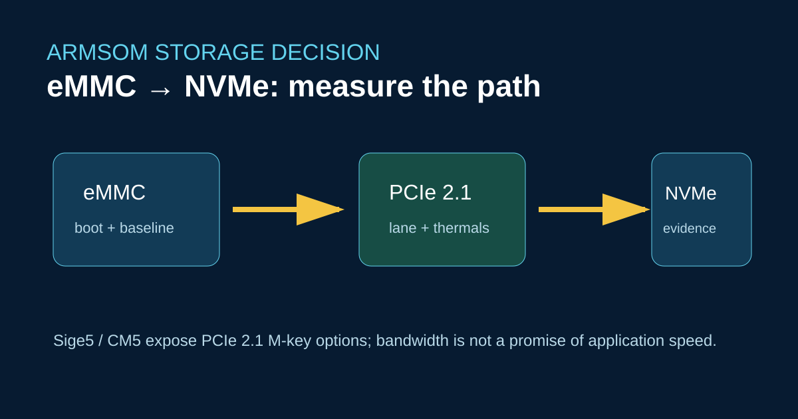

# NVMe-Speicher auf ArmSoM Sige5 und CM5: Erweiterung mit überprüfbaren Messungen



Ein M.2-Sockel bringt Vorteile, wenn die Arbeitslast durch den Speicher begrenzt wird. Für ArmSoM Sige5 ist eine PCIe-2.1-Lane mit M-Key dokumentiert; CM5 stellt PCIe-Erweiterungen über das Carrier Board bereit. Das unterscheidet sich vom Raspberry-Pi-Zubehörökosystem. Eine Binärkompatibilität mit Jetson-Nano-Anwendungen ergibt sich daraus nicht.

## Was sich bei einer Migration ändert

Behalten Sie eMMC oder microSD als Grundlage für die Wiederherstellung bei. Ergänzen Sie NVMe erst, wenn das Board zuverlässig bootet, und messen Sie anschließend die Ein-/Ausgabe der Anwendung zusätzlich zu `fio`. RK3576-CPU, Dateisystem, thermische Bedingungen und SSD-Controller beeinflussen die Latenz. Ein Benchmark auf einem kühlen, unbelasteten System kann eine Drosselung bei dauerhaftem Schreiben verdecken.

```bash
lsblk -o NAME,MODEL,SIZE,TRAN,MOUNTPOINT
sudo fio --name=read4k --filename=/mnt/nvme/test.bin --size=512M \
  --rw=randread --bs=4k --iodepth=16 --direct=1 --runtime=30 --time_based
```

Dokumentieren Sie Kernel, Dateisystem, SSD-Modell, Umgebungstemperatur und Stromquelle. Übernehmen Sie keine Raspberry-Pi-Speicherkonfiguration aus `config.txt`; prüfen Sie den RK3576-Device-Tree und die Bootreihenfolge im Boardhandbuch.

## Entscheidung zur Migration

Wählen Sie Sige5, wenn Sie ein vollständiges Board mit zwei Gigabit-Ethernet-Anschlüssen und dokumentiertem 5–23-V-Eingang benötigen. Wählen Sie CM5, wenn ein eigenes Carrier Board und produktspezifische Anschlüsse den Validierungsaufwand rechtfertigen. Beide Boards erfordern bei Jetson-Nano-Anwendungen eine Anpassung: CUDA-/TensorRT-Software muss auf den Rockchip-Userspace und gegebenenfalls RKNN portiert werden.

## Quellen

- [Sige5-Spezifikationen](https://docs.armsom.org/armsom-sige5)
- [CM5-Spezifikationen](https://docs.armsom.org/armsom-cm5)
- [ArmSoM-Entwicklerzentrum](https://docs.armsom.org/)

## Prüfung vor der Veröffentlichung

- [ ] Prüfen Sie die genaue M.2-Verdrahtung der jeweiligen Board- oder Carrier-Revision.
- [ ] Veröffentlichen Sie wiederholte Dauermessungen mit der unveränderten fio-Ausgabe.
- [ ] Kennzeichnen Sie die Speicherkompatibilität als abhängig von elektrischen Eigenschaften und Software.
