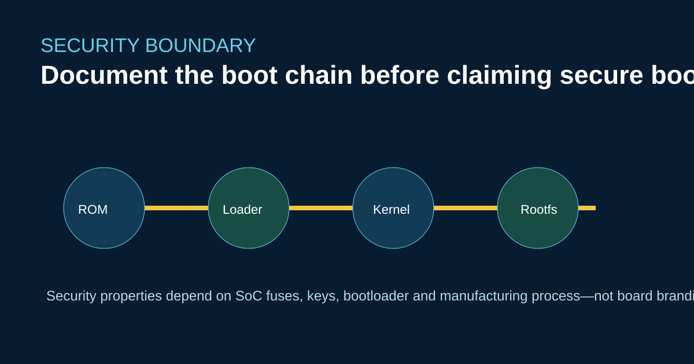

# Secure Boot auf RK3576, RK3588 und RK3506J: Geltungsbereich prüfen



Die Aussage „unterstützt Secure Boot“ ist erst vollständig, wenn die verifizierte Kette benannt wird. ROM, Loader der ersten Stufe, U-Boot, Kernel, Device Tree und Root-Dateisystem können sich bei Signierung und Wiederherstellung unterscheiden.

## Eine Nachweistabelle erstellen

Dokumentieren Sie für jede ArmSoM-Variante SoC, Bootmedium, Loader-Build, Schlüsselhierarchie, Fuse-Zustand, Debugrichtlinie und Wiederherstellungsverfahren. Übertragen Sie keine Sicherheitseigenschaften aus der Raspberry-Pi- oder Jetson-Nano-Dokumentation; Vertrauensanker und Werkzeuge unterscheiden sich.

```bash
cat /proc/cmdline
cat /proc/device-tree/compatible
dmesg | grep -iE 'verified|secure|rollback|avb'
```

Diese Lesezugriffe erfassen den Laufzeitkontext, belegen jedoch keine Fuse-Konfiguration der Produktion. Verwenden Sie für die Provisionierung das Boardhandbuch und die Rockchip-Sicherheitsdokumentation.

## Einordnung der Produkte

Sige5 (RK3576) und Sige7 (RK3588) richten sich an flexible Linux-/Android-Entwicklung. Forge1 (RK3506J) dient der industriellen Steuerung mit Buildroot. Ein geeignetes Sicherheitskonzept hängt von Updateverantwortung, physischem Zugang und Nutzungsdauer ab, nicht von TOPS oder der Anzahl der Anschlüsse.

## Quellen

- [Sige5](https://docs.armsom.org/armsom-sige5)
- [Sige7](https://docs.armsom.org/armsom-sige7)
- [Forge1](https://docs.armsom.org/zh/armsom-forge1)

## Prüfung vor der Veröffentlichung

- [ ] Benennen Sie die genaue Bootkette und die Schlüsselverantwortlichen.
- [ ] Unterscheiden Sie Labordebugging und Fuse-Richtlinien für die Produktion.
- [ ] Zeigen Sie die Wiederherstellung nach der Ablehnung eines Images.
