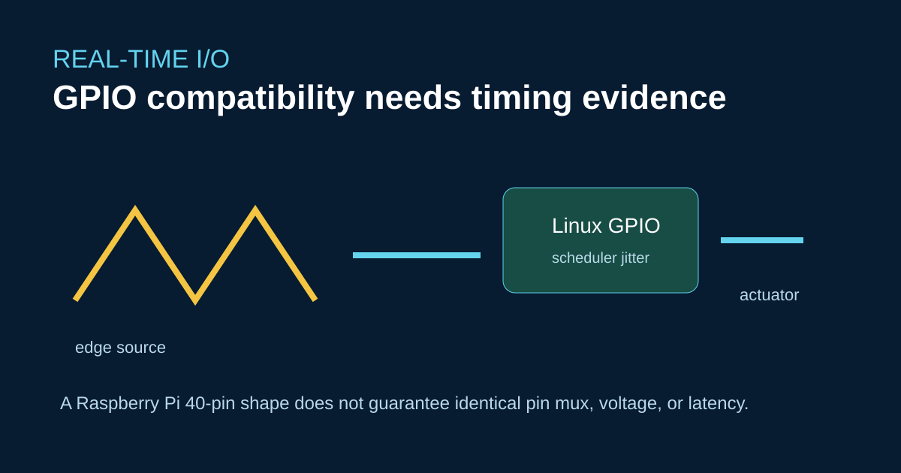

# GPIO-Timing auf ArmSoM RK3576: Echtzeitverhalten am 40-Pin-Anschluss prüfen



Für Sige5 ist ein Raspberry-Pi-kompatibler 40-Pin-Anschluss dokumentiert; CM5 stellt ähnliche Signalarten über sein Carrier Board bereit. Kompatibilität erfordert dennoch die Prüfung von Spannung, alternativen Funktionen, Pull-Zuständen, Interrupt-Routing und Timing.

## Ein Signal prüfen

```bash
gpioinfo
gpiomon --num-events=1000 gpiochip0 4
```

Messen Sie die Latenz zwischen Flanken und den Jitter mit einem Oszilloskop oder Logikanalysator. Eine GPIO-Schleife im Userspace garantiert keine harte Echtzeit. Verwenden Sie bei verbindlichen Zeitgrenzen Kerneltreiber, PREEMPT_RT oder eine dedizierte Peripherie.

## Grenzen bei der Migration

Raspberry-Pi-Overlays und BCM-GPIO-Nummern lassen sich nicht direkt auf Rockchip-Namen abbilden. Auch Jetson-GPIO-Werkzeuge sind plattformspezifisch. Passen Sie elektrisches Design und Device Tree an und wiederholen Sie anschließend EMV- und Timingtests mit dem endgültigen Carrier Board und Kabelbaum.

## Quellen

- [Sige5-Hardware](https://docs.armsom.org/armsom-sige5)
- [CM5-Hardware](https://docs.armsom.org/armsom-cm5)
- [Linux-GPIO-Dokumentation](https://docs.kernel.org/driver-api/gpio/index.html)

## Prüfung vor der Veröffentlichung

- [ ] Veröffentlichen Sie Nachweise zu Spannung und Pinmultiplexing.
- [ ] Geben Sie die Jitterverteilung an statt nur eines einzelnen Bestwerts.
- [ ] Benennen Sie Aufgaben, die einen Hardwaretimer oder Mikrocontroller erfordern.
