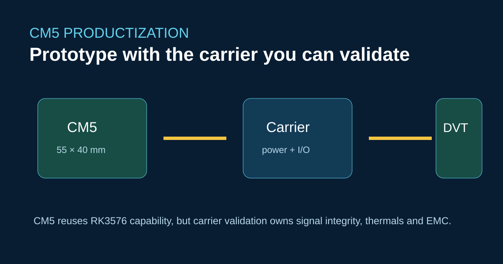
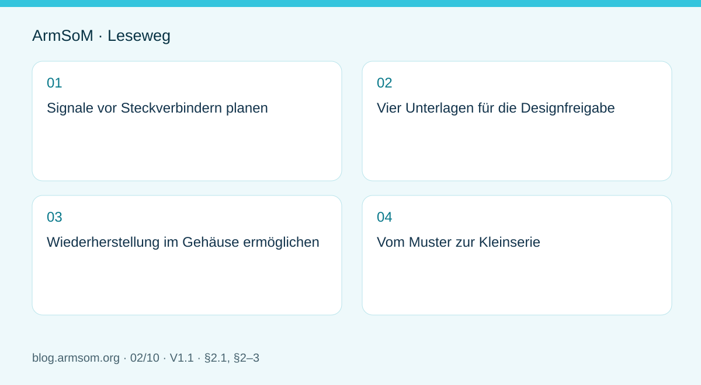

# Carrier-Board-Design für ArmSoM CM5: Vom Raspberry-Pi-Prototyp zum Produkt



CM5 ist ein 55 × 40 mm großes Rechenmodul mit RK3576. Es kann die Produktentwicklung verkürzen; das Carrier Board muss jedoch hinsichtlich Einschaltreihenfolge, Hochgeschwindigkeitsrouting, Steckerauswahl, Wärmeübertragung und Fertigungsprüfung sorgfältig ausgelegt werden.

## Reihenfolge der Inbetriebnahme

Beginnen Sie mit den Versorgungsspannungen und der seriellen Konsole. Fügen Sie Hochgeschwindigkeitsschnittstellen einzeln hinzu und prüfen Sie anschließend USB, PCIe, Kamera, Display und Ethernet unter Last. Versionieren Sie die Pintabelle. Übernehmen Sie einen Raspberry-Pi-Schaltplan nicht allein anhand übereinstimmender Signalnamen.

```bash
uname -a
cat /proc/device-tree/model
dmesg | grep -iE 'pcie|usb|dwc3|eth|drm'
```

ArmSoM weist auf ein Problem an Pin 21 des CM5 v1.2 hin, das in v1.3 behoben wurde. Legen Sie in der Produktionsdokumentation die Modulrevision fest und prüfen Sie das betroffene Netz.

## Anpassungsbedarf beim Austausch

Das Modul bietet die Rechenfunktionen des RK3576 sowie dokumentierte CSI-/PCIe-/USB-Ressourcen. Die tatsächlichen Anschlüsse und das elektrische Verhalten legt jedoch das eigene Carrier Board fest. Annahmen zu Jetson-Nano-Trägerplatinen, CUDA-Abhängigkeiten und Bootwerkzeugen lassen sich nicht direkt übertragen.

## Quellen

- [CM5-Produktvorstellung](https://docs.armsom.org/armsom-cm5)
- [CM5-IO-Erweiterungsplatine](https://docs.armsom.org/armsom-cm5-io)
- [RK3576-Übersicht](https://docs.armsom.org/blog/rk3576-sbc)

## Prüfung vor der Veröffentlichung

- [ ] Legen Sie Modulrevision und Pinbelegung verbindlich fest.
- [ ] Benennen Sie Verantwortliche für Signalqualität, thermische Prüfung und EMV-Validierung.
- [ ] Prüfen Sie Wiederherstellung und Programmierung in der Fertigung auf dem Carrier Board.

<!-- hardware-design-series expansion -->



## Geltungsbereich und Quellen

Dies ist ein thematischer Engineering-Leitfaden, keine seitenweise Übersetzung des gesamten PDF. Quellenbeispiele sind keine ArmSoM-Messungen. Spannungen, Pins, SDK/BSP und Kernel mit der tatsächlichen Platinenrevision abgleichen.

**Rockchip:** `RK3576_Hardware_Design_Guide_V1.1_20240528_CN.pdf` · V1.1 · §2.1, §2–3

## Signale vor Steckverbindern planen

Für jede Anforderung Funktion, Signal, Modulanschluss, Spannungsdomäne, Softwarekonfiguration und Testmethode festhalten. Eine Kamera benötigt neben CSI auch Steuerung, Takt, Reset und Versorgung. Beim Display kommen Touch, Hintergrundbeleuchtung und Einschaltreihenfolge hinzu. Gleiche Steckerformen belegen keine elektrische Kompatibilität.

Der RK3576-Leitfaden beschreibt Chipgrenzen, die CM5-Dokumentation die Modulgrenzen und der Trägerschaltplan die tatsächlichen Verbindungen. DDR und Kernversorgung, die bereits auf dem Modul liegen, werden nicht erneut aufgebaut. Eine Raspberry-Pi-Migration erfordert Prüfungen von Pinbelegung, Versorgung, Mechanik, Treibern und Systemimage.

## Vier Unterlagen für die Designfreigabe

| Unterlage | Zu beantwortende Frage |
| --- | --- |
| Pinbelegung | Gibt es Multiplexkonflikte, falsch genutzte reservierte Pins oder Pegelfehler? |
| Leistungsbudget | Sind Lastspitzen und Anlauf von Modul und Peripherie berücksichtigt? |
| PCB-Vorgaben | Welche Impedanz, Längenreserve, Referenzebene und Stecker gelten je Kanal? |
| Testmatrix | Wie werden Boot, Wiederherstellung, Wärme, Parallelbetrieb und Spannungsausfall geprüft? |

Kapitel 2–3 der Quelle geben eine Prüfstruktur vor. Zahlenwerte müssen zur Schnittstelle und Topologie passen. Die gesamte Kanalreserve darf nicht der Trägerplatine zugewiesen werden: Modul, Board-to-Board-Stecker und Kabel verbrauchen ebenfalls Reserven.

## Wiederherstellung im Gehäuse ermöglichen

UART, Recovery-Bedienung und Programmierkontakte vor dem Mechanikabschluss festlegen. Auch das montierte Produkt braucht einen kontrollierten Wiederherstellungsweg. Zunächst das Image auf einem bekannten Modul mit IO-Platine prüfen, danach dasselbe Modul mit Image und Peripherie auf den neuen Träger übertragen.

Nach dem ersten Boot USB-Hotplug, Speicher, Displaywechsel und Kameras einzeln testen und erst dann zur Anwendungsbelastung kombinieren. Fehlerprotokolle, Versorgung und Umgebungstemperatur dokumentieren.

## Vom Muster zur Kleinserie

Modulrevision, BOM, Steckverbinder, Lagenaufbau und Image festschreiben. Pro Gerät Seriennummer und Testergebnisse speichern. Bootfähigkeit, Schnittstellenfunktion und Dauerlaststabilität sind getrennte Kriterien. Nach Änderungen an Modul oder Peripherie betroffene Tests neu bewerten.

CM5 ermöglicht den Fokus auf eigene Schnittstellen, Gehäuse und Anwendung. Daraus folgt weder universelle Trägerkompatibilität noch eine in diesem Artikel durchgeführte Hardwarevalidierung.

## Abbildung aus der Quelle

[](/assets/hardware-design-series/rk3576-en.png)

Original aus dem englischen Dokument, gemeinsam für EN/RU/DE. Referenzdesign, kein ArmSoM-Platinenschaltplan.

`RK3576_Hardware_Design_Guide_V1.1_20240528_EN.pdf` · PDF p. 22.

## Produkte und Entwicklungsunterlagen

- **CM5** — [Produktseite](https://www.armsom.org/cm5) · [Dokumentation](https://docs.armsom.org/armsom-cm5)

## Weitere Beiträge der Reihe

- [RK3576 in Betrieb nehmen: Minimalsystem und erste Einschaltprüfung](/de/articles/rk3576-hardware-bringup/)
- [RK3576-Hochgeschwindigkeitsschnittstellen: Schaltplan und PCB gemeinsam prüfen](/de/articles/rk3576-high-speed-interface-design/)
- [RK3588S-Hardwaredesign: vom Referenzschaltplan zur CM7s-Trägerplatine](/de/articles/rk3588s-cm7s-carrier-design/)
- [RK3588 für Edge-KI: Versorgung, Kühlung und Erweiterung gemeinsam planen](/de/articles/rk3588-edge-ai-hardware-design/)
- [RK3588-PCB-Prüfung: Lagenaufbau, Impedanz und Leiterführung](/de/articles/rk3588-high-speed-pcb-review/)
- [RK3506-HMI-Hardware: Entwicklung mit CM1 oder Forge1](/de/articles/rk3506-industrial-hmi-hardware/)
- [RK3308-Varianten: Hardwarekompatibilität für P2-Pro-Audioprojekte](/de/articles/rk3308-hardware-variant-compatibility/)
- [RK3588S und RK3588S2: Prüfungen vor einer Hardwareänderung](/de/articles/rk3588s-rk3588s2-hardware-differences/)
- [Vom Rockchip-Prototyp zur Serie: Prozessvorgaben und Prüfunterlagen](/de/articles/rockchip-hardware-production-checklist/)
