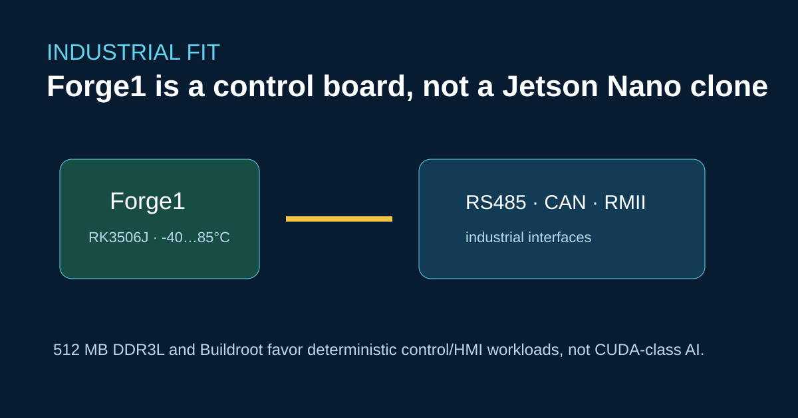

# ArmSoM Forge1, Raspberry Pi und Jetson Nano: Zuerst industrielle Schnittstellen bewerten



Forge1 ist ein Industrieboard mit RK3506J und drei Cortex-A7-Kernen, 512 MB DDR3L, zwei 100-Mbit/s-Ethernet-Anschlüssen sowie Schnittstellen wie RS485 und CAN. Es ist für Gateways, HMI, SPS und Gerätesteuerungen ausgelegt. CUDA-Arbeitslasten eines Jetson Nano gehören nicht zu diesem Einsatzprofil.

## Die Eignung praxisnah prüfen

Wählen Sie Forge1, wenn Temperaturbereich, Feldbusanbindung und deterministische Bedien- beziehungsweise Steuerabläufe wichtiger als GPU-/NPU-Durchsatz sind. Der dokumentierte Betriebsbereich von -40 °C bis 85 °C und die Ausrichtung auf Buildroot sind wesentliche Auswahlkriterien und sollten ausdrücklich angegeben werden.

```bash
ip -details link show can0
ip link set can0 type can bitrate 1000000 dbitrate 3000000 fd on
ip link set can0 up
candump can0
```

Prüfen Sie Busabschluss, Isolation und Watchdog-Verhalten mit dem endgültigen Kabelbaum. Ein Raspberry-Pi-Zubehör für den 40-Pin-Anschluss kann mechanisch passen; Spannung, Pinmultiplexing und Softwareunterstützung müssen trotzdem geprüft werden.

## Grenzen bei der Migration

Die Portierung einer Python-GPIO-Anwendung ist meist weniger aufwendig als die eines Jetson-CUDA-Stacks. Planen Sie Aufwand für Buildroot-Paketintegration, Updates im Feldeinsatz und industrielle Validierung ein und bewerten Sie Forge1 anhand des konkreten Anwendungsfalls.

## Quellen

- [Forge1-Dokumentation](https://docs.armsom.org/zh/armsom-forge1)
- [ArmSoM-Entwicklerzentrum](https://docs.armsom.org/)

## Prüfung vor der Veröffentlichung

- [ ] Geben Sie Temperatur-, Speicher- und Schnittstellengrenzen an.
- [ ] Ergänzen Sie die elektrische Validierung von CAN und RS485.
- [ ] Bewerten Sie deterministische Steuerung und KI-Leistung getrennt.
