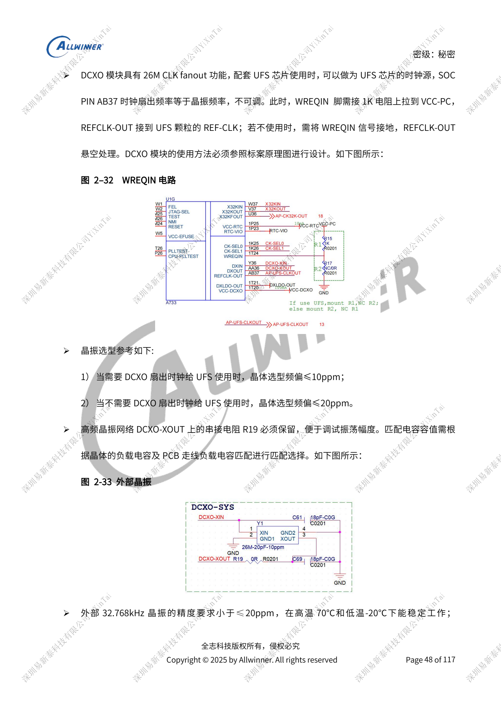
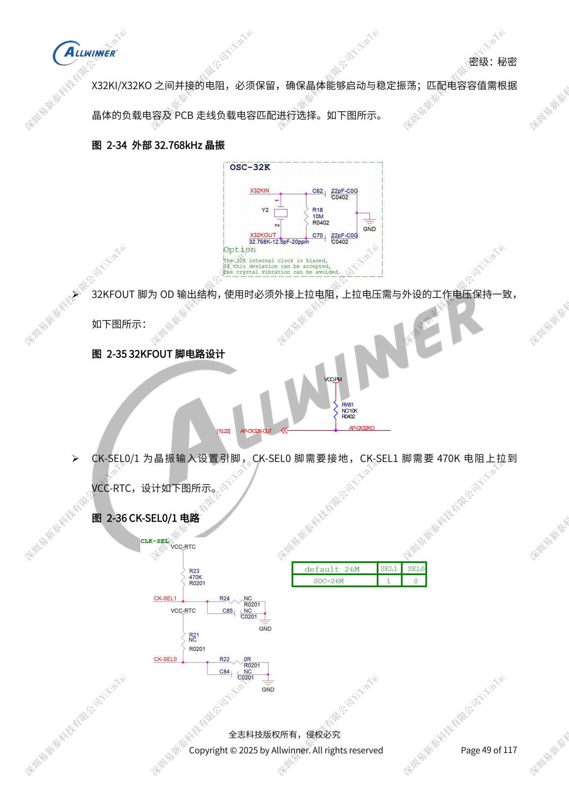
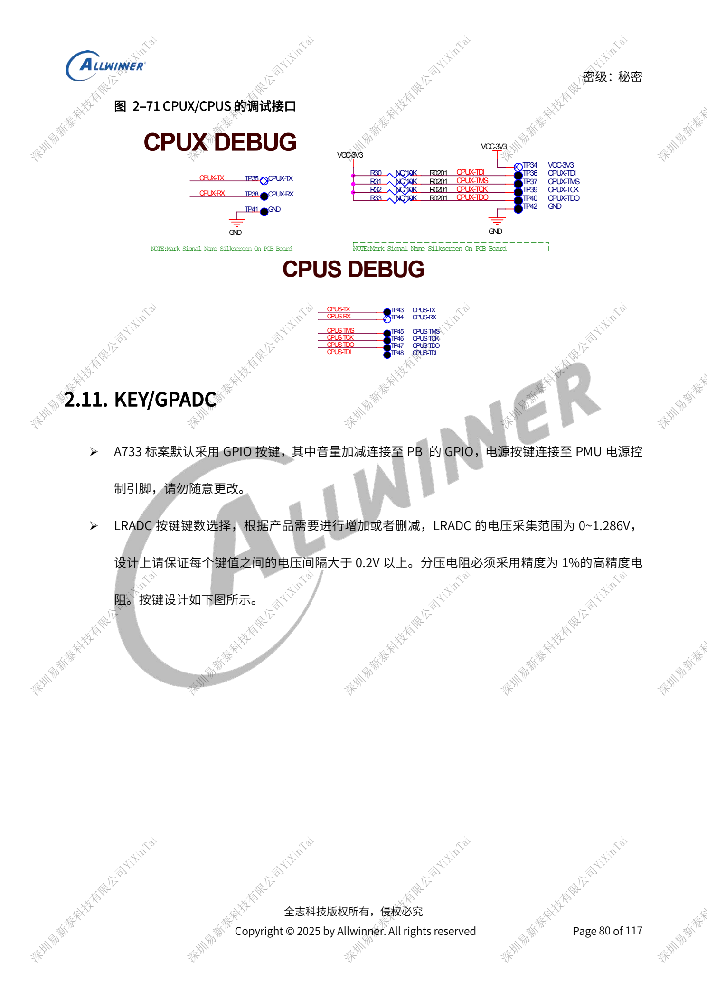

# A733-Takte und Wiederherstellung: 26MHz, GPIO und FEL

Dieser quellenbasierte Hardwarebeitrag dient als Plattformreferenz; ein passendes ArmSoM-Board ist nicht bestätigt. Parameter stammen aus der Quelle, nicht aus ArmSoM-Messungen. Siliziumrevision, PCB, SDK/BSP, Kernel, Firmware und Peripheriespezifikationen vor Umsetzung prüfen.

Die A733-Quelle ist ein V0.9-Entwurf; Parameter und Softwareunterstützung können sich ändern. Keine endgültige Serienfreigabe.

**Design draft V0.9 §2.3, §2.10–2.11; PDF 45–54, 80–83**

## H618-Schaltung mit 24MHz nicht übernehmen

Dieser A733-Entwurf sieht nur 26MHz vor. AB37 gibt die unveränderbare Quarzfrequenz aus: ≤10ppm für UFS, sonst ≤20ppm. Mit REFCLK-OUT WREQIN über 1kΩ nach VCC-PC ziehen, sonst erden und REFCLK-OUT offen lassen. XOUT-Widerstand erhalten, Kapazitäten nach CL und PCB-Parasiten wählen. CK-SEL0 erden, CK-SEL1 über 470kΩ nach VCC-RTC. Open-Drain-32KFOUT passend zum Empfänger hochziehen. Präzises Wakeup benötigt externen 32.768kHz-Quarz, Referenz ≤20ppm und stabil von -20 bis 70°C.

## Boot- und Debugpins

JTAG-SEL High erlaubt PF/PB per Software, Low erzwingt PB. TEST offen ohne lange Stichleitung lassen. FEL Low startet Programmierung; 1nF an FEL/GPADC-Tasten erhalten. AP-RESET/AP-NMI jeweils mit 1nF, Open-Drain-NMI nach VCC-RTC hochziehen. CPUX-JTAG oder UART erhalten, PF bevorzugen; PB-UART0-Jumper und CPUS-PL/PM-Prüfpunkte für Standby vorsehen. UBOOT/FEL oder Lautstärke+POWER als Rettungsweg erhalten. LRADC: 0–1.286V, >0.2V Abstand und 1%-Teiler; GPADC separat: 12-bit-Auflösung, 10-bit-Genauigkeit, 0–AVCC.

## GPIO-Domänen und Bootimpulse

PL/PM sind dauerhaft versorgte CPUS-Domänen, Referenz PL=3.3V, PM=1.8V. Wake-Interrupts und Pull-ups müssen zur aktiven Domäne passen. PL0/1 dient PMIC, Charger und Type-C mit intern 4.7kΩ und extern 2.2kΩ in der Referenz, nicht beliebiger Peripherie. PC/PF senden beim Start Speicherprobes und dürfen Verstärker, LEDs oder Sensoren nicht direkt steuern. Pull-ups folgen ihrer IO-Versorgung; Änderungen brauchen passende Software-Pegeleinstellungen gegen Rückspeisung und Standby-Leckstrom.

## Referenzabbildungen

Die Referenzseiten behalten chinesische Bildbeschriftungen. Keine passende englische Ausgabe gefunden; alle vier Sprachen verwenden die chinesischen Originale. Textparameter und Schritte bleiben kopierbar, Bilder dienen dem Abgleich. Nummern bezeichnen physische PDF-Seiten.

## ArmSoM-Plattform auswählen

Für ArmSoM-Projekte Plattform anhand offizieller Produkte und Dokumentation wählen und Prozessor, Schnittstellen und Software erneut prüfen. A733/H618-Schaltungen nicht pauschal auf andere SoCs übertragen.

- [ArmSoM](https://www.armsom.org/)
- [ArmSoM Docs](https://docs.armsom.org/)

## Weitere Beiträge

- [A733-Versorgung: AXP318W, Sequenzen und Ladepfade](/de/articles/a733-power-sequence-pmic-design/)
- [A733-Speicherdesign: LPDDR4/4X/5, eMMC und UFS](/de/articles/a733-ddr-emmc-ufs-design/)
- [A733-Anzeige und Kameras: Multiplexing, Versorgung und Eingangsbrücken](/de/articles/a733-display-camera-interface-design/)
- [A733-Peripherie: USB, PCIe, Wi-Fi, Ethernet und Audio](/de/articles/a733-usb-pcie-network-audio-design/)
- [A733-Zuverlässigkeit: ESD, EMI, Überspannung und Wärme](/de/articles/a733-esd-emi-thermal-review/)
- [A733 · Serienübersicht](/de/articles/a733-hardware-design-series/)
