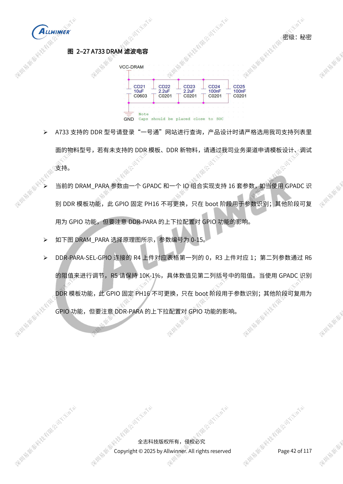
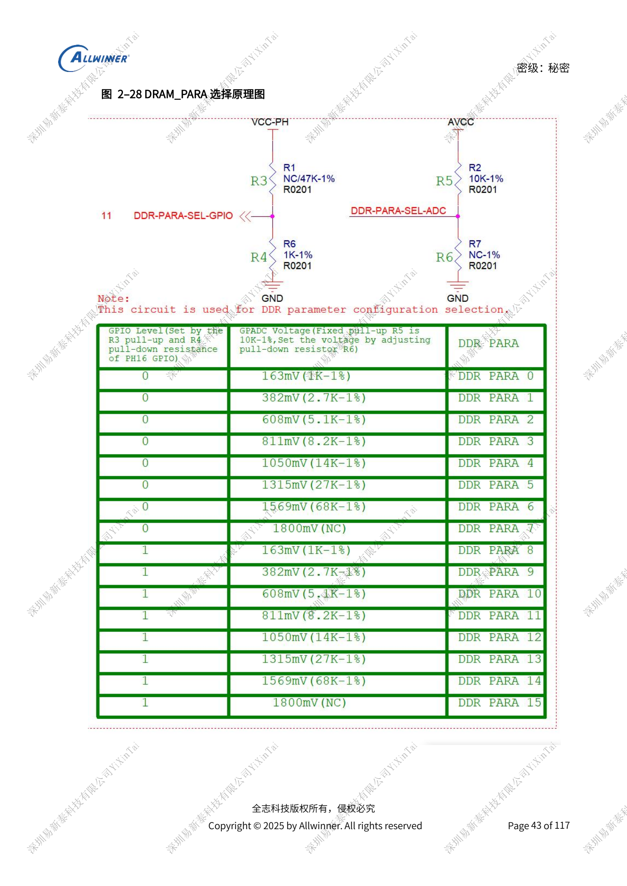
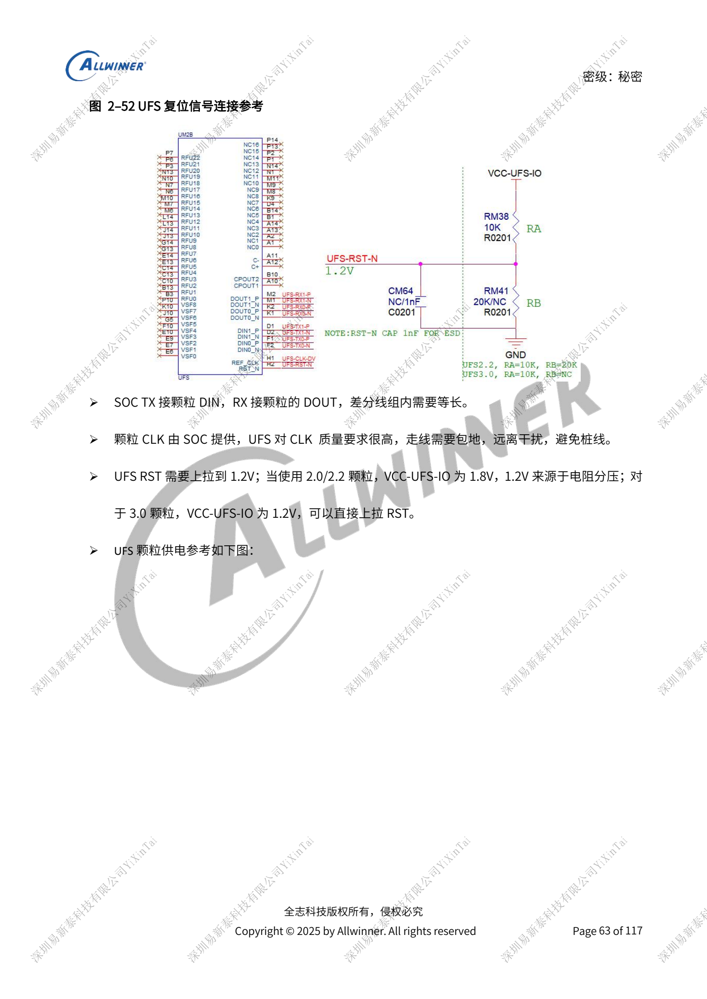

# A733-Speicherdesign: LPDDR4/4X/5, eMMC und UFS

Dieser quellenbasierte Hardwarebeitrag dient als Plattformreferenz; ein passendes ArmSoM-Board ist nicht bestätigt. Parameter stammen aus der Quelle, nicht aus ArmSoM-Messungen. Siliziumrevision, PCB, SDK/BSP, Kernel, Firmware und Peripheriespezifikationen vor Umsetzung prüfen.

Die A733-Quelle ist ein V0.9-Entwurf; Parameter und Softwareunterstützung können sich ändern. Keine endgültige Serienfreigabe.

**Design draft V0.9 §2.2, §2.4–2.6; PDF 41–44, 55–65**

## Gleiche DDR-Spannungen machen Schienen nicht austauschbar

Typ, Chip-Selects und Breite vor der zusammengehörigen Schaltplan-/PCB-Vorlage festlegen; Bauteilbezeichnungen erhalten. Differentiell 85Ω, einpolig 50Ω. SoC-SZQ: 120Ω mit 1% nach Masse; bausteinseitig typischerweise 240Ω mit 1% nach VCC-VDDQ, Datenblatt prüfen. GPADC plus festes PH16 wählt 16 DRAM_PARA-Sätze 0–15. Spätere GPIO-Nutzung muss Bootbeschaltung berücksichtigen. Kondensatorplätze bis zur Validierung erhalten.

## Unterschiedliche eMMC-/SD-Grenzen

HS200/HS400 erfordern 1.8V an VCCQ und PC mit monotonem Hochlauf. HS400 mit 200MHz empfiehlt <1000mil; allgemein stehen separat <2000mil und ≤300mil zu CLK. Den allgemeinen Wert nicht für den schnelleren Modus übernehmen. 33Ω am SoC-Takt, 50Ω-Leitungen, NC/RFU offen. SD3.0 benötigt 3.3V und 1.8V zur internen Umschaltung. CLK-Parallelkapazität ≤15pF; TVS SD3.0 ≤5pF, SD2.0 <35pF; 1kΩ in DET erhalten. Metallkartenhalter brauchen Softstart, Versorgungsschutz nicht durch 0Ω ersetzen.

## UFS-Generation vor Versorgung festlegen

Zwei Lanes, laut Entwurf bis 11.6Gbps/lane; UFS3.1 nur Speicherfunktion. UFS2.0/2.2: VCCQ2=1.8V, VCC=3.3V. UFS3.0/3.1: VCCQ=1.2V, VCC standardmäßig 2.5V, optional 3.3V. DC8SET und PMIC gemeinsam konfigurieren. TX an DIN, RX an DOUT. RST benötigt 1.2V, bei 1.8V-IO daher einen Teiler. SoC-Takt abschirmen und Stichleitungen vermeiden. Ripple <5%, Versorgungsbreite >30mil, mindestens 600mA. Unbenutzte UFS-Signale dürfen offen bleiben, erforderliche Versorgungen bleiben aktiv.

## Parameterübersicht

| Punkt | Quellenreferenz |
| --- | --- |
| Versorgungsdomäne | LPDDR4 / LPDDR4X / LPDDR5 |
| VCC-DRAM: DCDC7 | 1.1V / 1.1V / 1.05V |
| VCC-DRAML: DCDC6 | 0.8V / 0.6V / 0.5V |
| Baustein VCC-VDDQ | DCDC7 1.1V / DCDC6 0.6V / DCDC6 0.5V |
| LPDDR5 VDD2L | ELDO1 0.9V |
| Baustein / SoC 1.8V | CLDO1 / CLDO3 |

## Referenzabbildungen

Die Referenzseiten behalten chinesische Bildbeschriftungen. Keine passende englische Ausgabe gefunden; alle vier Sprachen verwenden die chinesischen Originale. Textparameter und Schritte bleiben kopierbar, Bilder dienen dem Abgleich. Nummern bezeichnen physische PDF-Seiten.

## ArmSoM-Plattform auswählen

Für ArmSoM-Projekte Plattform anhand offizieller Produkte und Dokumentation wählen und Prozessor, Schnittstellen und Software erneut prüfen. A733/H618-Schaltungen nicht pauschal auf andere SoCs übertragen.

- [ArmSoM](https://www.armsom.org/)
- [ArmSoM Docs](https://docs.armsom.org/)

## Weitere Beiträge

- [A733-Versorgung: AXP318W, Sequenzen und Ladepfade](/de/articles/a733-power-sequence-pmic-design/)
- [A733-Takte und Wiederherstellung: 26MHz, GPIO und FEL](/de/articles/a733-clock-gpio-recovery-design/)
- [A733-Anzeige und Kameras: Multiplexing, Versorgung und Eingangsbrücken](/de/articles/a733-display-camera-interface-design/)
- [A733-Peripherie: USB, PCIe, Wi-Fi, Ethernet und Audio](/de/articles/a733-usb-pcie-network-audio-design/)
- [A733-Zuverlässigkeit: ESD, EMI, Überspannung und Wärme](/de/articles/a733-esd-emi-thermal-review/)
- [A733 · Serienübersicht](/de/articles/a733-hardware-design-series/)
