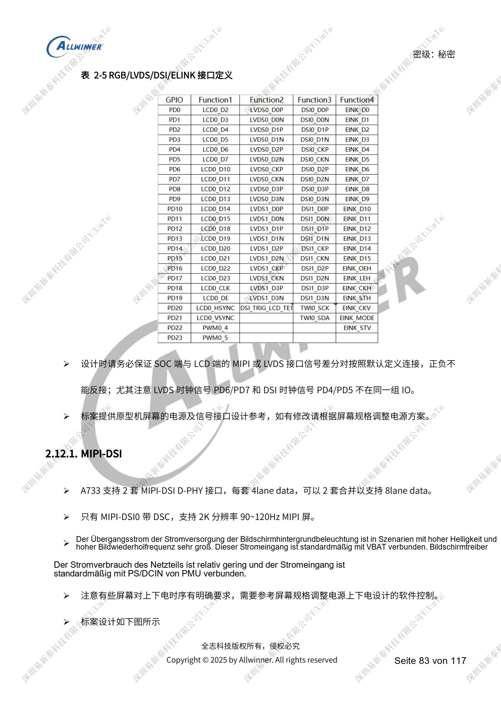
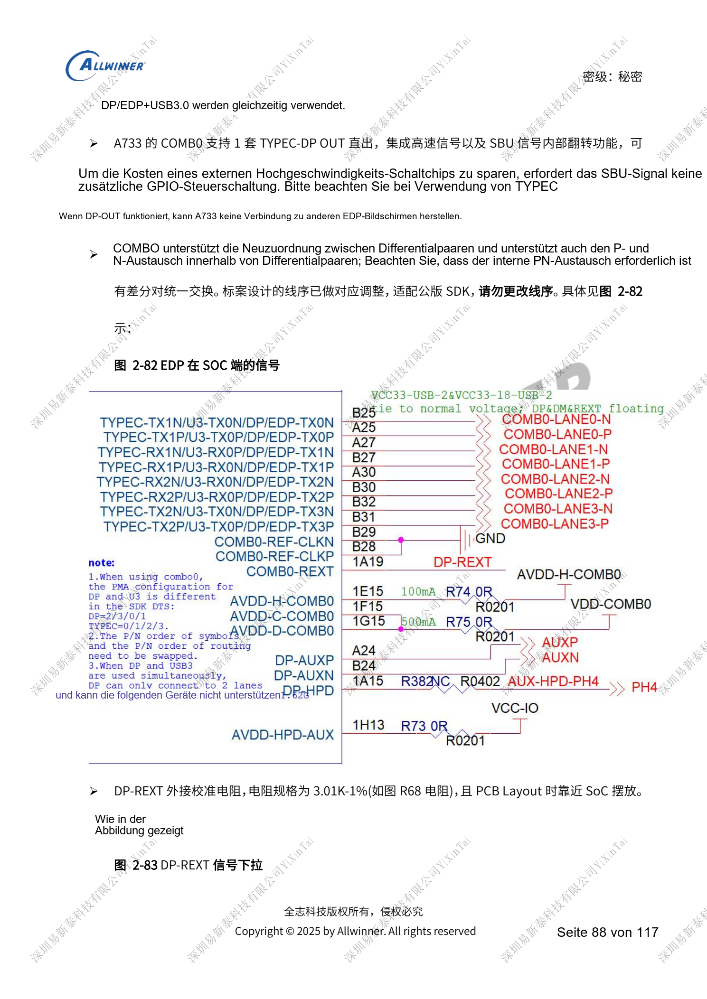
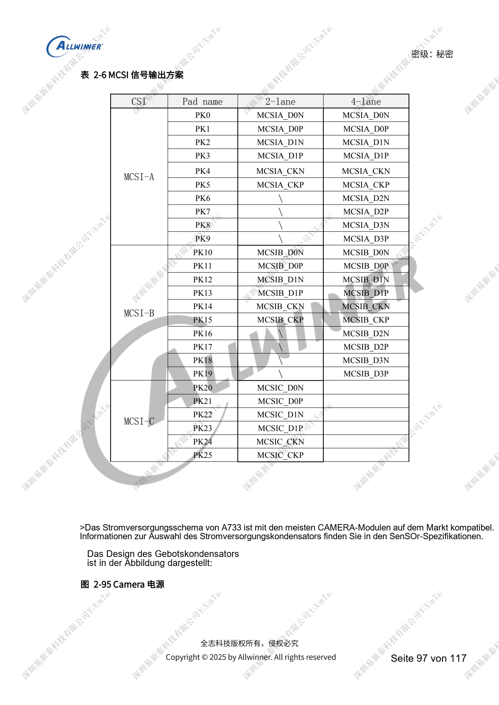

# A733-Anzeige und Kameras: Multiplexing, Versorgung und Eingangsbrücken

Dieser quellenbasierte Hardwarebeitrag dient als Plattformreferenz; ein passendes ArmSoM-Board ist nicht bestätigt. Parameter stammen aus der Quelle, nicht aus ArmSoM-Messungen. Siliziumrevision, PCB, SDK/BSP, Kernel, Firmware und Peripheriespezifikationen vor Umsetzung prüfen.

Die A733-Quelle ist ein V0.9-Entwurf; Parameter und Softwareunterstützung können sich ändern. Keine endgültige Serienfreigabe.

**Design draft V0.9 §2.12–2.15, §2.18–2.19; PDF 83–100, 102–106**

## Zuerst die Displayressourcen zuordnen

Zwei MIPI-DSI mit je vier Lanes können acht Lanes bilden; nur DSI0 hat DSC. Vier LVDS-Sätze mit je vier Datenlanes: Single-Link 1366×768@60Hz, Dual-Link 1920×1080@60Hz. RGB888 verteilt sich auf PD/PB; D0/1/8/9/16/17 sind 3.3V-Signale einer anderen Domäne. LVDS-Takt PD6/PD7 unterscheidet sich von DSI PD4/PD5; ähnliche Stecker bedeuten keine Kompatibilität. SPI-Incell nutzt SPI1, Pinbelegung und Versorgung hängen vom Panel ab. Backlight-PWM über 20kHz, Referenz 30–50kHz; Lastsprünge mit der Versorgung prüfen.

## DP und USB teilen COMB0

DP/eDP wird nur über COMB0 geführt. Vier Lanes schließen USB3 aus, zwei erlauben Parallelbetrieb. Type-C-DP-OUT plus separates eDP-Panel nicht zusagen. P/N-Tausch muss einheitlich für alle Paare erfolgen; die Referenzreihenfolge ist auf das SDK abgestimmt. DP-REXT: 3.01kΩ mit 1%; eDP: 100Ω und 100nF, gemeinsames Type-C-USB3/DP: 95Ω-Referenz. Erforderliche Schienen bleiben auch ungenutzt aktiv. HDMI OUT 2.0 bis 4K60, 0.8V/1.8V versorgt, REXT 1.62kΩ mit 1%, Paare 100Ω.

## Kameras und Videoeingänge

MCSIA/B bieten je vier Lanes, MCSIC zwei, Referenzmaximum 2Gbps/lane, alternativ NCSI. Kameratausch erfordert Softwareanpassung. MCLK mit 33Ω am SoC und optionaler Kapazität am Stecker. AVDD-CSI sauber separat versorgen; gemeinsame Fokus-/Digitalversorgung hängt von Sequenz, Spannung und Strom ab. TWI-Pull-ups erhalten, fremde Geräte und Adresskonflikte paralleler Sensoren vermeiden. A733 hat keinen nativen HDMI-Eingang: CSI-Brücke mit HDMI1.4-Referenzmaximum. DP IN nutzt ebenfalls externen LT7911D. Der Text nennt MIPI DSI und verweist auf CAMERA; Protokollrichtung anhand der Brückendokumentation klären.

## Referenzabbildungen

Die Referenzseiten behalten chinesische Bildbeschriftungen. Keine passende englische Ausgabe gefunden; alle vier Sprachen verwenden die chinesischen Originale. Textparameter und Schritte bleiben kopierbar, Bilder dienen dem Abgleich. Nummern bezeichnen physische PDF-Seiten.

## ArmSoM-Plattform auswählen

Für ArmSoM-Projekte Plattform anhand offizieller Produkte und Dokumentation wählen und Prozessor, Schnittstellen und Software erneut prüfen. A733/H618-Schaltungen nicht pauschal auf andere SoCs übertragen.

- [ArmSoM](https://www.armsom.org/)
- [ArmSoM Docs](https://docs.armsom.org/)

## Weitere Beiträge

- [A733-Versorgung: AXP318W, Sequenzen und Ladepfade](/de/articles/a733-power-sequence-pmic-design/)
- [A733-Speicherdesign: LPDDR4/4X/5, eMMC und UFS](/de/articles/a733-ddr-emmc-ufs-design/)
- [A733-Takte und Wiederherstellung: 26MHz, GPIO und FEL](/de/articles/a733-clock-gpio-recovery-design/)
- [A733-Peripherie: USB, PCIe, Wi-Fi, Ethernet und Audio](/de/articles/a733-usb-pcie-network-audio-design/)
- [A733-Zuverlässigkeit: ESD, EMI, Überspannung und Wärme](/de/articles/a733-esd-emi-thermal-review/)
- [A733 · Serienübersicht](/de/articles/a733-hardware-design-series/)

<!-- editable-source-tables -->

## Anhang: vollständige MCSI-Pinzuordnung

V0.9 · Table 2-6 · PDF 98

| CSI | Pad | 2-lane | 4-lane |
| --- | --- | --- | --- |
| MCSI-A | PK0 | MCSIA_D0N | MCSIA_D0N |
| MCSI-A | PK1 | MCSIA_D0P | MCSIA_D0P |
| MCSI-A | PK2 | MCSIA_D1N | MCSIA_D1N |
| MCSI-A | PK3 | MCSIA_D1P | MCSIA_D1P |
| MCSI-A | PK4 | MCSIA_CKN | MCSIA_CKN |
| MCSI-A | PK5 | MCSIA_CKP | MCSIA_CKP |
| MCSI-A | PK6 | \ | MCSIA_D2N |
| MCSI-A | PK7 | \ | MCSIA_D2P |
| MCSI-A | PK8 | \ | MCSIA_D3N |
| MCSI-A | PK9 | \ | MCSIA_D3P |
| MCSI-B | PK10 | MCSIB_D0N | MCSIB_D0N |
| MCSI-B | PK11 | MCSIB_D0P | MCSIB_D0P |
| MCSI-B | PK12 | MCSIB_D1N | MCSIB_D1N |
| MCSI-B | PK13 | MCSIB_D1P | MCSIB_D1P |
| MCSI-B | PK14 | MCSIB_CKN | MCSIB_CKN |
| MCSI-B | PK15 | MCSIB_CKP | MCSIB_CKP |
| MCSI-B | PK16 | \ | MCSIB_D2N |
| MCSI-B | PK17 | \ | MCSIB_D2P |
| MCSI-B | PK18 | \ | MCSIB_D3N |
| MCSI-B | PK19 | \ | MCSIB_D3P |
| MCSI-C | PK20 | MCSIC_D0N | — |
| MCSI-C | PK21 | MCSIC_D0P | — |
| MCSI-C | PK22 | MCSIC_D1N | — |
| MCSI-C | PK23 | MCSIC_D1P | — |
| MCSI-C | PK24 | MCSIC_CKN | — |
| MCSI-C | PK25 | MCSIC_CKP | — |
