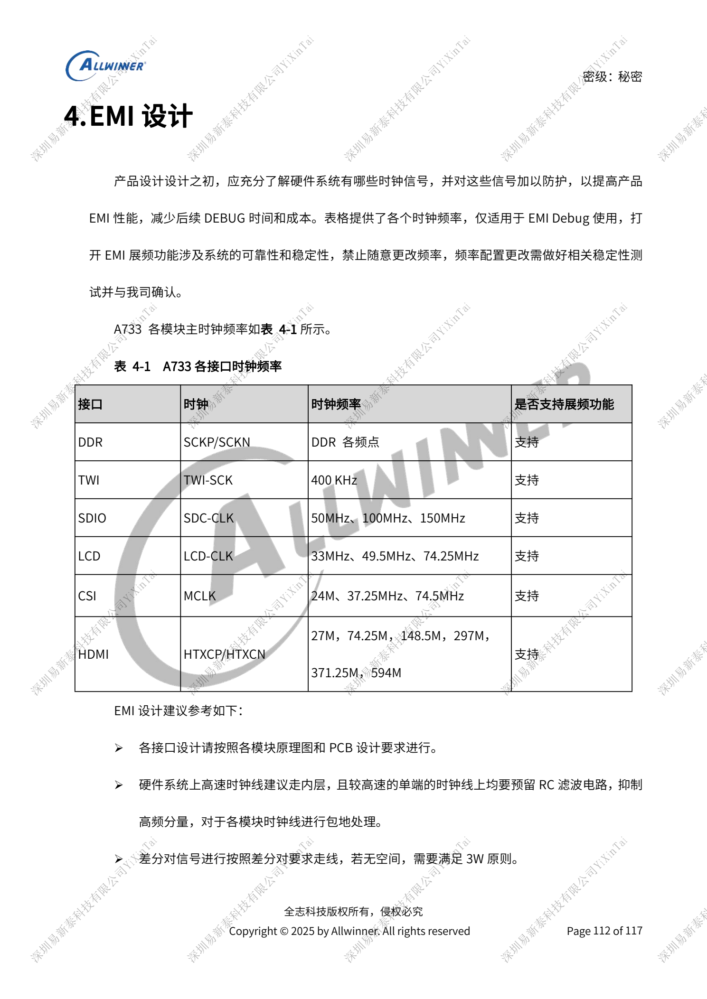
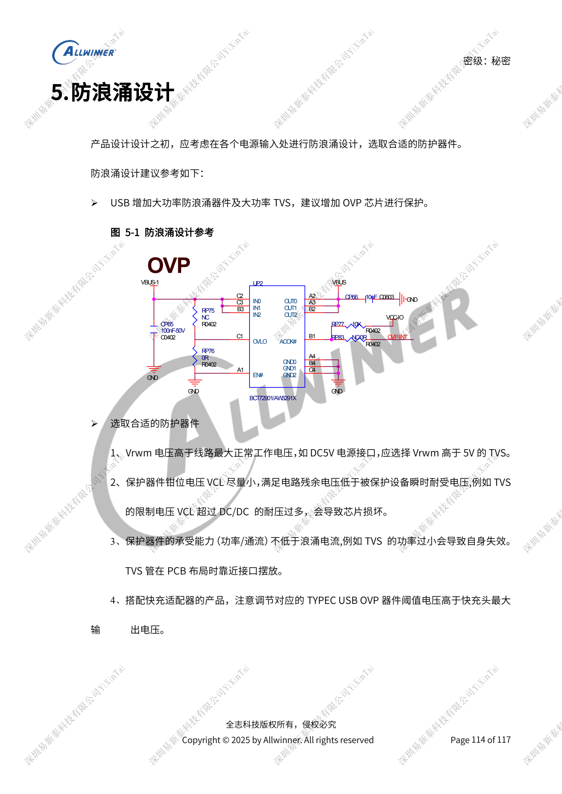

# A733-Zuverlässigkeit: ESD, EMI, Überspannung und Wärme

Dieser quellenbasierte Hardwarebeitrag dient als Plattformreferenz; ein passendes ArmSoM-Board ist nicht bestätigt. Parameter stammen aus der Quelle, nicht aus ArmSoM-Messungen. Siliziumrevision, PCB, SDK/BSP, Kernel, Firmware und Peripheriespezifikationen vor Umsetzung prüfen.

Die A733-Quelle ist ein V0.9-Entwurf; Parameter und Softwareunterstützung können sich ändern. Keine endgültige Serienfreigabe.

**Design draft V0.9 §3–6; PDF 110–116**

## ESD ist mehr als TVS am Anschluss

Offene Kopfhörer-, USB-, TF-, Mikrofon- und Tastenleitungen schützen. Serienwiderstände an Erkennungspins vorsehen; SoC-Reset behält 1nF. Unbenutzte TEST-Pins nicht als lange Stichleitungen führen. Schutz auf der Tochterplatine platzieren und über leitfähigen Schaum lokal zum Displaymetall ableiten statt über FPC zur Hauptplatine. Mehrere blanke Masseflächen mit mindestens 25mm² an beiden PCB-Seiten vorsehen, per Vias an durchgängige Masse. Display-, Touch-, Kamerareset und Watchdog sind Wiederherstellung, kein ESD-Prüfnachweis.

## EMI mit einer Taktliste beginnen

Schnelle Takte innen mit Quell-RC, durchgängiger Referenz und Abschirmung führen; bei Platzmangel Paarabstände prüfen. Leitungen/Bauteile unter Kabeln vermeiden, lange Flexleitungen abschirmen, Tochterplatinen wirksam erden und Lautsprecherdrähte verdrillen. Die Takttabelle dient der Diagnose, nicht beliebigen DDR-/Displayfrequenz- oder Spread-Spectrum-Änderungen bei Spektralspitzen. Änderungen brauchen Stabilitätsprüfung. Bei gemeinsamem USB/BMU-DP/DM BMU-Zweigwiderstände nahe der Verzweigung platzieren.

## Grenzen für Surge- und Wärmefreigabe

TVS-Vrwm oberhalb der höchsten Betriebsspannung wählen, Restspannung nach Klemmung unter der transienten Bauteilfestigkeit, Leistung/Strom passend zum Zielimpuls. Schutz am Eingang, Schnelllade-OVP passend zur höchsten Adapterspannung. TVS-Nennspannung allein genügt nicht. Temperatur im tatsächlichen Gerät messen und CPU-/DDR-Drosselung oder Kernabschaltung samt Leistung dokumentieren. DVFS ersetzt keinen Wärmeweg. Abschnitte 3.2 und 6 verweisen ohne vollständige Routing-/Wärmewiderstandsdaten auf separate Handbücher; dieser Beitrag belegt keine thermische Freigabe oder Zertifizierung.

## Parameterübersicht

| Punkt | Quellenreferenz |
| --- | --- |
| EMI-Taktreferenzen | TWI 400kHz; SDIO 50/100/150MHz; LCD 33/49.5/74.25MHz; CSI MCLK 24/37.25/74.5MHz; HDMI 27/74.25/148.5/297/371.25/594MHz |

## Referenzabbildungen

Die Referenzseiten behalten chinesische Bildbeschriftungen. Keine passende englische Ausgabe gefunden; alle vier Sprachen verwenden die chinesischen Originale. Textparameter und Schritte bleiben kopierbar, Bilder dienen dem Abgleich. Nummern bezeichnen physische PDF-Seiten.

## ArmSoM-Plattform auswählen

Für ArmSoM-Projekte Plattform anhand offizieller Produkte und Dokumentation wählen und Prozessor, Schnittstellen und Software erneut prüfen. A733/H618-Schaltungen nicht pauschal auf andere SoCs übertragen.

- [ArmSoM](https://www.armsom.org/)
- [ArmSoM Docs](https://docs.armsom.org/)

## Weitere Beiträge

- [A733-Versorgung: AXP318W, Sequenzen und Ladepfade](/de/articles/a733-power-sequence-pmic-design/)
- [A733-Speicherdesign: LPDDR4/4X/5, eMMC und UFS](/de/articles/a733-ddr-emmc-ufs-design/)
- [A733-Takte und Wiederherstellung: 26MHz, GPIO und FEL](/de/articles/a733-clock-gpio-recovery-design/)
- [A733-Anzeige und Kameras: Multiplexing, Versorgung und Eingangsbrücken](/de/articles/a733-display-camera-interface-design/)
- [A733-Peripherie: USB, PCIe, Wi-Fi, Ethernet und Audio](/de/articles/a733-usb-pcie-network-audio-design/)
- [A733 · Serienübersicht](/de/articles/a733-hardware-design-series/)
