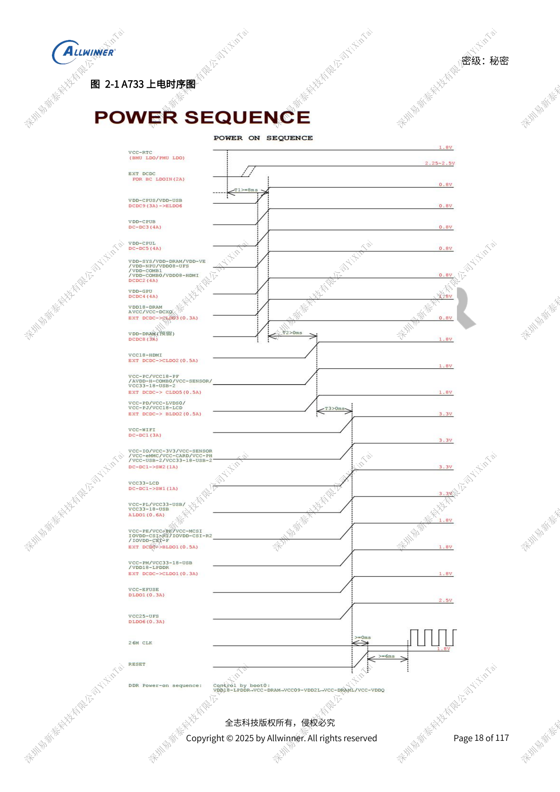
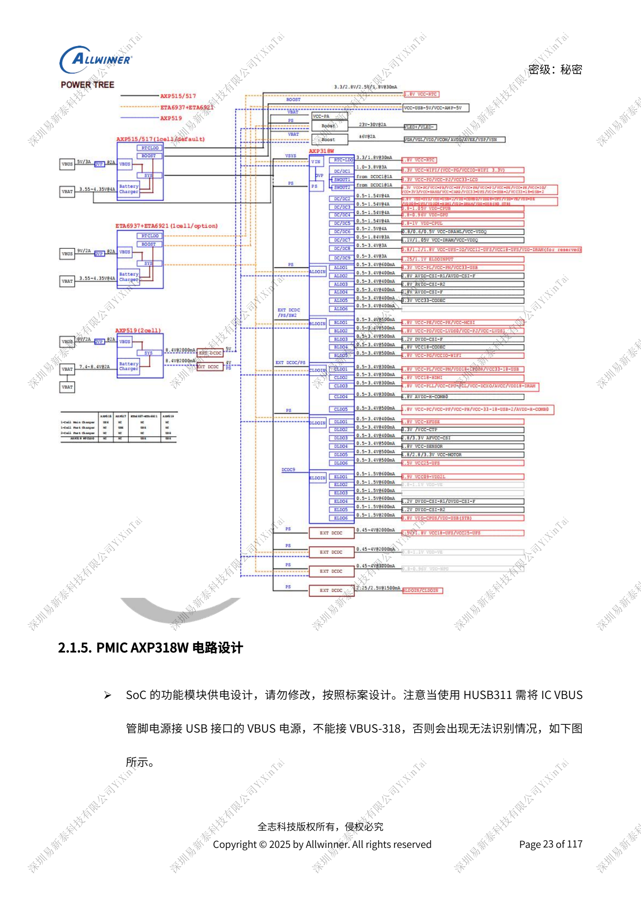
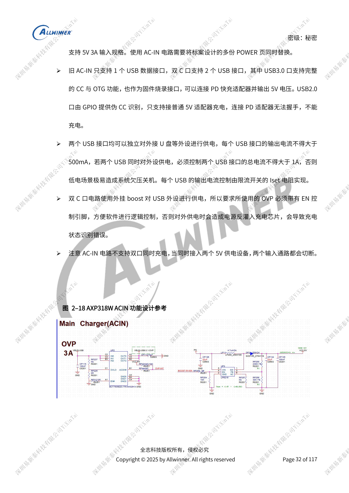

# A733-Versorgung: AXP318W, Sequenzen und Ladepfade

Dieser quellenbasierte Hardwarebeitrag dient als Plattformreferenz; ein passendes ArmSoM-Board ist nicht bestätigt. Parameter stammen aus der Quelle, nicht aus ArmSoM-Messungen. Siliziumrevision, PCB, SDK/BSP, Kernel, Firmware und Peripheriespezifikationen vor Umsetzung prüfen.

Die A733-Quelle ist ein V0.9-Entwurf; Parameter und Softwareunterstützung können sich ändern. Keine endgültige Serienfreigabe.

**Design draft V0.9 §2.1; PDF 17–41**

## Referenz-Versorgungsbaum erhalten

AXP318W bietet neun DCDCs, zwei Switches und 29 LDOs; DCDC2–9 arbeiten mit COT. Programmierte Schienen und gemeinsam versorgte DCXO/PLL nicht allein wegen gleicher Spannung umverteilen. VCC-RTC startet zuerst und bleibt aktiv. Reset wird nach drei stabilen Versorgungsschritten freigegeben; der Hauptoszillator startet 6ms nach PMU_RESET. BOOT0 aktiviert DDR mit VDD18-LPDDR≥VCC-DRAM≥VCC09-VDD2L≥VCC-VDDQ. Softwareabschaltung zieht Reset herunter und wartet einen STEP. 6s-Hartabschaltung oder Batterieentnahme folgen dieser Sequenz nicht.

## Rückführung und Stabilität

DCDC2/3/4/5 führen von den SoC-Feedbackpins SYS/CPUB/GPU/CPUL zurück. DCDC7 misst am Lastkondensator von SoC oder DRAM, nicht am PMU-Ausgang. COT DCDC2–9 erhalten einen 22µF direkt an der PMU, weitere große Kapazitäten an der Last. Ungezieltes Vergrößern kann die Regelung destabilisieren. Eingänge ungenutzter DCDC/LDO versorgt lassen. SW1/SW2 über G15/H15 mindestens für 2A auslegen. ALDO2/3/4 beziehen ihren Eingang für bessere PSRR von ALDO1; DLDO bleibt an PS.

## Eingang, Laden und Lastsprünge

HUSB311-VBUS an Stecker-VBUS, nicht VBUS-318 anschließen. DCIN–PS nur im dazugehörigen validierten Design mit vorgeschaltetem Charger/OVP überbrücken, niemals pauschal ohne Charger. Die Dual-Type-C-Referenz lädt nicht gleichzeitig über beide Ports; USB2.0 mit Pseudo-CC verhandelt kein PD. Ausgang ≤500mA je Port, insgesamt ≤1A. AXP515: 5V/2A-Beispiel; AXP519 mit zwei Zellen: PD 9V/2A und passende OVP-Schwellen. Lastsprünge von Backlight/Verstärker entlang Batterieschutz, Stecker, BMU und PMU messen. AXP2602-IRQ der Zweizellenschaltung an CPUS, nicht direkt an System-IRQ.

## Parameterübersicht

| Punkt | Quellenreferenz |
| --- | --- |
| DCDC1/6/7/8/9-Induktivitäten | 1µH; 4A; load ≤80%; DCR <100mΩ |
| DCDC2/3/4/5-Induktivitäten | 0.33µH; 4A; load ≤80%; DCR <100mΩ |
| Standardschwelle ohne Batterie | 2.8V; software configurable |
| AXP519-Referenzinduktivität | 2.2µH; ≥3.5A; load ≤80% saturation current; DCR <100mΩ |

## Referenzabbildungen

Die Referenzseiten behalten chinesische Bildbeschriftungen. Keine passende englische Ausgabe gefunden; alle vier Sprachen verwenden die chinesischen Originale. Textparameter und Schritte bleiben kopierbar, Bilder dienen dem Abgleich. Nummern bezeichnen physische PDF-Seiten.

## ArmSoM-Plattform auswählen

Für ArmSoM-Projekte Plattform anhand offizieller Produkte und Dokumentation wählen und Prozessor, Schnittstellen und Software erneut prüfen. A733/H618-Schaltungen nicht pauschal auf andere SoCs übertragen.

- [ArmSoM](https://www.armsom.org/)
- [ArmSoM Docs](https://docs.armsom.org/)

## Weitere Beiträge

- [A733-Speicherdesign: LPDDR4/4X/5, eMMC und UFS](/de/articles/a733-ddr-emmc-ufs-design/)
- [A733-Takte und Wiederherstellung: 26MHz, GPIO und FEL](/de/articles/a733-clock-gpio-recovery-design/)
- [A733-Anzeige und Kameras: Multiplexing, Versorgung und Eingangsbrücken](/de/articles/a733-display-camera-interface-design/)
- [A733-Peripherie: USB, PCIe, Wi-Fi, Ethernet und Audio](/de/articles/a733-usb-pcie-network-audio-design/)
- [A733-Zuverlässigkeit: ESD, EMI, Überspannung und Wärme](/de/articles/a733-esd-emi-thermal-review/)
- [A733 · Serienübersicht](/de/articles/a733-hardware-design-series/)

<!-- editable-source-tables -->

## Anhang: SoC-Abblockung

V0.9 · PDF 53

„Oder größer“ ist als ≥ erhalten. DC-Bias-Derating, Gehäuse und Referenz-BOM gemeinsam prüfen; Gesamtnennkapazität ersetzt keine Einzelbestückung.

| Schiene | Genannte Kapazitäten | Reserve |
| --- | --- | --- |
| VDD-CPUB | 2 × ≥22µF; 1 × 10µF; 1 × 4.7µF; 3 × 2.2µF; 2 × 1µF | 1–2 × 100nF |
| VDD-CPUL | 2 × ≥22µF; 1 × 10µF; 1 × 4.7µF; 4 × 2.2µF; 4 × 1µF | — |
| VDD-GPU | 1 × ≥10µF; 4 × 2.2µF | 2–3 × 100nF |
| VDD-VE | 1 × ≥10µF; 1 × ≥4.7µF; 1 × 2.2µF; 1 × 1µF | 1–2 × 100nF |
| VDD-SYS | 2 × ≥22µF; 3 × 10µF; 2 × 4.7µF; 1 × 2.2µF; 3 × 1µF | 3–4 × 100nF |
| VCC-DRAM | 1 × ≥22µF; 1 × 10µF; 1 × 2.2µF; 4 × 1µF | 2–3 × 100nF |
