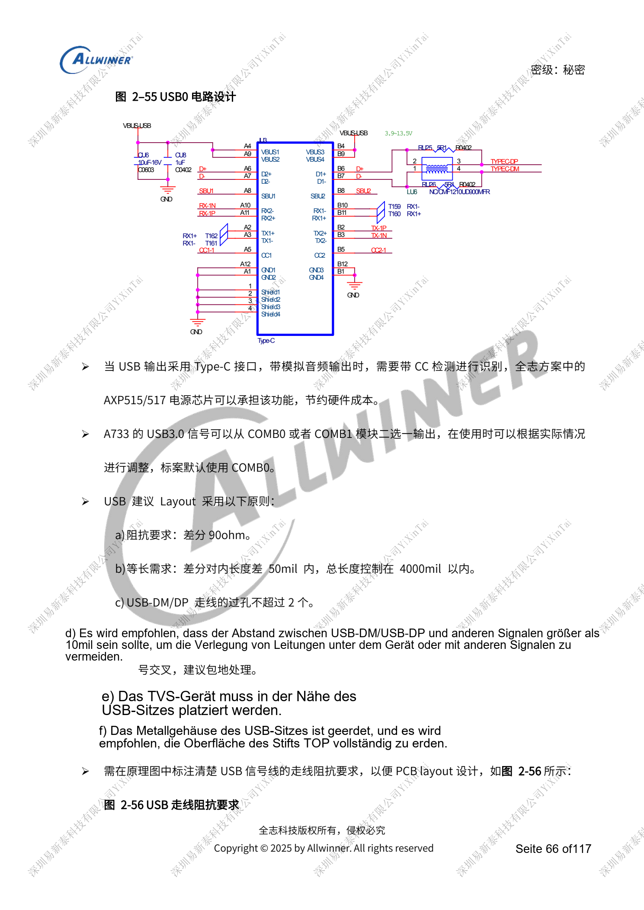
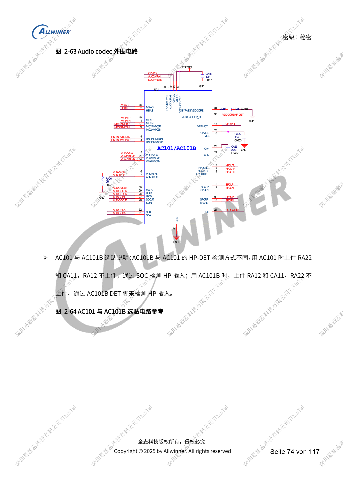
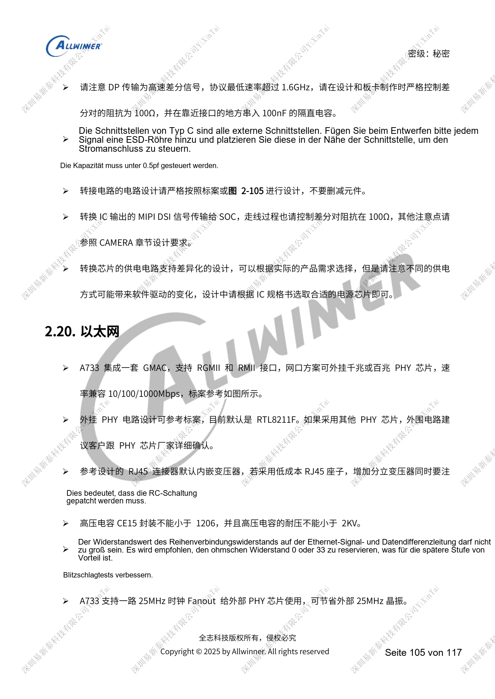
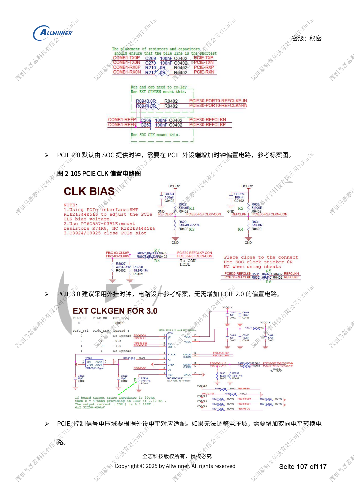

# A733-Peripherie: USB, PCIe, Wi-Fi, Ethernet und Audio

Dieser quellenbasierte Hardwarebeitrag dient als Plattformreferenz; ein passendes ArmSoM-Board ist nicht bestätigt. Parameter stammen aus der Quelle, nicht aus ArmSoM-Messungen. Siliziumrevision, PCB, SDK/BSP, Kernel, Firmware und Peripheriespezifikationen vor Umsetzung prüfen.

Die A733-Quelle ist ein V0.9-Entwurf; Parameter und Softwareunterstützung können sich ändern. Keine endgültige Serienfreigabe.

**Design draft V0.9 §2.7–2.9, §2.14, §2.16–2.17, §2.20–2.21; PDF 65–80, 96–97, 101–108**

## USB-Controller und PCIe-Takt

USB0/1 sind USB2.0, USB2-U3 ist der USB3.1-Pfad bis 10Gbps. USB0/2 unterstützen OTG, USB1 nur Host; Flashen erfolgt über USB0. Wakeup: USB0/1 ja, USB2 nein. Standard-Type-C kombiniert USB0 und USB2-U3. SuperSpeed wählt COMB0/1, standardmäßig COMB0. Controllernummern sind keine Protokollgenerationen. Schutzkapazität USB2 DP/DM <5pF, SuperSpeed <1pF; allgemeine 90Ω für USB2 ersetzen nicht die 95Ω im gemeinsamen Hochgeschwindigkeitspfad. PCIe: eine Lane 2.0/3.0; 2.0 mit SoC-Takt und Endpoint-Bias, 3.0 bevorzugt externer Takt ohne diesen Bias.

## Funk, Ethernet und Sensoren

Wi-Fi-SDIO an PG, Wake-Interrupts an PM anpassen; 1.8V-Pull-up von 32KFOUT bleibt im Standby aktiv. PCM DOUT/DIN, UART TX/RX und RTS/CTS kreuzen; gleichnamige Takt-/Syncsignale verbinden. Antennen-π-Netzwerk vorsehen, neue Boards leitungsgebunden und auf Anpassung messen. SDIO-CLK 33Ω, D0–D3 zu CLK <500mil. GMAC benötigt externen PHY, Referenz RTL8211F, optional 25MHz vom SoC; RJ45 ohne Magnetik braucht Übertrager. Sensor-VCC/IOVCC getrennt prüfen, Adresskonflikte vermeiden, Standbysensoren versorgen und Interrupt an PL. GPS ist ein externes Modul mit 50Ω-RF, Anlaufstrom- und Reset-Rückspeisungsprüfung.

## Audio: Rückstrom und Enable

AC101 besitzt zwei ADCs/zwei DACs, AC101B drei ADCs/zwei DACs mit anderer Kopfhörererkennungsbestückung. AEC nutzt AC107. Nicht per TWI gesteuertes Verstärker-EN gegen Pop auf Low ziehen; Leistungsendstufen nicht an PMU-PS/DCIN. Batterieversorgung hinter der Strommessung abgreifen. HPOUTFB nahe der Buchse erden, keine Ferrite in L/R; auch ohne Buchse Feedback und RC erhalten. Type-C-Audioswitch standardmäßig auf USB für Flashzugang, bei Wakeup dauerhaft versorgen. Mit DP sieht die Referenz BCT4690 statt WAS4766C vor. Bestückung und Software-Erkennungspolarität gemeinsam prüfen.

## Referenzabbildungen

Die Referenzseiten behalten chinesische Bildbeschriftungen. Keine passende englische Ausgabe gefunden; alle vier Sprachen verwenden die chinesischen Originale. Textparameter und Schritte bleiben kopierbar, Bilder dienen dem Abgleich. Nummern bezeichnen physische PDF-Seiten.

## ArmSoM-Plattform auswählen

Für ArmSoM-Projekte Plattform anhand offizieller Produkte und Dokumentation wählen und Prozessor, Schnittstellen und Software erneut prüfen. A733/H618-Schaltungen nicht pauschal auf andere SoCs übertragen.

- [ArmSoM](https://www.armsom.org/)
- [ArmSoM Docs](https://docs.armsom.org/)

## Weitere Beiträge

- [A733-Versorgung: AXP318W, Sequenzen und Ladepfade](/de/articles/a733-power-sequence-pmic-design/)
- [A733-Speicherdesign: LPDDR4/4X/5, eMMC und UFS](/de/articles/a733-ddr-emmc-ufs-design/)
- [A733-Takte und Wiederherstellung: 26MHz, GPIO und FEL](/de/articles/a733-clock-gpio-recovery-design/)
- [A733-Anzeige und Kameras: Multiplexing, Versorgung und Eingangsbrücken](/de/articles/a733-display-camera-interface-design/)
- [A733-Zuverlässigkeit: ESD, EMI, Überspannung und Wärme](/de/articles/a733-esd-emi-thermal-review/)
- [A733 · Serienübersicht](/de/articles/a733-hardware-design-series/)
