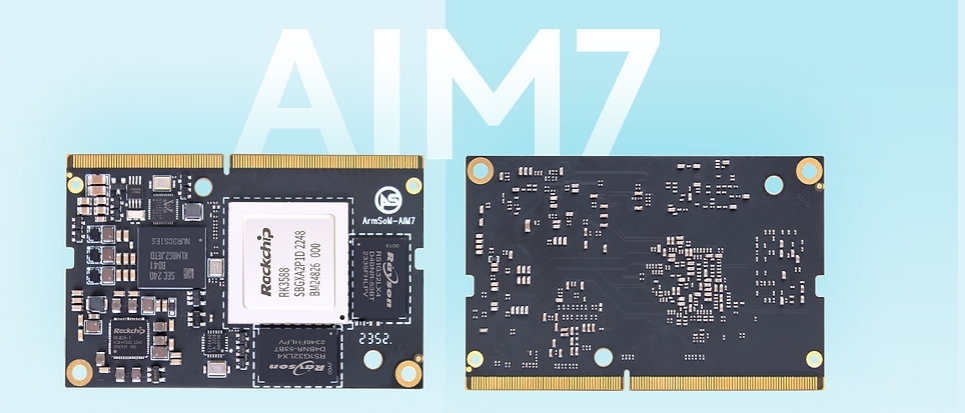

ArmSoM AIM7 ist eine RK3588-Plattform, die für Projekte mit Jetson Nano oder einem bestimmten Orin-Modul geprüft werden kann. CPU, GPU und NPU erfüllen unterschiedliche Aufgaben. Modell, Peripherie, Softwareabhängigkeiten und Systemanforderungen entscheiden gemeinsam über die Eignung.

## Nano und Orin getrennt bewerten

Die AIM7-Dokumentation beschreibt ein 260-poliges SO-DIMM-Design und einen Kompatibilitätspfad zu Jetson Nano. Sie verlangt dennoch die Prüfung von Pins, Versorgung und Peripherie des jeweiligen Trägers. **Ein passender Steckverbinder beweist keine universelle Kompatibilität.**

Orin umfasst unter anderem Orin Nano, Orin NX und AGX Orin. AIM7 wird hier nicht als universeller steckkompatibler Ersatz dargestellt. Zuerst die genaue Variante und das Trägerboard bestimmen. Ungeprüfte Kombinationen zunächst durch Softwaretests auf einem validierten AIM7-Träger ersetzen.

## Geeignete Evaluierungsprojekte

Interessant sind Anwendungen mit überwiegend CPU-basierter Linux-Logik, exportierbaren Modellen, flexibler Kamera-/Displayauswahl und messbaren Anforderungen. Klassifikation, Objekterkennung, Informationsterminals und Videoereignisanalyse sind mögliche Einstiege.

Eigene CUDA-Operatoren, TensorRT-Plugins und NVIDIA-spezifische Pipelines erhöhen den Portierungsaufwand. Entwicklung, Tests und Wartung gehören zum Kostenvergleich. Eine Gleichwertigkeit mit allen Orin-Varianten lässt sich nicht versprechen.

## Von TensorRT zu RKNN

| Vorhandener Bestandteil | Evaluierung auf AIM7 |
|---|---|
| Python/C++-Anwendungslogik | Für Ziel-Linux bauen und Abhängigkeiten testen |
| Trainiertes Ursprungsmodell | Unterstütztes Format exportieren, mit RKNN-Toolkit2 konvertieren |
| TensorRT-Engine / CUDA-Operatoren | Nicht direkt als RKNN nutzbar; Backend und Operatoren anpassen |
| Kamera-, Display- und Videopipeline | Rockchip-Treiber und Beschleunigungsschnittstellen prüfen |
| Container | Architektur, Bibliotheken und Gerätezugriff passend neu erstellen |

Rockchips Ablauf konvertiert auf dem Entwicklungsrechner und führt über C/C++- oder Python-Schnittstellen auf dem Board aus. Erfolgreiche Konvertierung ersetzt keine Prüfung von Operatoren, Quantisierungsgenauigkeit sowie Vor- und Nachverarbeitung.

## Mit identischen Testdaten entscheiden

1. Jetson-Modell, Softwarestände und reale Eingaben festhalten.
2. Genauigkeit, P50/P95-Latenz, Durchsatz, Speicher und Systemleistung messen.
3. Auf AIM7 gleiche Eingaben und Abnahmekriterien verwenden; Ergebnisse vor Geschwindigkeit vergleichen.
4. Kamera, Netzwerk, Aufzeichnung und Anzeige zur vollständigen Pipeline ergänzen.
5. Dauerlast, Wiederanlauf, Updates und Rollback testen.

Hier wird kein Leistungsfaktor erfunden. TOPS mit unterschiedlicher Präzision, Sparsity oder Leistungsaufnahme zu dividieren beantwortet die Eignungsfrage nicht. Entscheidend sind akzeptable Anwendungsergebnisse.

## Nächster Schritt

Modellstruktur, Eingabegrößen, Peripherie, genaue Jetson-SKU und Leistungsziele zusammentragen. Danach AIM7 und Träger auswählen. Sige7 kann RK3588-Software früh erproben; LM7 eignet sich zur Prüfung einer späteren gelöteten Modullösung.

## Artikelserie und Produkte

- [RK3588 erklärt: acht CPU-Kerne, 6-TOPS-NPU und schnelle Erweiterung](/de/articles/rk3588-chip-guide/)
- [Sige7 und LM7: sechs RK3588-Anwendungen vom Prototyp zum Produkt](/de/articles/sige7-lm7-rk3588-applications/)
- [RK3588 Datasheet V1.4: Download, Blockdiagramm, Gehäuse und Elektrik](/de/articles/rk3588-datasheet-v14/)
- [ArmSoM AIM7](https://docs.armsom.org/armsom-aim7) · [Sige7](https://docs.armsom.org/armsom-sige7) · [LM7](https://docs.armsom.org/armsom-lm7)

## Quellen

- [Rockchip RK3588](https://www.rock-chips.com/a/en/products/RK35_Series/2022/0926/1660.html)
- [ArmSoM AIM7](https://docs.armsom.org/armsom-aim7)
- [ArmSoM Sige7](https://docs.armsom.org/armsom-sige7)
- [ArmSoM LM7](https://docs.armsom.org/armsom-lm7)
- [NVIDIA Jetson modules](https://developer.nvidia.com/embedded/jetson-modules)
- [RKNN-Toolkit2](https://github.com/airockchip/rknn-toolkit2)
