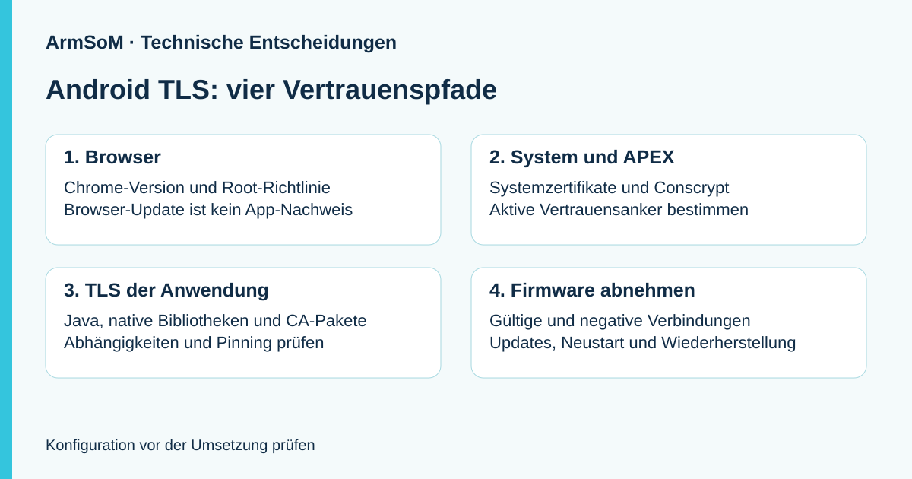

**Bei Android muss für jede Geschäftsverbindung der verwendete Vertrauensspeicher bekannt sein und die Korrektur das Gerät erreichen. Zwei Dateien zu löschen reicht als Vorgehensmodell nicht aus.** Chrome, System-TLS und Apps mit eigenen CA-Paketen können auf demselben ArmSoM-Gerät unterschiedliche Updatewege nutzen.

Dieser Leitfaden richtet sich an Teams mit eigener Android-Firmware. Die Befehle prüfen autorisierte Geräte und SDKs; sie dokumentieren keinen abgeschlossenen Sicherheitstest eines ArmSoM-Images. Die Vorlage liefert einen Untersuchungsanlass. Maßgeblich sind aktuelle Hinweise, Zielbranch und Anwendungsabhängigkeiten.



## 1. Vorfall und Wirkung einer Korrektur eingrenzen

Google bestätigte den Vorfall mit eMudhra-Zwischenschlüsseln und beschrieb getrennte Sperrmechanismen für Chrome und Android. Daraus folgt keine Aktualisierung aller Android-Apps. Die Meldung wurde um Richtlinienänderungen ergänzt und sollte vor einer Auslieferung erneut geprüft werden. [Google-Sicherheitsmeldung](https://blog.google/security/protecting-chrome-and-android-users-from-compromised-emudhra-intermediate-ca-certificates/)

Unterscheiden Sie Root-, Zwischen- und Serverzertifikate sowie öffentliche Schlüssel. Kreuzsignaturen können denselben Schlüssel in mehreren Ketten verwenden. Eine SPKI-Sperre hat andere Auswirkungen als das Entfernen einer Root-CA.

Die Vorlage empfiehlt `b74d2bd5.0` und `75680d2e.0` zu entfernen; dort stehen sie für emSign ECC Root CA - G3 und AAA Certificate Services. **Diese Dateinamen sind keine allgemeingültige Löschliste.** Die AAA-Root kann weitere legitime Ketten tragen. BSP-Verantwortliche müssen Sperrwirkung und Nebenwirkungen bewerten.

## 2. Geräte und Verbindungen erfassen

```bash
adb devices
adb shell getprop ro.build.fingerprint
adb shell getprop ro.build.version.release
adb shell getprop ro.build.version.security_patch
adb shell pm list packages com.google.android.gms
adb shell ls -ld /system/etc/security/cacerts
adb shell ls -ld /apex/com.android.conscrypt/cacerts
```

Fehler protokollieren: Fehlende Rechte oder Pfade sind allein kein Sicherheitsnachweis. Android-Version und Patchdatum identifizieren einen Build, belegen jedoch nicht den Zustand seiner Module oder Rückportierungen. Ab Android 14 ist auch der aktualisierbare Conscrypt-Root-Speicher zu prüfen, nicht nur `/system`. [AOSP Conscrypt](https://source.android.com/docs/core/ota/modular-system/conscrypt)

| Verbindung | Prüfgegenstand | Abnahme |
| --- | --- | --- |
| Webseite in Chrome | Browserversion, Root-Richtlinie, Sperrupdates | Im Zielbrowser testen |
| System-TLS über Java/Kotlin | Sicherheitsprovider, APEX, App-Netzwerkkonfiguration | Anfrage der echten Anwendung |
| Native oder plattformübergreifende Komponente | TLS-Bibliothek, CA-Paket, Abhängigkeitsversion | Positive und negative Tests derselben Bibliothek |
| Privater Unternehmensdienst | Private CA, Pinning und Rotation | Haupt- und Ersatzzertifikat |

Ein vorhandenes Paket `com.google.android.gms` belegt weder die Updatezustellung noch die Abdeckung jedes eigenen TLS-Stacks. Auch Firebase verlangt die Prüfung von App-Abhängigkeiten statt ausschließlich des Betriebssystems. [Firebase-Hinweise](https://firebase.google.com/support/guides/compromised-emudhra-intermediate-ca)

## 3. Zertifikate und Schlüssel eindeutig prüfen

Prüfen Sie Kandidaten aus dem Ziel-SDK oder öffentlichen Systemzertifikatsverzeichnissen auf dem Entwicklungsrechner. `candidate.pem` bezeichnet die untersuchte Datei und ist keine Aufforderung, eine neue Root-CA zu installieren.

```bash
openssl x509 -in candidate.pem -noout \
  -subject -issuer -serial -dates -fingerprint -sha256
openssl x509 -in candidate.pem -noout -subject_hash_old
openssl x509 -in candidate.pem -pubkey -noout |
  openssl pkey -pubin -outform DER |
  openssl dgst -sha256
```

Der erste Befehl liefert den SHA-256-Fingerabdruck des Zertifikats, der dritte den SHA-256-Wert des öffentlichen SPKI. Diese Werte sind nicht austauschbar. Vergleichen Sie mit der genauen Liste des Hinweises oder Maintainers. Ein Subject-Hash-Dateiname ist wegen gleicher Subjects, Kollisionen und Nummernsuffixen kein eindeutiger Identitätsnachweis. [OpenSSL x509](https://docs.openssl.org/3.0/man1/openssl-x509/)

Zuerst SDK-Dateien finden, danach Inhalte auswerten. Eine Namenssuche nach `emudhra` reicht nicht:

```bash
export SDK_ROOT=/path/to/android-sdk
find "$SDK_ROOT/system/ca-certificates" \
  "$SDK_ROOT/external/conscrypt" \
  -type f \( -name '*.0' -o -name '*.pem' -o -name '*.crt' \) -print
```

Fehlende Pfade müssen an den Branch angepasst werden. Prüfen Sie außerdem das gebaute Image und aktive Modul: Eine ungenutzte Quellkopie zu ändern beeinflusst das Gerät nicht.

## 4. Korrekturen in einen wartbaren Updateweg einbauen

1. Firmware und betroffene Verbindungen festhalten; öffentliche Fingerabdrücke und Buildnachweise sichern.
2. Passenden Herstellerpatch oder Komponentenupdate bevorzugen. Root-Änderung, Intermediate-Sperre und Bibliotheksupdate unterscheiden.
3. System, APEX und eigene CA-Pakete zusammen mit Signierung, AVB und OTA prüfen.
4. Auf Testgeräten Regression durchführen, gestaffelt ausrollen und Wiederherstellung sowie Versionsverfolgung vorhalten.

Zertifikats- oder Hostnamenprüfung abzuschalten ist keine Kompatibilitätslösung. Pinning braucht Rotation, Ersatzschlüssel und Fehlerbehandlung. [Android Network Security Configuration](https://developer.android.com/privacy-and-security/security-config) kann Vertrauensanker einer App festlegen, repariert aber keine anderen Prozesse.

## 5. Nach Dateien auch Verbindungen testen

Die vom eigenen Server gesendete Kette lässt sich am Entwicklungsrechner untersuchen:

```bash
openssl s_client -connect your-server.example:443 \
  -servername your-server.example -showcerts \
  -verify_hostname your-server.example -verify_return_error </dev/null
```

Ersetzen Sie den Beispieldomainnamen durch einen selbst verwalteten Dienst. Server senden häufig keine Root-CA. Reihenfolge und letzter issuer beweisen daher nicht den tatsächlich gewählten Vertrauenspfad. Ein Rechnerergebnis ersetzt keinen Android-App-Test.

| Prüfung | Zu dokumentieren |
| --- | --- |
| Legitime HTTPS-Verbindung | App, TLS-Bibliothek, Hostname, Zeit und Ergebnis |
| Kontrolliert ungültige Kette oder falscher Name | Ablehnung im Labor; fehlende Dateien genügen nicht |
| Update und Neustart | Korrektur aktiv, kein Rückfall auf alten Vertrauensstand |
| Wiederherstellung und Kompatibilität | Werksreset, Ersatzzertifikate, OTA und Zeitsynchronisierung |

Dafür muss kein öffentlicher Dienst angegriffen werden. Auch ohne erreichbare betroffene Webseite lassen sich kontrollierte Richtlinientests und Fehlerpfade in der echten Anwendung prüfen. Offline-Produkte brauchen ebenfalls einen Plan für spätere Vernetzung, Wartung und Updates.

Die [bereitgestellte Android-CA-Vorlage](https://mp.weixin.qq.com/s/URwEId_RlZYRRrHSUy5Jig) wurde anhand offizieller Quellen neu aufbereitet. Pauschales Löschen, GMS-Abdeckung und Prüfaussagen wurden eingegrenzt. Es wurden keine Gerätezertifikate entfernt und keine bestimmte Firmware als repariert ausgewiesen.

## Produkte und weiterführende Artikel

Für ein ArmSoM-Projekt kommen [Sige7](https://www.armsom.org/sige7), [AIM7](https://www.armsom.org/aim7) und [LM7](https://www.armsom.org/lm7) mit RK3588 oder [CM5](https://www.armsom.org/cm5) und [Sige5](https://www.armsom.org/sige5) mit RK3576 infrage. Schnittstellen und verfügbare Images stehen in der Dokumentation zu [Sige7](https://docs.armsom.org/armsom-sige7), [CM5](https://docs.armsom.org/armsom-cm5) und [Sige5](https://docs.armsom.org/armsom-sige5). Die Links dienen der Produktauswahl und bestätigen keine Prüfung sämtlicher hier beschriebener SDK-Kombinationen.
