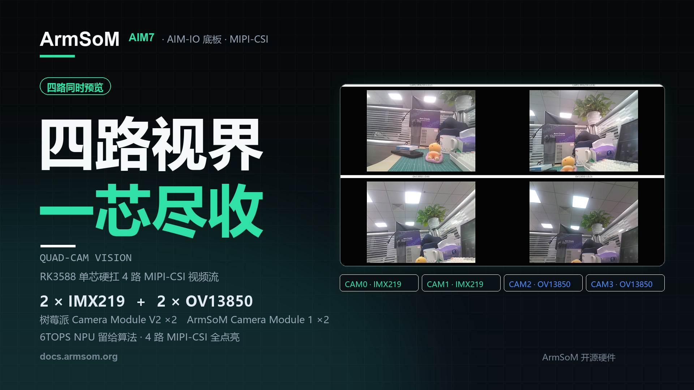
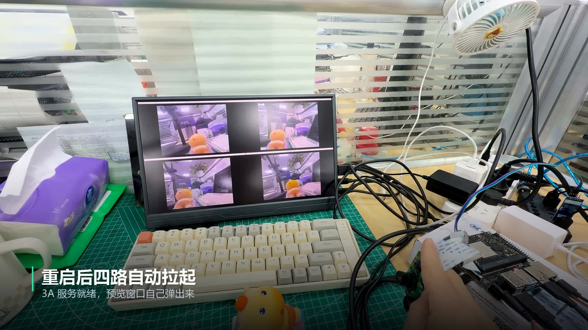

Vier Kameras, vier Blickwinkel und ein Bildschirm: In dieser Demonstration zeigt **ArmSoM AIM7 mit dem AIM-IO-Trägerboard** gleichzeitig die Bilder von zwei IMX219- und zwei OV13850-Kameras über MIPI-CSI auf einer RK3588-Plattform.

Für Robotik, industrielle Bildverarbeitung und Prototypen mit mehreren Kamerapositionen ist das ein praktischer Einstieg: Kameras anschließen, Ansichten gemeinsam prüfen und den Aufbau abstimmen, bevor Erfassung, Auswertung und Steuerung hinzukommen.



## Die Demo: von der Konfiguration zu vier Vorschaufenstern

<video controls playsinline preload="metadata" width="1920" height="1080" poster="/assets/armsom-aim7-four-camera-preview/cover.jpg" style="display:block;width:100%;height:auto;aspect-ratio:16/9;margin:1.5rem auto;background:#101820" aria-label="Vier Kameras an ArmSoM AIM7: Bildverarbeitungsprototyp mit RK3588">
  <source src="/assets/armsom-aim7-four-camera-preview/demo.mp4" type="video/mp4">
  <a href="/assets/armsom-aim7-four-camera-preview/demo.mp4">Originalvideo herunterladen oder abspielen</a>
</video>

*Originales ArmSoM-Demonstrationsvideo, etwa 34 Sekunden lang. Die chinesischen Einblendungen bleiben erhalten. Gezeigt werden die Dokumentation, der Programmstart und die vier Kamerabilder.*

Die oberen Fenster zeigen die IMX219-Kameras, die unteren die OV13850-Kameras. Wird die Spielfigur vor den Objektiven bewegt, werden Unterschiede bei Position, Größe und Verdeckung sichtbar. So lässt sich die Kameraplatzierung prüfen, statt nur festzustellen, ob ein einzelner Sensor ein Bild liefert.

## Was gehört zu diesem Aufbau?

| Komponente | Konfiguration der Demonstration | Aufgabe |
| --- | --- | --- |
| Rechenplattform | ArmSoM AIM7, Rockchip RK3588 | Kameratreiber, Bildverarbeitung und Vorschauprogramm |
| Trägerboard | AIM-IO | Anschlüsse für Kameras, Display und Peripherie |
| Obere Kameras | 2 × Raspberry Pi Camera Module V2, IMX219 | Zwei Blickwinkel |
| Untere Kameras | 2 × ArmSoM Camera Module 1, OV13850 | Zwei weitere Blickwinkel |
| Anzeige | 1920 × 1080, vier gleich große Fenster | Gemeinsame Anzeige bei erhaltenem Seitenverhältnis |
| Vorschauausgabe | ISP-Ausgabe je Kamera auf 640 × 480 skaliert | Mehrfenster-Vorschau in diesem Beispiel |

AIM7 kombiniert vier Cortex-A76- mit vier Cortex-A55-Kernen und einer NPU mit bis zu 6 TOPS (INT8). Die Anschlüsse werden über das Trägerboard herausgeführt. Hier geht es um die **Kombination aus AIM7 und AIM-IO**; Verkabelung und Image-Konfiguration gelten nicht automatisch für jedes andere Trägerboard. [AIM7-Produktspezifikationen](https://www.armsom.org/aim7)

[](/assets/armsom-aim7-four-camera-preview/demo-still.png)

*Der reale Aufbau mit vier Vorschaufenstern aus dem bereitgestellten Material. Verkabelung und Bildschirminhalt wurden unverändert übernommen.*

## Wie sind die Vorschauwerte einzuordnen?

Die offizielle Dokumentation nennt für diese Konfiguration ungefähr **15 FPS für IMX219 und 25 FPS für OV13850**. Diese Werte beziehen sich auf die gezeigten Bildmodi, die Software und die Anzeige. Sie sind weder eine Zusage für vier Aufnahmen in voller Sensorauflösung noch ein KI-Inferenzbenchmark. [Offizielle Anleitung zur Vierkamera-Vorschau](https://docs.armsom.org/zh/armsom-aim7#aim-io-四路摄像头同时预览)

Die gleichzeitige Anzeige belegt keine hardwareseitige Bildsynchronisation zwischen den Sensoren. Für Stereomessungen, schnelle Bewegungsanalyse, Stitching oder Sensorfusion müssen Zeitstempel, Belichtung, Triggerung, Kalibrierung und Gesamtlatenz separat bewertet werden.

Das Video zeigt Bilderfassung und Vorschau. KI-Erkennung, Langzeitstabilität und der Durchsatz bei mehreren Aufzeichnungen wurden damit nicht nachgewiesen. Prüfen Sie diese Anforderungen mit der vorgesehenen Auflösung, Bildrate, Kühlung und Algorithmuslast Ihres Projekts.

## Nachbauen: Geräte identifizieren, dann Vorschau starten

1. Bereiten Sie AIM7, AIM-IO, die angegebenen Kameramodule, passende Flachbandkabel, Display und Netzteil vor. Vor dem Anschließen der Kamerakabel die Stromversorgung trennen.
2. Wählen Sie anhand der AIM7-Dokumentation ein passendes Image. Aktivieren Sie die vier Kamera-Overlays in `/boot/uEnv/uEnvarmsom-aim7-io.txt` passend zur dokumentierten Verkabelung, starten Sie neu und prüfen Sie die Erkennung.
3. Kontrollieren Sie, ob der IMX219-Modulname zu `imx219_rpi-camera-v2_default.json` passt und der 3A-Dienst läuft.
4. Laden Sie das Skript für vier Vorschaufenster aus der offiziellen Dokumentation herunter. Öffnen Sie dessen Verzeichnis in einem **Terminal innerhalb des grafischen Desktops der Platine**. Das GTK-Beispiel benötigt eine grafische Sitzung; eine reine TTY-Anmeldung stellt keine Desktopfenster bereit.

Die offizielle Anleitung verwendet folgende Startbefehle. Für die Installation der Abhängigkeiten müssen passende Paketquellen erreichbar sein:

```bash
sudo apt-get install -y python3-gi gir1.2-gtk-3.0 gir1.2-gstreamer-1.0 gir1.2-gst-plugins-base-1.0
sudo systemctl restart rkaiq_3A.service
python3 aim7-four-camera-preview.py
```

Mit `Ctrl+C` beenden Sie die Vorschau. Im Beispiel heißen die Geräte `/dev/video53`, `/dev/video62`, `/dev/video44` und `/dev/video71`; diese Nummern können zwischen Images variieren. Prüfen Sie die Geräte mit `v4l2-ctl --list-devices` und die Topologie mit `media-ctl -p`, gegebenenfalls unter Auswahl des zugehörigen Media-Geräts. Passen Sie das Skript an die tatsächlichen ISP-Ausgabeknoten an. Laut Dokumentation wurde dieses Vierkamera-Beispiel noch nicht auf AIM5 validiert.

## Welche Projekte lassen sich darauf aufbauen?

### Robotik und mobile Geräte: zuerst die Sichtfelder prüfen

Richten Sie Kameras in verschiedene Richtungen und prüfen Sie, ob das Gehäuse Bereiche verdeckt oder ein bewegtes Ziel zwischen den Sichtfeldern verschwindet. Die Vorschau hilft bei der Montageplanung, bevor Erkennung, Tracking oder Sensorfusion umgesetzt werden.

### Industrielle Bildverarbeitung: verschiedene Werkstückflächen

Richten Sie Kameras auf Vorderseite, Seitenfläche oder Montagebereich eines Werkstücks und bewerten Sie Beleuchtung, Fokus und Position. Eine Fehlererkennung benötigt zusätzlich repräsentative Daten, validierte Algorithmen und eine Triggerlösung. Die Demo enthält keine Messungen zur Erkennungsgenauigkeit oder zum Produktionstakt.

### Lehre und Entwicklung: den Bildpfad verstehen

Zwei Sensortypen auf einer Plattform eignen sich für Experimente mit Device Tree, V4L2-Geräten, ISP, 3A und GStreamer. Vergleichen Sie zunächst den Betrieb einer und mehrerer Kameras und ergänzen Sie anschließend Bildspeicherung, Videoaufzeichnung oder andere Funktionen.

### Edge-KI: Inferenz nach stabiler Erfassung ergänzen

Sobald die Erfassung zuverlässig arbeitet, können Sie mit dem [ArmSoM-RKNN-Leitfaden](https://docs.armsom.org/advanced-manual/rknn-sdk) unterstützte Modelle bereitstellen. Prüfen Sie zuerst Korrektheit und Latenz eines Streams, erweitern Sie dann die Anzahl und messen Sie den gesamten Verarbeitungspfad. Die 6 TOPS sind eine Hardwareangabe; das Ergebnis hängt von Operatoren, Quantisierung, Eingabegröße und Ressourcenverteilung ab.

## Der Einstieg in Ihr Bildverarbeitungsprojekt

Nutzen Sie die Demo, um Kamerapositionen und Softwarepfad zu prüfen. Entwickeln Sie darauf die Erfassung und Verarbeitung, die Ihre Anwendung benötigt.

- [ArmSoM AIM7 entdecken](https://www.armsom.org/aim7)
- [AIM7, AIM-IO und die Vierkamera-Anleitung](https://docs.armsom.org/zh/armsom-aim7#aim-io-四路摄像头同时预览)
- [RKNN-Modelle bereitstellen](https://docs.armsom.org/advanced-manual/rknn-sdk)
- [Lokale Konsole in ArmSoM-Server-Images](/de/articles/armsom-server-hdmi-tty-console/)

Für Plattformauswahl oder Projektanfragen erreichen Sie uns unter [sales@armsom.org](mailto:sales@armsom.org). Nennen Sie Kamerazahl, Zielauflösung, Synchronisationsbedarf und geplante Algorithmen, damit das Gesamtsystem bewertet werden kann.
