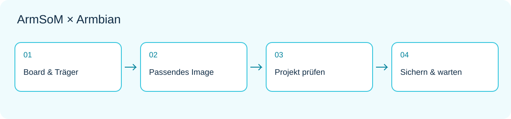

*Entwicklungsablauf: Hardware und Image zuordnen, dann Anwendung und Wartung prüfen.*

Eine Entwicklungsplatine wird dann wertvoll, wenn aus Rechenleistung und Anschlüssen ein reproduzierbares Projekt entsteht. ArmSoM liefert Hardware und Platinenunterlagen; Armbian bietet Linux-Images und Build-Konfigurationen für mehrere konkrete Plattformen. Wer Debian oder Ubuntu kennt, findet damit einen möglichen Einstieg.

Dieser Leitfaden richtet sich an neue ArmSoM-Anwender und Teams mit Desktop-, Heimserver- oder Embedded-Prototypen. Die Schritte sind Entwicklungsempfehlungen, kein Hardwaretest. Maßgeblich bleibt die aktuelle Seite der exakten Zielplatine.

## 1. Die drei Ebenen verstehen

Die Platine stellt Rechenleistung, Versorgung und Anschlüsse bereit. Bootsoftware, Kernel und Device Tree erschließen die Hardware. Im Linux-Userspace laufen Anwendungen, Paketverwaltung und Dienste. Armbian bündelt mehrere dieser Teile zu einem herunterladbaren oder selbst baubaren System. Ein Image ist nicht für jede ARM-Platine geeignet; derselbe Prozessor macht unterschiedliche Trägerplatinen nicht austauschbar.

Linux-Kenntnisse lassen sich weiterverwenden: zuerst Verwaltung per SSH, anschließend Datenerfassung, Weboberfläche oder Hintergrunddienst. Anwendungskonfiguration und Geschäftslogik gehören in die Versionsverwaltung; Hardwareanpassungen bleiben modellspezifisch.

## 2. Die genaue Plattform finden

Bei dieser Prüfung enthält der Herstellerkatalog Sige1, Sige3, Sige5, Sige7, AIM7 IO, CM5 IO, CM5 CM4 IO, CM7s IO, W3 und Forge1. Das sind Plattform-/Trägerkonfigurationen, keine austauschbaren Images. [Aktuellen Katalog öffnen](https://armbian.com/vendors/armsom).

Die Einträge sind als Community gekennzeichnet. Dafür gelten nicht die Test- und Wartungszusagen des Standard-Supports; Fehlerkorrekturen durch das Projekt sind nicht garantiert. Download-Verfügbarkeit, erfolgreicher Start und vollständige Peripherieunterstützung sind unterschiedliche Aussagen. [Support-Regeln](https://docs.armbian.com/contribute/board-support-rules/).

## 3. Nach Aufgabe statt Versionsnummer wählen

| Frage | Auswirkung |
|---|---|
| Wird ein lokaler Bildschirm benötigt? | Desktop für Interaktion, CLI für Dienste ohne Monitor |
| Welche Anwendung ist unverzichtbar? | Architektur, Abhängigkeiten und Distribution prüfen |
| Kamera, NPU oder Videobeschleunigung? | Treiber, Laufzeit und Anwendungsschnittstelle separat prüfen |
| Dauerbetrieb geplant? | Updates, Sicherung und Wiederherstellung einplanen |
| Welche Trägerplatine und Revision? | Passendes Board-Image bestimmen |

Vendor, current und edge stehen für Kernel-Entwicklungslinien, nicht für Leistungsstufen. Minimal oder Desktop ist eine weitere Entscheidung. Armbian ordnet edge und rolling dem Testbetrieb zu, nicht dem Produktionseinsatz. Die [Image-Auswahlhilfe](https://docs.armbian.com/getting-started/choosing-an-image/) erläutert die Unterschiede. Vollständigen Dateinamen und verwendeten Zweig aufbewahren.

## 4. Herunterladen, schreiben und starten

Ein geeignetes Netzteil, zuverlässigen Speicher und einen Wiederherstellungsweg vorbereiten. Image und Prüfinformationen von der passenden Board-Seite beziehen und mit Armbian Imager oder dem dokumentierten Werkzeug schreiben. Dabei wird das Zielmedium überschrieben: Namen und Kapazität prüfen, vorhandene Daten sichern. Das Kopieren der Image-Datei auf eine normale Partition ersetzt diesen Vorgang nicht.

Beim ersten Start nur Versorgung, Startmedium und kabelgebundenes Netzwerk anschließen; bei Bedarf Bildschirm oder seriellen Adapter mit passendem Pegel ergänzen. Die aktuelle Kontoeinrichtung verwenden, keine festen Passwörter aus alten Anleitungen übernehmen. Erst den Grundbetrieb prüfen, danach Kameras oder USB-Hubs hinzufügen. [Offizieller Einstieg](https://docs.armbian.com/getting-started/).

## 5. Einen Ausgangszustand dokumentieren

Diese Befehle lesen Systeminformationen. Sie prüfen weder jede Schnittstelle noch messen sie Leistung. Nicht benötigte Hostnamen und Adressen vor einer Veröffentlichung entfernen.

```sh
cat /etc/os-release
uname -r
uname -m
free -h
lsblk -o NAME,SIZE,TYPE,FSTYPE,MOUNTPOINTS
ip -br address
systemctl --failed
```

Ausgaben zusammen mit Hardwarestand, Versorgung, Speichermodell und Image-Dateiname speichern. Bei Fehlern zuerst klären, was sich seit dem letzten funktionierenden Lauf verändert hat. Ein fehlender Befehl kann am Paketbestand oder Init-System liegen und belegt keinen Hardwaredefekt.

## 6. Ein kleines Projekt vollständig umsetzen

Ein guter Einstieg ist eine nur im lokalen Netz erreichbare Statusseite. Sie zeigt Temperatur oder Anwendungszustand, Aktualisierungszeit und Dienstneustarts. Zuerst mit simulierten Daten Oberfläche und Protokollierung prüfen. Dann einen echten Sensor anschließen, nachdem Pegel und Treiber geklärt sind. Anschließend Netzausfall, ungültige Werte und Wiederanlauf behandeln.

So bleiben Hardware-, Anwendungs- und Netzwerkfehler unterscheidbar. Später lassen sich MQTT-Knoten, Automatisierungskonsole oder Dateidienst ergänzen. Ein messbares Ziel setzen, etwa keine doppelten Datensätze nach Wiederverbindung, statt viele Dienste gleichzeitig einzurichten.

## 7. Wartbarkeit einplanen

Anwendungsdaten getrennt vom Systemimage sichern, Protokollgröße begrenzen und Abhängigkeiten festhalten. Updates zunächst auf Ersatzmedium oder Testgerät gegen Start, Netzwerk und zentrale Peripherie prüfen. Erst mit Wiederherstellungsweg und Wartungsfenster ein dauerhaft betriebenes Gerät aktualisieren. Sicherheitsupdates unbegrenzt zu ignorieren ersetzt keine Versionsstrategie.

Bei schwarzem Bildschirm fehlende Desktopausgabe von fehlgeschlagenem Start unterscheiden, etwa per Netzwerk oder serieller Konsole. Wiederholte Neustarts erfordern zuerst Prüfung von Versorgung und Medium. Bei einzelnen Geräten deren Logs, Device Tree und Softwarepfad untersuchen. Ein Community-Bericht braucht reproduzierbare Schritte, Hardwarestand und relevante Logs.

## 8. Die nächste Plattform auswählen

Für Prototypen mit zugänglichen Anzeige-, Netzwerk- und Speicheranschlüssen eignen sich [Sige5](https://www.armsom.org/sige5) oder [Sige7](https://www.armsom.org/sige7) als Ausgangspunkt. Für ein Modul auf eigener Trägerplatine bietet sich [CM5](https://www.armsom.org/cm5) zur Prüfung an. Hardware und Image gemeinsam auswählen, Kernfunktionen validieren und dann erweitern.

## Weitere Artikel dieser Reihe

- [Sige5 / Sige7 mit Armbian: sechs Linux-Projekte für die Praxis](/de/articles/sige5-sige7-armbian-projects/)
- [CM5 mit Armbian: vom Modulprototyp zum eigenen Linux-Gerät](/de/articles/cm5-armbian-custom-device/)
