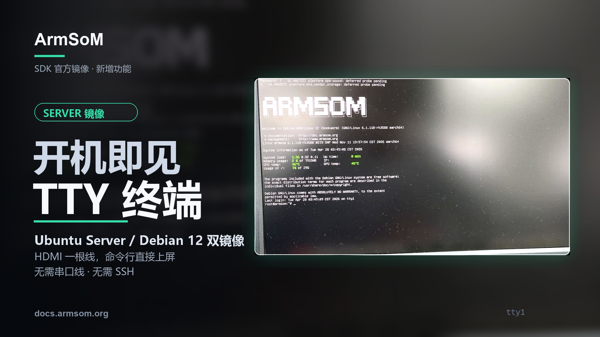
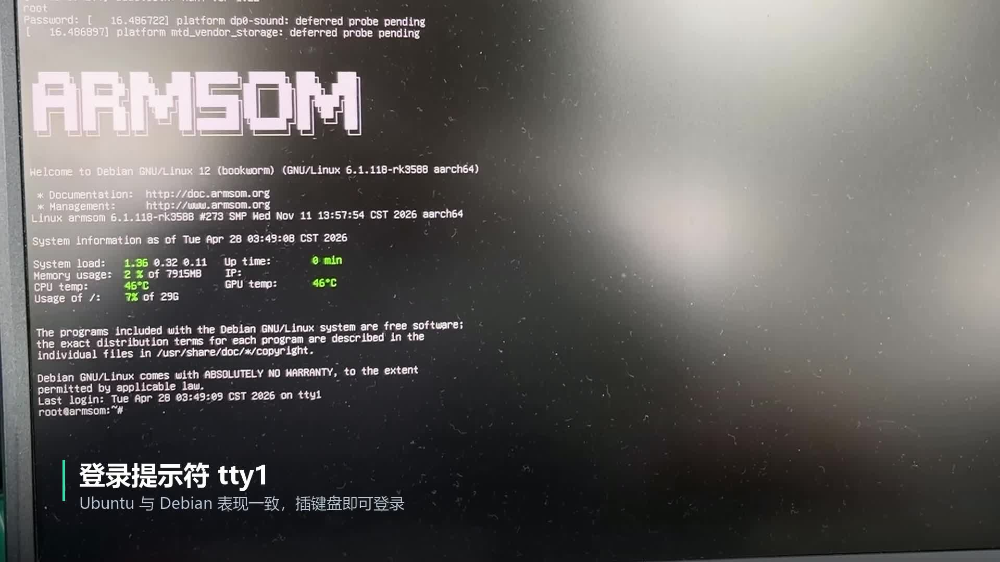

Das Server-Image ist frisch geschrieben, das Netzwerk noch nicht eingerichtet und die IP-Adresse unbekannt. Wie gelingt die erste Anmeldung? Diese ArmSoM-Demonstration zeigt einen direkten Weg: **HDMI-Bildschirm und USB-Tastatur anschließen, an der lokalen TTY anmelden und Linux bedienen.**

Auf Grundlage des bereitgestellten ArmSoM-Artikels und Videos stellt dieser Beitrag den lokalen Konsolenzugriff für Ubuntu-Server-/Debian-12-Images vor. Im gefilmten Terminal ist ausdrücklich Debian 12 zu sehen; das Begleitmaterial beschreibt auch Ubuntu Server. Unterstützte Platinen, Image-Versionen und Standardkonten entnehmen Sie den Download-Hinweisen des jeweiligen Produkts.



## Was zeigt das Video vom Start bis zur Kommandozeile?

<video controls playsinline preload="metadata" width="1920" height="1080" poster="/assets/armsom-server-hdmi-tty-console/cover.jpg" style="display:block;width:100%;height:auto;aspect-ratio:16/9;margin:1.5rem auto;background:#101820" aria-label="ArmSoM Server: lokale Linux-Konsole mit HDMI und USB-Tastatur">
  <source src="/assets/armsom-server-hdmi-tty-console/demo.mp4" type="video/mp4">
  <a href="/assets/armsom-server-hdmi-tty-console/demo.mp4">Originalvideo herunterladen oder abspielen</a>
</video>

*Originale Demonstration, etwa 20 Sekunden lang, mit unveränderten chinesischen Einblendungen. Zu sehen sind HDMI-Startmeldungen, der Start von Diensten und der Shell-Prompt nach der Anmeldung an Debian 12.*

Die Textausgabe zeigt, wie weit der Systemstart fortgeschritten ist. Sobald die Anmeldeaufforderung erscheint, gelangen Sie mit Benutzername und Passwort zur lokalen Shell. Die Aufnahme zeigt außerdem das ArmSoM-Logo, die Systemversion und Statusinformationen.

Bei der Ersteinrichtung können Sie das System prüfen, seine Netzwerkadresse ermitteln und Einstellungen vornehmen, bevor SSH funktioniert. Das Video ist geschnitten: Seine Laufzeit von 20 Sekunden ist kein Kaltstart-Benchmark. Last, Temperatur und Uhrzeit auf dem Bildschirm sind lediglich die damals angezeigten Werte.

## Lokale TTY, SSH oder Desktop?

TTY bezeichnet hier eine lokale Textkonsole, in der Sie nach der Anmeldung Linux-Befehle ausführen. `tty1` ist die in der Demo verwendete virtuelle Konsole; andere Images können abweichend konfiguriert sein.

| Zugang | Voraussetzungen | Geeignete Aufgaben |
| --- | --- | --- |
| Lokale TTY mit HDMI und USB-Tastatur | Image mit Bildausgabe und lokaler Anmeldung sowie passende Hardwareanschlüsse | Erste Anmeldung, Netzwerkprüfung und Protokolle vor Ort |
| SSH | Erreichbares Netzwerk, verfügbarer SSH-Dienst und gültiges Konto | Fernwartung, Bereitstellung und Administration |
| Grafischer Desktop | Installierte Desktopumgebung und funktionierende Anzeigetreiber | Fensterprogramme und grafische Werkzeuge |

Lokale Befehle benötigen keinen Desktop. Umgekehrt stellt eine TTY nicht automatisch Browser oder grafische Fenster bereit. Für eine Kamera-Vorschau mit Fenstern wählen Sie ein Image mit der benötigten grafischen Umgebung.

[](/assets/armsom-server-hdmi-tty-console/demo-still.png)

*Lokale Debian-12-Konsole aus der Originalaufnahme. Kernel, Konto und Statuswerte gehören zu dieser Demonstration und gelten nicht pauschal für alle Platinen oder Images.*

## Vorbereitung für die erste Anmeldung

- Ein offizielles ArmSoM-Server-Image für die Platine, das eine lokale HDMI-Konsole unterstützt.
- Ein nach Produktanleitung vorbereitetes Startmedium.
- Einen HDMI-Bildschirm mit passendem Kabel an einem Bildausgang.
- Eine Tastatur am USB-Host-Anschluss und das passende Netzteil.

Prüfen Sie Monitoreingang und Kabel vor dem Einschalten. Verwenden Sie das für Ihr Image dokumentierte Konto. Bei der Passworteingabe erscheinen im Linux-Terminal normalerweise keine Zeichen. Ändern Sie nach der ersten Anmeldung die Standardzugangsdaten entsprechend den Projektanforderungen.

Weitere Informationen finden Sie bei den [ArmSoM-Image-Ressourcen](https://docs.armsom.org/getting-start/cloud-disk) und in der [Anleitung zu Start und Anmeldung](https://docs.armsom.org/getting-start/startup). Ubuntu oder Debian im Dateinamen bedeutet nicht, dass ein Image zu jedem Produkt passt.

## Zuerst einige lesende Prüfungen

Die folgenden allgemeinen Linux-Beispiele sind keine Testausgaben aus dem Video. Führen Sie sie einzeln auf der Platine aus. Ihre Verfügbarkeit hängt von den installierten Werkzeugen ab; `systemctl` gilt für Systeme mit systemd.

```bash
cat /etc/os-release
uname -r
tty
ip -br address
df -h
free -h
systemctl --failed --no-pager
```

| Prüfung | Erkenntnis |
| --- | --- |
| Distribution und Kernel | Tatsächliche Softwareversionen zum Abgleich mit der Dokumentation |
| Aktuelles Terminal | Ob die Sitzung über eine lokale TTY läuft |
| Netzwerkadressen | Ob eine Adresse für späteren Fernzugriff verfügbar ist |
| Speicherplatz und Arbeitsspeicher | Grundlegender Ressourcenstatus |
| Fehlgeschlagene Dienste | Startprobleme, für die weitere Protokolle nötig sein können |

Mit der tatsächlichen Netzwerkadresse richten Sie anschließend den Fernzugriff nach offizieller Anleitung ein. So lässt sich das Gerät zunächst lokal vorbereiten und danach aus der Ferne verwalten, ohne die erste Anmeldung von einer bereits funktionierenden Netzwerkkonfiguration abhängig zu machen.

## Drei praktische Einsatzsituationen

**Erster Start am Entwicklungstisch.** Beobachten Sie den Start, kontrollieren Sie Softwareversionen, Speicher und Netzwerk und installieren Sie dann Ihre Anwendung. Im Unterricht kann die Konsole auf einen großen Bildschirm gelegt werden, um Befehle gemeinsam nachzuvollziehen.

**Ersteinrichtung am Einsatzort.** Ein Gerät, das noch nicht im Zielnetzwerk erreichbar ist, lässt sich bereits lokal prüfen. Bei Netzwerkänderungen hilft die Konsole außerdem, die Konfiguration fortzusetzen, wenn die Fernverbindung abbricht.

**Dienstdiagnose vor Ort.** Solange das System startet und die lokale Konsole funktioniert, können Sie Dienste und Protokolle untersuchen. Fehler vor der Displayinitialisierung oder vor einer nutzbaren Anmeldung können weiterhin serielle Diagnose erfordern. HDMI-TTY ersetzt nicht jedes Werkzeug für die Fehlersuche auf niedriger Ebene.

## Wenn keine Anmeldeaufforderung erscheint

Prüfen Sie zuerst Stromversorgung, Monitoreingang und die Richtung des HDMI-Anschlusses, anschließend Platinenmodell, Image und Startmedium. Sind Systemmeldungen sichtbar, aber keine Anmeldung möglich, prüfen Sie die Konsolenkonfiguration des Images. Bei fehlender Tastatureingabe kontrollieren Sie den USB-Host-Anschluss.

Server- und Desktop-Images können sich unterschiedlich verhalten; das allein beweist keinen Hardwaredefekt. Halten Sie für Supportanfragen Modell, Image-Dateiname, Displayverbindung und sichtbare Fehlermeldungen bereit.

## Lokalen Zugriff in die Entwicklung einplanen

Eine lokale TTY vereinfacht die erste Anmeldung und Arbeiten direkt am Gerät. Bewerten Sie bei der Plattformwahl Display, USB, Netzwerk und Anwendungsschnittstellen gemeinsam und wählen Sie dann das passende Image.

- [ArmSoM-Entwicklungsplattformen entdecken](https://www.armsom.org/)
- [AIM7 und AIM-IO kennenlernen](https://www.armsom.org/aim7) — benötigtes Server-Image und Trägerboard-Unterstützung vor Kauf oder Einsatz prüfen
- [Images und Download-Ressourcen](https://docs.armsom.org/getting-start/cloud-disk)
- [Start, Anmeldung und Fernzugriff](https://docs.armsom.org/getting-start/startup)
- [Vom Terminal zur Bildverarbeitung: vier Kameras an AIM7](/de/articles/armsom-aim7-four-camera-preview/)

Für die Auswahl von Image oder Plattform schreiben Sie an [sales@armsom.org](mailto:sales@armsom.org) und nennen Sie Modell, Bedarf an einer grafischen Oberfläche und den geplanten Ablauf vor Ort.
