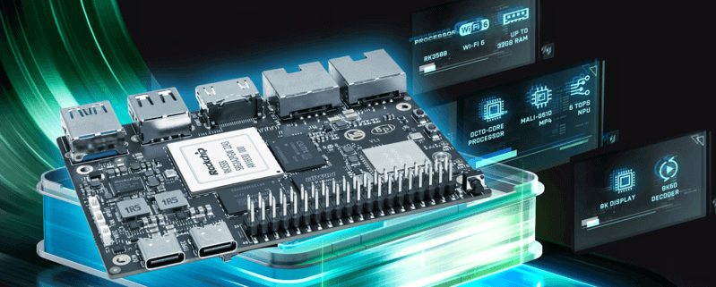
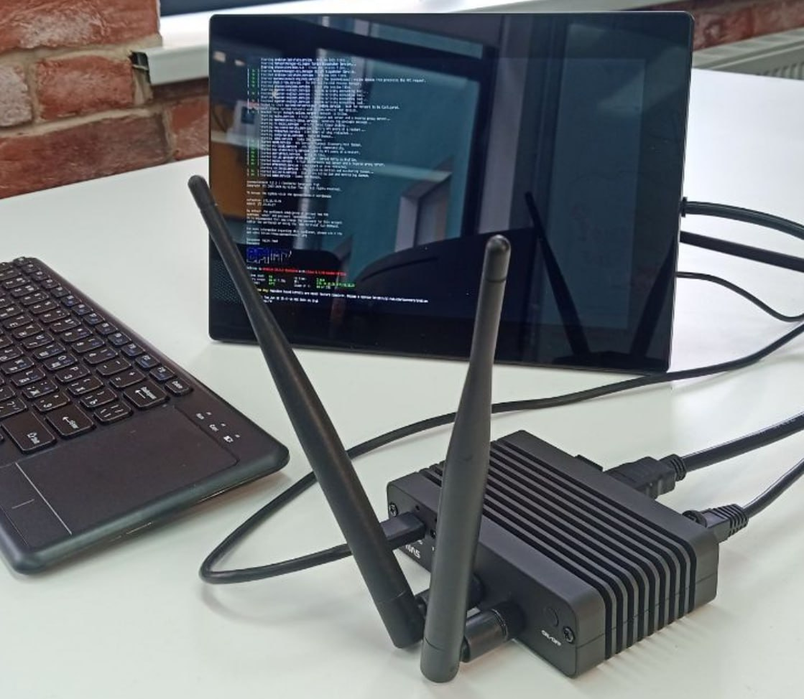

Bei der Auswahl eines Einplatinencomputers zählen praktische Fragen: Lassen sich die benötigten Geräte anschließen, läuft ein geeignetes Betriebssystem und gibt es hilfreiche Informationen bei Problemen? Öffentliche Diskussionen, verständliche Dokumentation und funktionierende Projekte verdienen ebenso Beachtung wie technische Daten.

ArmSoM Sige7 verbindet RK3588-Rechenleistung mit Netzwerk- und Speicheranschlüssen auf einer kompakten Platine. Dieser Beitrag nimmt Erfahrungen aus der Community als Ausgangspunkt für die Planung eines Linux-Projekts. Als konkretes Beispiel dient der bereits veröffentlichte ArmSoMNAS-Anwenderbericht.

*Offizielles Sige7-Produktbild. Anschlüsse und Ausstattung sind anhand der jeweiligen Hardwareversion zu prüfen.*

## Ein öffentlich einsehbarer Testverlauf

Jeff Geerling eröffnete den Sige7-Testeintrag im November 2024; ArmSoM/BPI stellte das Muster bereit. Er trägt weiterhin „testing in progress“, mit offenen Benchmarks und früheren Einrichtungsproblemen. Nutzer platima berichtet separat über Ubuntu/Frigate-rk und Kühlung. Das ist keine Empfehlung von Jeff. [Zum ursprünglichen Kontext](https://github.com/geerlingguy/sbc-reviews/issues/56).

Achten Sie beim Lesen auf Datum, Verfasser und Testumgebung. Ein früheres Problem beschreibt nicht automatisch den Stand einer aktuellen Version. Ebenso beweist die erfolgreiche Einrichtung eines anderen Nutzers nicht, dass jede Konfiguration funktioniert. Nutzen Sie die Diskussion für Ihren eigenen Prüfplan.

## Welche Grundlage bietet Sige7?

Die [offiziellen Spezifikationen](https://www.armsom.org/sige7) nennen einen RK3588 mit acht CPU-Kernen, eine NPU mit bis zu 6 TOPS (INT8), Speicherkonfigurationen bis 32 GB, zwei 2.5GbE-Anschlüsse und NVMe-Erweiterung über M.2 PCIe 3.0 x4.

| Projektrichtung | Verfügbare Ressourcen | Erste Prüfungen am Prototyp |
| --- | --- | --- |
| Netzwerk- und Speicherdienste | Zwei kabelgebundene Netzwerkschnittstellen und NVMe | Netzwerktopologie, Datenträgeraufteilung und tatsächliche Speicherlast |
| Bildverarbeitung am Netzwerkrand | Anwendungsprozessor und unterstützte NPU-Werkzeuge | Modellkompatibilität, Bilderfassung und Verarbeitungslatenz |
| Linux-Anwendungsprototypen | Speicher, Display- und Peripherieanschlüsse | Image-Unterstützung, Abhängigkeiten und Wiederherstellung |

Schnittstellenraten und Rechenleistung helfen bei der Vorauswahl. Anwendungsergebnisse hängen auch von System, Modell, Speicher und Kühlung ab. Messbare Anforderungen sind meist hilfreicher als ein Vergleich allein anhand der Prozessornamen.

## Ein konkretes Beispiel: mobiler Speicher mit ArmSoMNAS

Unser veröffentlichter **ArmSoMNAS-Anwenderbericht** zeigt ein Entwicklerprojekt, das Sige7 mit einer Erweiterung für zwei NVMe-Laufwerke, USV, OLED und modularem Gehäuse zu einem tragbaren Netzwerkspeicher-Prototyp kombiniert.

*Foto aus dem veröffentlichten ArmSoMNAS-Projekt. Erweiterungsmodule und Gehäuse gehören zu diesem Projekt; sie sind weder Standardzubehör des Sige7 noch Jeffs Testaufbau.*

Übertragbar ist vor allem die Vorgehensweise: Das Gesamtgerät wird in separat prüfbare Teile zerlegt. Zuerst Platine und Speicher, danach Stromversorgung, Gehäuse und Nutzung. Bei einem Modul für zwei Laufwerke müssen Topologie und Kompatibilität gesondert geprüft werden. Ein mobiles Gerät braucht außerdem Tests für Stromausfall, Herunterfahren und Wiederherstellung.

Wer einen persönlichen Dateiserver, ein Gerät zur Datenerfassung vor Ort oder einen tragbaren gemeinsamen Speicher plant, kann sich an diesem Entwicklungsprozess orientieren. Kapazität, Redundanz und Sicherungen richten sich nach den eigenen Anforderungen.

[Den vollständigen ArmSoMNAS-Bericht lesen](/de/articles/armsomnas-sige7-portable-nas/)

## Zwei weitere Entwicklungsrichtungen

**Bildverarbeitung und lokale Verarbeitung.** Trennen Sie Erfassung, Inferenz und Ereignisaufzeichnung. Prüfen Sie zunächst einen stabilen Eingang, danach das gewünschte Modell und ergänzen Sie erst dann Aufzeichnung und Benachrichtigungen. Bei mehreren Videoströmen zählt die gesamte Verarbeitungskette; die Inferenzgeschwindigkeit allein ist kein Systemdurchsatz. Ein Einstieg sind die [RKNN-Unterlagen von ArmSoM](https://docs.armsom.org/advanced-manual/rknn-sdk).

**Linux-Dienste und Anwendungsprototypen.** Beginnen Sie mit einer klar abgegrenzten Anwendung, etwa Gerätedatenerfassung, einer Entwicklungsumgebung oder einem lokalen Dienst. Ergänzen Sie Peripherie schrittweise. Dokumentieren Sie Systemversionen und Abhängigkeiten und planen Sie Neustart, Wiederherstellung sowie Fernwartung. Fensterprogramme benötigen eine passende Desktopumgebung; Konsolendienste werden nach ihrem Bedarf eingerichtet.

Dies sind Vorschläge zur Projektplanung. Der Beitrag enthält keine neuen Hardwaremessungen oder Zusagen zu Kamerazahl, Erkennungsgenauigkeit und Dienstkapazität.

## Vier Schritte zu einem reproduzierbaren Aufbau

1. **Gerät und Image bestimmen.** Notieren Sie Platinenrevision, Speicher, Startmedium und vollständigen Dateinamen des Images. Beginnen Sie mit den Ressourcen in der [Sige7-Dokumentation](https://docs.armsom.org/armsom-sige7).
2. **Die Anleitung des jeweiligen Images befolgen.** Unterschiedliche Formate können verschiedene Werkzeuge erfordern. Nutzen Sie die [Anleitung zum Schreiben des Images](https://docs.armsom.org/getting-start/flash-img) und sichern Sie vorher die Daten des Zielmediums.
3. **Ein minimales System prüfen.** Schließen Sie zunächst die nötige Stromversorgung, Anzeige oder Debug-Schnittstelle an. Melden Sie sich an und prüfen Sie Netzwerk und Speicher, bevor Sie Geräte einzeln ergänzen.
4. **Umgebung und Reproduktionsschritte festhalten.** Dokumentieren Sie Kernel, Anwendungsversionen, Stromversorgung, Kühlung und Arbeitsschritte. Entfernen Sie Passwörter, Tokens und private Adressen, bevor Sie Protokolle teilen.

Diese Aufzeichnungen helfen anderen, Probleme nachzustellen und Versionen zu vergleichen. Eine Stabilitätsbewertung sollte Laufzeit, Arbeitslast und Umgebungsbedingungen nennen.

## Erfolg anhand der eigenen Anwendung definieren

Legen Sie einige konkrete Abnahmekriterien fest: wiederholbare Kaltstarts, Verhalten unter Ziellast, Wiederherstellung nach Dienstunterbrechungen sowie Temperatur- und Leistungsaufnahmeverlauf im Dauerbetrieb. Speicherprojekte brauchen Wiederherstellungstests, Bildverarbeitung benötigt Latenz- und Genauigkeitsmessungen mit realen Eingaben.

Sie müssen nicht alle Funktionen gleichzeitig prüfen. Entwickeln Sie zuerst den kleinsten nützlichen Prototyp und erweitern Sie ihn schrittweise, während Sie funktionierende Konfigurationen dokumentieren.

## Das nächste Projekt mit Sige7 beginnen

Öffentliche Rückmeldungen liefern Ansatzpunkte; praktische Projekte machen aus Schnittstellen und Software nutzbare Geräte. Ob kompaktes NAS, Bildverarbeitung oder Linux-Anwendung: Gleichen Sie die Ressourcen mit Ihren Anforderungen ab und testen Sie einen klar abgegrenzten Prototyp.

- [ArmSoM Sige7 und seine Konfigurationen entdecken](https://www.armsom.org/sige7)
- [Sige7-Entwicklerdokumentation öffnen](https://docs.armsom.org/armsom-sige7)
- [ArmSoMNAS-Anwenderbericht lesen](/de/articles/armsomnas-sige7-portable-nas/)
- [Originalbeitrag des Community-Nutzers lesen](https://github.com/geerlingguy/sbc-reviews/issues/56#issuecomment-4588587535)

Teilen Sie Projekte und reproduzierbare Rückmeldungen im [Community-Forum](https://forum.armsom.org/). Für Produktauswahl und Zusammenarbeit: [sales@armsom.org](mailto:sales@armsom.org).

*Quellen am 12. November 2026 geprüft. Redaktion: ArmSoM Editorial. Aussagen aus der Community stammen von ihren jeweiligen Autoren und werden nicht als unabhängige Zertifizierung oder Leistungszusage dargestellt.*
