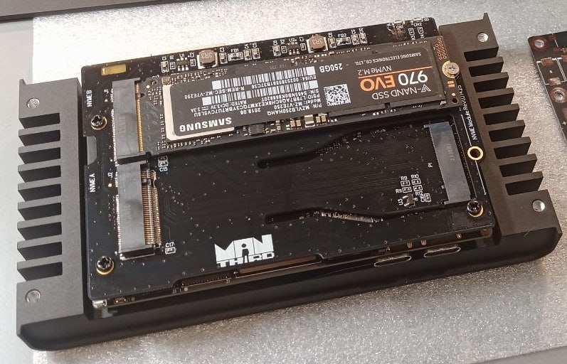
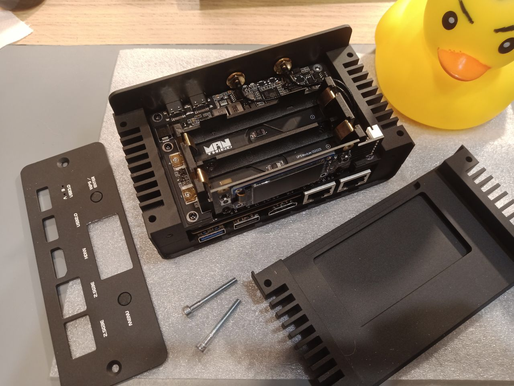
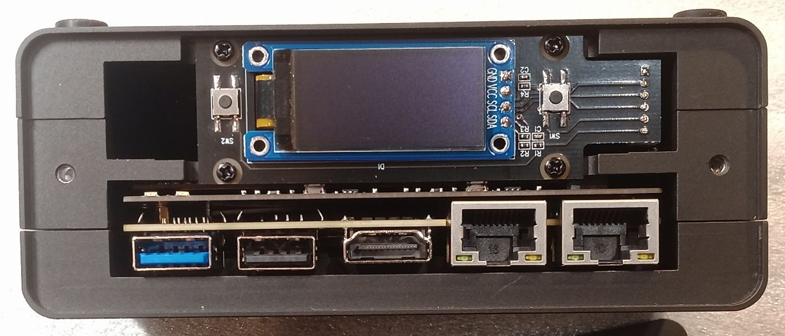
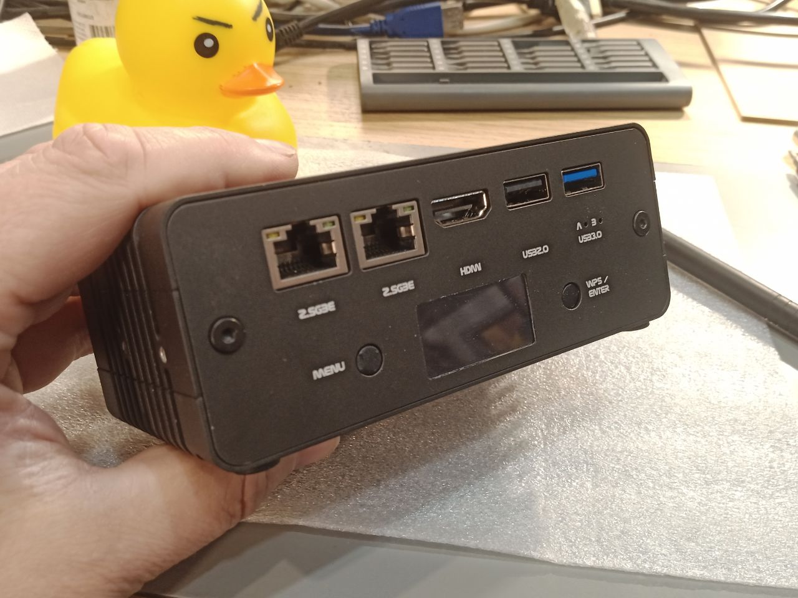
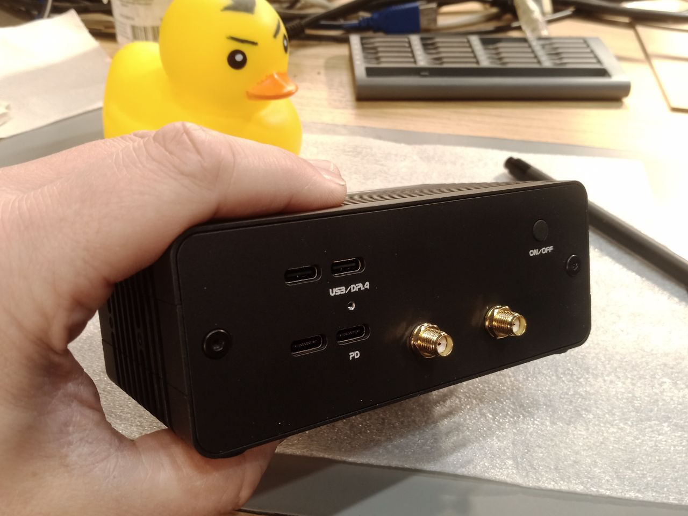
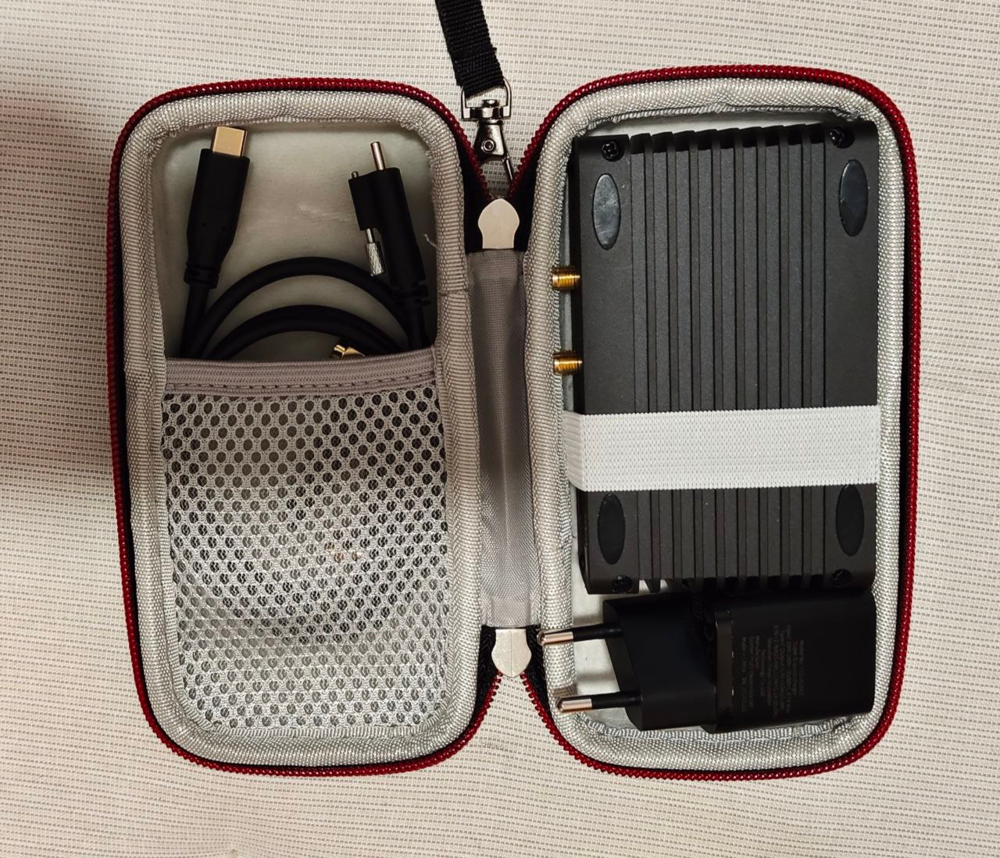
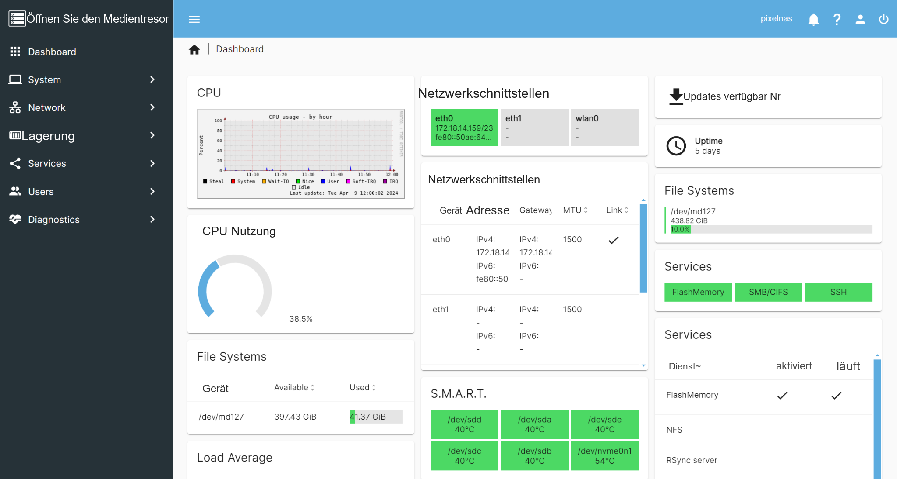

Mobiler Speicher muss nicht nur eine an den Laptop angeschlossene Festplatte sein. Entwickler der UberNAS-Community wollten einen kleinen NAS zum Mitnehmen, der Dateien im Netzwerk bereitstellt und sich bei Bedarf um Akku und Anzeige erweitern lässt. Als Rechenplattform wählten sie ArmSoM Sige7. Ein Twin-NVMe-Modul, eine USV und ein OLED ergänzen den modularen Prototyp.

Dieser Anwenderbericht basiert auf den bereitgestellten Unterlagen und verwendet **ArmSoMNAS** als Projektnamen. Er behandelt die Sige7-Variante. Module und Fotos stammen aus dem Anwenderprojekt und gehören nicht zum standardmäßigen Lieferumfang von Sige7.

*Kompakter Prototyp im Desktop-Einsatz, fotografiert vom Projektteam.*

## Von fünf SATA-Laufwerken zu einem kleineren NVMe-System

Zuvor entwickelte das Team einen mobilen NAS auf RK3568-Basis mit fünf M.2-SATA-Speicherplätzen. Der nächste Entwurf sollte kleiner werden und NVMe sowie 2.5GbE verwenden. Die beiden 2.5GbE-Ports und der rückseitige M.2-PCIe-3.0-x4-Anschluss von Sige7 waren wichtige Auswahlkriterien.

Mit einem fertigen SBC konnte sich das Team auf Speicher, Versorgung und Gehäuse konzentrieren, statt eine Prozessorplatine neu zu entwickeln. Im Mittelpunkt standen die Erweiterung für zwei SSDs, der mobile Einsatz und die Modulmontage.

## Rechenleistung und Anschlüsse als Grundlage

Die [offizielle Sige7-Dokumentation](https://docs.armsom.org/armsom-sige7) bestätigt RK3588, zwei 2.5GbE-Ports und M.2 PCIe 3.0 x4. Für dieses Projekt zählt die Kombination aus Rechenplattform, Netzwerk und Speicheranbindung auf einer kompakten Platine.

| Bestandteil | Aufgabe im Projekt |
| --- | --- |
| Sige7 | Linux und Netzwerkspeicherdienste |
| Zwei 2.5GbE-Ports | Grundlage für kabelgebundene Freigaben und Netzwerkverbindungen |
| M.2 PCIe 3.0 x4 | Verbindung zum selbst entwickelten Twin-NVMe-Modul |
| Modulares Gehäuse | Kombinationen mit oder ohne USV und Display |

Schnittstellendaten sind keine Kopier-Benchmarks. Die Unterlagen enthalten keine Ergebnisse zu dauerhaftem Lesen/Schreiben, parallelem SSD-Zugriff oder Link-Aggregation. Der tatsächliche Durchsatz muss am vollständigen System gemessen werden.

## Twin NVMe als eigenständiges Speichermodul

Twin NVMe ist eine Erweiterungsplatine mit zwei M.2-NVMe-Steckplätzen für den M.2-Anschluss auf der Sige7-Rückseite. Die Trennung als Modul erleichtert weitere Anpassungen an SSD-Auswahl, Bauhöhe und Kühlung.

*Twin-NVMe-Prototyp mit einer eingebauten SSD und einem sichtbaren zweiten Steckplatz.*

Die Quelle nennt RAID 0 und RAID 1, veröffentlicht aber weder PCIe-Topologie noch Linkbreite pro SSD oder eine vollständige Kompatibilitätsliste. Zwei Steckplätze bedeuten deshalb nicht zwei unabhängige x4-Verbindungen. Für einen Nachbau müssen Modulrevision, Treiber, SSDs und Systemabbild zusammenpassen.

RAID 0 verteilt Daten über Laufwerke, bietet aber keine Redundanz bei einem Laufwerksausfall. RAID 1 spiegelt Daten und verbessert die Verfügbarkeit beim Ausfall eines Laufwerks. Beide ersetzen keine unabhängige, wiederherstellbare Sicherung wichtiger Dateien.

## USV für den Betrieb abseits einer festen Versorgung

Das USV-Modul verwendet zwei LiFePO4-Zellen im 18650-Format und einen intelligenten Akkucontroller auf RP2040-Basis mit USB-HID-Kommunikation. In der Quelle steht „RPi 2040“; hier wird die übliche Chipbezeichnung verwendet, die anhand der Modulunterlagen zu prüfen bleibt.

*USV-Modul und Akkuhalter aus dem bereitgestellten Projektmaterial.*

Der Autor nennt bis zu etwa 1,5 Stunden Betrieb ohne Einschränkung von Speicher- oder Netzwerkaktivität. Akkukapazität, SSD-Modelle, Lastprofil und Abschaltbedingungen fehlen. Das ist eine Angabe des Autors zu seinem Prototyp und keine allgemeine ArmSoM-Laufzeitgarantie.

Für eine weitere Revision sollten Versorgungsumschaltung, Ladezustandsmeldung und geordnetes Herunterfahren gemeinsam geprüft werden. USB HID allein belegt noch keinen vollständig implementierten Abschaltablauf.

## OLED und zwei Tasten für lokale Bedienung

Das Anzeigemodul kombiniert ein OLED mit zwei softwareseitig belegbaren Tasten. Bei einem NAS ohne dauerhaft angeschlossenen Monitor entsteht so ein lokaler Zugang zu Statusinformationen und einfachen Aktionen.

*OLED und zwei Tasten oberhalb der Netzwerk- und USB-Anschlüsse.*

Netzwerkadresse, Akkustand oder Speicherstatus wären sinnvolle Oberflächenfunktionen. Das sind Entwicklungsideen: Die Unterlagen nennen nicht sämtliche bereits umgesetzten Ansichten und Tastenbelegungen.

## Zwei Ausbaustufen mit denselben Modulen

Sige7 mit Twin NVMe ergibt den kompakteren Desktop-Prototyp. USV, OLED und Tasten ergänzen ihn zu einem umfangreicher ausgestatteten mobilen System. Anwender können die Module nach Einsatz auswählen, statt immer alle Komponenten mitzuführen.

*Netzwerk-, USB- und Anzeigeseite des vollständig ausgestatteten Prototyps.*

*Weitere Anschlussseite und Gehäuse der vollständigen Konfiguration.*

Der Prototyp besitzt ein Aluminiumgehäuse mit Kühlrippen. Der Bericht beschreibt passive Kühlung und erwähnt aktive Kühlung als mögliche Variante. Ob ein Lüfter erforderlich ist, hängt von SSDs, Dauerlast, Umgebungstemperatur und Gehäuse ab; entsprechende Temperaturtests liegen nicht bei.

*Prototyp und Kabel in einer Transporttasche veranschaulichen das mobile Format.*

Das Format eignet sich als Ausgangspunkt für Dateifreigaben auf Reisen, Medienarchive, Vorführungen vor Ort und kleine Homelabs. Dies sind Anwendungsideen und keine nachgewiesenen Installationen.

## Armbian und OpenMediaVault als Softwarebasis

Das Projekt verwendet Armbian und OpenMediaVault. Die aktuelle [Armbian-Seite für Sige7](https://armbian.com/boards/armsom-sige7) bietet Images an und kennzeichnet den Support als Community. Distribution, Kernel und OpenMediaVault-Version des Prototyps sind nicht angegeben; für einen Nachbau sollten sie dokumentiert und die passenden Anleitungen verwendet werden.

[OpenMediaVault](https://www.openmediavault.org/) stellt eine Weboberfläche zur Verwaltung von Speicher und Freigaben bereit. Laufwerke, Dienste und Statusinformationen an einer Stelle helfen, aus einer Linux-Platine einen verwaltbaren NAS zu machen. RAID, USV-Anbindung und Erweiterungen hängen weiterhin von Version und Konfiguration ab.

*OpenMediaVault-Referenzansicht aus der Quelle. Die mehreren Laufwerke, Kapazitäten, Temperaturen und Laufzeiten sind keine Messwerte dieses Zwei-Laufwerk-Prototyps.*

## Gemeinsam mit der Community weiterentwickeln

Der Autor beschreibt, wie Veröffentlichungen zu mobilen NAS weitere Interessierte zu UberNAS News und UberNAS Community brachten. Der Austausch über Hardware, Software und Homelabs liefert Rückmeldungen von Menschen, die solche Geräte später nutzen könnten.

ArmSoMNAS zeigt einen praktischen Entwicklungsweg: Sige7 stellt Rechenplattform und Anschlüsse bereit, Anwender entwickeln Speicher-, Versorgungs- und Bedienmodule, und Linux sowie Community-Erfahrung verbinden die Teile zum System.

## Ein eigenes ArmSoMNAS-Projekt beginnen

Legen Sie zuerst Laufwerkszahl, Bedarf an netzunabhängigem Betrieb und Backup-Konzept fest. Danach folgen Platine, Speichererweiterung, Versorgung und Gehäuse. Prüfen Sie Laufwerkserkennung, Dauerkopieren, Temperaturen, Versorgungsumschaltung und Wiederherstellung. Der Beitrag ist ein Anwenderbericht, kein vollständiger Schaltplan, keine BOM und kein reproduzierbares Installationsskript für die Zusatzhardware.

- [ArmSoM Sige7 kennenlernen](https://www.armsom.org/sige7)
- [Sige7-Schnittstellen und Entwicklerdokumentation](https://docs.armsom.org/armsom-sige7)
- [Armbian-Images für Sige7](https://armbian.com/boards/armsom-sige7)
- [OpenMediaVault](https://www.openmediavault.org/)
- [UberNAS Community aus dem Ausgangsmaterial](https://t.me/UberNasCommunity)

Bericht und Fotos stammen aus den bereitgestellten UberNAS-Community-Unterlagen. Ursprüngliche Gehäusemarkierungen und Dashboard-Inhalte bleiben erhalten. Es wurden keine neuen ArmSoM-Hardwaretests durchgeführt; der Prototyp wird nicht als bereits erhältliches Standardkit dargestellt.
