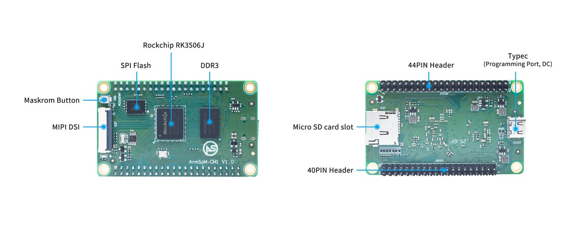

Ein Rechenmodul bündelt Prozessor und Basisspeicher, damit sich das Produktteam auf Schnittstellen, Gehäuse und Anwendung konzentrieren kann. ArmSoM CM1 mit RK3506J richtet sich an Industrieterminals, Anzeigesteuerung und vernetzte Geräte. Vor einer eigenen Trägerplatine empfiehlt sich die Erprobung mit CM1-IO.

## Modul und Kit unterscheiden

| Merkmal | CM1 | Kit mit CM1-IO |
|---|---|---|
| Prozessor | RK3506J | Nutzt CM1 |
| Speicher | 256/512MB DDR3L und 256/512MB NAND | Abhängig vom eingesetzten Modul |
| Abmessungen | 70×42mm | Trägerplatine: 100×70mm |
| Display | MIPI DSI | Panel und Treiber validieren |
| Netzwerk | Erweiterungssignale | Zwei 10/100-Ethernet-Ports, Wi-Fi 5/BT 4.2 |
| USB | Type-C für Versorgung/Programmierung | Zwei USB2.0-Host-Ports |

Netzwerkbuchsen, Funk und zwei USB-Host-Ports gehören zum Trägerkit, nicht zum nackten Modul. Dokumentiert sind −40 bis 85°C; das Gesamtsystem muss mit Netzteil, Display, Speicher und Gehäuse gesondert geprüft werden.

## Ein eigenes Bedienpanel

Verpackungsmaschinen, Umweltmessgeräte und Instrumente benötigen oft spezielle Anschlüsse und Gehäuse. CM1 übernimmt Oberfläche, Einstellungen und Kommunikation; Signalaufbereitung und Schutz liegen auf dem Träger. Displaygröße, Hintergrundbeleuchtung und Touch-Anbindung bereits beim Schaltplan festlegen.

## Vernetzung bestehender Geräte

Einen vorhandenen Controller seriell oder per CAN anbinden, Linux für Aufbereitung, Pufferung und Upload nutzen. Zustandsverantwortung, Timeout-Verhalten und Offline-Speicherung definieren. Logwachstum begrenzen und Not-Aus-Funktionen nicht von Netzwerkdiensten abhängig machen.

## Ein Kern für mehrere Produkte

Wandpanel, Tischinstrument und Hutschienengateway können auf demselben Modul aufbauen. Anwendungssoftware lässt sich teilweise wiederverwenden; Anschlüsse, Device Trees, Kühlung und Fertigungstests bleiben modellspezifisch. Wiederverwendung ersetzt keine elektrische Prüfung.

## Vom Kit zum Prototyp

1. CM1-Ausführung, Hardwarestand und Buildroot-Image festlegen.
2. Display, Touch, Speicher, Netzwerk und Feldprotokolle prüfen.
3. Für jedes Signal Multiplexing, Spannung, Pulls, Bootzustand und Schutz dokumentieren.
4. Stromausfall, Update-Rückfall, Watchdog und Loggrenzen testen.
5. Mit endgültiger Versorgung, Gehäuse und Kabeln Temperatur und Stabilität prüfen.

Aus 40-PIN/44-PIN folgt keine Kompatibilität. Die teilweise Raspberry-Pi-40-pin-Kompatibilität eines Trägers bedeutet keinen direkten Austausch des Moduls gegen andere Module.

## Wann CM1 passt

CM1 eignet sich für eigene Mechanik und Schnittstellen auf Basis von ArmSoM-Dokumentation, Referenzdesigns und Software. Für einen schnellen vollständigen Platinenprototyp auch Forge1 betrachten. Diese Entwicklungsvorschläge sind keine abgeschlossene Zertifizierung oder Serienvalidierung.

## Weitere Artikel und offizielle Unterlagen

- [RK3506J erklärt: industrielle HMI und vernetzte Geräte](/de/articles/rk3506j-chip-guide/)
- [ArmSoM Forge1: Gateways, HMI und Datenerfassung entwickeln](/de/articles/forge1-industrial-hmi-gateway/)
- [RK3506B Datasheet V1.0: Architektur, Anschlüsse und elektrische Auslegung](/de/articles/rk3506b-datasheet-v10/)
- [Rockchip RK3506](https://www.rock-chips.com/a/cn/product/RK35xilie/2025/1208/2125.html)
- [ArmSoM CM1](https://docs.armsom.org/armsom-cm1)
- [ArmSoM Forge1](https://docs.armsom.org/armsom-forge1)
- [ArmSoM](https://www.armsom.org/)
