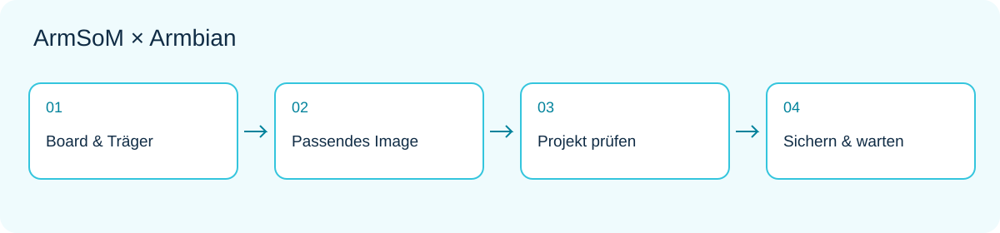

*Offizielle ArmSoM-Produktabbildung; Chipfunktionen belegen nicht die vollständige Beschleunigungsunterstützung eines Armbian-Images.*

Ein Rechenmodul wird interessant, wenn ein Prototyp ein bestimmtes Gehäuse, eigene Anschlüsse oder eine besondere Versorgung benötigt. ArmSoM CM5 konzentriert die Recheneinheit auf einem Modul; die Trägerplatine folgt den Produktanforderungen. Armbian-Images und Build-Konfigurationen können die Softwarebewertung beginnen, ersetzen aber nicht die Prüfung einer eigenen Trägerplatine.

Dieser Leitfaden beschreibt den Weg zu einem wartbaren Linux-Gerät. Er ist keine Serienfreigabe und bestätigt nicht alle Peripheriefunktionen eines Images. Vor dem Modulprojekt empfiehlt sich der Artikel zur Image-Auswahl.

## 1. Modul, Träger und Image gemeinsam auswählen

CM5 verwendet RK3576. Das Modul liefert die Rechenbasis, die Trägerplatine bestimmt Versorgung, Anschlüsse und herausgeführte Signale. Derselbe Prozessor garantiert kein identisches Startverhalten auf unterschiedlichen Trägern. [CM5-Produktinformationen](https://www.armsom.org/cm5).

Modul- und Trägerrevision, RAM, Speicher sowie Display-, Kamera- und Gerätemodelle dokumentieren. Eine Verbindungstabelle ist hilfreicher als die Angabe „CM5“: Zweck, Versorgung, Pegel, Treiberabhängigkeit und Prüfverfahren für jede Schnittstelle notieren.

## 2. CM5 IO und CM5 CM4 IO sind verschiedene Ziele

| Armbian-Eintrag | Build-Ziel | Auswahlprinzip |
|---|---|---|
| CM5 IO | `armsom-cm5-io` | Die auf der Seite beschriebene CM5-IO-Referenzplattform |
| CM5 CM4 IO | `armsom-cm5-rpi-cm4-io` | Die zugehörige CM4-IO-Trägerkonfiguration |

Es handelt sich nicht nur um verschiedene Downloadnamen. Die Seiten für [CM5 IO](https://armbian.com/boards/armsom-cm5-io) und [CM5 CM4 IO](https://armbian.com/boards/armsom-cm5-rpi-cm4-io) mit dem tatsächlichen Aufbau abgleichen. Beide Einträge haben derzeit Community-Status. Eine Referenzkonfiguration garantiert nicht jede fremde Trägerplatine.

## 3. Kompatibilität an den Pins prüfen

Passende Abmessungen und Steckverbinder sind erst der Anfang. Versorgungsschienen, Reset, Bootsignale, Anzeigekanäle, USB-Rollen, PCIe, Netzwerk und unbenutzte Pins prüfen. Die CM5-Unterlagen nennen Unterschiede zu CM4, etwa bei der Anzahl der Anzeigekanäle. Eine nutzbare Trägerkategorie bedeutet keine vollständige Funktionsgleichheit.

Schaltpläne, Modulbelegung und Trägerdesign vergleichen, bevor Funktionen aktiviert werden. Bei Kameras und Displays kommen Anschlussreihenfolge, Versorgung und Treiber hinzu. Die [CM5-Hardwareunterlagen](https://docs.armsom.org/armsom-cm5) verwenden, statt Images oder Peripheriekonfigurationen eines anderen Moduls ungeprüft zu übernehmen.

## 4. Drei zu prüfende Produktprototypen

**Zustandsterminal:** Anzeige und Eingabe anschließen, dann Gerätezustände darstellen. Mit einer lesenden Oberfläche und Offlineanzeige beginnen, danach Bedienaktionen ergänzen. Touchzuordnung, Ausrichtung und Wiederherstellung nach unerwartetem Neustart prüfen. Eine normale Linux-Oberfläche ist keine sicherheitsgerichtete Echtzeitsteuerung.

**Erfassungsgateway:** Feldschnittstellen auf dem Träger anpassen; Linux übernimmt Aufbereitung, Warteschlange und Übertragung. Treiber von Geschäftsprotokollen trennen, Puffer begrenzen, Zeitstempel führen und Duplikate behandeln. Industrielle Pegel, Isolation und Überspannungsschutz sind Hardwareaufgaben, keine Eigenschaften eines OS-Images.

**Edge-Vision-Knoten:** Erfassung, Inferenz und Netzausgabe getrennt prüfen. Erst feste Dateien vergleichen, dann Kamera anschließen und Kühlung bewerten. NPU und Videobeschleunigung benötigen passende Software. Ein CPU-Referenzpfad trennt Modellfehler von Treiberproblemen.




## 5. Eigene Trägerplatine schrittweise starten

| Phase | Eine neue Variablengruppe | Beispiel für Abnahme |
|---|---|---|
| A | Versorgung, Startmedium, Debugkanal | Kaltstart und Neustart beobachtbar |
| B | Speicher und kabelgebundenes Netz | Persistente Daten, stabile Pfade |
| C | Anzeige, USB oder einzelner Sensor | Richtige Erkennung und Ein-/Ausgaben |
| D | Alle wichtigen Schnittstellen gleichzeitig | Keine ungeklärten Ressourcenkonflikte |
| E | Gehäuse und endgültige Versorgung | Temperatur und Wiederherstellung erfüllen das Ziel |

Ist B stabil und C nicht, zuerst die neue Schnittstelle untersuchen. Nicht gleichzeitig Kernel, Speicher und Anwendung austauschen. Jeweils ein startfähiges Image samt Konfiguration behalten, damit Vergleiche aussagekräftig bleiben.

## 6. Reproduzierbare Software schaffen

Imagequelle, Armbian-Codeversion, Board-Ziel, Kernelzweig, Device-Tree-Änderungen und Anwendungsabhängigkeiten zusammen festhalten. Eine Speicherkarte mit vielen undokumentierten Handänderungen reicht nicht aus. Jede Änderung benötigt Begründung, Hardwarezuordnung und Rückkehrweg.

Diese lesenden Befehle dokumentieren die Umgebung; sie bauen oder ersetzen keine Startdateien:

```sh
cat /etc/armbian-release
uname -a
cat /proc/device-tree/model
lsblk -o NAME,SIZE,TYPE,FSTYPE,MOUNTPOINTS
systemctl --failed
```

Die Modelldatei kann ohne abschließenden Zeilenumbruch ausgegeben werden. Fehlt eine Datei, zuerst Image und Umgebung prüfen. Für eigene Builds der aktuellen Anleitung auf der Board-Seite folgen, Codeversion festlegen und Ergebnis testen. Befehle verschiedener Distributionen, Zweige und Träger nicht beliebig kombinieren.

## 7. Installation und Updates brauchen Wiederherstellung

Vor dem Wechsel auf internen Speicher unterstützten Startablauf und Zielmedium bestätigen. Daten sichern und Debug-/Recovery-Zugang erhalten. Nicht jede Kombination aus eMMC, NVMe und SPI verwendet dasselbe Verfahren.

Updateprüfungen umfassen Start, Netzwerk, Anwendungsdaten, Peripherie und Dienstrechte, nicht nur Versionsnummern. Wiederherstellung als Abnahmepunkt behandeln: vorige Anwendung nach fehlerhaftem Update zurückholen und ein defektes Medium anhand der Dokumentation neu aufbauen. Sicherheitsupdates weiter bewerten; ein festgehaltener Ausgangsstand bedeutet keinen dauerhaften Wartungsstopp.

## 8. Vom Einzelgerät zu mehreren Geräten

Konfigurationsvorlagen von Geräteidentitäten trennen. Bei der Einrichtung eigene Zugangsdaten erzeugen oder zuweisen; keine gemeinsamen privaten Schlüssel und festen Netzwerkidentitäten auf alle Geräte klonen. Lesbare Versionsinformationen erleichtern dem Support die Zuordnung von Hardware und Software.

Modul-/Trägerstand, Image-Hash, Buildquelle, Anwendungsversion, wesentliche Peripherie, Prüfergebnisse und Rückkehrverfahren dokumentieren. Community-Images sind ein Evaluierungseinstieg, kein Serien-Servicevertrag. Langfristige Auslieferung erfordert klare Wartungsverantwortung und Ressourcen für Updateprüfungen.

## 9. Mit Referenzhardware beginnen

[CM5-Varianten](https://www.armsom.org/cm5) und [CM5-IO-Unterlagen](https://docs.armsom.org/armsom-cm5-io) ansehen. Die Kernanwendung zuerst auf einer bekannten Kombination betreiben, danach Träger und Peripherie einzeln verändern. So bleiben Anpassungsprobleme eingrenzbar.

Das Modul schafft Raum für die wirklich besonderen Schnittstellen und das Produktverhalten; Armbian bietet den Linux-Einstieg. Der Nutzen liegt in einer klaren Ausgangsbasis, mit der jeder Prüfschritt einfacher wird, nicht im Überspringen von Prüfungen.

## Weitere Artikel dieser Reihe

- [ArmSoM × Armbian: vom passenden Image zum ersten Linux-Projekt](/de/articles/armsom-armbian-getting-started/)
- [Sige5 / Sige7 mit Armbian: sechs Linux-Projekte für die Praxis](/de/articles/sige5-sige7-armbian-projects/)
