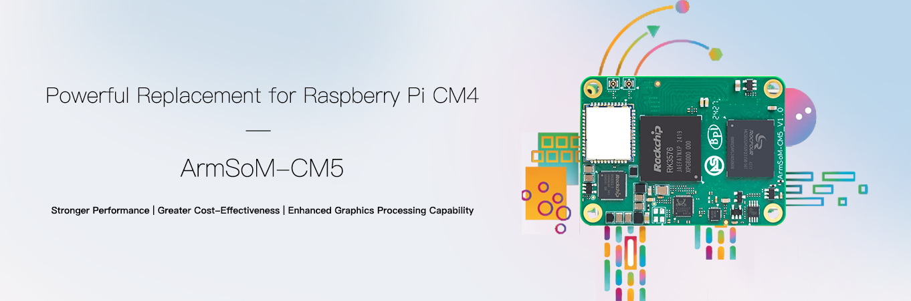

Für Projekte mit Raspberry Pi CM4 oder CM5 bietet ArmSoM CM5 eine alternative RK3576-Plattform: acht CPU-Kerne und eine NPU in einem kompakten Modul, dessen Träger die Anwendungsperipherie verbindet. Bei lokaler Inferenz oder einer neuen Systemarchitektur lohnt sich eine Bewertung anhand des konkreten Produkts.

## Zwei Bedeutungen von Alternative

Eine **Plattformalternative** bedeutet eine neue Auswahl von Prozessor, Software und Peripherie. Ein **kompatibler Modultausch** setzt zusätzlich passende Elektrik, Pins, Schnittstellen und Software voraus. ArmSoM dokumentiert einen Einsatz auf Raspberry-Pi-CM4-Trägern und abweichende HDMI-/DSI-Anzahlen. Das garantiert weder jeden CM4-Träger eines Drittanbieters noch die Kompatibilität zum Raspberry Pi CM5 IO Board.

| Ausgangslage | Vorgehen |
|---|---|
| Raspberry Pi CM4 IO Board | Peripherie mit passendem ArmSoM-Abbild und Dokumentation prüfen |
| CM4-Träger eines Drittanbieters | Schaltplan, Pins, Versorgung und Schnittstellen einzeln prüfen |
| Raspberry Pi CM5 mit Träger | Als Plattformmigration behandeln, nicht nach Produktnamen tauschen |
| Neues Edge-AI-Gerät | CM5 mit passendem Träger vor eigener Hardware erproben |

## Warum ArmSoM CM5 prüfen?

Die RK3576-NPU bietet einen eigenen Ausführungspfad für konvertierte Klassifikations- und Erkennungsmodelle, während die CPU Protokolle und Anwendungslogik verarbeitet. RKNN-Konvertierung und Genauigkeitsprüfung bleiben erforderlich. Die 6 TOPS INT8 gelten mit Sparsität und sind keine allgemeine Modellgeschwindigkeit.

Ein Modul ermöglicht einen Träger nach den Anforderungen an Stromversorgung, Anschlüsse und Mechanik. Vorhandene Investitionen lassen sich eventuell teilweise weiterverwenden; das muss geprüft werden, statt unveränderte Hardware und Software vorauszusetzen.

## Anwendungen statt Kernzahlen vergleichen

Raspberry Pi nennt vier Cortex-A76-Kerne für CM5, ArmSoM CM5 verwendet vier A72 und vier A53. Acht gegenüber vier Kernen unterschiedlicher Mikroarchitekturen bestimmen keinen pauschalen Sieger. Messen Sie Reaktionszeit, Durchsatz, Speicherbedarf und Energieverbrauch Ihrer Anwendung und berücksichtigen Sie Treiber-, Wartungs- und Migrationsaufwand.

Ein Raspberry-Pi-OS-Abbild ist kein RK3576-Abbild. Python- oder Container-Anwendungslogik kann gut übertragbar sein; GPIO-Nummern, Kamerastack, Videobeschleunigung, Device Trees und Bootpfad benötigen gesonderte Anpassung. Ein gemeinsamer Arm-Befehlssatz macht Treiber nicht austauschbar.

## Migration in fünf Schritten

1. **Abhängigkeiten erfassen:** Kameras, Displays, USB, PCIe, Funk und GPIO.
2. **Hardware prüfen:** Revision, Stecker, Pins und Versorgungsablauf. Laut ArmSoM wurde das Pin-21-Problem früher CM5 v1.2 mit v1.3 behoben; die tatsächliche Revision kontrollieren.
3. **Softwarebasis schaffen:** Abbild für Modul und Träger wählen, Kernel und Treiber dokumentieren.
4. **Anwendung übertragen:** Grundfunktion herstellen, dann Beschleunigung und Peripheriezugriffe anpassen.
5. **Gesamtsystem prüfen:** Kaltstart, Stromausfall, Netzunterbrechung, Temperatur und Dauerlast.

## Wann zunächst Sige5?

Ist der Träger noch offen, lassen sich Funktionen mit Sige5 direkt erproben. Sind Maße, Anschlusspositionen und Produktionsanforderungen bekannt, kommt CM5 für die kundenspezifische Integration infrage. Dies ist ein Entwicklungsweg, kein ungetestetes Leistungs- oder Kostenvorteilsversprechen.

## Artikelserie und Produkte

- [RK3576 erklärt: acht CPU-Kerne und Edge-AI-Produkte von ArmSoM](/de/articles/rk3576-chip-guide/)
- [Was kann Sige5? Sechs Anwendungen für RK3576-Edge-Computing](/de/articles/sige5-rk3576-applications/)
- [RK3576 Datasheet V1.0: Download, Gehäuse, Elektrik und Kühlung](/de/articles/rk3576-datasheet-v10/)
- [ArmSoM CM5](https://www.armsom.org/cm5) · [ArmSoM Sige5](https://docs.armsom.org/armsom-sige5)

## Quellen

- [Rockchip RK3576](https://www.rock-chips.com/a/en/products/RK35_Series/2024/1212/2033.html)
- [RK3576 Brief V1.2 (2025-08-28)](https://www.rock-chips.com/uploads/pdf/2024.3.18/191/RK3576%20Brief%20Datasheet%20V1.2-20250828.pdf)
- [ArmSoM CM5](https://docs.armsom.org/armsom-cm5)
- [ArmSoM Sige5](https://docs.armsom.org/armsom-sige5)
- [Raspberry Pi CM5](https://www.raspberrypi.com/products/compute-module-5/)
