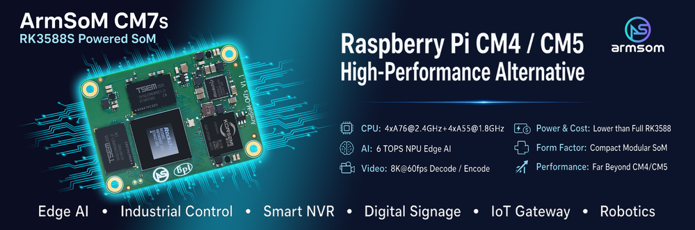
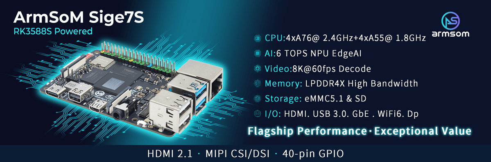

Bei einer RK3588S-Plattform entscheidet zunächst die Bauform: ein fertiges Board mit Anschlüssen oder ein Rechenmodul im eigenen Gerät? **Sige7S erleichtert den Anwendungsstart; CM7S ermöglicht eine angepasste Trägerplatine.** Das ist keine Rangliste der Rechenleistung.

## Entwicklungsweg wählen

| Anforderung | Ausgangspunkt | Einzuplanende Arbeit |
|---|---|---|
| Linux-Anwendung oder Demonstrator | Sige7S | Image, Kühlung, Peripherie und Anwendung |
| Eigenes Gehäuse und spezielle Anschlüsse | CM7S + eigene Trägerplatine | Versorgung, Signalintegrität, Device Tree und Systemtests |
| Frühe Softwareentwicklung für ein Modulprodukt | CM7S + CM7S-IO | Auf dem Entwicklungsboard prüfen, anschließend migrieren |

Die CM7S-Dokumentation nennt 55 × 40 × 1.6 mm und drei 100-polige Board-to-Board-Steckverbinder. Das Modul bündelt komplexe Rechenfunktionen, während die Trägerplatine anwendungsbezogene Anschlüsse bereitstellt. Ähnliche Abmessungen bedeuten keine Kompatibilität mit Raspberry-Pi-CM4/CM5-Trägerplatinen: Steckverbinder, Pinbelegung und Versorgung müssen geprüft werden.

## Sige7S: zuerst die Anwendung entwickeln

Die Dokumentation nennt Gigabit Ethernet, Wi-Fi 6, HDMI, USB und eine Erweiterungsleiste. Damit lässt sich ein Inferenzterminal, eine Displaysteuerung oder ein Linux-Prototyp evaluieren. Kameras und Displays müssen zur Boardbelegung und zum Treiber passen, nicht nur zur Maximalleistung des SoC.

Der dokumentierte DP-Anschluss des Sige7S nutzt beispielsweise zwei Lanes und unterstützt bis 4K60. Die maximale Vier-Lane-Konfiguration im Chipdatenblatt ist ein anderer Fall. Auch CSI und DSI erfordern passende Lane-Zahlen, Kabel und Treiber.

## CM7S: das Gerät bestimmt die Trägerplatine

Software lässt sich zunächst mit CM7S-IO prüfen. Beim Wechsel zur eigenen Platine sollten bewährte Softwareversionen beibehalten, Device Tree, Einschaltsequenz und Schnittstellen aber erneut validiert werden.

Modul- und Trägerversorgung unterscheiden sich: Die CM7S-Unterlagen nennen 5V, CM7S-IO hingegen 12V DC. Die Trägereingangsspannung darf nicht direkt an die Modulversorgung gelegt werden. Für CM7S v1.1 nennt die Dokumentation außerdem Einschränkungen an CN2, Pins 2 und 4. Hardwareversion und Errata vor dem Design prüfen.

## Fünf Punkte vor der Bestellung

1. RAM und eMMC der gelieferten Variante bestätigen.
2. Tatsächlich herausgeführte Display-, Kamera- und Erweiterungssignale prüfen.
3. Image, Kernel, NPU-Runtime und Treiber abstimmen.
4. Spitzenlast, Kühlung, Gehäuse und Umgebung testen.
5. Produktionsimage, Wiederherstellung und Hardwarestand dokumentieren.

Die Sige7S-Seite enthält unterschiedliche Maßangaben. Für ein Gehäuse sind die mechanischen Dateien der konkreten Revision maßgeblich. Dieser Beitrag ist eine Auswahlhilfe, kein gemessener Leistungsvergleich.

## Weiterführende Artikel und Produkte

- [RK3588S erklärt: acht CPU-Kerne, 6-TOPS-NPU und ArmSoM-Plattformen](/de/articles/rk3588s-chip-guide/)
- [Edge-KI und Multimedia mit RK3588S: Produkte mit CM7S und Sige7S planen](/de/articles/rk3588s-edge-ai-multimedia/)
- [RK3588S Datasheet V1.3: Download, Blockdiagramm und Hardware-Leitfaden](/de/articles/rk3588s-datasheet-v13/)

### Produkte und Entwicklungsunterlagen

- [CM7S](https://www.armsom.org/cm7s) · [CM7S Docs](https://docs.armsom.org/armsom-cm7s)
- [Sige7S](https://www.armsom.org/sige7s) · [Sige7S Docs](https://docs.armsom.org/armsom-sige7s)
- [Rockchip RKNN-Toolkit2](https://github.com/airockchip/rknn-toolkit2) · [RKNN-LLM](https://github.com/airockchip/rknn-llm)
