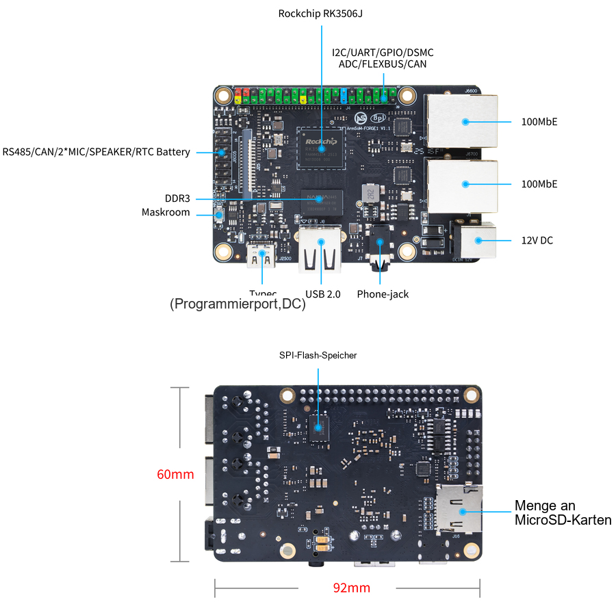
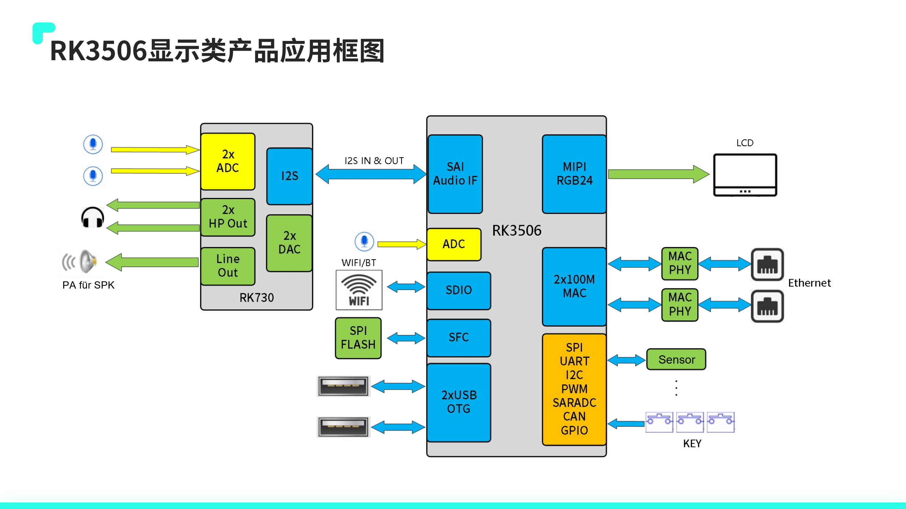
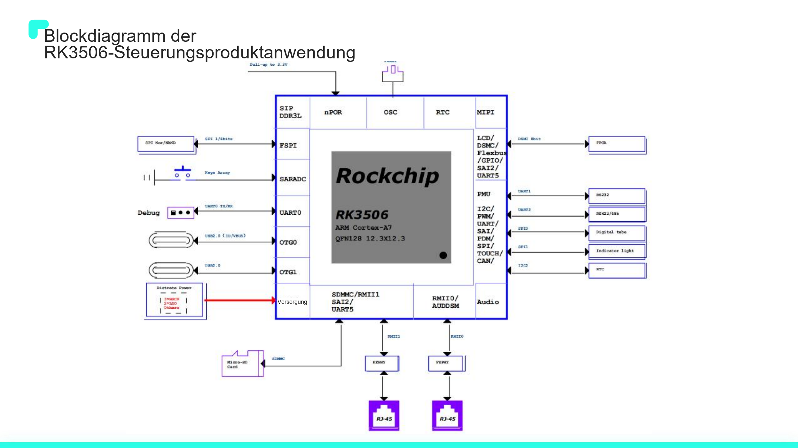
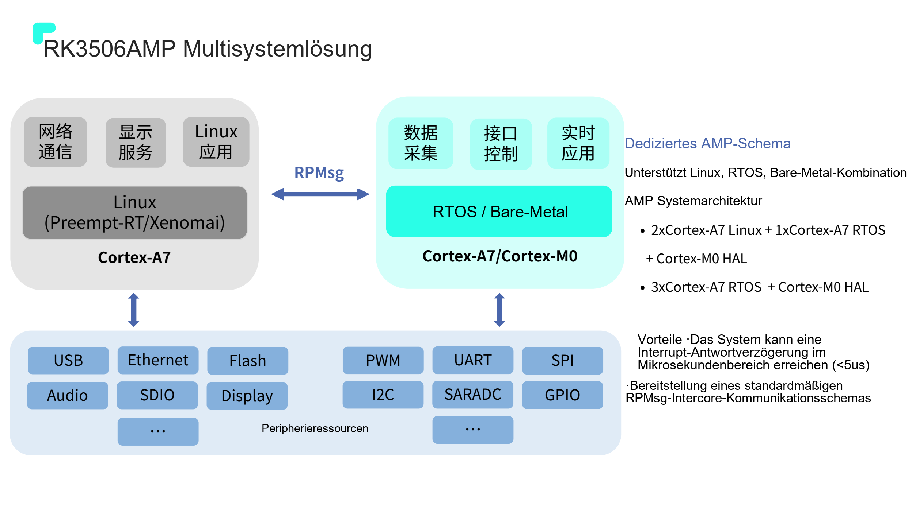
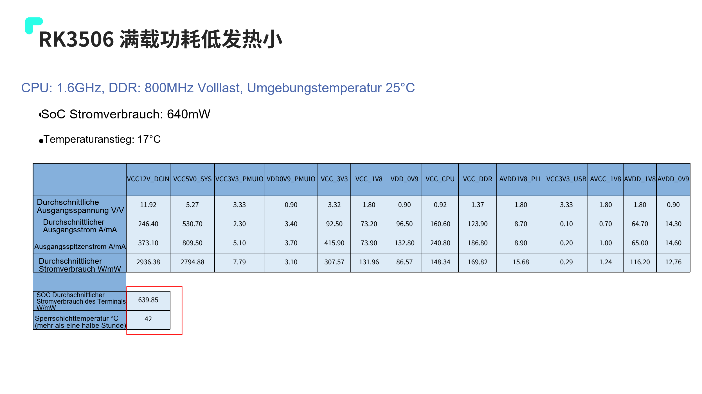

Bei Industrieprojekten müssen Anzeige, Gerätekommunikation und Anwendung gemeinsam zuverlässig arbeiten. ArmSoM Forge1 integriert RK3506J und übliche Platinenschnittstellen für HMI, Gateways und Datenerfassung. Für eine spätere eigene Bauform kann CM1 geprüft werden.

## Ausstattung und Software

Die Spezifikation nennt 512MB DDR3L, 512MB NAND, zwei Fast-Ethernet-Ports, MIPI DSI, USB2.0 Host und RS485/CAN-Ressourcen bei 92×62mm. Versorgung wahlweise DC 12V/1A oder Type-C 5V/2A gemäß Handbuch.

Die Softwarebeschreibung führt Buildroot, Linux 6.1, RT-Thread 4.1, AMP, Preempt-RT/Xenomai und LVGL auf. Nicht jedes Image aktiviert alle Funktionen zugleich. Vor Tests Image, Kernelkonfiguration und Beispiele prüfen.

## HMI für die Maschine

Status, Einstellungen, Alarmhistorie und Wartung darstellen. Reale Gerätedaten verwenden und Bedienreaktion unter Kommunikationslast messen. Erfassung von Darstellung entkoppeln, Aktualisierungsumfang begrenzen und große Bilddekodierungen oder häufige Schreibzugriffe vermeiden.

Paneltiming, Treiber und Touch müssen zusammenpassen. Eine 2D-Engine beschleunigt nicht automatisch jede UI-Bibliothek; Rendering-Backend und Treiberpfad verifizieren.

## Gateway zwischen Feld und Netzwerk

RS485 oder CAN verbinden Geräte, zwei Ethernet-Schnittstellen Feld- und übergeordnetes Netzwerk. Modbus und MQTT sind zu evaluierende Softwareoptionen, keine Zusage für das Werksimage.

Abfragezyklen, Timeouts, Wiederholungen, Puffergrenzen und Duplikaterkennung festlegen. Terminierung, Masse, Isolation, Überspannungsschutz und Kabel prüfen. Schnittstellennamen ersetzen keine EMV-Prüfung des Gesamtsystems.

## Nachvollziehbare Datenerfassung

Zustände, Zähler und Alarme mit Zeitstempeln versehen, offline begrenzt puffern und periodisch übertragen. Verhalten ohne Netzwerkzeit definieren, Konfigurationsstände speichern und Stromausfälle testen. Analoge, Thermoelement- oder Hochspannungseingänge benötigen externe Erfassungs- und Isolationsschaltungen.

## Echtzeit bewerten

Linux, Echtzeit-Patches und AMP bieten unterschiedliche Ansätze, garantieren aber keine maximale Reaktionszeit. Netzwerk, Display und Speicher gleichzeitig belasten und Latenzverteilung sowie Spitzen messen. Ob kritische Regelschleifen einen unabhängigen Controller benötigen, ergibt sich aus Zeit- und Fehleranforderungen.

## Einsatzgrenzen

Forge1 unterstützt frühe Schnittstellen- und Anwendungstests, CM1 die spätere eigene Trägerplatine. Der dokumentierte Bereich −40 bis 85°C gilt nicht automatisch für ein komplettes Gerät mit Display. Die offizielle Seite enthält neben NAND-Angaben auch einen eMMC-Boot-Hinweis. Hier wird die NAND-Spezifikation verwendet; das Startmedium ist am gelieferten Hardwarestand zu prüfen.

Die offizielle Schnittstellenabbildung nennt 92×60mm, die Spezifikation dagegen 92×62mm. Diese Abweichung bleibt dokumentiert. Für Gehäuse und Befestigung die mechanische Zeichnung des gelieferten Hardwarestands verwenden.

## Mit der RK3506-Anwendungspräsentation weiterplanen

Diese Ergänzung verwendet das 34-seitige `RK3506 产品应用方案介绍_V1.2.2_20240903(1).pdf`. Auf dem Titel steht 2024.08.29, abweichend vom Dateinamen; beides gehört zur gleichen bereitgestellten Datei. Es folgt eine redaktionelle Projekthilfe, keine Wiederholung der Herstellermessungen durch ArmSoM.

S. 12 unterscheidet RK3506G2, RK3506B und RK3506J. G2 besitzt eingebettete 128MB DDR3L, B/J nutzen externe DDR, J ist industriell positioniert. Offizielle Forge1- und CM1-Angaben nennen RK3506J; G2-Speicher und EVB-Verbindungen sind nicht direkt übertragbar.

*RK3506-Displayanwendung — Chinesische Originalabbildung; in dieser Auswahl liegt keine entsprechende englische Abbildung vor. `RK3506 产品应用方案介绍_V1.2.2_20240903(1).pdf`, PDF p. 5.*

## Sechs Anwendungen als Entwicklungsaufgaben

| Anwendung der Quelle | Erstes messbares Ziel | Offene Integration |
| --- | --- | --- |
| Gerätesteuerung | Einstellungen, Alarme und Konfigurationswiederherstellung | Paneltreiber, Zertifizierung, Schlaf- und Weckstrategie |
| Handheld-POS | Scannereingabe parallel zur Bedienoberfläche | Kamera/Scanner, Batterie und Sicherheitsanforderungen |
| Gegensprechanlage | Audio/Video-Gespräch, Echopfad und Wiederverbindung | Audioalgorithmen, Kamera, Netzwerk und Lautsprecher |
| PLC-Steuerung | Reproduzierbare Zyklus- und Jittermessung | Echtzeittreiber, Task-Isolation, Fehlerbehandlung und Feldbus |
| Industrielles HMI | Touch, Neuzeichnen und Erfassung gleichzeitig | Paneltiming, Beleuchtung, Störfestigkeit und UI-Ressourcen |
| Industriegateway | Lokaler Puffer, Weiterleitung und Fernwartung | Protokolle, Isolation, Logs und Update-Rollback |

Das sind Entwicklungswege, keine zugesicherten Anwendungen im Standardimage. Forge1 dient zur Boardprüfung; eigene Stecker, Abmessungen oder Branchenschnittstellen lassen sich anschließend mit einem CM1-Träger evaluieren.

*RK3506-Steuerungsanwendung — Chinesische Originalabbildung; in dieser Auswahl liegt keine entsprechende englische Abbildung vor. `RK3506 产品应用方案介绍_V1.2.2_20240903(1).pdf`, PDF p. 6.*

## Softwarevideo und UI teilen CPU-Leistung

S. 19 nennt H.264/MJPEG-Softwaredecoding mit 720P 30FPS oder 480P 60FPS und ausdrücklich 90% Auslastung zweier Cortex-A7-Kerne. Das ist keine Zusage eines sparsamen Hardwaredecoders. Decoding, Skalierung, UI, Kommunikation und Audio gemeinsam belasten und Bildrate sowie Touch-Latenz erfassen.

Die Präsentation nennt Linux Kernel 6.1, RT-Thread 4.1, LVGL, RGA-Beschleunigung, differenzielle OTA, A/B-Partitionen und Schnellstart. Verfügbarkeit hängt von SDK, Image und Konfiguration ab. Die Vorführung „Start innerhalb von 3 Sekunden“ garantiert keine entsprechende Anwendungsstartzeit.

## Echtzeitwerte nur unter passenden Bedingungen vergleichen

*RK3506-AMP-Aufteilung — Chinesische Originalabbildung; in dieser Auswahl liegt keine entsprechende englische Abbildung vor. `RK3506 产品应用方案介绍_V1.2.2_20240903(1).pdf`, PDF p. 22.*

S. 22 zeigt AMP-Aufteilungen wie `2× Cortex-A7 Linux + 1× Cortex-A7 RTOS + Cortex-M0 HAL` mit RPMsg. Netzwerk/UI lassen sich von reaktionskritischen Aufgaben trennen; gemeinsamer Speicher, Peripheriebesitz und Wiederherstellung müssen dennoch geplant werden.

Die etwa 62µs Preempt-RT-Latenz auf S. 23 nutzt cyclictest auf isoliertem Kern, stress-ng, CPU 1300MHz und DDR3 800MHz. S. 24 nennt separat 90µs EtherCAT-Jitter bei 1ms Zyklus. Die Interruptantwort `<5us` auf S. 22 ist eine andere Messgröße; zusammen ergeben sie keine Echtzeitgarantie.

## SoC-, Board- und Peripherieleistung trennen

*Herstellerbedingungen und Messgrenzen der Leistungsaufnahme — Chinesische Originalabbildung; in dieser Auswahl liegt keine entsprechende englische Abbildung vor. `RK3506 产品应用方案介绍_V1.2.2_20240903(1).pdf`, PDF p. 29.*

Bei CPU 1.6GHz, DDR 800MHz und 25℃ Umgebung nennt S. 29 rund 640mW SoC-Leistung und 17℃ Erwärmung. Die Tabelle derselben Seite gibt am 12V-Eingang etwa 2936.38mW an. Die Messgrenzen unterscheiden sich; 640mW darf nicht als Leistungsaufnahme der gesamten Forge1-Platine erscheinen.

Auch IDLE 109mW, statischer Desktop 200mW und Schlafzustände 30mW/8mW auf S. 28 haben Bedingungen zu Display, Wi-Fi und Logic-Abschaltung. Versorgung, Kühlung und Batterie anhand der Spitzen- und Durchschnittswerte des ganzen Systems mit Bildschirm, Netzwerk, USB und Adaptern auslegen.

## Von der Vorführung zum auslieferbaren Produkt

Je Projekt Board/Image, Startzeit, Spitzen-RAM, Paketverlust, UI-Reaktion, Temperatur, Stromausfall-Wiederanlauf und Update-Rollback erfassen. Software und Anschlüsse zuerst auf Forge1 prüfen, danach über einen eigenen CM1-Träger entscheiden. Unbestätigte Funktionen bleiben ausdrücklich ungeprüft.

## Produkte und Entwicklungsunterlagen

- **Forge1** — [Produkt](https://www.armsom.org/forge1) · [Dokumentation](https://docs.armsom.org/armsom-forge1)
- **CM1** — [Produkt](https://www.armsom.org/cm1) · [Dokumentation](https://docs.armsom.org/armsom-cm1)

## Weiterführende Artikel

- [RK3506G-EVB-Schnittstellen und Debugging](/de/articles/rk3506g-evb-interface-debugging/)
- [RK730-Audiodesign](/de/articles/rk730-audio-codec-design/)

## Weitere Artikel und offizielle Unterlagen

- [RK3506J erklärt: industrielle HMI und vernetzte Geräte](/de/articles/rk3506j-chip-guide/)
- [ArmSoM CM1: RK3506J-Modul für eigene Industrieterminals](/de/articles/cm1-rk3506j-industrial-module/)
- [RK3506B Datasheet V1.0: Architektur, Anschlüsse und elektrische Auslegung](/de/articles/rk3506b-datasheet-v10/)
- [Rockchip RK3506](https://www.rock-chips.com/a/cn/product/RK35xilie/2025/1208/2125.html)
- [ArmSoM CM1](https://docs.armsom.org/armsom-cm1)
- [ArmSoM Forge1](https://docs.armsom.org/armsom-forge1)
- [ArmSoM](https://www.armsom.org/)
