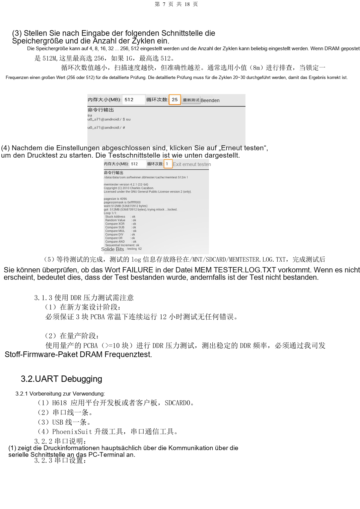
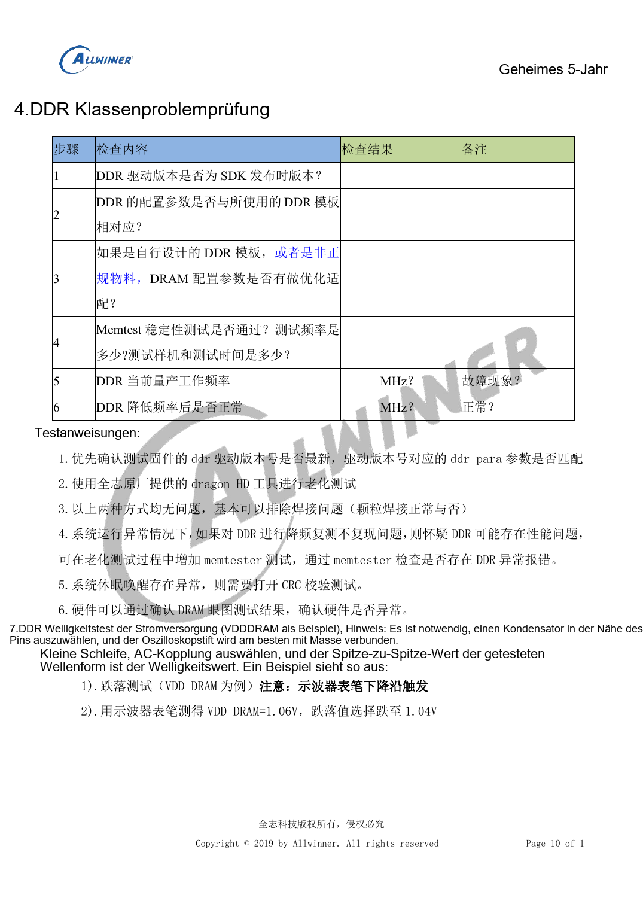

# H618-Inbetriebnahme: Flashen, DDR und Stabilitätsprüfung

Dieser quellenbasierte Hardwarebeitrag dient als Plattformreferenz; ein passendes ArmSoM-Board ist nicht bestätigt. Parameter stammen aus der Quelle, nicht aus ArmSoM-Messungen. Siliziumrevision, PCB, SDK/BSP, Kernel, Firmware und Peripheriespezifikationen vor Umsetzung prüfen.

**Debug V1.1 PDF 4–17; stability checklist F01 PDF 5–12**

## Fehlerphase eingrenzen

Spannungsfrei DCIN, CPU, GPU, SYS, DRAM und PLL auf Kurzschluss sowie Lötstellen prüfen. Die Quelle nutzt 5V mit 500mA Begrenzung zur Erstprüfung, nicht als Volllastversorgung. Fehlende Spannung durch spannungsfreie Messungen beidseits der Spule auf Regler oder Last eingrenzen. Danach Resetfreigabe, 24MHz und USB0-Erkennung prüfen. Richtige Spannungen bestätigen nur diesen Prüfpunkt, nicht das gesamte System.

## Flashen und UART

Die Quelle verwendet PhoenixSuit, nicht gleichzeitig mit PhoenixUSB Pro. Ohne Firmware USB0 nutzen; mit Firmware ausschalten und UBOOT beim USB-Anschluss halten. Zusätzlich beschreibt sie einen FEL-Serviceeingriff mit Flash CLK nach Masse; Prüfpunkt und Versorgungszustand müssen vorher feststehen. Bei wiederholtem automatischem Flashen BOOT_Select und `need secure img` prüfen. Bei UART über SDCARD0 ist D3 Board-TX und CLK Board-RX. IO-Pegel beachten; Adapter-VCC ist keine universelle Versorgung.

## DDR und dynamische Last

DDRTest1_2.apk wählt im Beispiel maximal 256 bei 512M RAM und 512 bei 1G. Zunächst kleine Bereiche, danach 20–30 Detailzyklen mit 256/512 testen. Quellenpfad `/MNT/SDCARD/MEMTESTER.LOG.TXT` und Suche nach `FAILURE` erhalten; Großschreibung am Ziel prüfen. Gefordert sind drei Entwicklungsboards über 12h bei Raumtemperatur und mindestens zehn Serienboards zur Frequenzbewertung. Das sind Anforderungen, keine ArmSoM-Ergebnisse. CRC bei Resumeproblemen ergänzen. Besserung bei niedrigerer Frequenz deutet auf Reservemangel, nicht auf qualifizierte Bauteile.

## Messung und offene Quellenfehler

Am lastnahen Kondensator mit kurzer Tastkopf-Masseschleife messen: AC-Kopplung für Ripple, fallende Flanke für Einbrüche. Die Tabelle druckt `1.05/1.1` bei 1200000/1320000 unter mV; die Folgeseite nennt ausdrücklich 1.05V/1.1V. Fehlerhafte Werte nicht programmieren. Auch „Reflexion größer als -20dB/-10dB“ im Wi-Fi-Abschnitt bleibt klärungsbedürftig. Bei HDMI, USB, Audio, SD und Ethernet Versorgung, Enable, Durchgang, Signal und Lötung prüfen; Anzahl und Dauer für Neustart-, Resume- und Temperaturtests dokumentieren.


## Befehlsbeispiel der Quelle

Nur für das Quell-SDK mit passenden cpufreq/debugfs-Knoten. Governor und Frequenz vorher erfassen und nach dem Test wiederherstellen. Für diesen Beitrag wurden die Befehle nicht ausgeführt.

```sh
echo userspace > /sys/devices/system/cpu/cpu0/cpufreq/scaling_governor
echo 1008000> /sys/devices/system/cpu/cpu0/cpufreq/scaling_setspeed
cat /sys/devices/system/cpu/cpu0/cpufreq/cpuinfo_cur_freq
cat /sys/kernel/debug/cpufreq_table
```

## Referenzabbildungen

Die Referenzseiten behalten chinesische Bildbeschriftungen. Keine passende englische Ausgabe gefunden; alle vier Sprachen verwenden die chinesischen Originale. Textparameter und Schritte bleiben kopierbar, Bilder dienen dem Abgleich. Nummern bezeichnen physische PDF-Seiten.

[](/assets/localized/figures/de/61f64d99e36d50511c40.png)

[](/assets/localized/figures/de/7c47a206885029fb7a4d.png)

## ArmSoM-Plattform auswählen

Für ArmSoM-Projekte Plattform anhand offizieller Produkte und Dokumentation wählen und Prozessor, Schnittstellen und Software erneut prüfen. A733/H618-Schaltungen nicht pauschal auf andere SoCs übertragen.

- [ArmSoM](https://www.armsom.org/)
- [ArmSoM Docs](https://docs.armsom.org/)

## Weitere Beiträge

- [H618-Minimalsystem: AXP313A, 24MHz-Takt und Bootauswahl](/de/articles/h618-power-clock-boot-design/)
- [H618 DDR und eMMC: Vorlagen, Impedanz und PCB-Prüfung](/de/articles/h618-dram-emmc-pcb-design/)
- [H618-Schnittstellen: USB, HDMI, Ethernet und ESD-Layout](/de/articles/h618-interfaces-esd-layout/)
- [H618 · Serienübersicht](/de/articles/h618-hardware-design-series/)

<!-- editable-source-tables -->

## Anhang: Frequenz-/Spannungstabelle des Tests

Stability checklist F01 · PDF 9

Nur Sollwerte der Quell-Testfirmware, keine universellen H618-OPPs. Eigene Firmwaretabelle vergleichen, Spannungen nicht manuell übernehmen. Einheitenkonflikt der Vorseite ist oben dokumentiert.

| Frequenz kHz | Beispielspannung V |
| --- | --- |
| 480000 | 0.9 |
| 720000 | 0.9 |
| 936000 | 0.9 |
| 1008000 | 0.95 |
| 1104000 | 1.0 |
| 1200000 | 1.05 |
| 1320000 | 1.1 |
| 1416000 | 1.15 |
