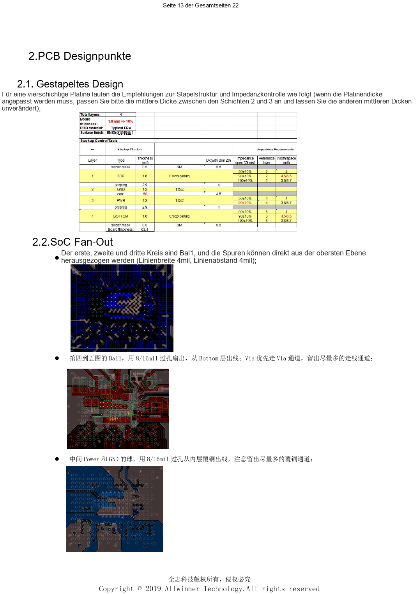
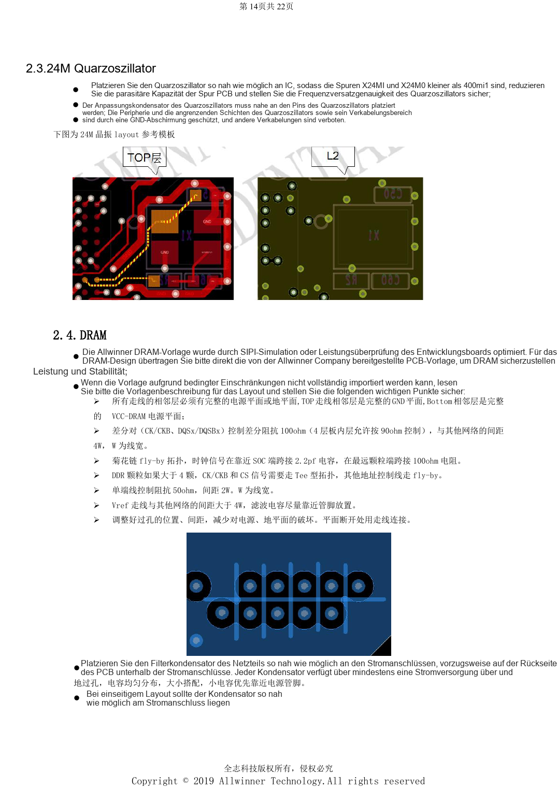

# H618 DDR und eMMC: Vorlagen, Impedanz und PCB-Prüfung

Dieser quellenbasierte Hardwarebeitrag dient als Plattformreferenz; ein passendes ArmSoM-Board ist nicht bestätigt. Parameter stammen aus der Quelle, nicht aus ArmSoM-Messungen. Siliziumrevision, PCB, SDK/BSP, Kernel, Firmware und Peripheriespezifikationen vor Umsetzung prüfen.

**Design V1.0 §1.5–1.6, §2.1–2.5; PDF 9–10, 14–16; PCB checklist V1.0**

## Speicherkonfiguration zuerst festlegen

Genannt werden DDR4, DDR3/3L, LPDDR3 und LPDDR4, ein 32-bit-Kanal, zwei Chip-Selects und bis 4GB. Vorlage mit Baustein und Firmware abstimmen. Die Quelle fordert 240Ω mit 1% nach Masse an SoC- und DRAM-ZQ. Beim Tauschen von 8-bit-Gruppen zugehörige DQM und DQS-Paare mitführen. Die Vierlagenreferenz nutzt 4/4mil und 8/16mil-Vias; Änderungen der Platinendicke dürfen die Referenzgeometrie nicht beliebig verändern.

## DDR-Leitungen und Rückstrom

Obere Signale beziehen sich auf durchgängige GND, untere auf VCC-DRAM. CK/DQS: 100Ω differentiell; für innere Leitungen der Vierlagenreferenz erlaubt das Handbuch 90Ω, die Checkliste nennt 100Ω±10%. Mit der gewählten Vorlage klären. Abstand zu anderen Netzen: Paare 4W, einpolige 50Ω-Leitungen 2W, Vref mehr als 4W. Das Fly-by-Beispiel nutzt 2.2pF am SoC-Takt und 100Ω am letzten Baustein. Bei mehr als vier Bausteinen CK/CS als Tee, übrige Adresssignale als Fly-by. Jeder Abblockkondensator erhält Versorgungs- und Massevia; kleine Werte bevorzugt nahe den Pins.

## eMMC: mehr als Längenabgleich

33Ω in CLK und 10kΩ von CMD nach VCC-PC vorsehen. SoC-GPIO-Domäne und eMMC-VCCQ gemeinsam versorgen. NC/RFU niemals zur Routingvereinfachung verbinden. Für zu erdende eMMC5.0-Pins nennt der Text keine vollständige Liste: Bauteildatenblatt prüfen. Länge ≤2000mil, D0–D7/DS zu CLK ≤300mil, 50Ω und ≥2W Abstand; CLK/DS abschirmen oder ≥3W einhalten. VCC/VCCQ mindestens 12mil und zwei Vias beim Lagenwechsel. Hochfrequent Punkt-zu-Punkt bevorzugen; bei Doppelbestückung eMMC am Kettenende, Abzweige kurz.

## Referenzabbildungen

Die Referenzseiten behalten chinesische Bildbeschriftungen. Keine passende englische Ausgabe gefunden; alle vier Sprachen verwenden die chinesischen Originale. Textparameter und Schritte bleiben kopierbar, Bilder dienen dem Abgleich. Nummern bezeichnen physische PDF-Seiten.

## ArmSoM-Plattform auswählen

Für ArmSoM-Projekte Plattform anhand offizieller Produkte und Dokumentation wählen und Prozessor, Schnittstellen und Software erneut prüfen. A733/H618-Schaltungen nicht pauschal auf andere SoCs übertragen.

- [ArmSoM](https://www.armsom.org/)
- [ArmSoM Docs](https://docs.armsom.org/)

## Weitere Beiträge

- [H618-Minimalsystem: AXP313A, 24MHz-Takt und Bootauswahl](/de/articles/h618-power-clock-boot-design/)
- [H618-Schnittstellen: USB, HDMI, Ethernet und ESD-Layout](/de/articles/h618-interfaces-esd-layout/)
- [H618-Inbetriebnahme: Flashen, DDR und Stabilitätsprüfung](/de/articles/h618-bringup-stability-validation/)
- [H618 · Serienübersicht](/de/articles/h618-hardware-design-series/)
